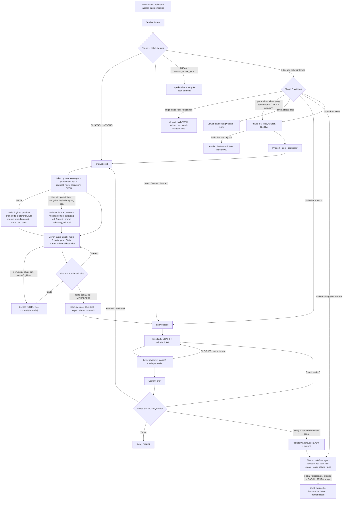
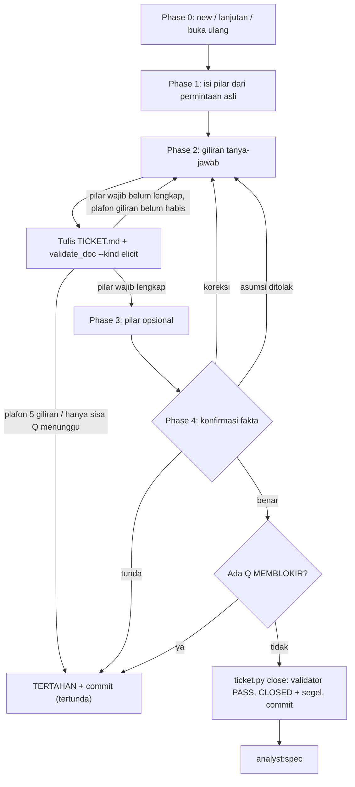
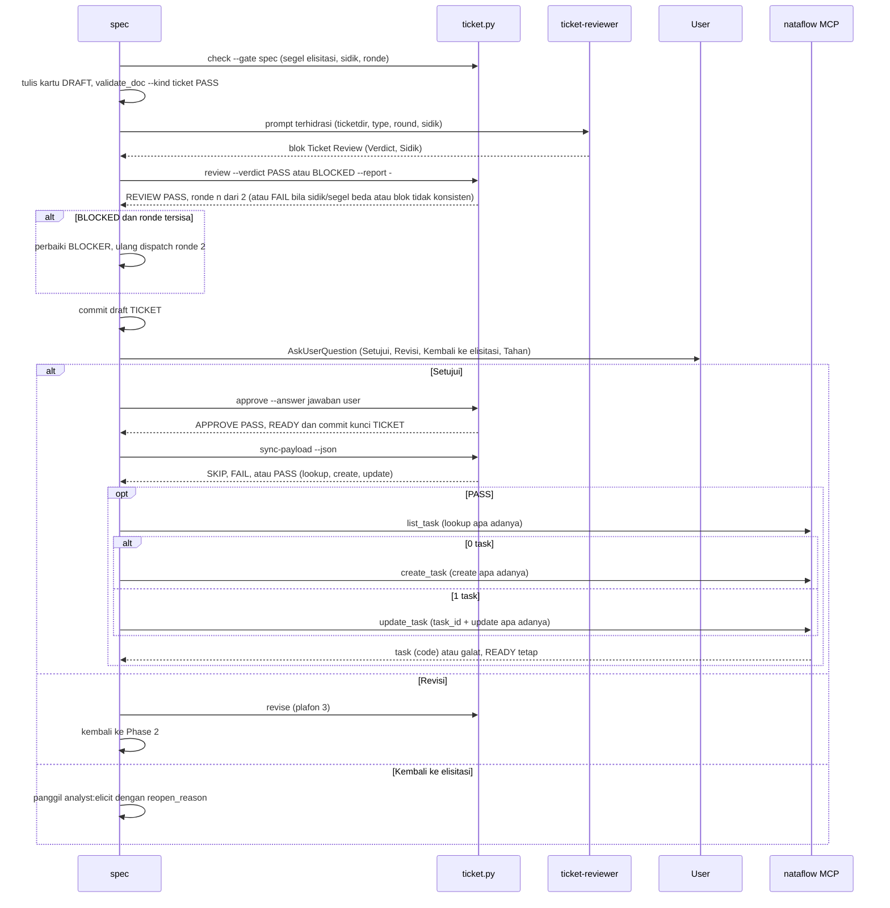
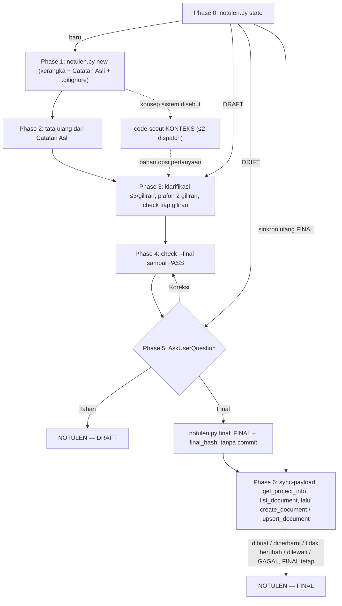
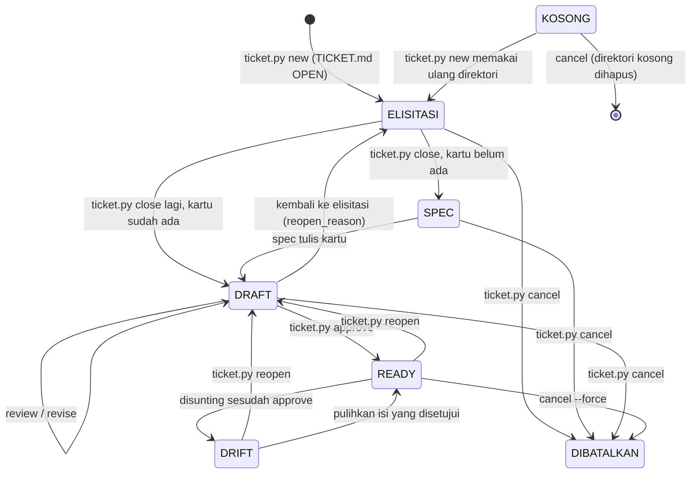
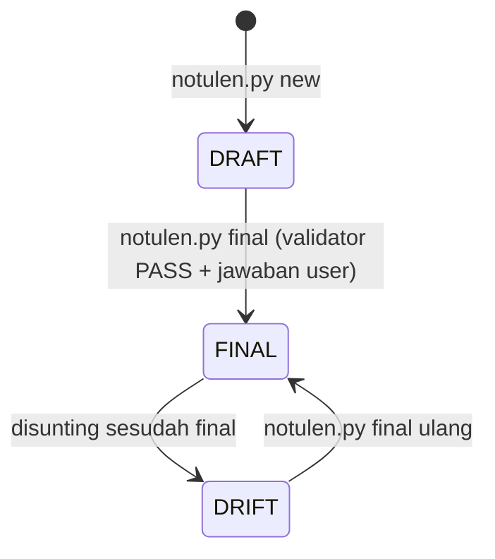

# Alur Plugin `analyst`

> Plugin `analyst` (v0.15.0) adalah jembatan antara pengguna/stakeholder dan engineer. Ia menerima permintaan,
> keluhan, atau laporan bug dari sisi pengguna, menggali faktanya lewat tanya-jawab dengan peminta
> non-engineer, lalu menerbitkan `TICKET.md`: kartu tiket non-teknis setara kartu Jira/Trello, berisi user
> story, acceptance criteria, dan aturan bisnis. Tiket melewati review independen dan persetujuan user sebelum
> diserahkan ke `backend:tech-lead` / `frontend:lead` lewat parameter `ticket_source`. Pakai plugin ini
> ketika kebutuhan datang dari bahasa bisnis. Sejak v0.13.0 ada satu jalur teknis: tipe `TECH`, untuk
> perubahan struktur dari lead engineer (refaktor, relasi data, arsitektur, kinerja, dependensi) yang perlu
> dikunci sebelum dikerjakan. Kartunya teknis dan berbukti `file:baris`, tetapi tetap berhenti di kondisi
> target. Kerja teknis kecil dan diagnosis (stacktrace dari developer) bukan wilayahnya. Sejak v0.14.0 kode
> hanya dibaca subagent, dan skill `analyst:notulen` merapikan catatan kasar rapat menjadi `NOTULEN.md` di luar
> alur tiket. Sejak v0.15.0 satu pesan berisi 2–5 permintaan diproses sebagai batch: semua tiket dialokasikan dan
> ditelusuri kodenya di awal, lalu diselesaikan satu per satu menurut urutan otomatis. Sejak v0.17.0 `elicit`
> memakai `code-explorer` (sonnet) yang memahami cara kode bekerja sekarang — bukti untuk `TECH`, kondisi sekarang
> sebagai `Asumsi:` yang dikonfirmasi peminta untuk tipe lain — sedangkan `code-scout` (sonnet, dangkal) tinggal
> untuk `notulen`. Tiga prinsip membentuk
> plugin ini: tiket menyebut **apa dan kenapa**, tidak pernah **bagaimana**; fakta berasal dari peminta, bukan
> tebakan analis; dan semua yang bisa divonis mesin divonis skrip.

## Peta Komponen

| Komponen | Jenis | Peran singkat | Berkas |
|---|---|---|---|
| `analyst:intake` | skill (menu `/`; titik masuk tiket) | Gerbang: pulihkan ticketdir, tentukan wilayah, tipe (beserta `category` untuk `TECH`), ukuran, batch 2–5 tiket berurutan, cek duplikat, tetapkan slug, dan sinkron ulang tiket `READY` ke nataflow. Tidak menulis berkas apa pun | `skills/intake/SKILL.md`, `references/batch.md` (aturan batch, dirujuk juga oleh `elicit` dan `spec`) |
| `analyst:elicit` | skill (`user-invocable: false`) | Tanya-jawab dengan peminta. Fakta direkam per pilar ke `## Catatan Elisitasi` setiap giliran, lalu elisitasi ditutup lewat `ticket.py close` (`CLOSED` + segel) | `skills/elicit/SKILL.md`, `references/elicitation-guide.md`, `references/literasi-teknis.md`, `references/elicitation-tech.md` (tiket `TECH`), `templates/elicit-template.md`, `dispatcher/explorer.md` |
| `analyst:spec` | skill (`user-invocable: false`) | Menyusun kartu di atas catatan elisitasi, dispatch reviewer, commit draft, minta persetujuan user, lalu `READY` dan sinkron nataflow opsional | `skills/spec/SKILL.md`, `templates/ticket-template.md`, `dispatcher/reviewer.md`, `references/nataflow-sync.md` |
| `analyst:notulen` | skill (menu `/`) | Catatan kasar rapat → `NOTULEN.md` terstruktur tanpa mengarang isi, klarifikasi celah ke pencatat, `FINAL` lewat `notulen.py final`, lalu sinkron opsional ke nataflow sebagai dokumen `notes.meeting` project. Kode hanya dibaca lewat `code-scout` `KONTEKS` sebagai bahan pertanyaan ke pencatat; tidak membuat tiket | `skills/notulen/SKILL.md`, `templates/notulen-template.md`, `dispatcher/scout.md`, `references/nataflow-sync.md` |
| `code-explorer` | agent (read-only, model `sonnet`, `maxTurns: 45`) | Penelusuran kode untuk `elicit`: cara kode bekerja sekarang di sekitar konsep peminta (aktor dan izin, aturan berangka, status, pesan; `TECH`: struktur menurut `category`). `BUKTI` (`TECH`, `menyeluruh`, kuota 40) atau `KONTEKS` (tipe lain, `ringkas`, kuota 20). Diadaptasi dari `backend:code-explorer`, tanpa `Write` | `agents/code-explorer.md` |
| `code-scout` | agent (read-only, model `sonnet`, `maxTurns: 10`) | Penelusuran kode dangkal khusus `notulen`: apa yang ada dan di mana, tanpa flow/alur/edge case. Selalu `KONTEKS`, kuota 8 pemanggilan | `agents/code-scout.md` |
| `ticket-reviewer` | agent (read-only, model `sonnet`) | Memvonis draft kartu `PASS`/`BLOCKED` secara semantik terhadap catatan elisitasi; tiket `TECH` dinilai rubrik T1–T11, termasuk membuka sendiri tiap bukti `path:baris` | `agents/ticket-reviewer.md` |
| `ticket.py` | script (CLI siklus hidup) | `state` (`--batch <id>` menyaring satu batch), `new` (menulis `TICKET.md` awal, dan `analyst/tickets/.gitignore` di repo bersinkron; `--urutan`/`--batch` menandai tiket batch), `check --gate elicit\|spec`, `close`, `review`, `revise`, `approve`, `commit --stage draft\|tertunda` (commit draft), `reopen`, `cancel`, `ref`, dan `sync-payload` (argumen tool MCP nataflow, read-only) | `skills/_common/ticket.py` |
| `notulen.py` | script (CLI siklus hidup notulen) | `state`, `new` (kerangka, catatan asli, `source_hash`, `analyst/notulen/.gitignore`), `check [--final]` (termasuk nol `path:baris` di seksi notulen), `final` (`FINAL` + `final_hash`), dan `sync-payload` (argumen dokumen nataflow, read-only). Tidak pernah meng-commit | `skills/notulen/scripts/notulen.py` |
| `validate_doc.py` | script (validator) | `--kind elicit` menilai catatan elisitasi; tipe selain `TECH` ditolak bila memuat `path:baris` (konteks `code-explorer` bukan fakta). `--kind ticket` menilai kartu, termasuk pemindai kebocoran teknis; kartu `TECH` sebagai gantinya ditagih AC `— verifikasi:`, `D-{n}`/`C-{n}`, dan bukti `path:baris` yang ada di disk | `skills/_common/validate_doc.py` |
| `analyst_lib.py` | script (pustaka) | Mencari root, parser frontmatter, pemecah kartu/catatan, sidik `content_hash`, `request_digest`, kerangka `ticket_skeleton`, segel `ticket_seal`, `scan_leaks`, config sinkron `load_sync_config`, dan commit git yang melewati path diabaikan `.gitignore` | `skills/_common/analyst_lib.py` |

## Alur Utama



Semua pekerjaan tiket masuk lewat `/analyst:intake`, termasuk melanjutkan tiket yang setengah jalan. Notulen
rapat punya titik masuk sendiri, `/analyst:notulen`, dan tidak menyentuh ticketdir. Intake membaca
keadaan setiap ticketdir dari `ticket.py state`, bukan dari ingatan sesi. `elicit` dan `spec` tidak muncul di
menu. Model memanggil keduanya lewat tool Skill sesuai keadaan ticketdir. Permintaan yang sudah lengkap tetap
melewati `elicit`: fakta diisi dari permintaan asli, dikonfirmasi sekali, lalu ditutup tanpa satu pertanyaan
pun, sehingga `spec` dan reviewer selalu punya satu sumber kebenaran tertulis. `READY` hanya bisa ditulis
`ticket.py approve`, dan skrip itu menagih validator, elisitasi `CLOSED` yang catatannya sama dengan segel
`ticket.py close`, vonis review `PASS` atas sidik konten terkini, serta jawaban eksplisit user.

## Alur per Skill

### `analyst:intake`

- **Pemicu / kapan dipakai**: permintaan, keluhan, atau laporan dari pengguna/stakeholder yang perlu dijadikan
  tiket, tiket analyst yang sudah ada perlu dilanjutkan atau diubah, atau tiket `READY` perlu disinkron ulang
  ke nataflow. Dipanggil user lewat `/analyst:intake`.
- **Prasyarat**: `python3` tersedia. Ruang kerja berakar di root worktree git bila ada, selain itu di
  direktori kerja. Tiket tinggal di `analyst/tickets/`. Git tidak wajib. Parameter: `request` (wajib, apa
  adanya), `requester`, `force_type`, `force_category`.
- **Langkah**:
  1. **Pemulihan ticketdir**: jalankan `ticket.py state`, lalu rutekan per keadaan: `KOSONG` (sisa alokasi
     lama, permintaan aslinya tidak tersimpan) meminta permintaan asli bila perlu, menjalankan Phase 2–3,
     lalu `elicit` dengan slug direktori itu — `ticket.py new` memakai ulang direktorinya. `ELISITASI` ke `elicit`. `SPEC`/`DRAFT` ke `spec`. `DRIFT`
     membuat intake bertanya ke user: setujui ulang lewat `spec` atau pulihkan isi. `RUSAK`/`NAMA_TIDAK_SAH`
     dilaporkan ke user. Permintaan yang jelas menyambung ticketdir terbuka dirutekan ke sana. Bila
     hubungannya tidak jelas, intake bertanya ke user lewat `AskUserQuestion`. Ticketdir yang dilanjutkan
     bertanda batch melanjutkan batch itu dari tiket terbuka berurutan terkecil.
  2. **Wilayah**: kebutuhan bisnis lanjut ke Phase 3. Perubahan tiket `READY` dirutekan ke `spec` dengan
     `change_request`. Pertanyaan status dijawab dari `ticket.py state --ready`. Sinkron ulang tiket ke
     nataflow (mis. sesudah segmen `nataflow GAGAL`) menjalankan prosedur `spec/references/nataflow-sync.md`
     apa adanya atas tiket `READY` (atau tiket pernah-`READY` yang dibatalkan) tanpa `reopen`; tiket `DRIFT` tetap
     dirutekan ke `spec`. Permintaan membatalkan tiket dirutekan ke `spec` dengan `cancel_request`. Perubahan teknis yang
     perlu dikunci sebelum dikerjakan lanjut ke Phase 3 sebagai `TECH`. Kerja teknis kecil dan diagnosis
     dijawab `DI LUAR WILAYAH`.
  3. **Tipe**: `FEATURE` (kemampuan baru), `IMPROVEMENT` (memperluas kemampuan yang sudah bekerja), atau
     `BUG` (menyimpang dari yang seharusnya), atau `TECH` (perubahan struktur) beserta `category`
     (`REFACTOR`/`DATA_MODEL`/`ARCHITECTURE`/`PERFORMANCE`/`DEPENDENCY`). Bila ragu antara IMPROVEMENT dan
     BUG, ajukan satu pertanyaan ke user.
  4. **Ukuran**: satu tujuan pengguna menjadi tiket tunggal. 2–5 tujuan menjadi **batch**: tiap tujuan
     menjadi tiket sendiri, diurutkan tanpa pertanyaan (prasyarat → urgensi yang disebut → urutan pesan) per
     `skills/intake/references/batch.md`. Lebih dari 5, atau user meminta satu tujuan dulu, menyisakan
     **antrian tiket**. Butir yang bukan tiket baru tidak ikut batch. Tiket `TECH` dihitung per repo: bagian
     repo lain masuk antrian, dan ruang kerja yang bukan repo yang diubah membuat intake `TERTAHAN`.
  5. **Duplikat**: bandingkan dengan judul tiket `READY`. Bila sama, tawarkan dua pilihan: ubah tiket lama
     atau buat tiket baru beralasan. Dalam batch, butir kembar digabung dan tujuan yang sama dengan tiket
     lama keluar dari batch tanpa pertanyaan.
  6. **Slug & serah terima**: slug kebab-case ≤ 40 karakter dari kata benda bisnis, unik dalam batch.
     Tanyakan `requester` bila kosong, sekali untuk seluruh batch. Panggil `elicit` dengan
     `{slug, type, category, request, requester}`, atau `{batch: [...]}` berurutan sesudah blok
     `INTAKE — BATCH`. `request` diteruskan verbatim: potongan butirnya, atau teks utuh bila tujuan bercampur.
- **Subagent yang didispatch**: tidak ada.
- **Output / artefak**: tidak ada berkas. Serah terima bersih ditutup satu baris
  `INTAKE — <BARU | LANJUT | UBAH> · <type>[/<category>] · <slug> · next analyst:<elicit | spec>`. Di luar wilayah,
  barisnya `INTAKE — DI LUAR WILAYAH · next <backend:tech-lead | frontend:lead>`. Sinkron ulang ditutup
  `SINKRON — <ticketdir> · nataflow <dibuat #<code> | diperbarui #<code> | dilewati | GAGAL: <sebab>>`.
  Batch ditutup blok `INTAKE — BATCH <N> tiket` (urutan, peminta, digabung, antrian, di luar batch) dan baris
  `INTAKE — BATCH · <N> tiket · next analyst:elicit`. Keadaan lain memakai blok
  `INTAKE — TERTAHAN | DILANJUTKAN DENGAN ANTRIAN`.
- **Gerbang & commit**: maksimal satu `AskUserQuestion` per phase (batch: satu per tiket per phase, tiap
  panggilan tentang satu tiket; urutan tidak pernah ditanyakan). Intake tidak membaca kode (juga untuk `TECH`) dan tidak
  membuat commit. Satu-satunya tulisan keluarnya adalah task nataflow pada sinkron ulang, dengan isi dari
  `ticket.py sync-payload`.
- **Lanjut ke**: `analyst:elicit` atau `analyst:spec`. Kerja teknis kecil dan diagnosis diarahkan ke plugin engineer.

### `analyst:elicit`

- **Pemicu / kapan dipakai**: dipanggil `intake` sesudah tipe dan slug ditetapkan (satu tiket, atau `batch`
  2–5 tiket berurutan), untuk ticketdir berkeadaan `ELISITASI`/`KOSONG`, atau oleh `spec` bila fakta perlu
  digali ulang (`reopen_reason`).
- **Prasyarat**:
  - Template dispatch `dispatcher/explorer.md` dan prosedur `skills/intake/references/batch.md` ada (ditagih
    `check --gate elicit`).
  - Tiket baru (juga ticketdir `KOSONG`): `ticket.py new --slug <slug> --type <type> [--category <category>] --requester … --request -`
    (permintaan asli lewat stdin; `--category` wajib untuk `TECH` dan ditolak untuk tipe lain) harus mengembalikan
    `NEW PASS: <ticketdir> · root=… · git=… · type=…`.
    Skrip menulis `TICKET.md` awal. Slug kembar yang masih terbuka ditolak; ticketdir `KOSONG` ber-slug sama
    dipakai ulang. Repo git bersinkron nataflow → skrip juga menulis `analyst/tickets/.gitignore` (`*`) bila
    belum ada, dan `git=diabaikan` (lihat Artefak & Siklus Status).
  - Batch: `new` yang sama untuk tiap tiket, berurutan, dengan `--urutan <k>/<N>` dan, untuk k ≥ 2,
    `--batch <id>` (id = nama ticketdir urutan 1 dari keluaran `NEW PASS`-nya). Semua tiket dialokasikan
    sebelum tiket pertama dielisitasi.
  - Ticketdir sudah ada: `ticket.py check --gate elicit --ticketdir <ticketdir>` (dengan `--reopen` bila
    dibuka ulang). Skrip memeriksa ticketdir sah, berkas template/panduan plugin ada, dan keadaan
    `ELISITASI` (plus `SPEC`/`DRAFT` bila `--reopen`).
- **Langkah**:
  0. **Alokasi atau lanjutan**. Awal batch: alokasi semua tiket, lalu satu dispatch `analyst:code-explorer` per tiket
     yang membutuhkannya, semuanya dalam satu pesan; tiket urutan 1 lanjut sebagai tiket baru. Tiket baru: `TICKET.md` sudah ditulis `ticket.py new` (`elicitation: OPEN`,
     permintaan asli sebagai blockquote beserta `request_hash`, semua pilar `_(belum terjawab)_`). Lanjutan: tanyakan apakah
     `Q-{n}` yang `menunggu:` sudah terjawab. Buka ulang: set `OPEN`, tambah baris log "Dibuka ulang" (wajib: `close`
     menolak menutup ulang catatan yang berubah tanpa baris ini), lalu gali hanya pilar yang disebut alasannya.
  1. **Isi dari permintaan**: tiket `TECH` memakai mode ringkas `references/elicitation-tech.md`: brief lead
     engineer dipetakan ke pilar `TECH` (Masalah Teknis, Kondisi Saat Ini, Kondisi Target, Batasan, Batas
     Cakupan, Urgensi; opsional Keputusan, Rollout, Ukuran Keberhasilan), klaim kondisi sekarang dikirim ke
     `analyst:code-explorer` `mode: BUKTI` kedalaman `menyeluruh` (kuota 40 `Read`/`Grep`/`Glob` di subagent), butir `Ditemukan` dicatat sebagai
     `path:baris`, lalu giliran tanya-jawab hanya untuk celahnya. Tipe lain: fakta tersurat ditulis langsung. Fakta tersirat ditulis sebagai `Asumsi:`.
     Bila permintaan menyebut layar, menu, laporan, status, atau data yang mungkin sudah ada,
     `analyst:code-explorer` `mode: KONTEKS` kedalaman `ringkas` didispatch. Keadaan sekarang (`Perilaku`,
     `Aktor`/`Status` sekarang) ditulis lebih dulu sebagai `Asumsi:` tanpa rujukan berkas di `Kondisi Saat Ini`
     (`BUG`: `Langkah Reproduksi`) lalu ditanyakan sebagai konfirmasi; aturan dan aktor sekarang hanya menjadi
     opsi pertanyaan `Aturan Bisnis`/`Aktor`/`Yang Diharapkan`, tidak pernah fakta pilar. Konteks utama tidak
     membaca kode sendiri; plafon 2 dispatch per tiket. Tiket batch memakai balikan explorer awal batch dan
     menunggunya sebelum Phase 2.
     `Kondisi Diinginkan` diawali `Bentuk hasil:` (layar, API, proses otomatis, laporan; panduan bagian 6).
     Istilah teknis dari peminta dirumuskan ulang sebagai perilaku. Istilah yang memang kosakata produk
     dikonfirmasi, dicatat di log sebagai baris berjawaban *Ya*, lalu dimasukkan ke `domain_terms`.
  2. **Giliran tanya-jawab**: tiap giliran menyasar ≤ 3 pilar wajib, diurutkan menurut dampak. Tiap
     pertanyaan punya 2–4 opsi konkret. Pertanyaan pilar `Aktor`, `Aturan Bisnis`, `Kondisi Diinginkan`, dan
     `Kasus Khusus` dipilih dari `references/literasi-teknis.md` (batas data per peran, daftar, status, nilai
     turunan, kasus batas, keadaan layar), sebatas konsep yang disentuh permintaan dan bentuk hasilnya.
     **Sesudah setiap giliran**: catat log, perbarui pilar, tulis
     `TICKET.md`, lalu jalankan `validate_doc.py --kind elicit`. Jawaban "tidak tahu" dicatat sebagai
     `Q-{n}` `MEMBLOKIR`/`TIDAK MEMBLOKIR` dengan `menunggu: <siapa>`. Plafon 5 giliran per tiket; bila
     habis, hasilnya `TERTAHAN`. Tiket batch: satu `AskUserQuestion` hanya tentang satu tiket (header
     `Tiket k/N`), dan jawaban tiket lain hanya masuk sebagai `Asumsi:`.
  3. **Pilar opsional**: satu giliran. Pilar yang ditolak ditulis `Tidak dibahas — <alasan>`.
  4. **Konfirmasi fakta** (bukan persetujuan tiket). User memilih *Fakta sudah benar*, *Ada koreksi*, atau
     *Tunda*. Asumsi yang dikonfirmasi dihapus labelnya. Asumsi yang ditolak kembali ke Phase 2.
  5. **Tutup & serah terima**: bila masih ada `MEMBLOKIR`, elisitasi dilarang ditutup. Selain itu lakukan
     self-test semantik, lalu `ticket.py close`: skrip menulis `CLOSED` hanya bila validator `PASS`, menyegel
     catatan (`elicit_hash`, `elicit_log`), dan meng-commit. Lalu panggil `spec`.
- **Subagent yang didispatch**: `analyst:code-explorer` (nama penuh), langsung lewat `dispatcher/explorer.md`, maksimal 2 kali per
  tiket; dalam batch, dispatch pertama semua tiket berjalan paralel di awal batch. Balikan kosong atau rusak
  diulang sekali, begitu pula balikan yang hilang dari percakapan, tanpa dihitung plafon; gagal lagi → tipe
  lain lanjut tanpa konteks kode, `TECH` `TERTAHAN`. Balikan tidak ditulis ke berkas mana pun.
- **Output / artefak**: `<ticketdir>/TICKET.md` berisi frontmatter dan `## Catatan Elisitasi` (Permintaan
  Asli · Fakta per pilar · Log Tanya-Jawab · Pertanyaan Terbuka). Baris penutup:
  `ELICIT — CLOSED · <ticketdir> · <n> pilar · <n> log · <n> Q tidak memblokir · <commit> — lanjut ke analyst:spec`.
  Bila belum tuntas, dipakai blok `ELICIT — TERTAHAN` dengan pertanyaan siap diteruskan.
- **Gerbang & commit**: `validate_doc.py --kind elicit` wajib `PASS` setiap giliran untuk struktur (tiap
  heading sekali, permintaan asli sama dengan `request_hash`) dan, untuk tipe selain `TECH`, nol `path:baris` di
  luar permintaan asli (check 11). Saat `CLOSED`, validator menagih nol pilar
  kosong, nol `MEMBLOKIR`, nol `Asumsi:` di mana pun dalam baris, dan setiap `domain_terms` punya baris
  konfirmasi berjawaban *Ya*. `ticket.py close` meng-commit `docs(ticket): elisitasi <slug>`; draft tertahan
  di-commit lewat `ticket.py commit --stage tertunda` (`… (tertunda)`). Ticketdir yang diabaikan git tidak
  di-commit keduanya (`commit diabaikan git`).
- **Lanjut ke**: `analyst:spec`. Bila tertahan, lanjutkan lewat `analyst:intake` pada sesi berikutnya; tiket
  batch yang tertahan tidak menghentikan batch, yang lanjut ke tiket urutan berikutnya.



### `analyst:spec`

- **Pemicu / kapan dipakai**: dipanggil `elicit` sesudah `CLOSED`, atau `intake` untuk keadaan
  `SPEC`/`DRAFT`/`DRIFT` dan untuk perubahan tiket `READY`.
- **Prasyarat**:
  1. Untuk perubahan tiket `READY`/`DRIFT`: konfirmasi ke user, lalu jalankan
     `ticket.py reopen --ticketdir … --reason …`.
  2. `ticket.py check --gate spec` memeriksa: ticketdir sah, berkas template/dispatcher ada, keadaan
     `SPEC`/`DRAFT`, catatan elisitasi `CLOSED` yang lolos validator, dan catatan sama dengan segel
     `elicit_hash` (check 5; tiket lama tanpa segel diadopsi sekali lewat `ticket.py close`). Skrip mencetak
     `root`, `type`, `git`, dan untuk draft juga `revision`, `review_round`, `ronde`, `sidik`,
     `review_segar`, `review_basi`, `review_report`.
- **Langkah**:
  0. **Orientasi**. Untuk `DRAFT` dengan `review_segar=ya`, langsung ke Phase 5. Bila `review_basi` memuat
     `elisitasi`, jalankan `ticket.py revise` lalu Phase 1. Bila `review_basi=kartu`, ke Phase 2. Bila
     `change_request` membawa fakta baru, panggil `elicit` dengan `reopen_reason`.
  1. **Rumusan**: judul ≤ 12 kata berupa perintah kerja untuk engineer (`<kata kerja> <objek domain>
     <kualifikasi>`, mis. `Tambah …`, `Tampilkan …`, `Perbaiki …`), menyasar hasil teramati, bukan keinginan
     aktor atau cara membangun; istilah domain berbahasa Inggris dari elisitasi tidak diterjemahkan. Prioritas dipetakan dari pilar `Urgensi` dengan rubrik HIGH/MEDIUM/LOW.
     Tulis latar belakang. Tulis user story (`BUG`: laporan bug); subjeknya, objek judul, dan bunyi `then` AC
     mengikuti bentuk hasil (bentuk API: pemanggilnya, bukan peran bisnis yang datanya dibatasi). Setiap fakta aturan menjadi `BR-{n}`. AC
     Given/When/Then disapu dari jalur utama, sisi lolos dan tolak tiap BR, kasus khusus, dan peran
     terlarang. Lebih dari 10 AC berarti tiket harus dipecah. Isi juga Di Luar Cakupan dan Pertanyaan
     Terbuka beserta asumsinya. Tiket `TECH` memakai Phase 1T: judul berkata kerja teknis, Kondisi Saat Ini
     disalin beserta buktinya dari catatan, Kondisi Target berupa struktur akhir (bukan langkah), `D-{n}`
     beserta alternatif, `C-{n}` dari pilar Batasan, AC `— verifikasi:` yang memikul tiap `C-{n}` dan
     tuntutan `category`, lalu Dampak & Rollout.
  2. **Tulis draft**: sisipkan kartu di antara H1 dan `## Catatan Elisitasi` (catatan tidak disentuh sama
     sekali), lalu jalankan `validate_doc.py --kind ticket` sampai `PASS` dan self-test semantik.
  3. **Review independen**: bila `ronde=habis`, dispatch dilarang. Selain itu hidrasi
     `dispatcher/reviewer.md` dan dispatch `analyst:ticket-reviewer`. Vonisnya segera dicatat lewat
     `ticket.py review --verdict … --report -` dengan blok balikan apa adanya. Blok yang tidak konsisten
     (hitungan BLOCKER ≠ butir, `PASS` ber-BLOCKER, `- Ronde:` salah) ditolak dan dispatch diulang.
  4. **Commit draft**: `ticket.py commit --stage draft` meng-commit `TICKET.md` dan `review.md` dengan subjek
     `docs(ticket): draft TICKET <slug>` (sesudah `revise`: `revise TICKET <slug>`). Ticketdir yang diabaikan
     git dilewati.
  5. **Persetujuan user**: sajikan ringkasan gerbang 3–4 kalimat (judul, tipe, prioritas, inti user story atau
     bug, jumlah AC/BR, vonis reviewer) beserta path `TICKET.md` dan `review.md`, bukan salinan kartu maupun
     blok `## Ticket Review`. Pilihan: *Setujui* (hanya bila
     `review_segar=ya`), *Revisi*, *Kembali ke elisitasi*, atau *Tahan*. *Setujui* menjalankan
     `ticket.py approve --answer "<jawaban user>"`. *Revisi* menjalankan `ticket.py revise`, lalu Phase 2–4
     diulang.
     - **5.4 Sinkron nataflow**: sesudah `approve` exit 0 atau 3 (`READY` tertulis), sebelum baris penutup,
       jalankan prosedur `references/nataflow-sync.md`. `ticket.py sync-payload --json` menyusun seluruh
       argumen (`SKIP` tanpa `.claude/nataflow.json` maupun `analyst/nataflow.json`, `FAIL` bila config rusak,
       keduanya berbeda isi, atau tiket bukan `READY`).
       Model lalu memanggil `list_task` bersaring `{"source":"analyst","ticket_key":<ticketdir>}`: 0 hasil →
       `create_task`, 1 → `update_task` dengan `task_id` hasil itu, lebih dari 1 → berhenti tanpa menulis.
       Sesudahnya `review.md` di-`upsert_document` ke task itu (`ticket.review`). Hasilnya satu segmen `nataflow …` di baris penutup; `GAGAL` tidak menurunkan `READY`.
- **Subagent yang didispatch**: `analyst:ticket-reviewer`, langsung tanpa skill pembungkus. Vonisnya
  `PASS`/`BLOCKED`. Balikan kosong atau rusak dicatat `DISPATCH_FAILED` (tidak dihitung ronde) dan diulang
  maksimal sekali.
- **Output / artefak**: kartu di `TICKET.md` (`status: DRAFT`, lalu `READY`) dan `<ticketdir>/review.md`
  (blok vonis terakhir, ditulis hanya oleh `ticket.py review`). Baris penutup:
  `SPEC — READY · <ticketdir>/TICKET.md @<sidik> · <type> · <priority> · <n> AC · <n> BR · <commit> · nataflow <dibuat #<code> | diperbarui #<code> | dilewati | GAGAL: <sebab>> — serahkan ke engineer … ticket_source: <ticketdir>/TICKET.md`.
  Selain itu dipakai blok `SPEC — MENUNGGU KEPUTUSAN | TERTAHAN`.
- **Gerbang & commit**: `validate_doc.py --kind ticket` harus `PASS` sebelum dispatch. Plafon review 2
  ronde per revisi, dan ronde kembali ke 0 hanya bila catatan elisitasi disegel ulang lewat `close`. Plafon revisi 3 per basis fakta.
  `approve` menulis `READY`, `approved_hash`, `approved_seal`, dan `approval`, lalu meng-commit
  `docs(ticket): kunci TICKET <slug> READY`. `external_ref` sesudah `READY` diisi lewat `ticket.py ref`
  (commit `docs(ticket): ref TICKET <slug>`) tanpa membuka ulang tiket; `ref` menolak `DRIFT` dan tidak
  meng-commit `DRAFT`. Semua commit itu dilewati untuk ticketdir yang diabaikan git; bila sinkron juga
  `GAGAL`/`dilewati`, baris penutup menandai `(tiket hanya di disk ini)`.
- **Lanjut ke**: engineer (`backend:tech-lead` dan/atau `frontend:lead`) dengan `ticket_source`. Bila fakta
  perlu digali ulang, kembali ke `analyst:elicit`. Tiket batch yang `READY`, ditahan, tertahan, atau dibatalkan
  menutup tiket itu saja: spec lanjut ke tiket urutan berikutnya, dan sesudah tiket terakhir menyajikan
  ringkasan `BATCH <id>` dari `ticket.py state --batch <id>`.



### `analyst:notulen`

- **Pemicu / kapan dipakai**: user membawa catatan kasar rapat untuk dirapikan, melanjutkan atau memfinalkan
  notulen, atau menyinkron ulang notulen `FINAL` ke nataflow. Dipanggil lewat `/analyst:notulen`; model juga boleh
  memanggilnya. Bukan untuk membuat tiket.
- **Prasyarat**: `notulen.py state` berjalan. Parameter: `notes` (tempelan atau path berkas), `title`,
  `meeting_date`, `notulendir`.
- **Langkah**:
  0. **Orientasi**: `notulen.py state`. `DRAFT` dilanjutkan, `DRIFT` dikonfirmasi ulang ke user, sinkron ulang
     langsung ke Phase 6, `RUSAK`/`NAMA_TIDAK_SAH` dilaporkan.
  1. **Alokasi**: judul dan tanggal rapat ditanyakan bila kosong. `notulen.py new --slug --title --date --notes -`
     menulis kerangka, `## Catatan Asli` verbatim beserta `source_hash`, dan `analyst/notulen/.gitignore` (`*`)
     tanpa syarat. Berkas catatan dibaca lewat redirect stdin, tidak diketik ulang.
  2. **Tata ulang**. Catatan yang menyebut konsep sistem (singkatan istilah, layar, menu, laporan, fitur) lebih dulu
     mendispatch `code-scout` mode `KONTEKS` lewat `skills/notulen/dispatcher/scout.md`; scout berjalan sementara
     notulen ditata, dan balikannya baru dipakai di Phase 3. Seksi ditata menurut bagian 2
     `templates/notulen-template.md`: Ringkasan, Peserta, Agenda, Pembahasan,
     Keputusan `D-{n}` (hanya yang dinyatakan diputuskan), Action Item `A-{n}` (PIC dan tenggat, atau `belum
     ditentukan`), Pertanyaan Terbuka `Q-{n}`.
  3. **Klarifikasi celah**: ≤ 3 pertanyaan per giliran, plafon 2 giliran (keputusan atau pembahasan, PIC dan
     tenggat, peserta, singkatan). Butir `Ditemukan` balikan scout menjadi opsi pertanyaan dalam bahasa pengguna,
     bukan isi notulen; dispatch susulan (plafon 2 per notulen) dijalankan sebelum giliran kedua. Tulis `NOTULEN.md`
     dan `check` sesudah tiap giliran. Yang tak terjawab menjadi `belum ditentukan` atau `Q-{n}`.
  4. **Validasi**: `notulen.py check --final` sampai `PASS`, lalu self-test bagian 3 template.
  5. **Konfirmasi pencatat**: *Final* · *Ada koreksi* · *Tahan*. *Final* menjalankan `notulen.py final --answer`.
  6. **Sinkron nataflow**: prosedur `skills/notulen/references/nataflow-sync.md`.
- **Subagent yang didispatch**: `code-scout` (opsional, mode `KONTEKS`, ≤ 2 dispatch per notulen). Balikannya tidak
  ditulis ke berkas mana pun; isinya masuk notulen hanya lewat jawaban pencatat, atau sebagai `Asumsi:` tanpa rujukan
  berkas yang dikonfirmasi sebelum `final`. Kegagalan scout tidak menahan notulen.
- **Output / artefak**: `analyst/notulen/<YYMMDDhhmm>-<slug>/NOTULEN.md`. Baris penutup
  `NOTULEN — FINAL · <notulendir> · <n> keputusan · <n> action item · <n> Q · nataflow <dibuat | diperbarui | tidak
  berubah | dilewati | GAGAL: <sebab>>`, atau `NOTULEN — DRAFT · <notulendir> · <sebab>`.
- **Gerbang & commit**: `FINAL` hanya lewat `notulen.py final` (validator `PASS` termasuk nol `Asumsi:`, dan
  jawaban user tidak kosong). Tidak ada commit sama sekali: notulendir selalu diabaikan git.
- **Lanjut ke**: selesai. Permintaan kerja yang muncul di rapat dijadikan tiket oleh user lewat `/analyst:intake`.



## Subagent

| Agent | Dipanggil oleh | Tools | Input | Output/vonis | Larangan |
|---|---|---|---|---|---|
| `code-explorer` | `analyst:elicit` Phase 1 (dan satu dispatch susulan di Phase 2), lewat `skills/elicit/dispatcher/explorer.md` | Read, Grep, Glob (model `sonnet`, `maxTurns: 45`) | Slot `mode` (`BUKTI`/`KONTEKS`), `tipe`, `category` (`TECH`), `root` (path absolut), `batas` (opsional), `kedalaman` (`TECH` → `menyeluruh`, lainnya `ringkas`), `pertanyaan` (1–5 butir `P{n}` dalam kata-kata peminta) | Blok `## Code Explorer`: `Mode`, `Tipe`, `Repo`, `Profil`, `Kedalaman`, `Pemanggilan: <n> dari <20 \| 40>`, `Confidence`, lalu `### Ditemukan` (satu `#### P<n>` per butir dengan baris `Perilaku`/`Aktor`/`Aturan`/`Status`/`Pesan`/`Struktur` berbukti `path:baris` yang dibaca sendiri), `### Tidak ditemukan` (beserta direktori yang disisir), `### Belum disisir` (termasuk `P<n> (sebagian)`) | Dilarang mengedit atau menulis berkas, membuka `.env*`, mendiagnosis penyebab bug, menyarankan solusi, menulis `path:baris` yang tidak dibaca, dan berdialog dengan user. Jendela baca dipaku ke `backend:code-explorer` (`tests/analyst/test_explorer_27.py`) |
| `code-scout` | `analyst:notulen` Phase 2 (dan satu susulan sebelum giliran klarifikasi kedua), selalu mode `KONTEKS`, lewat `skills/notulen/dispatcher/scout.md` | Read, Grep, Glob (model `sonnet`, `maxTurns: 10`) | Slot `mode` (`KONTEKS`), `root` (path absolut), `batas` (opsional), `pertanyaan` (1–5 butir `P{n}` dalam kata-kata catatan rapat) | Blok `## Code Scout`: `Mode`, `Repo` (`ada kode`/`tanpa kode`), `Pemanggilan: <n> dari 8`, lalu `### Ditemukan` (`path:baris` yang dibaca sendiri), `### Tidak ditemukan` (beserta direktori yang disisir), `### Belum disisir`. Tiap butir tepat sekali | Dilarang mengedit atau menulis berkas, menelusuri flow/alur/edge case/rantai pemanggil, menyarankan solusi, menulis `path:baris` yang tidak dibaca, dan berdialog dengan user |
| `ticket-reviewer` | `analyst:spec` Phase 3, lewat `skills/spec/dispatcher/reviewer.md` | Read, Grep, Glob (model `sonnet`) | Slot `ticketdir` (path absolut), `type`, `round` (1/2), `sidik` (`<12hex>/<12hex>`, diambil tepat sebelum dispatch). Ronde 2 menambah `previous_verdict` dan `changed_sections`. Isi tiket dibaca sendiri dari disk | Blok `## Ticket Review`: `Verdict: PASS\|BLOCKED`, `Sidik`, `Ronde`, hitungan BLOCKER `[MEKANIS]`/`[SEMANTIK]`, BLOCKER berjangkar `TICKET.md:<baris>`, dan ADVISORY. Ada 12 fokus pemeriksaan: hasil teramati, ukuran pasti, setia elisitasi maju dan mundur, kebocoran teknis semantik, satu tujuan, BUG dapat direproduksi, pertanyaan terbuka jujur, latar belakang, prioritas selaras urgensi, judul perintah kerja, celah yang belum ditanyakan (`ADVISORY [ELISITASI]`, tidak diserap `spec`) | Dilarang mengedit berkas, menulis/menyarankan `READY`, menulis ulang tiket, menilai kelayakan teknis/estimasi, bertanya ke user, dan menghitung ulang cek mekanis `validate_doc.py` |

## Hooks & Guard

Tidak ada. Plugin `analyst` tidak punya direktori `hooks/`. Penegakannya sepenuhnya lewat skrip `ticket.py`,
`validate_doc.py`, dan `notulen.py` di setiap gerbang. Ketiga subagent analyst read-only lewat daftar `tools`-nya
(`code-explorer`, `code-scout`, dan `ticket-reviewer` tanpa `Write`/`Edit`/`Bash`), sehingga tidak butuh pagar `guard_bash` seperti
subagent backend/frontend.

Catatan dari sisi lain: hook `SessionStart` plugin `backend`/`frontend` mengecualikan permintaan yang
memanggil atau melanjutkan `analyst:*`. Di dalam alur analyst, blok `<backend-tech-lead-gate>` /
`<frontend-lead-gate>` tidak berlaku. Untuk repo yang hanya memakai analyst, tulis `.claude/workflow` tanpa
nama plugin engineer (mis. berisi `analyst`) agar hook kedua plugin engineer diam.

## Artefak & Siklus Status

```
./.claude/nataflow.json          opsional, ditulis user: config sinkron nataflow bersama keempat plugin
./analyst/nataflow.json          opsional, format lama yang tetap diterima
./analyst/tickets/.gitignore     ditulis ticket.py new di repo git bersinkron nataflow bila belum ada: `*`
./analyst/tickets/<YYMMDDhhmm>-<slug>/
  TICKET.md   satu-satunya artefak yang disunting skill (kartu di atas, ## Catatan Elisitasi sebagai H2 terakhir)
  review.md   blok ## Ticket Review terakhir, hanya ditulis ticket.py review --report
./analyst/notulen/.gitignore     ditulis notulen.py new tanpa syarat bila belum ada: `*`
./analyst/notulen/<YYMMDDhhmm>-<slug>/
  NOTULEN.md  notulen rapat, ## Catatan Asli sebagai H2 terakhir; tidak pernah di-commit
```

`.claude/nataflow.json` (objek JSON, ter-commit; `analyst/nataflow.json` lama tetap diterima, dan dua berkas yang
berbeda isi berarti `FAIL`) memuat `mcp_server` (default `nataflow-api`), `workspaces` (objek alias → UUID; lebih
dari satu entri → user memilih saat task tiket pertama kali dibuat, lewat `sync-payload --workspace <alias>`),
`pic_id` (UUID, opsional), dan `repo` (identitas repo di metadata task). Berkas absen berarti sinkron dilewati; ada tetapi rusak
berarti `sync-payload` `FAIL`. Plugin tidak pernah menulis berkas ini, dan sinkron tidak menulis apa pun ke `TICKET.md`: identitas
task di nataflow adalah metadata `ticket_key` = path ticketdir, bukan field frontmatter.

Kehadiran config itu (sah maupun rusak) juga membuat `ticket.py new` menulis `analyst/tickets/.gitignore` berisi
`*` bila belum ada. Berkas itu mengabaikan dirinya sendiri, jadi ticketdir tetap di disk, tidak pernah di-commit,
dan tidak mengotori working tree yang ditagih gerbang engineer. `git_commit` melewati path yang diabaikan
(`commit diabaikan git`, exit 0) dan men-stage berkas lama yang masih ter-track dengan `git add -u`, sehingga tiket
yang di-commit sebelum `.gitignore` ada tetap di-commit sampai user melepasnya (`git rm -r --cached
analyst/tickets`). Serah terima tetap sah karena `approved_seal` dibaca dari disk; yang hilang adalah riwayat git
tiket, dan `ticket_source` hanya berlaku di clone yang sama. Isi `.gitignore` itu milik user sesudah ditulis:
menggantinya lalu meng-commit berkasnya mengembalikan commit tiket.

Frontmatter punya dua sumbu status dengan pemilik berbeda:

| Field | Nilai | Penulis |
|---|---|---|
| `elicitation` | `OPEN` → `CLOSED` | `OPEN` awal: `ticket.py new`; `OPEN` saat buka ulang: `analyst:elicit`; `CLOSED`: hanya `ticket.py close` |
| `status` | `DRAFT` → `READY` / `CANCELLED` | `ticket.py` (`approve`, `reopen`, `cancel`). `DRAFT` awal ditulis `ticket.py new` |
| `priority`, `external_ref`, H1 final | — | `analyst:spec` (`external_ref` sesudah `READY` hanya lewat `ticket.py ref`) |
| `type`, `category` (hanya `TECH`), `slug`, `requester`, `created` | — | `ticket.py new` |
| `batch`, `urutan` (hanya tiket batch) | id batch = nama ticketdir urutan 1; `<k>/<N>`, 2 ≤ N ≤ 5 | `ticket.py new --urutan [--batch]`; pembukuan di luar sidik dan segel |
| `domain_terms` | — | `analyst:elicit` |
| `request_hash`, `elicit_hash`, `elicit_log`, `revision`, `revision_base`, `review`, `review_round`, `approved*`, `reopen*`, `cancel_reason` | pembukuan | hanya `ticket.py` (`new`, `close`, dan seterusnya) |

`ticket.py state` menurunkan satu keadaan per ticketdir dari kedua field tersebut plus isi berkas. Keadaan
inilah yang dipakai intake untuk merutekan. Tiket satu batch tampil berurutan `urutan` di posisi tiket urutan
1-nya, sehingga batch yang terputus dilanjutkan dari tiket terbuka berurutan terkecil:



`KOSONG` hanya tersisa dari alokasi lama (sebelum `new` menulis `TICKET.md`) atau alokasi yang gagal di tengah
jalan. Dua keadaan lain berada di luar siklus di atas. `RUSAK` berarti berkas bukan UTF-8, status tidak sah, tidak ada
`## Catatan Elisitasi`, atau tiket `READY` dengan elisitasi `OPEN`/tanpa kartu. `NAMA_TIDAK_SAH` berarti
direktori tidak cocok dengan pola `<YYMMDDhhmm>-<slug>`.

**Sidik & segel** (`analyst_lib.py`):

- Sidik review adalah pasangan `<kartu>/<catatan elisitasi>` (masing-masing 12 hex `content_hash`).
  Suntingan di bagian mana pun membuat vonis basi.
- `new` memateraikan `request_hash` (sidik `### Permintaan Asli`), yang ditagih validator elisitasi.
- `close` memateraikan `elicit_hash` (sidik catatan elisitasi) dan `elicit_log` (jumlah baris log). `check
  --gate spec`, `review`, dan `approve` menolak catatan yang berbeda dari segel ini.
- `approve` memateraikan `approved_hash` (sidik berkas utuh) dan `approved_seal` (`ticket_seal`: body utuh
  plus `type`, `priority`, `domain_terms`, tanpa field pembukuan dan `external_ref`).
- `batch` dan `urutan` di luar sidik maupun segel: tiket batch melewati review, persetujuan, dan serah terima
  persis seperti tiket tunggal.

### Notulen

`NOTULEN.md` punya satu sumbu status, `status: DRAFT → FINAL`, ditulis `notulen.py` (`DRAFT` awal oleh `new`,
`FINAL` oleh `final`). `type`, `slug`, `created`, dan `source_hash` ditulis `new`; `meeting_date` adalah tanggal
rapat dari pencatat dan ikut sidik; `final_hash`, `finalized`, dan `final_answer` ditulis `final`. `notulen.py
state` menurunkan keadaan berikut:



`RUSAK` berarti `NOTULEN.md` tidak ada, bukan UTF-8, atau status tidak sah. `NAMA_TIDAK_SAH` berarti direktori
tidak cocok dengan pola `<YYMMDDhhmm>-<slug>`. Sinkron hanya untuk `FINAL`: dokumen `notes.meeting` di bawah project
MCP key (`get_project_info`), beridentitas metadata `notulen_key` = path notulendir. Isinya badan notulen tanpa
frontmatter dan tanpa `## Catatan Asli`; judulnya `<H1> — <tanggal rapat>`, dikunci saat `create_document` pertama.

## Handoff Lintas Plugin

- **Ke engineer**: tiket `READY` diserahkan sebagai `ticket_source: <ticketdir>/TICKET.md` ke
  `backend:tech-lead` dan/atau `frontend:lead`.
- **Syarat penerimaan**: frontmatter `status: READY` dan `elicitation: CLOSED`, dan isi berkas sama dengan
  `approved_seal`. Tiket lama tanpa segel dinilai dari subjek commit terakhir, yaitu
  `docs(ticket): kunci TICKET <slug> READY` atau `docs(ticket): ref TICKET <slug>`, dan berkasnya harus
  bersih. Penerima memeriksanya lewat `ticket_source_verdict` di `skills/_common/precondition_lib.py`
  backend dan frontend, yang dipanggil prasyarat skill `task` masing-masing. Tiket yang disunting sesudah
  approve ditolak sebagai `DRIFT` dan dikembalikan ke `analyst:spec`.
- **Satu segel, tiga salinan**: `ticket_seal` di `analyst_lib.py` disalin apa adanya ke `precondition_lib.py`
  backend dan frontend, dan `tests/test_a1_ticket_source.py` menagih ketiganya identik. Mengubah segel
  atau subjek commit `approve`/`ref` berarti mengubah ketiganya bersamaan.
- **Yang dibaca engineer**: kartu saja (H1 sampai akhir `## Lampiran`). Catatan elisitasi hanya jejak.
- **Namespace**: di hilir, `AC-{n}`/`BR-{n}` tiket dirujuk sebagai `TAC-{n}`/`TBR-{n}`. Tiap `TAC-{n}` wajib
  dipikul minimal satu `SC-{n}` di `TASK.md` engineer, atau dicatat beralasan di `## Out of Scope`.
  Validator `TASK.md` kedua plugin menagihnya.
- **Kesepakatan aturan**: aktor, kondisi, dan `TBR-{n}` di tiket dihitung sudah disetujui. `backend:analyst`
  tidak menjadwalkan BRD hanya karena fakta itu. Bila BRD tetap terbit, `business-analysis` menyerap
  `TBR-{n}` tanpa menanyakannya ulang (`— Asal: TBR-{m}`).
- **Tiket `TECH`**: diserahkan hanya ke gerbang repo tempat tiket tinggal, karena bukti `path:baris`-nya relatif
  ke root repo itu dan `ticket_source` hanya membaca tiket di repo engineer sendiri. `D-{n}`/`C-{n}` dirujuk
  `TD-{n}`/`TC-{n}` dan dihitung disepakati; tidak ada BRD; bukti `path:baris` adalah titik awal yang dibuktikan
  ulang gerbang. Segel dan skrip penerima sama dengan tiket lain (`tests/test_17_tech_handoff.py`). `category`
  ikut sidik `approved_hash` (hanya bila tertulis), tetapi tidak ikut segel serah-terima.
- **Cermin nataflow (opsional)**: bukan serah terima. Task nataflow mencerminkan kartu tiket `READY` (judul,
  kartu, metadata `ticket_key`/`repo`) dan `review.md`, dan tidak pernah dibaca balik oleh analyst maupun
  engineer. Artefak engineer kini menempel ke task yang sama lewat workdir: taskdir `backend`/`frontend` dengan
  `ticket_source` menurunkan `ticket_key` persis sama. Satu-satunya status yang dikirim analyst adalah
  `cancelled` untuk tiket pernah-`READY` yang dibatalkan. Plugin engineer menaikkan task itu ke `in_progress`
  begitu workdir pertama terbit, dan menutupnya `done` baru bila seluruh workdir di bawahnya (backend maupun
  frontend, dibaca lewat `list_workdir`) sudah `done`/`abandoned` (28 T2).
- **Batas dengan plugin lain**: kontrak teknis dan brief milik `backend`, alur/bentuk layar milik
  `frontend`, perubahan kecil tanpa taskdir milik `quickdev`. Dua skill sengaja belum dibuat: `split`
  (pemecahan epic; untuk sementara intake memakai antrian tiket) dan `acceptance` (UAT atas `REPORT.md`
  engineer). Notulen belum diserahkan ke mana pun: calon tiket dari rapat dibuat user lewat `/analyst:intake`.

## Titik Gagal & Pemulihan

| Kondisi | Di mana | Pemulihan |
|---|---|---|
| `ticket.py` gagal jalan (python3 absen, izin tulis) | intake | Laporkan galat mentah. Dilarang lanjut ke elisitasi tanpa pemindaian keadaan |
| Ticketdir `RUSAK` / `NAMA_TIDAK_SAH` | intake | Laporkan baris skrip. Perbaikan manual oleh user, `git mv` ke nama sah, atau `ticket.py cancel` atas keputusan user. Frontmatter tidak boleh ditambal dengan tangan |
| User bersikeras beberapa tujuan dijadikan satu tiket | intake | Tawarkan batch berurutan. Bila tetap menolak, keluarkan blok `INTAKE — TERTAHAN` |
| `NEW FAIL` di tengah alokasi batch (urutan kembar, batch tak dikenal, N berbeda, slug kembar terbuka) | elicit | Tiket yang sudah `PASS` tidak dialokasikan ulang. Perbaiki sebabnya dan ulangi urutan itu saja; slug kembar terbuka berarti duplikat yang lolos intake → jangan alokasikan, sebut `Belum disentuh` di ringkasan |
| Balikan explorer awal batch hilang dari percakapan (diringkas otomatis, sesi baru) | elicit | Dispatch ulang satu kali saat giliran tiket itu tiba, tidak dihitung plafon 2 |
| Sesi putus di tengah batch | intake | `ticket.py state` menampilkan batch berurutan. Lanjutkan dari tiket terbuka berurutan terkecil; tiket yang tertahan ditanya sekali apakah jawabannya sudah ada, lalu batch berlanjut |
| Validator frontmatter: `batch`/`urutan` rusak (tidak berpasangan, `urutan` di luar `<k>/<N>`, id bukan nama ticketdir) | elicit, spec | Field itu hanya ditulis `ticket.py new`: pulihkan dari git. Dilarang menebak nilainya |
| `NEW FAIL` karena slug kembar terbuka, direktori sudah ada di menit yang sama, atau `--request`/`--requester` kosong | elicit | Kembali ke intake Phase 1 untuk melanjutkan ticketdir itu, atau pilih slug lain; masukan kosong ditanyakan ke user |
| `CLOSE FAIL` (validator `FAIL` pada `CLOSED`, atau catatan berubah sejak segel tanpa baris log `Dibuka ulang`) | elicit | Berkas dikembalikan apa adanya. Perbaiki per laporan validator, atau catat pembukaan ulang yang benar-benar terjadi |
| Check 5 `check --gate spec`: catatan elisitasi berubah sesudah ditutup | spec | Dilarang menyegel ulang dari `spec`. Pulihkan catatannya, atau `elicit` dengan `reopen_reason` yang menyebut perubahannya. Tiket lama tanpa segel diadopsi sekali lewat `ticket.py close` |
| Peminta menjawab "terserah" / tidak tahu | elicit | Tawarkan opsi rekomendasi. Bila tetap tidak ada jawaban, catat `Q-{n}` `MEMBLOKIR` dan tahan (`TERTAHAN`) |
| Jawaban bertentangan dengan fakta sebelumnya | elicit | Sajikan keduanya lewat `AskUserQuestion` dan tandai yang lama `(dikoreksi di #n)` |
| `validate_doc.py` `FAIL` | elicit, spec | Perbaiki per baris `Tindakan`. Menutup elisitasi, dispatch reviewer, dan approve dilarang sebelum `PASS` |
| Kebocoran teknis tak kunjung `PASS` karena istilahnya kosakata produk | spec | Panggil `elicit` dengan `reopen_reason = konfirmasi istilah domain: <istilah>`, lalu kembali ke Phase 0. `spec` dilarang menambah `domain_terms` |
| Fakta elisitasi saling bertentangan saat merumuskan AC | spec | Panggil `elicit` dengan `reopen_reason` yang menyebut kedua fakta |
| `REVIEW FAIL` karena sidik berbeda (draft berubah sesudah dispatch) | spec | Dispatch ulang dengan `{sidik}` baru. Blok balikan tidak boleh disunting |
| `REVIEW FAIL: blok reviewer tidak konsisten` | spec | Catat `DISPATCH_FAILED` (tidak dihitung ronde) dan dispatch ulang maksimal sekali. Blok balikan tidak boleh disunting |
| Plafon 2 ronde review habis dengan BLOCKER tersisa | spec | Tanpa opsi *Setujui*. Tawarkan *Revisi* (`ticket.py revise` membuka ronde baru) atau *Kembali ke elisitasi* |
| Plafon 3 revisi habis | spec | Lingkup belum jelas. Tawarkan *Kembali ke elisitasi* atau `ticket.py cancel` |
| Dispatch reviewer gagal dua kali | spec | Tiket tidak dapat di-approve. Sajikan `TERTAHAN` dan minta user mengulang sesi |
| `APPROVE FAIL` (status bukan DRAFT, validator FAIL, elisitasi bukan CLOSED atau berbeda dari segelnya, review bukan `PASS @<sidik sekarang>`, jawaban kosong) | spec | Ikuti sebab di keluaran. Bila review basi dan ronde tersisa, jalankan ronde berikut |
| `close`/`approve`/`ref`/`cancel`/`commit` exit 3 (commit gagal karena hook, gpg, index terkunci) | elicit, spec / ticket.py | Isi sudah tertulis. Sajikan baris `COMMIT GAGAL`, lalu user meng-commit manual dengan perintah dan subjek persis yang dicetak. Dilarang `--no-verify` dan `git add -f`. Path yang diabaikan `.gitignore` bukan kegagalan: skrip melewati commit-nya |
| Tiket `READY` disunting (`DRIFT`) | intake, penerima engineer | Setujui ulang lewat `spec` (`reopen` → review → approve), atau pulihkan isi yang disetujui. `ticket.py ref` menolak tiket `DRIFT`. Bila suntingannya menyentuh catatan elisitasi, check 5 mengarahkan ke `elicit` dulu |
| Membatalkan tiket `READY` | ticket.py, spec (`cancel_request`) | `cancel` ditolak tanpa `--force`, karena tiket mungkin sudah diserahkan ke engineer. `--force` hanya atas keputusan eksplisit user, lalu sinkron membuat task cerminnya `cancelled` |
| `code-explorer` mengembalikan balikan kosong, tanpa blok `## Code Explorer`, atau error | elicit | Ulangi sekali (tidak dihitung plafon 2). Gagal lagi atau `Repo: tanpa kode`: tipe lain lanjut tanpa konteks kode; `TECH` `ELICIT — TERTAHAN` ("bukti kode tidak dapat dikumpulkan") |
| Validator elisitasi check 11: `path:baris` di catatan tiket non-`TECH` | elicit | Tulis ulang sebagai perilaku yang terlihat pengguna atau `Asumsi:` tanpa rujukan berkas, lalu konfirmasi ke peminta |
| `NEW FAIL` notulen (slug kembar terbuka, judul/tanggal/catatan kosong, tanggal tidak sah) | notulen | Lanjutkan notulendir yang terbuka atau pilih slug lain; masukan kosong ditanyakan ke user |
| `code-scout` notulen gagal (balikan kosong, tanpa blok `## Code Scout`, error) atau `Repo: tanpa kode` | notulen | Ulangi sekali (tidak dihitung plafon 2). Gagal lagi → lanjut tanpa konteks kode; notulen tidak pernah tertahan karena scout |
| `notulen.py check` check 10: `path:baris` di seksi notulen | notulen | Tulis ulang dengan kata-kata pencatat, atau `Asumsi:` tanpa rujukan berkas lalu konfirmasi ke pencatat |
| `notulen.py check` `FAIL` karena isi memang tidak diketahui | notulen | Ubah jadi `Q-{n}` atau `belum ditentukan`, bukan dikarang. `Catatan asli utuh` `FAIL` → salin ulang kutipan byte demi byte |
| Notulen `FINAL` disunting (`DRIFT`) | notulen | Sajikan perubahannya ke user, lalu `notulen.py final` ulang. `sync-payload` menolak `DRIFT` |
| Sinkron notulen `GAGAL` (server MCP tidak tersedia, `get_project_info` galat, judul bentrok, dokumen ber-`notulen_key` kembar) | notulen | Notulen tetap `FINAL`. Bereskan sebabnya, lalu `/analyst:notulen` "sinkron ulang notulen `<notulendir>`". Judul bentrok diputuskan user (sunting H1, `final` ulang). Dilarang mengulang `create_document` tanpa `list_document` ulang |
| Sinkron nataflow `GAGAL` (server MCP tidak tersedia, tool galat, config rusak, task ber-`ticket_key` kembar) | spec, intake | Tiket tetap `READY` dan serah terima tetap berjalan. Bereskan sebabnya, lalu `/analyst:intake` "sinkron ulang tiket `<ticketdir>`". Dilarang `reopen` hanya demi sinkron, dan dilarang mengulang `create_task` tanpa `list_task` ulang |
