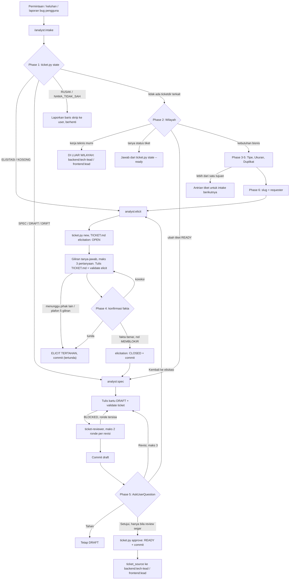
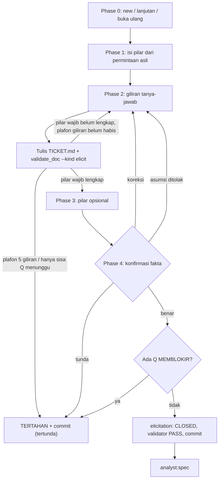
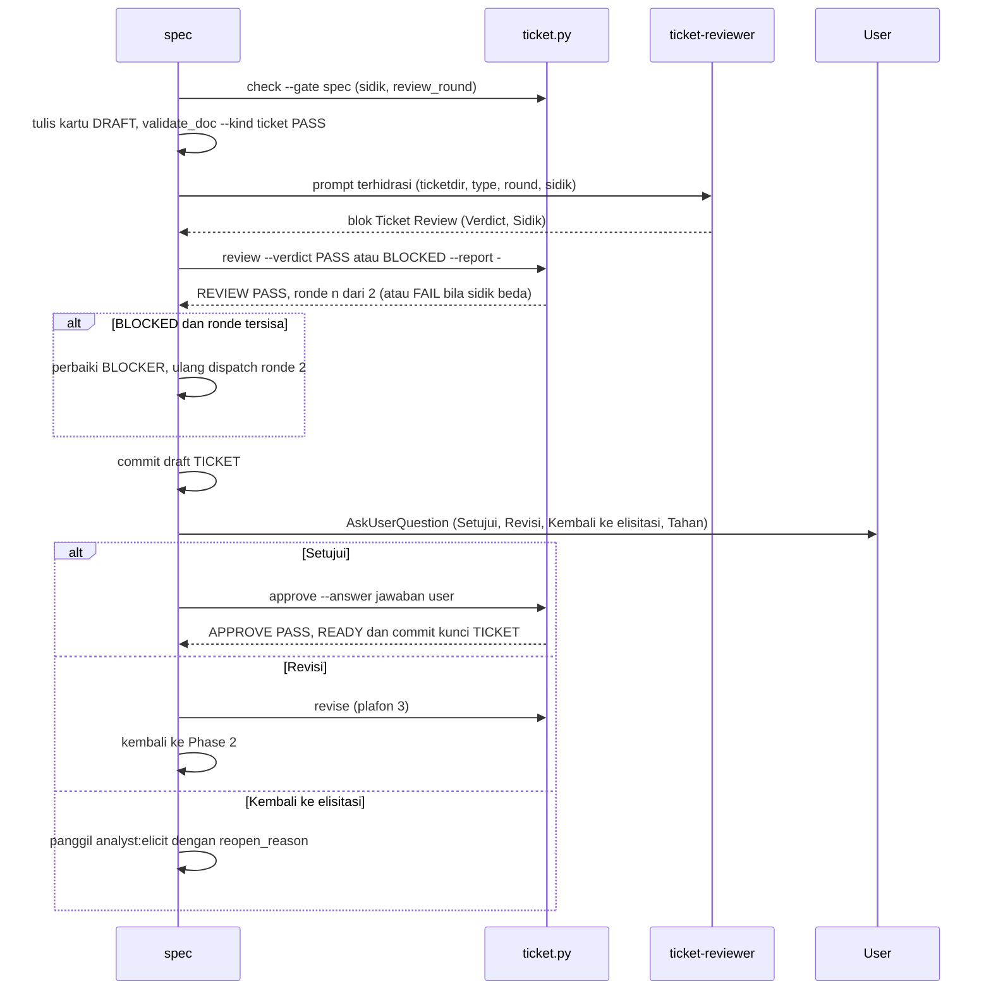
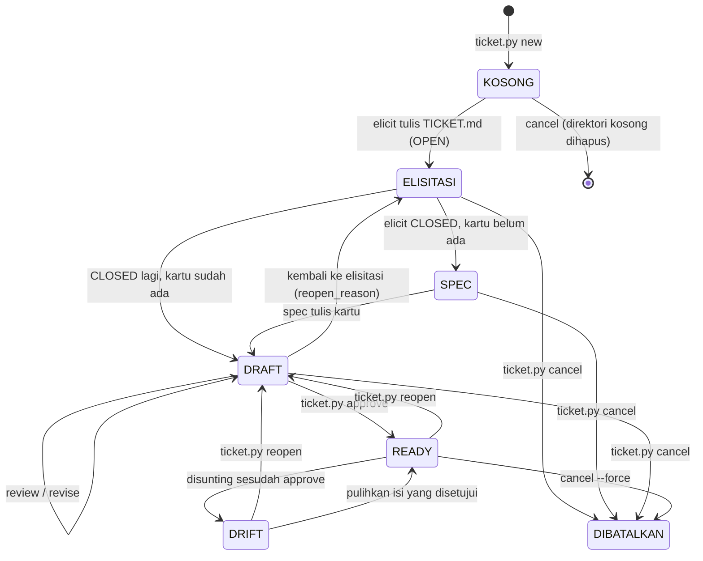

# Alur Plugin `analyst`

> Plugin `analyst` (v0.5.0) adalah jembatan antara pengguna/stakeholder dan engineer. Ia menerima permintaan,
> keluhan, atau laporan bug dari sisi pengguna, menggali faktanya lewat tanya-jawab dengan peminta
> non-engineer, lalu menerbitkan `TICKET.md`: kartu tiket non-teknis setara kartu Jira/Trello, berisi user
> story, acceptance criteria, dan aturan bisnis. Tiket melewati review independen dan persetujuan user sebelum
> diserahkan ke `backend:tech-lead` / `frontend:lead` lewat parameter `ticket_source`. Pakai plugin ini
> ketika kebutuhan datang dari bahasa bisnis. Kerja teknis murni (refaktor, stacktrace dari developer) bukan
> wilayahnya. Tiga prinsip membentuk plugin ini: tiket menyebut **apa dan kenapa**, tidak pernah
> **bagaimana**; fakta berasal dari peminta, bukan tebakan analis; dan semua yang bisa divonis mesin divonis
> skrip.

## Peta Komponen

| Komponen | Jenis | Peran singkat | Berkas |
|---|---|---|---|
| `analyst:intake` | skill (satu-satunya yang muncul di menu `/`) | Gerbang: pulihkan ticketdir, tentukan wilayah, tipe, ukuran, cek duplikat, tetapkan slug. Tidak menulis berkas apa pun | `skills/intake/SKILL.md` |
| `analyst:elicit` | skill (`user-invocable: false`) | Tanya-jawab dengan peminta. Fakta direkam per pilar ke `## Catatan Elisitasi` setiap giliran, lalu elisitasi ditutup (`CLOSED`) | `skills/elicit/SKILL.md`, `references/elicitation-guide.md`, `templates/elicit-template.md` |
| `analyst:spec` | skill (`user-invocable: false`) | Menyusun kartu di atas catatan elisitasi, dispatch reviewer, commit draft, minta persetujuan user, lalu `READY` | `skills/spec/SKILL.md`, `templates/ticket-template.md`, `dispatcher/reviewer.md` |
| `ticket-reviewer` | agent (read-only, model `sonnet`) | Memvonis draft kartu `PASS`/`BLOCKED` secara semantik terhadap catatan elisitasi | `agents/ticket-reviewer.md` |
| `ticket.py` | script (CLI siklus hidup) | `state`, `new`, `check --gate elicit\|spec`, `review`, `revise`, `approve`, `reopen`, `cancel`, `ref` | `skills/_common/ticket.py` |
| `validate_doc.py` | script (validator) | `--kind elicit` menilai catatan elisitasi. `--kind ticket` menilai kartu, termasuk pemindai kebocoran teknis | `skills/_common/validate_doc.py` |
| `analyst_lib.py` | script (pustaka) | Mencari root, parser frontmatter, pemecah kartu/catatan, sidik `content_hash`, segel `ticket_seal`, `scan_leaks`, dan commit git | `skills/_common/analyst_lib.py` |

## Alur Utama



Semua pekerjaan masuk lewat `/analyst:intake`, termasuk melanjutkan tiket yang setengah jalan. Intake membaca
keadaan setiap ticketdir dari `ticket.py state`, bukan dari ingatan sesi. `elicit` dan `spec` tidak muncul di
menu. Model memanggil keduanya lewat tool Skill sesuai keadaan ticketdir. Permintaan yang sudah lengkap tetap
melewati `elicit`: fakta diisi dari permintaan asli, dikonfirmasi sekali, lalu ditutup tanpa satu pertanyaan
pun, sehingga `spec` dan reviewer selalu punya satu sumber kebenaran tertulis. `READY` hanya bisa ditulis
`ticket.py approve`, dan skrip itu menagih validator, elisitasi `CLOSED`, vonis review `PASS` atas sidik
konten terkini, serta jawaban eksplisit user.

## Alur per Skill

### `analyst:intake`

- **Pemicu / kapan dipakai**: permintaan, keluhan, atau laporan dari pengguna/stakeholder yang perlu dijadikan
  tiket, atau tiket analyst yang sudah ada perlu dilanjutkan atau diubah. Dipanggil user lewat `/analyst:intake`.
- **Prasyarat**: `python3` tersedia. Ruang kerja berakar di root worktree git bila ada, selain itu di
  direktori kerja. Tiket tinggal di `analyst/tickets/`. Git tidak wajib. Parameter: `request` (wajib, apa
  adanya), `requester`, `force_type`.
- **Langkah**:
  1. **Pemulihan ticketdir**: jalankan `ticket.py state`, lalu rutekan per keadaan: `KOSONG` menjalankan
     Phase 2–3 lalu `elicit` pada direktori itu. `ELISITASI` ke `elicit`. `SPEC`/`DRAFT` ke `spec`. `DRIFT`
     membuat intake bertanya ke user: setujui ulang lewat `spec` atau pulihkan isi. `RUSAK`/`NAMA_TIDAK_SAH`
     dilaporkan ke user. Permintaan yang jelas menyambung ticketdir terbuka dirutekan ke sana. Bila
     hubungannya tidak jelas, intake bertanya ke user lewat `AskUserQuestion`.
  2. **Wilayah**: kebutuhan bisnis lanjut ke Phase 3. Perubahan tiket `READY` dirutekan ke `spec` dengan
     `change_request`. Pertanyaan status dijawab dari `ticket.py state --ready`. Kerja teknis murni dijawab
     `DI LUAR WILAYAH`.
  3. **Tipe**: `FEATURE` (kemampuan baru), `IMPROVEMENT` (memperluas kemampuan yang sudah bekerja), atau
     `BUG` (menyimpang dari yang seharusnya). Bila ragu antara IMPROVEMENT dan BUG, ajukan satu pertanyaan
     ke user.
  4. **Ukuran**: bila permintaan memuat lebih dari satu tujuan pengguna, user memilih satu tujuan untuk
     tiket ini. Sisanya masuk **antrian tiket**.
  5. **Duplikat**: bandingkan dengan judul tiket `READY`. Bila sama, tawarkan dua pilihan: ubah tiket lama
     atau buat tiket baru beralasan.
  6. **Slug & serah terima**: slug kebab-case ≤ 40 karakter dari kata benda bisnis. Tanyakan `requester`
     bila kosong. Panggil `elicit` dengan `{slug, type, request, requester}`. `request` diteruskan
     verbatim.
- **Subagent yang didispatch**: tidak ada.
- **Output / artefak**: tidak ada berkas. Serah terima bersih ditutup satu baris
  `INTAKE — <BARU | LANJUT | UBAH> · <type> · <slug> · next analyst:<elicit | spec>`. Di luar wilayah,
  barisnya `INTAKE — DI LUAR WILAYAH · next <backend:tech-lead | frontend:lead>`. Keadaan lain memakai blok
  `INTAKE — TERTAHAN | DILANJUTKAN DENGAN ANTRIAN`.
- **Gerbang & commit**: maksimal satu `AskUserQuestion` per phase. Intake tidak membaca kode dan tidak
  membuat commit.
- **Lanjut ke**: `analyst:elicit` atau `analyst:spec`. Kerja teknis murni diarahkan ke plugin engineer.

### `analyst:elicit`

- **Pemicu / kapan dipakai**: dipanggil `intake` sesudah tipe dan slug ditetapkan, untuk ticketdir berkeadaan
  `ELISITASI`/`KOSONG`, atau oleh `spec` bila fakta perlu digali ulang (`reopen_reason`).
- **Prasyarat**:
  - Tiket baru: `ticket.py new --slug <slug> --type <type>` harus mengembalikan
    `NEW PASS: <ticketdir> · root=… · git=…`. Slug kembar yang masih terbuka ditolak.
  - Ticketdir sudah ada: `ticket.py check --gate elicit --ticketdir <ticketdir>` (dengan `--reopen` bila
    dibuka ulang). Skrip memeriksa ticketdir sah, berkas template/panduan plugin ada, dan keadaan
    `KOSONG`/`ELISITASI` (plus `SPEC`/`DRAFT` bila `--reopen`).
- **Langkah**:
  0. **Alokasi atau lanjutan**. Tiket baru: tulis `TICKET.md` dari template dengan `elicitation: OPEN`,
     permintaan asli sebagai blockquote, dan semua pilar `_(belum terjawab)_`. Lanjutan: tanyakan apakah
     `Q-{n}` yang `menunggu:` sudah terjawab. Buka ulang: set `OPEN`, tambah baris log "Dibuka ulang", lalu
     gali hanya pilar yang disebut alasannya.
  1. **Isi dari permintaan**: fakta tersurat ditulis langsung. Fakta tersirat ditulis sebagai `Asumsi:`.
     Istilah teknis dari peminta dirumuskan ulang sebagai perilaku. Istilah yang memang kosakata produk
     dikonfirmasi, dicatat di log, lalu dimasukkan ke `domain_terms`.
  2. **Giliran tanya-jawab**: tiap giliran menyasar ≤ 3 pilar wajib, diurutkan menurut dampak. Tiap
     pertanyaan punya 2–4 opsi konkret. **Sesudah setiap giliran**: catat log, perbarui pilar, tulis
     `TICKET.md`, lalu jalankan `validate_doc.py --kind elicit`. Jawaban "tidak tahu" dicatat sebagai
     `Q-{n}` `MEMBLOKIR`/`TIDAK MEMBLOKIR` dengan `menunggu: <siapa>`. Plafon 5 giliran per sesi; bila
     habis, hasilnya `TERTAHAN`.
  3. **Pilar opsional**: satu giliran. Pilar yang ditolak ditulis `Tidak dibahas — <alasan>`.
  4. **Konfirmasi fakta** (bukan persetujuan tiket). User memilih *Fakta sudah benar*, *Ada koreksi*, atau
     *Tunda*. Asumsi yang dikonfirmasi dihapus labelnya. Asumsi yang ditolak kembali ke Phase 2.
  5. **Tutup & serah terima**: bila masih ada `MEMBLOKIR`, elisitasi dilarang ditutup. Selain itu set
     `elicitation: CLOSED`, jalankan validator sampai `PASS`, lakukan self-test semantik, commit, lalu
     panggil `spec`.
- **Subagent yang didispatch**: tidak ada.
- **Output / artefak**: `<ticketdir>/TICKET.md` berisi frontmatter dan `## Catatan Elisitasi` (Permintaan
  Asli · Fakta per pilar · Log Tanya-Jawab · Pertanyaan Terbuka). Baris penutup:
  `ELICIT — CLOSED · <ticketdir> · <n> pilar · <n> log · <n> Q tidak memblokir · <commit> — lanjut ke analyst:spec`.
  Bila belum tuntas, dipakai blok `ELICIT — TERTAHAN` dengan pertanyaan siap diteruskan.
- **Gerbang & commit**: `validate_doc.py --kind elicit` wajib `PASS` setiap giliran untuk struktur. Saat
  `CLOSED`, validator menagih nol pilar kosong, nol `MEMBLOKIR`, nol `Asumsi:`, dan setiap `domain_terms`
  berjejak. Commit `docs(ticket): elisitasi <slug>`, atau `… (tertunda)` bila tertahan, dengan staging
  path eksplisit.
- **Lanjut ke**: `analyst:spec`. Bila tertahan, lanjutkan lewat `analyst:intake` pada sesi berikutnya.



### `analyst:spec`

- **Pemicu / kapan dipakai**: dipanggil `elicit` sesudah `CLOSED`, atau `intake` untuk keadaan
  `SPEC`/`DRAFT`/`DRIFT` dan untuk perubahan tiket `READY`.
- **Prasyarat**:
  1. Untuk perubahan tiket `READY`/`DRIFT`: konfirmasi ke user, lalu jalankan
     `ticket.py reopen --ticketdir … --reason …`.
  2. `ticket.py check --gate spec` memeriksa: ticketdir sah, berkas template/dispatcher ada, keadaan
     `SPEC`/`DRAFT`, dan catatan elisitasi `CLOSED` yang lolos validator. Skrip mencetak `root`, `type`,
     `git`, dan untuk draft juga `revision`, `review_round`, `sidik`, `review_segar`, `review_basi`,
     `review_report`.
- **Langkah**:
  0. **Orientasi**. Untuk `DRAFT` dengan `review_segar=ya`, langsung ke Phase 5. Bila `review_basi` memuat
     `elisitasi`, jalankan `ticket.py revise` lalu Phase 1. Bila `review_basi=kartu`, ke Phase 2. Bila
     `change_request` membawa fakta baru, panggil `elicit` dengan `reopen_reason`.
  1. **Rumusan**: judul ≤ 12 kata. Prioritas dipetakan dari pilar `Urgensi` dengan rubrik HIGH/MEDIUM/LOW.
     Tulis latar belakang. Tulis user story (`BUG`: laporan bug). Setiap fakta aturan menjadi `BR-{n}`. AC
     Given/When/Then disapu dari jalur utama, sisi lolos dan tolak tiap BR, kasus khusus, dan peran
     terlarang. Lebih dari 10 AC berarti tiket harus dipecah. Isi juga Di Luar Cakupan dan Pertanyaan
     Terbuka beserta asumsinya.
  2. **Tulis draft**: sisipkan kartu di antara H1 dan `## Catatan Elisitasi` (catatan tidak disentuh sama
     sekali), lalu jalankan `validate_doc.py --kind ticket` sampai `PASS` dan self-test semantik.
  3. **Review independen**: bila `review_round` sudah 2, dispatch dilarang. Selain itu hidrasi
     `dispatcher/reviewer.md` dan dispatch `analyst:ticket-reviewer`. Vonisnya segera dicatat lewat
     `ticket.py review --verdict … --report -` dengan blok balikan apa adanya.
  4. **Commit draft**: `docs(ticket): draft TICKET <slug>` (revisi: `revise TICKET <slug>`) atas
     `TICKET.md` dan `review.md`.
  5. **Persetujuan user**: sajikan tiket beserta blok `## Ticket Review`. Pilihan: *Setujui* (hanya bila
     `review_segar=ya`), *Revisi*, *Kembali ke elisitasi*, atau *Tahan*. *Setujui* menjalankan
     `ticket.py approve --answer "<jawaban user>"`. *Revisi* menjalankan `ticket.py revise`, lalu Phase 2–4
     diulang.
- **Subagent yang didispatch**: `analyst:ticket-reviewer`, langsung tanpa skill pembungkus. Vonisnya
  `PASS`/`BLOCKED`. Balikan kosong atau rusak dicatat `DISPATCH_FAILED` (tidak dihitung ronde) dan diulang
  maksimal sekali.
- **Output / artefak**: kartu di `TICKET.md` (`status: DRAFT`, lalu `READY`) dan `<ticketdir>/review.md`
  (blok vonis terakhir, ditulis hanya oleh `ticket.py review`). Baris penutup:
  `SPEC — READY · <ticketdir>/TICKET.md @<sidik> · <type> · <priority> · <n> AC · <n> BR · <commit> — serahkan ke engineer … ticket_source: <ticketdir>/TICKET.md`.
  Selain itu dipakai blok `SPEC — MENUNGGU KEPUTUSAN | TERTAHAN`.
- **Gerbang & commit**: `validate_doc.py --kind ticket` harus `PASS` sebelum dispatch. Plafon review 2
  ronde per revisi, dan ronde kembali ke 0 bila catatan elisitasi berubah. Plafon revisi 3 per basis fakta.
  `approve` menulis `READY`, `approved_hash`, `approved_seal`, dan `approval`, lalu meng-commit
  `docs(ticket): kunci TICKET <slug> READY`. `external_ref` sesudah `READY` diisi lewat `ticket.py ref`
  (commit `docs(ticket): ref TICKET <slug>`) tanpa membuka ulang tiket.
- **Lanjut ke**: engineer (`backend:tech-lead` dan/atau `frontend:lead`) dengan `ticket_source`. Bila fakta
  perlu digali ulang, kembali ke `analyst:elicit`.



## Subagent

| Agent | Dipanggil oleh | Tools | Input | Output/vonis | Larangan |
|---|---|---|---|---|---|
| `ticket-reviewer` | `analyst:spec` Phase 3, lewat `skills/spec/dispatcher/reviewer.md` | Read, Grep, Glob (model `sonnet`) | Slot `ticketdir` (path absolut), `type`, `round` (1/2), `sidik` (`<12hex>/<12hex>`, diambil tepat sebelum dispatch). Ronde 2 menambah `previous_verdict` dan `changed_sections`. Isi tiket dibaca sendiri dari disk | Blok `## Ticket Review`: `Verdict: PASS\|BLOCKED`, `Sidik`, `Ronde`, hitungan BLOCKER `[MEKANIS]`/`[SEMANTIK]`, BLOCKER berjangkar `TICKET.md:<baris>`, dan ADVISORY. Ada 10 fokus pemeriksaan: hasil teramati, ukuran pasti, setia elisitasi maju dan mundur, kebocoran teknis semantik, satu tujuan, BUG dapat direproduksi, pertanyaan terbuka jujur, latar belakang, prioritas selaras urgensi | Dilarang mengedit berkas, menulis/menyarankan `READY`, menulis ulang tiket, menilai kelayakan teknis/estimasi, bertanya ke user, dan menghitung ulang cek mekanis `validate_doc.py` |

## Hooks & Guard

Tidak ada. Plugin `analyst` tidak punya direktori `hooks/`. Penegakannya sepenuhnya lewat skrip `ticket.py`
dan `validate_doc.py` di setiap gerbang.

Catatan dari sisi lain: hook `SessionStart` plugin `backend`/`frontend` mengecualikan permintaan yang
memanggil atau melanjutkan `analyst:*`. Di dalam alur analyst, blok `<backend-tech-lead-gate>` /
`<frontend-lead-gate>` tidak berlaku. Untuk repo yang hanya memakai analyst, tulis `.claude/workflow` tanpa
nama plugin engineer (mis. berisi `analyst`) agar hook kedua plugin engineer diam.

## Artefak & Siklus Status

```
./analyst/tickets/<YYMMDDhhmm>-<slug>/
  TICKET.md   satu-satunya artefak yang disunting skill (kartu di atas, ## Catatan Elisitasi sebagai H2 terakhir)
  review.md   blok ## Ticket Review terakhir, hanya ditulis ticket.py review --report
```

Frontmatter punya dua sumbu status dengan pemilik berbeda:

| Field | Nilai | Penulis |
|---|---|---|
| `elicitation` | `OPEN` → `CLOSED` | `analyst:elicit` |
| `status` | `DRAFT` → `READY` / `CANCELLED` | `ticket.py` (`approve`, `reopen`, `cancel`). `DRAFT` awal ditulis `elicit` |
| `priority`, `external_ref`, H1 final | — | `analyst:spec` (`external_ref` sesudah `READY` hanya lewat `ticket.py ref`) |
| `type`, `slug`, `requester`, `created`, `domain_terms` | — | `analyst:elicit` |
| `revision`, `revision_base`, `review`, `review_round`, `approved*`, `reopen*`, `cancel_reason` | pembukuan | hanya `ticket.py` |

`ticket.py state` menurunkan satu keadaan per ticketdir dari kedua field tersebut plus isi berkas. Keadaan
inilah yang dipakai intake untuk merutekan:



Dua keadaan berada di luar siklus di atas. `RUSAK` berarti berkas bukan UTF-8, status tidak sah, tidak ada
`## Catatan Elisitasi`, atau tiket `READY` dengan elisitasi `OPEN`/tanpa kartu. `NAMA_TIDAK_SAH` berarti
direktori tidak cocok dengan pola `<YYMMDDhhmm>-<slug>`.

**Sidik & segel** (`analyst_lib.py`):

- Sidik review adalah pasangan `<kartu>/<catatan elisitasi>` (masing-masing 12 hex `content_hash`).
  Suntingan di bagian mana pun membuat vonis basi.
- `approve` memateraikan `approved_hash` (sidik berkas utuh) dan `approved_seal` (`ticket_seal`: body utuh
  plus `type`, `priority`, `domain_terms`, tanpa field pembukuan dan `external_ref`).

## Handoff Lintas Plugin

- **Ke engineer**: tiket `READY` diserahkan sebagai `ticket_source: <ticketdir>/TICKET.md` ke
  `backend:tech-lead` dan/atau `frontend:lead`.
- **Syarat penerimaan**: frontmatter `status: READY` dan `elicitation: CLOSED`, dan isi berkas sama dengan
  `approved_seal`. Tiket lama tanpa segel dinilai dari subjek commit terakhir, yaitu
  `docs(ticket): kunci TICKET <slug> READY` atau `docs(ticket): ref TICKET <slug>`, dan berkasnya harus
  bersih. Penerima memeriksanya lewat `ticket_source_verdict` di `skills/_common/precondition_lib.py`
  backend dan frontend, yang dipanggil prasyarat skill `task` masing-masing. Tiket yang disunting sesudah
  approve ditolak sebagai `DRIFT` dan dikembalikan ke `analyst:spec`.
- **Satu segel, tiga salinan**: `ticket_seal` di `analyst_lib.py` disalin apa adanya ke `precondition_lib.py`
  backend dan frontend, dan `tests/test_a1_ticket_source.py` menagih ketiganya identik. Mengubah segel
  atau subjek commit `approve`/`ref` berarti mengubah ketiganya bersamaan.
- **Yang dibaca engineer**: kartu saja (H1 sampai akhir `## Lampiran`). Catatan elisitasi hanya jejak.
- **Namespace**: di hilir, `AC-{n}`/`BR-{n}` tiket dirujuk sebagai `TAC-{n}`/`TBR-{n}`. Tiap `TAC-{n}` wajib
  dipikul minimal satu `SC-{n}` di `TASK.md` engineer, atau dicatat beralasan di `## Out of Scope`.
  Validator `TASK.md` kedua plugin menagihnya.
- **Kesepakatan aturan**: aktor, kondisi, dan `TBR-{n}` di tiket dihitung sudah disetujui. `backend:analyst`
  tidak menjadwalkan BRD hanya karena fakta itu. Bila BRD tetap terbit, `business-analysis` menyerap
  `TBR-{n}` tanpa menanyakannya ulang (`— Asal: TBR-{m}`).
- **Batas dengan plugin lain**: kontrak teknis dan brief milik `backend`, alur/bentuk layar milik
  `frontend`, perubahan kecil tanpa taskdir milik `quickdev`. Dua skill sengaja belum dibuat: `split`
  (pemecahan epic; untuk sementara intake memakai antrian tiket) dan `acceptance` (UAT atas `REPORT.md`
  engineer).

## Titik Gagal & Pemulihan

| Kondisi | Di mana | Pemulihan |
|---|---|---|
| `ticket.py` gagal jalan (python3 absen, izin tulis) | intake | Laporkan galat mentah. Dilarang lanjut ke elisitasi tanpa pemindaian keadaan |
| Ticketdir `RUSAK` / `NAMA_TIDAK_SAH` | intake | Laporkan baris skrip. Perbaikan manual oleh user, `git mv` ke nama sah, atau `ticket.py cancel` atas keputusan user. Frontmatter tidak boleh ditambal dengan tangan |
| User menolak memilih satu tujuan | intake | Rekomendasikan tujuan paling mendesak. Bila tetap menolak, keluarkan blok `INTAKE — TERTAHAN` |
| `NEW FAIL` karena slug kembar terbuka atau direktori sudah ada di menit yang sama | elicit | Kembali ke intake Phase 1 untuk melanjutkan ticketdir itu, atau pilih slug lain |
| Peminta menjawab "terserah" / tidak tahu | elicit | Tawarkan opsi rekomendasi. Bila tetap tidak ada jawaban, catat `Q-{n}` `MEMBLOKIR` dan tahan (`TERTAHAN`) |
| Jawaban bertentangan dengan fakta sebelumnya | elicit | Sajikan keduanya lewat `AskUserQuestion` dan tandai yang lama `(dikoreksi di #n)` |
| `validate_doc.py` `FAIL` | elicit, spec | Perbaiki per baris `Tindakan`. Menutup elisitasi, dispatch reviewer, dan approve dilarang sebelum `PASS` |
| Kebocoran teknis tak kunjung `PASS` karena istilahnya kosakata produk | spec | Panggil `elicit` dengan `reopen_reason = konfirmasi istilah domain: <istilah>`, lalu kembali ke Phase 0. `spec` dilarang menambah `domain_terms` |
| Fakta elisitasi saling bertentangan saat merumuskan AC | spec | Panggil `elicit` dengan `reopen_reason` yang menyebut kedua fakta |
| `REVIEW FAIL` karena sidik berbeda (draft berubah sesudah dispatch) | spec | Dispatch ulang dengan `{sidik}` baru. Blok balikan tidak boleh disunting |
| Plafon 2 ronde review habis dengan BLOCKER tersisa | spec | Tanpa opsi *Setujui*. Tawarkan *Revisi* (`ticket.py revise` membuka ronde baru) atau *Kembali ke elisitasi* |
| Plafon 3 revisi habis | spec | Lingkup belum jelas. Tawarkan *Kembali ke elisitasi* atau `ticket.py cancel` |
| Dispatch reviewer gagal dua kali | spec | Tiket tidak dapat di-approve. Sajikan `TERTAHAN` dan minta user mengulang sesi |
| `APPROVE FAIL` (status bukan DRAFT, validator FAIL, elisitasi bukan CLOSED, review bukan `PASS @<sidik sekarang>`, jawaban kosong) | spec | Ikuti sebab di keluaran. Bila review basi dan ronde tersisa, jalankan ronde berikut |
| `approve`/`ref`/`cancel` exit 3 (commit gagal karena hook, gpg, `.gitignore`) | spec / ticket.py | Isi sudah tertulis. Sajikan baris `COMMIT GAGAL`, lalu user meng-commit manual dengan perintah dan subjek persis yang dicetak. Dilarang `--no-verify` |
| Tiket `READY` disunting (`DRIFT`) | intake, penerima engineer | Setujui ulang lewat `spec` (`reopen` → review → approve), atau pulihkan isi yang disetujui |
| Membatalkan tiket `READY` | ticket.py | `cancel` ditolak tanpa `--force`, karena tiket mungkin sudah diserahkan ke engineer. `--force` hanya atas keputusan eksplisit user |
