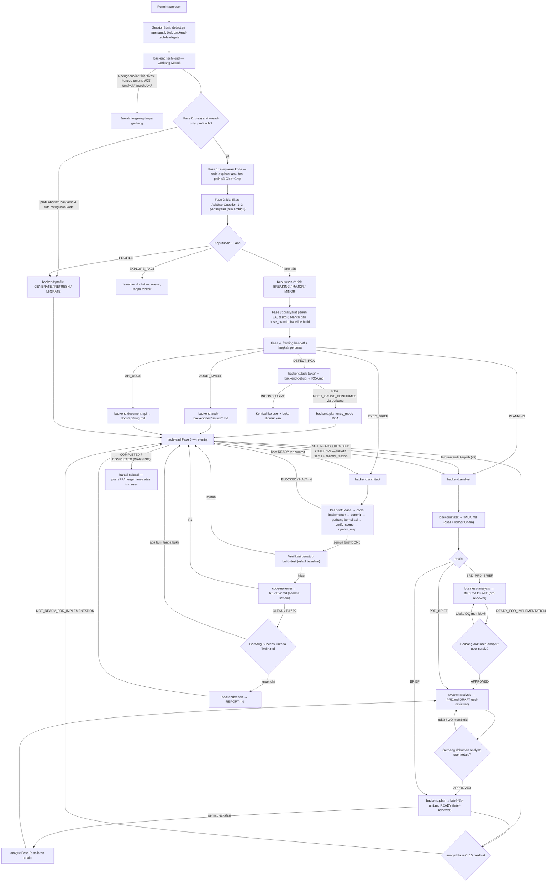
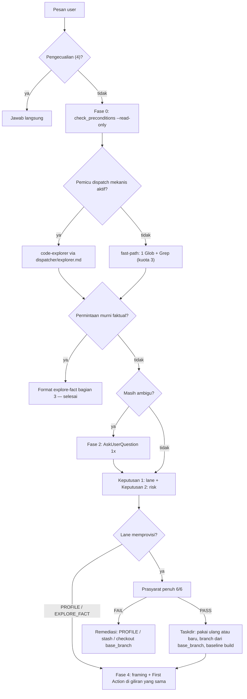
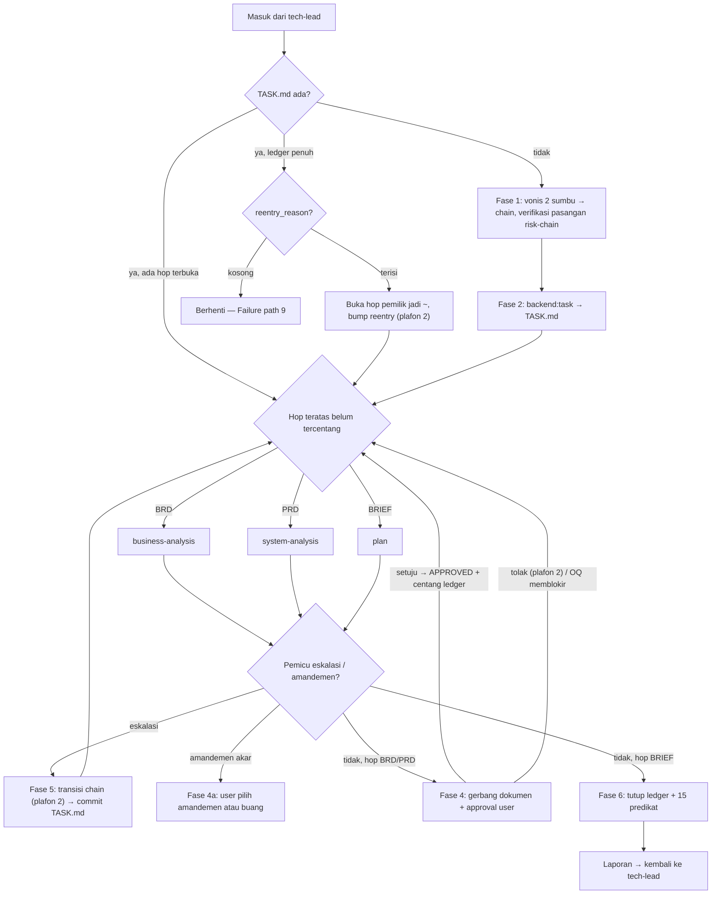
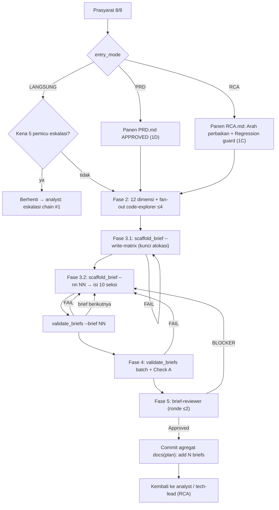
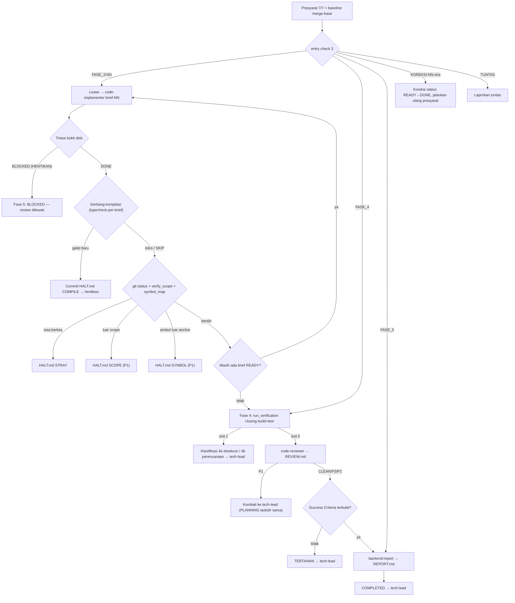
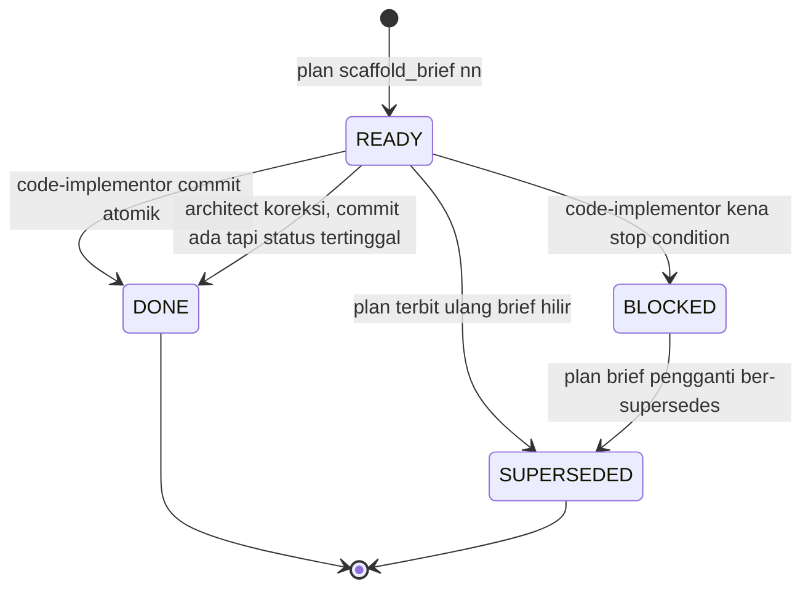
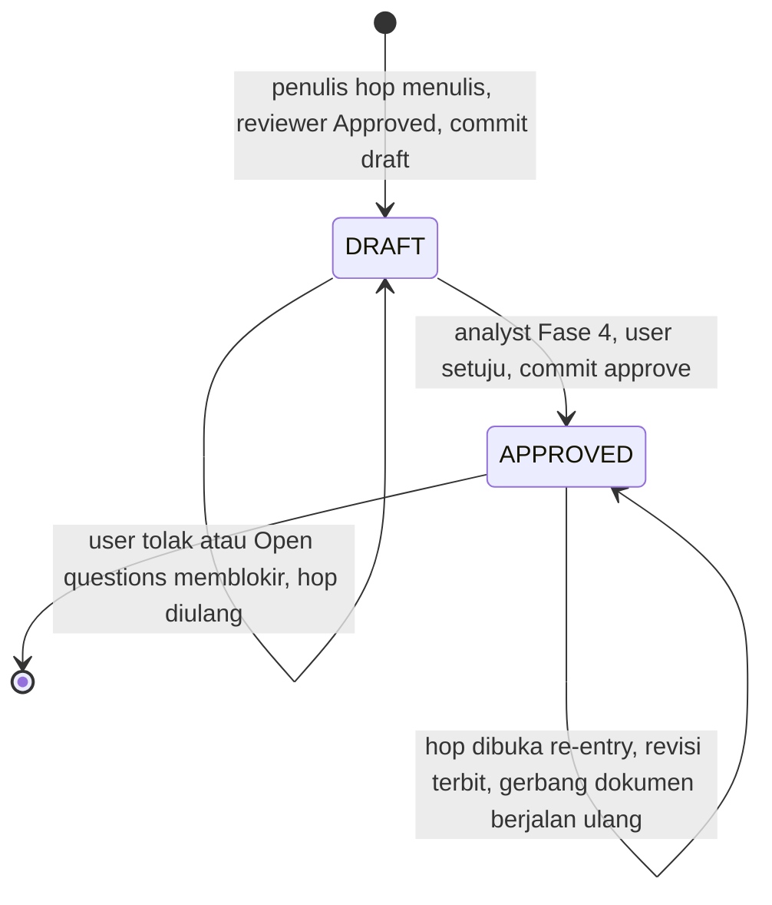

# Alur Plugin `backend`

> Plugin `backend` (v0.11.1, `src/plugins/backend/.claude-plugin/plugin.json`) menyediakan 12 skill dan 6 subagent untuk kerja backend lintas-stack: Java Spring, Go, Node, Bun, Rust, PHP, dan CodeIgniter 4. Plugin ini dipakai untuk tiap permintaan kerja di repo backend, yaitu fitur, bugfix, audit, dokumentasi API, maupun pertanyaan tentang kode. Semua permintaan masuk lewat satu gerbang, `backend:tech-lead`. Gerbang itu memutuskan lane, risk level, dan taskdir dari kode aktual sebelum satu brief ditulis atau satu berkas `src/` disentuh. Plugin sengaja dibuat generic: pengetahuan spesifik-repo disimpan di `.claude/profile/backenddev/`, sedangkan pengetahuan spesifik-stack disimpan di adapter `skills/profile/stacks/<stack>.md`.

Semua path berkas di dokumen ini relatif terhadap `src/plugins/backend/`.

## Peta Komponen

| Komponen | Jenis | Peran singkat | Berkas |
|---|---|---|---|
| `backend:tech-lead` | skill (titik masuk user) | Gerbang tiap permintaan: menentukan lane, risk, taskdir, branch, dan re-entry rantai | `skills/tech-lead/SKILL.md` |
| `backend:profile` | skill (titik masuk user) | Deteksi stack, pemindaian 17 titik arsitektur, dan baseline perintah ke `.claude/profile/backenddev/` | `skills/profile/SKILL.md` |
| `backend:debug` | skill (titik masuk user) | Membuktikan rantai kausal `file:line` lalu menulis `RCA.md` | `skills/debug/SKILL.md` |
| `backend:audit` | skill (titik masuk user) | Menyapu 6 dimensi konvensi arsitektur lalu menulis laporan ke `backenddev/issues/` | `skills/audit/SKILL.md` |
| `backend:document-api` | skill (titik masuk user) | Memetakan endpoint nyata di kode ke `docs/api/<slug>.md` | `skills/document-api/SKILL.md` |
| `backend:architect` | skill (titik masuk user) | Orkestrasi sekuensial brief READY, verifikasi penutup, dan review tunggal | `skills/architect/SKILL.md` |
| `backend:analyst` | skill (`user-invocable: false`) | Orkestrasi rantai TASK/BRD/PRD/brief beserta gerbang approval dokumen | `skills/analyst/SKILL.md` |
| `backend:task` | skill (`user-invocable: false`) | Menulis akar rantai `TASK.md` | `skills/task/SKILL.md` |
| `backend:business-analysis` | skill (`user-invocable: false`) | Hop BRD: elisitasi aturan bisnis ke `BRD.md` DRAFT | `skills/business-analysis/SKILL.md` |
| `backend:system-analysis` | skill (`user-invocable: false`) | Hop PRD: kontrak API, lifecycle, validasi, permission, dan impact map ke `PRD.md` DRAFT | `skills/system-analysis/SKILL.md` |
| `backend:plan` | skill (`user-invocable: false`) | Menerbitkan brief `READY` atomik (hop BRIEF atau jalur RCA) | `skills/plan/SKILL.md` |
| `backend:report` | skill (`user-invocable: false`) | Menulis `REPORT.md` penutup dari diff merge-base | `skills/report/SKILL.md` |
| `code-explorer` | agent | Penelusur bukti `file:line` yang hanya boleh menulis ke laci `.explore/` | `agents/code-explorer.md` |
| `code-implementor` | agent | Menerapkan satu brief READY lalu meng-commit sendiri | `agents/code-implementor.md` |
| `code-reviewer` | agent | Menilai diff merge-base terhadap union brief, lalu menulis dan meng-commit `REVIEW.md` | `agents/code-reviewer.md` |
| `brd-reviewer` | agent | Vonis BRD `Approved`/`Issues Found` | `agents/brd-reviewer.md` |
| `prd-reviewer` | agent | Vonis PRD `Approved`/`Issues Found` | `agents/prd-reviewer.md` |
| `brief-reviewer` | agent | Audit helikopter batch brief terhadap TASK/BRD/PRD | `agents/brief-reviewer.md` |
| `detect.py` + `gate_text.py` | hook SessionStart | Menyuntik blok `<backend-tech-lead-gate>` sekali per sesi | `hooks/detect.py`, `hooks/gate_text.py`, `hooks/hooks.json` |
| `guard_bash.py` | hook PreToolUse | Pagar mekanis Bash/Edit/Write untuk explorer, implementor, dan reviewer (fail-closed) | `hooks/guard_bash.py` |
| `check_preconditions.py` | script (per skill) | Prasyarat sebelum fase pertama (exit 0 = PASS, 1 = FAIL) | `skills/<skill>/scripts/check_preconditions.py` |
| `precondition_lib.py` | script | Parser frontmatter, taskdir, chain, status git, dan profil; mengimpor `hooks/detect.py` | `skills/_common/precondition_lib.py` |
| `brief_status.py` | script | Mesin status brief, tautan `supersedes`, kesegaran `REVIEW.md`, dan `HALT.md` | `skills/_common/brief_status.py` |
| `validate_doc.py` | script | Self-test mekanis `TASK.md`/`BRD.md`/`PRD.md` | `skills/_common/validate_doc.py` |
| `run_verification.py` | script | Verifikasi `baseline` dan `closing` (vonis relatif baseline) | `skills/_common/run_verification.py` |
| `verify_scope.py` | script | Diff commit dibandingkan dengan `## File scope` brief | `skills/_common/verify_scope.py` |
| `sync_payload.py` | script | Argumen tool MCP nataflow (task, workdir, dokumen) untuk satu taskdir atau dokumen repo; read-only, dua fase | `skills/_common/sync_payload.py` |
| `nataflow_sync.py` | pustaka | Config `.claude/nataflow.json`, identitas repo, isi blob `HEAD`, dan diff manifest remote. Salinan identik di keempat plugin | `skills/_common/nataflow_sync.py` |
| Prosedur sinkron nataflow | referensi | Urutan panggilan tool MCP dua fase dan target per titik panggil | `skills/tech-lead/references/nataflow-sync.md` |
| `commit_lib.py` | script | Pesan commit brief dari `commit_template` profil | `skills/_common/commit_lib.py` |
| `chain_counters.py` | script | Plafon loop rantai di `## Counters` `TASK.md` | `skills/analyst/scripts/chain_counters.py` |
| `scaffold_brief.py` | script | Mengunci matriks alokasi, lalu menulis kerangka brief | `skills/plan/scripts/scaffold_brief.py` |
| `validate_briefs.py` | script | Validasi batch dan per-brief, serta state ronde review brief | `skills/plan/scripts/validate_briefs.py` |
| `symbol_map.py` | script | Peta simbol yang disunting satu commit, dicocokkan dengan kolom `Anchor` | `skills/architect/scripts/symbol_map.py` |
| `migrate_profile.py` | script | Memindah profil lama `.claude/profile/` ke `.claude/profile/backenddev/` via `git mv` | `skills/profile/scripts/migrate_profile.py` |
| Adapter stack | referensi | `java-spring`, `go`, `node`, `bun`, `rust`, `php`, `php-codeigniter`. Masing-masing memuat 7 seksi wajib: `## Detection`, `## Commands`, `## Layer taxonomy`, `## Navigation recipes`, `## Audit checklist`, `## API surface`, `## Failure signatures` | `skills/profile/stacks/*.md`, kontrak di `_CONTRACT.md` |

Skill ber-`user-invocable: false` tidak muncul di menu `/`. Untuk memulai, melanjutkan, atau memulihkan rantai, user memanggil `/backend:tech-lead` (README).

## Alur Utama



**Narasi singkat.**

1. Hook SessionStart menyuntik aturan bahwa `backend:tech-lead` jalan lebih dulu untuk tiap permintaan kerja, termasuk susulan kecil di tengah sesi.
2. `tech-lead` membaca profil, lalu membuktikan permukaan yang diminta dari kode aktual. Pembuktian memakai subagent `code-explorer` bila satu pemicu dispatch aktif; tanpa pemicu, dipakai fast-path berkuota 3. Sesudah itu gerbang memilih tepat satu dari tujuh lane dengan presedensi `PROFILE → EXEC_BRIEF → AUDIT_SWEEP → DEFECT_RCA → PLANNING → API_DOCS → EXPLORE_FACT`.
3. Untuk lane yang mengubah repo (`PLANNING`, `DEFECT_RCA`, `EXEC_BRIEF`, `AUDIT_SWEEP`, `API_DOCS`), gerbang menjalankan prasyarat penuh. Tiga lane pertama lalu memakai ulang atau membuat taskdir `backenddev/docs/<YYMMDDhhmm>-<slug>/`, mencabangkan branch dari `base_branch`, dan menjalankan baseline build. `AUDIT_SWEEP` berjalan di `base_branch` dan `API_DOCS` di branch aktif, keduanya tanpa taskdir dan tanpa branch baru.
4. Lane `PLANNING` diserahkan ke `backend:analyst`. Analyst menurunkan panjang rantai (`chain`) dari dua sumbu, yaitu sumbu bisnis (butuh BRD) dan sumbu kontrak (butuh PRD). Ia lalu menjalankan hop satu per satu dengan gerbang approval user untuk BRD dan PRD, dan menutup dengan 15 predikat `READY_FOR_IMPLEMENTATION`.
5. `backend:architect` mengeksekusi brief secara sekuensial. Tiap brief dikerjakan satu `code-implementor` yang meng-commit sendiri dan dipagari lease hook. Sesudah semua brief DONE, architect menjalankan verifikasi penutup sekali, mendispatch satu `code-reviewer`, lalu memanggil `backend:report`.
6. Tiap skill hilir pulang ke `tech-lead` Fase 5 (re-entry). Di sana gerbang meng-commit artefak yang menunggu dan menentukan langkah berikutnya dari tabel "pengirim balik". Kegagalan selalu dikerjakan ulang **di taskdir yang sama** lewat lane `PLANNING` dengan `reentry_reason`.

## Alur per Skill

### `backend:tech-lead`

- **Pemicu / kapan dipakai**: tiap pesan user berupa permintaan perubahan perilaku, bugfix, audit, eksekusi artefak, susulan cakupan, koreksi arah, atau pertanyaan baca-kode. Pertanyaan baca-kode memakai jalur cepat `references/explore-fact.md`. Ada empat pengecualian yang dijawab tanpa gerbang (`references/gate-scope.md` bagian 1): jawaban klarifikasi, konsep umum non-repo, operasi VCS atas kerja tuntas, dan alur `/analyst:*` atau `/quickdev:*` yang dipanggil eksplisit. Persetujuan `BRD.md`/`PRD.md` bukan pemicu; ia diteruskan ke `backend:analyst`.
- **Prasyarat**: `scripts/check_preconditions.py --read-only` di Fase 0. Prasyarat penuh 6 check dijalankan tanpa flag di Fase 3 butir 0, atau dengan `--re-entry` di Fase 5. Keenam check: Profile Index & Invariants, Git Worktree & HEAD State, Git Clean Working Tree, Workspace Write Access, Profile Commands, dan Base Branch & Branch Convention.
- **Langkah**:
  1. **Fase 0**: jalankan prasyarat read-only. Bila profil absen, pertanyaan baca-kode tetap dijawab dalam mode terdegradasi, sedangkan rute yang mengubah kode diarahkan ke `PROFILE` lebih dulu. Profil di lokasi lama memicu `PROFILE` mode MIGRATE.
  2. **Fase 1**: eksplorasi kode. Kuota main loop maksimal 3 panggilan `Glob`+`Grep`, potongan ≤40 baris, dan tanpa membaca berkas penuh. `code-explorer` wajib didispatch lewat `dispatcher/explorer.md` bila salah satu pemicu aktif: kerja melintasi lebih dari satu layer, yang dicari relasi, simbol tak ditemukan di Glob #1, atau kuota habis. Eksplorasi berhenti sesudah tiap permukaan yang diminta terbukti atau tercatat belum terbukti. Untuk pertanyaan faktual murni, skill menjawab lalu selesai.
  3. **Fase 2**: tepat satu kali `AskUserQuestion` (1–3 pertanyaan), hanya bila rute atau batas modul masih ambigu.
  4. **Keputusan 1 (lane)**: pilih dari tabel `references/decisions.md` bagian 6. Mengarang lane baru dilarang.
  5. **Keputusan 2 (risk)**: `BREAKING` (kontrak eksternal berubah), `MAJOR` (validasi bisnis, transaksi, field opsional baru), atau `MINOR` (perubahan internal terisolasi). Bila ragu, pilih yang lebih tinggi. `strict_mode` menaikkan satu tingkat.
  6. **Fase 3**: prasyarat penuh, lalu provisi taskdir (pakai ulang yang belum tuntas) dan branch `branch_convention`+slug dari `base_branch`. Lane `PLANNING`/`EXEC_BRIEF` juga menjalankan baseline `build`. Lane `DEFECT_RCA` memanggil `backend:task` sesudah branch kerja aktif (prasyarat `task` menolak akar di base atau branch lain). Kegagalan pascaeksekusi di taskdir tanpa ledger `## Chain` dirutekan ke `plan` jalur RCA atau `debug`, bukan `PLANNING`. Plafon `analyst` yang tertembus berakhir di pertanyaan ke user: rumuskan ulang di taskdir baru atau hentikan. Lane `EXEC_BRIEF` tanpa `TASK.md` menjalankan backfill `task`. Laporan explorer disalin ke `<taskdir>/.explore/gate-<slug>.md`.
  7. **Fase 4**: framing handoff deterministik, yaitu Target Skill, Taskdir, File Scope, Risk Level, Acceptance Criteria, Stop Conditions, `evidence`, dan `Finding Source`/`Ticket Source`. Langkah pertama rute dijalankan di giliran yang sama.
  8. **Fase 5 (re-entry)**: prasyarat `--re-entry`, lalu commit artefak yang menunggu dengan staging path eksplisit, lalu sinkron nataflow (`gate-lifecycle.md` bagian 6 butir 2a: `--repo-docs` untuk pengirim `audit`/`document-api`/`profile`, `--taskdir` untuk lainnya). Langkah lanjut ditentukan dari tabel pengirim balik di bawah. Rute "sinkron ulang taskdir" hanya menjalankan Fase 0 `--read-only` dan prosedur sinkron, tanpa provisi.
- **Subagent yang didispatch**: `code-explorer`, hanya di Fase 1 butir 2 (satu titik sah). Balikan `confidence: low` atau rusak memicu pertajaman objective dan satu kali ulang, lalu sapuan manual.
- **Output / artefak**: blok `### TECH-LEAD GATEWAY DECISION` (Lane, Taskdir, Branch, Bukti, Justifikasi Rute, File Scope, First Action) atau `### TECH-LEAD RE-ENTRY DECISION`. Taskdir, branch, dan laporan laci `backenddev/docs/.explore/<slug>.md` (tidak di-commit).
- **Gerbang & commit**: gerbang hanya meng-commit artefak `profile`, `audit`, `debug`, dan `document-api` di Fase 5. Selain itu ia meng-commit amandemen akar `TASK.md` (`docs(<slug>): amandemen akar TASK (<pemicu>)`), pencabutan `HALT.md` yang scope-nya diterima user, dan `docs: migrate backend profile`. Push, merge, rebase, `gh pr create`, dan `branch -D` dilarang tanpa izin user.
- **Lanjut ke**: skill rute lane, lalu kembali ke Fase 5 sesudah tiap skill hilir selesai.



**Tabel pengirim balik Fase 5** (`references/gate-lifecycle.md` bagian 6):

| Pengirim & vonis | Langkah lanjut gerbang |
|---|---|
| `profile` | Commit profil + `.gitignore`, ulangi Fase 0, lanjutkan rute tertunda |
| `analyst` `READY_FOR_IMPLEMENTATION` | Rutekan ke `backend:architect` |
| `analyst` `NOT_READY_FOR_IMPLEMENTATION` | Selesaikan akar masalah, lalu lane `PLANNING` pada taskdir sama dengan `reentry_reason` berisi predikat gagal |
| `analyst` membawa amandemen akar | Tulis ulang `## Success Criteria`/`## Out of Scope`, jalankan `validate_doc.py --kind task`, commit, lalu `PLANNING` lagi |
| `debug` `ROOT_CAUSE_CONFIRMED` | `plan` dengan `entry_mode: RCA`, `risk`, dan `file_scope` eksplisit |
| `debug` `INCONCLUSIVE` | Kembali ke user dengan daftar bukti tambahan |
| `plan` jalur RCA, brief READY ter-commit | `backend:architect` pada taskdir sama |
| `plan` jalur RCA membawa pemicu eskalasi | Tanya user. Bila naik, amandemen ke `PRD_BRIEF` lalu `PLANNING` (analyst mulai dari hop PRD) |
| `audit` | Ringkasan per severity, user memilih ≤7 temuan, taskdir baru, lalu `PLANNING` + `finding_source` |
| `architect` `TERTAHAN (scope)` / `HALT.md` `SCOPE`/`SYMBOL` | Tanya user: bila diterima, `git rm HALT.md` lalu architect lagi; bila di-reset, user sendiri yang me-reset lalu `PLANNING` |
| `architect` `HALT.md` `COMPILE`/`STRAY` | `PLANNING` pada taskdir sama. `plan` menambah baris `repairs` |
| `architect` severity `P1` | `PLANNING` pada taskdir sama, `finding_source` = `REVIEW.md`, `reentry_reason` = `REVIEW P1: <ID>` |
| `architect` `COMPLETED` / `COMPLETED (WARNING)` | Rantai selesai. Pada WARNING, tawarkan taskdir perbaikan P2 (tidak otomatis) |
| `architect` membawa `Umpan balik profil` | Tanya user. Bila ya, jalankan `backend:profile` dengan `reported_anti_patterns` |
| `document-api` | Commit `docs/api/`, rantai selesai |

### `backend:profile`

- **Pemicu / kapan dipakai**: repo belum punya `.claude/profile/backenddev/`, profil rusak/tidak lengkap/di lokasi lama, konfigurasi berubah, atau gerbang meneruskan `reported_anti_patterns`. Bisa juga dipanggil langsung `/backend:profile`.
- **Prasyarat**: `scripts/check_preconditions.py [--mode] [--stack]`, 6 check. Baris `Terselesaikan: mode <GENERATE | REFRESH | MIGRATE>` menetapkan mode kerja.
- **Langkah**:
  1. **Fase 0**: deteksi stack lewat `hooks/detect.py` atas manifest (root, workspace, `apps/*`, `packages/*`, `services/*`), lalu baca adapter `stacks/<stack>.md`. Nol stack menghentikan skill. Bila ada lebih dari satu stack, user memilih.
  2. **Fase 1**: tentukan mode. GENERATE langsung jalan. REFRESH meminta konfirmasi (kecuali `force`). MIGRATE menjalankan `migrate_profile.py` lalu melompat ke Fase 7.
  3. **Fase 2**: pindai 17 titik arsitektur (`references/scan-guide.md` titik 1–14, `references/convention-scan.md` titik 15–17), dengan anchor `<file>#<simbol>` tanpa nomor baris.
  4. **Fase 3**: wawancara inkonsistensi (Gaya A vs B), konfirmasi konvensi dan anti-pattern, vonis `[MASIH HIDUP]`/`[PUNAH]` saat REFRESH, dan kandidat `[DARI EKSEKUSI]`.
  5. **Fase 4**: baseline nyata untuk `build`, `typecheck`, `lint`, `test`, `test-single`, dan `migration-status`. Perintah yang menyentuh DB, jaringan, atau docker butuh izin via satu `AskUserQuestion`. `migration-apply`, `typecheck-scoped`, dan `typecheck-per-brief` hanya disalin dari adapter.
  6. **Fase 5**: cek state git dan tambahkan baris `.backenddev/` dan `.explore/` ke `.gitignore` bila belum ter-ignore.
  7. **Fase 6**: tulis `index.json` + 8 berkas `.md`.
  8. **Fase 7**: laporan penutup beserta audit field `tidak terdeteksi`.
- **Subagent yang didispatch**: tidak ada.
- **Output / artefak**: `.claude/profile/backenddev/` berisi `index.json` (project, stack, architecture, root_namespace, source_root, commit_convention, commit_template, base_branch, branch_convention) dan `stack.md`, `module-structure.md`, `domain-map.md`, `surface-map.md`, `code-conventions.md`, `anti-patterns.md`, `invariants.md`, `commands.md`. Kemungkinan juga `.gitignore`.
- **Gerbang & commit**: skill ini tidak meng-commit. Slot `Menunggu commit` menyebut path yang di-stage gerbang di Fase 5. Menjalankan `migrate`/`seed`/`reset` atau memperbaiki kode demi baseline hijau dilarang.
- **Lanjut ke**: `backend:tech-lead` (ulangi Fase 0, lanjutkan rute tertunda).

### `backend:analyst`

- **Pemicu / kapan dipakai**: hanya dari gerbang `tech-lead` pada lane `PLANNING`, setelah taskdir terprovisi dan `risk` tertetapkan. Permintaan user langsung dikembalikan ke gerbang.
- **Prasyarat**: `scripts/check_preconditions.py --taskdir --risk [--chain]`, 7 check: Taskdir, Profile & Commit Convention, Risk Level Enum, Chain Enum & Risk Alignment, Artifact vs Chain Consistency, Git Worktree, dan Resume Point. Check 7 (`Resume Point`) menentukan titik masuk Fase 0.
- **Langkah**:
  1. **Fase 0 (resume)**: bila `TASK.md` sudah ada, `task` tidak dipanggil lagi. Chain dan risk dibaca dari frontmatter, dan hop teratas yang `[ ]`/`[~]` dilanjutkan. Bila ledger sudah tercentang penuh, skill butuh `reentry_reason`.
  2. **Fase 1 (derivasi chain)**: vonis sumbu bisnis (5 butir) dan sumbu kontrak (3 butir) dari `references/chain-rules.md`, lalu terapkan matriks. Bisnis aktif + kontrak aktif → `BRD_PRD_BRIEF`. Bisnis nol + kontrak aktif → `PRD_BRIEF`. Keduanya nol → `BRIEF`. Bisnis aktif + kontrak nol tidak sah dan dinaikkan ke `BRD_PRD_BRIEF`. Pasangan `(risk, chain)` diverifikasi: `BREAKING` hanya ber-PRD, dan `MINOR` hanya `BRIEF`. `MINOR` yang sumbu kontraknya aktif dinaikkan ke `MAJOR`.
  3. **Fase 2**: panggil `backend:task`, lalu verifikasi `### TASK ROOT LOCKED` (uji akar 9/9, commit) dan isi ledger `## Chain`. Akar yang terkunci di giliran ini langsung disinkron ke nataflow.
  4. **Fase 3**: jalankan hop teratas yang belum tercentang, satu per giliran. `BRD` → `business-analysis`, `PRD` → `system-analysis`, `BRIEF` → `plan`. Butir 0 menangani re-entry dengan membuka hop pemilik kegagalan menjadi `[~]` sesudah `chain_counters.py --bump reentry` dan `--reset-hop`.
  5. **Fase 4 (gerbang dokumen BRD/PRD)**: jangkar commit draft `docs(spec): draft <BRD|PRD> <slug>`, cek `## Open questions` (≤3, tidak memblokir), ringkasan eksekutif, lalu `AskUserQuestion`. Bila user setuju, tulis `status: APPROVED`, commit `docs(spec): approve …`, lalu centang ledger dengan sha dan commit `TASK.md`, lalu sinkron nataflow sehingga dokumen `APPROVED` tercermin seketika. Bila user menolak, jalankan `--bump reject:<HOP>` (sekaligus menolkan `review_round:<HOP>`) dan ulangi hop. Prasyarat hop berikutnya hanya menerima `APPROVED` yang commit terakhirnya `docs(spec): approve …`.
  6. **Fase 4a (kanal amandemen akar)**: bila hop menyentuh `## Success Criteria`/`## Out of Scope`, hop ditahan dan user memilih antara amandemen (diserahkan ke gerbang) atau membuang butir hilir.
  7. **Fase 5 (eskalasi)**: ada 4 pemicu. (1) `plan` LANGSUNG menemukan kontrak baru: `BRIEF → PRD_BRIEF`. (2) risk brief melampaui plafon: `BRIEF → PRD_BRIEF`. (3) sumbu bisnis ternyata aktif: `PRD_BRIEF → BRD_PRD_BRIEF`. (4) kontrak pecah: risk naik dari `MAJOR` ke `BREAKING`. Chain hanya bisa naik.
  8. **Fase 6**: tutup ledger (`docs(<slug>): tutup ledger chain <enum>`), lalu vonis 15 predikat A–M (TASK ACTIVE, ledger penuh, BRD/PRD APPROVED, brief READY ter-commit, keterlacakan SC/AC/BR/EC, nol rujukan hantu, `BR-DISANGGAH` diputuskan, nol Open questions memblokir, Out of Scope dan plafon risk dipatuhi, asumsi mendarat di `## Objective`).
- **Subagent yang didispatch**: tidak langsung. Reviewer didispatch skill hop.
- **Output / artefak**: `### PLANNING CHAIN REPORT — READY_FOR_IMPLEMENTATION (15/15)` atau blok `NOT_READY_FOR_IMPLEMENTATION` dengan slot `Verifikasi Manual` (AC bertanda `QA manual:`).
- **Gerbang & commit**: satu-satunya penulis `status: APPROVED` BRD/PRD. Selain itu ia meng-commit `TASK.md` untuk ledger, re-entry, dan eskalasi. Skill ini tidak menulis isi BRD/PRD/brief.
- **Lanjut ke**: `backend:tech-lead` (yang merutekan ke `architect` atau membuka ulang `PLANNING`).



### `backend:task`

- **Pemicu / kapan dipakai**: dipanggil `backend:analyst` (Fase 2) pada lane planning, atau oleh gerbang `tech-lead` pada lane `DEFECT_RCA` dan backfill `EXEC_BRIEF`.
- **Prasyarat**: `scripts/check_preconditions.py --taskdir --lane [--chain] [--ticket-source]`, 7 check. Check "TASK.md Absence" menolak bila `TASK.md` sudah ada. Check 7 menolak `ticket_source` yang tidak `READY` atau yang disunting sesudah approve.
- **Langkah**:
  1. **Fase 1**: serap 6 slot framing gerbang, baca `commit_convention`, petakan `evidence` ke berkas nyata, dan turunkan H1 `<Domain> — <jenis kerja>`.
  2. **Fase 2**: tulis `## Description` berisi 2–4 kalimat keputusan teknis dengan minimal satu `file:line`.
  3. **Fase 3**: tulis `## Success Criteria` `SC-{n}` (1–7 butir), masing-masing dengan alat ukur sah per lane (`PRD_CONVERSION`, `DIRECT_BRIEF`, `DEFECT_RCA`, `EXEC_BRIEF`). Bila `finding_source` terisi, satu temuan memikul tepat satu SC. Bila `ticket_source` terisi, tiap `TAC-{n}` dipikul SC atau dicatat di Out of Scope.
  4. **Fase 4**: tulis `## Out of Scope` (minimal satu butir).
  5. **Fase 5**: tulis dari `templates/task-template.md` (`status: ACTIVE`, ledger `## Chain` bila chain terisi, tabel `## Counters` kosong), jalankan `validate_doc.py --kind task --fresh`, lalu commit.
- **Subagent yang didispatch**: tidak ada.
- **Output / artefak**: `{taskdir}/TASK.md` dan laporan `### TASK ROOT LOCKED — … · Uji Akar 9/9 lolos`.
- **Gerbang & commit**: commit sendiri dengan pesan `docs(<slug>): kunci TASK sebagai akar rantai`. TASK.md tidak punya gerbang approval, dan `TASK.md` yang sudah ada tidak disentuh.
- **Lanjut ke**: `backend:analyst` (lane planning) atau `backend:tech-lead` (lane lain).

### `backend:business-analysis`

- **Pemicu / kapan dipakai**: hop `BRD` pada chain `BRD_PRD_BRIEF`, dipanggil `backend:analyst`.
- **Prasyarat**: `scripts/check_preconditions.py --taskdir --chain`, 8 check.
- **Langkah**:
  1. **Fase 0**: periksa status `BRD.md`. Kunci `## Success Criteria`/`## Out of Scope` TASK sebagai batas atas, dan petakan tiap `BR-{n}` ke minimal satu `SC-{n}`.
  2. **Fase 1**: observasi kode as-is dengan label `Observasi kode: <file:baris>`. Kuota 3 sapuan. `code-explorer` didispatch via `dispatcher/explorer.md` (maksimal 1, naik ke 2 bila lebih dari satu modul) dengan kedalaman `ringkas`.
  3. **Fase 2**: elisitasi 1–3 pertanyaan per giliran atas 6 pilar wajib (Problem, Actors, Current/Target State, Business Rules, Out of Scope) plus 2 pilar opsional. Mode serap tiket tidak menanyakan ulang isi `TICKET.md`.
  4. **Fase 3**: konfirmasi fakta sebelum menulis. Ini bukan gerbang keputusan.
  5. **Fase 4**: tulis `BRD.md` berisi 9 seksi (`status: DRAFT`), dengan `BR-{n}`/`EC-{n}`/`BM-{n}` bernomor permanen. Mode serap tiket menambah `— Asal: TBR-{m}`.
  6. **Fase 5**: jalankan `validate_doc.py --kind brd`, `chain_counters.py --bump review_round:BRD`, dan `brd-reviewer`. Commit hanya bila `Approved`.
- **Subagent yang didispatch**: `code-explorer` (opsional) dan `brd-reviewer` (vonis `Approved — nol temuan` | `Approved` | `Issues Found`, maksimal 2 ronde).
- **Output / artefak**: `{taskdir}/BRD.md` DRAFT dan `### BUSINESS ANALYSIS SUMMARY`, dengan blok `## BRD Review` dilampirkan apa adanya.
- **Gerbang & commit**: commit `docs(spec): draft BRD <slug>` hanya sesudah verdict `Approved`. Skill ini dilarang meminta approval user atau menulis `APPROVED`.
- **Lanjut ke**: `backend:analyst` Fase 4 (gerbang dokumen).

### `backend:system-analysis`

- **Pemicu / kapan dipakai**: hop `PRD` pada chain `BRD_PRD_BRIEF` (sesudah BRD APPROVED) atau `PRD_BRIEF`, dengan `risk_level` `MAJOR`/`BREAKING`.
- **Prasyarat**: `scripts/check_preconditions.py --taskdir --risk-level --chain`, 8 check.
- **Langkah**:
  1. **Fase 0**: kunci acuan hulu menurut `chain`, bukan menurut risk. Pada `BRD_PRD_BRIEF`, BRD wajib `APPROVED`. Pada `PRD_BRIEF`, BRD tidak boleh ada.
  2. **Fase 1**: pemetaan as-is sesuai `references/analysis-protocol.md` bagian A. Laporan `gate-*.md` dipanen lebih dulu, lalu `code-explorer` Profil S (`dispatcher/explorer-surface.md`) dan Profil B (`dispatcher/explorer-blast.md`) didispatch dengan kedalaman `menyeluruh`.
  3. **Fase 2**: klarifikasi 1–3 pertanyaan bila pilar belum konkret.
  4. **Fase 3**: kunci 4 pilar kontrak: API contract, status lifecycle, validation policy, dan permission & scope. Kolom `Pesan` error disalin literal dari `### Error Surface`. Pembacaan skema read-only maksimal 5 panggilan.
  5. **Fase 4**: impact map 16 dimensi dan `## Migration requirements` beserta rollback.
  6. **Fase 5**: `## Task breakdown` per unit/modul (bukan path berkas) dan `## Acceptance criteria` Given/When/Then dengan kolom `Dasar` dan `Akar`.
  7. **Fase 6**: tulis `PRD.md` DRAFT.
  8. **Fase 7**: koreksi fakta sebelum commit.
  9. **Fase 8**: jalankan `validate_doc.py --kind prd`, `--bump review_round:PRD`, dan `prd-reviewer`, lalu commit.
- **Subagent yang didispatch**: `code-explorer` (Profil S/B) dan `prd-reviewer` (maksimal 2 ronde).
- **Output / artefak**: `{taskdir}/PRD.md` DRAFT dan `### SYSTEM ANALYSIS SUMMARY` beserta `## PRD Review`. Slot `BR Disanggah` bila ada.
- **Gerbang & commit**: commit `docs(spec): draft PRD <slug>` hanya bila `Approved`. Bila field wajib atau transisi terekspos berubah, skill kembali ke analyst dengan pemicu eskalasi #4. Bila ada pilar bisnis yang tak terjawab, kembali dengan pemicu #3.
- **Lanjut ke**: `backend:analyst` Fase 4.

### `backend:plan`

- **Pemicu / kapan dipakai**: dipanggil `backend:analyst` dengan `entry_mode: PRD` (sesudah PRD APPROVED) atau `LANGSUNG` (chain `BRIEF`), atau dipanggil gerbang dengan `entry_mode: RCA` (RCA terkonfirmasi).
- **Prasyarat**: `scripts/check_preconditions.py --taskdir --entry-mode [--chain] [--risk] [--file-scope]`, 8 check. Check 3 menolak `entry_mode` kosong. Check 8 menolak jalur RCA tanpa `risk`/`file_scope`.
- **Langkah**:
  1. **Fase 1**: tetapkan jalur masuk dari `entry_mode` apa adanya (`references/entry-rules.md` bagian 1). Jalur `LANGSUNG` berhenti bila menyentuh salah satu dari 5 pemicu eskalasi: kontrak API, transisi status, validation policy, permission/scope, atau side-effect lintas modul.
  2. **Fase 2**: pemetaan 12 dimensi per unit (`references/slicing-and-scan.md`). Unit yang melebihi kuota didelegasikan ke fan-out `code-explorer` (≤4 serentak). Jalur non-PRD juga menjalankan sapuan 7 dimensi residual.
  3. **Fase 3**: tulis `brief-spec.json`, lalu jalankan `scaffold_brief.py --write-matrix` (atau `--append` untuk taskdir ber-brief lama) yang mengunci matriks alokasi `covers`/`fulfills`. Sesudah itu `scaffold_brief.py --nn <NN>` menulis kerangka 10 seksi: Objective, Interfaces, File scope, Out of scope, Steps, Migration, Mirrored paths, Risk & rollback, Work status, dan Analysis trace. Tiap kerangka diisi, lalu `validate_briefs.py --brief <NN>` dijalankan per brief.
  4. **Fase 4**: `validate_briefs.py` atas seluruh batch (predikat mekanis). Check A (source coverage) dan arah baliknya (kecukupan unit) dinilai main loop.
  5. **Fase 5**: `--review-state` → `--open-round` → `brief-reviewer` → `--record-round`, dengan plafon 2 ronde per generasi batch dan 4 per taskdir. Lalu commit agregat.
- **Subagent yang didispatch**: `code-explorer` (Fase 2) dan `brief-reviewer` (vonis `Approved`/`Issues Found`, temuan `BLOCKER [MEKANIS|SEMANTIK]` atau `ADVISORY`. Hanya `BLOCKER` yang menahan commit).
- **Output / artefak**: `brief-<NN>-<unit>.md` berstatus `READY`, laci `.explore/brief-matrix.md`, dan `### BACKEND PLAN GENERATION REPORT — <n> BRIEF READY @ <sha> … Check 15/15`.
- **Gerbang & commit**: satu commit agregat `docs(plan): add <N> briefs for <slug>` yang berisi brief baru, brief yang di-`SUPERSEDED`, `git rm HALT.md` bila ada baris `repairs`, dan berkas `finding_source` yang ditandai `OBSOLETE`/`DROPPED`. `src/` tidak disentuh sama sekali.
- **Lanjut ke**: `backend:analyst` Fase 6 (lane planning), atau `backend:tech-lead` (jalur RCA).



### `backend:architect`

- **Pemicu / kapan dipakai**: taskdir berisi brief READY (lane `EXEC_BRIEF`, atau sesudah analyst `READY_FOR_IMPLEMENTATION`), atau rantai terputus di tengah eksekusi.
- **Prasyarat**: `scripts/check_preconditions.py --taskdir [--base-branch]`, 7 check. Check 3 memberi `entry` titik masuk, dan check 7 menolak bila `HALT.md` ada.
- **Langkah**:
  1. **Fase 0**: serap profil. Baseline verifikasi dikunci ke `git merge-base <base_branch> HEAD` lewat `run_verification.py baseline` (dijalankan di worktree sementara bila HEAD ≠ merge-base) dan disimpan di `.explore/verification-baseline.json`. Working tree harus bersih, dengan pengecualian `.explore/`.
  2. **Fase 1**: traversal brief menurut `entry`. `FASE_3:<NN>` mulai dari brief READY pertama. `FASE_4` berarti `REVIEW.md` belum ada atau basi. `FASE_5` berarti `REPORT.md` belum ada. `KOREKSI:<NN>:<sha7>` berarti status tertinggal. `TUNTAS` berarti tidak ada yang perlu dikerjakan. Brief `BLOCKED` menghentikan skill.
  3. **Fase 2**: sajikan tabel rencana (NN, unit, risk, file scope) dan kunci konfigurasi.
  4. **Fase 3 (per brief, sekuensial)**:
     1. Tulis lease dengan `guard_bash.py lease --brief`, dispatch `code-implementor` via `dispatcher/implementor.md` tepat sekali, lalu triase `DONE`/`BLOCKED` memakai matriks bukti disk.
     2. **Gerbang kompilasi**: `run_verification.py closing --cmd typecheck` (relatif baseline) bila `typecheck-per-brief: ya`. Galat baru ditulis ke `HALT.md` dengan `verdict: COMPILE`.
     3. **Pemeriksaan diff**: `git status` bersih (berkas sisa → `HALT.md STRAY`), `verify_scope.py --commit` (berkas di luar scope → `HALT.md SCOPE`, P1), dan `symbol_map.py --anchor` (simbol di luar anchor → `HALT.md SYMBOL`, P1).
     4. Berkas yatim (di luar union File scope) dicatat sebagai P1 lalu dikembalikan ke gerbang.
     5. Cabut lease dengan `lease --clear`.
  5. **Fase 4**: sesudah brief NN tertinggi DONE, jalankan `run_verification.py closing --cmd build --cmd test` sekali. Exit 1 diklasifikasi sebagai 4a (cacat eksekusi) atau 4b (cacat perencanaan / berkas yatim). Bila hijau, dispatch `code-reviewer` via `dispatcher/reviewer.md` tepat sekali.
  6. **Fase 5**: tabel eksekusi, lalu gerbang Success Criteria `TASK.md`. Bila tidak `TERTAHAN`/`BLOCKED`/P1, panggil `backend:report`. Serah-terima ke gerbang.
- **Subagent yang didispatch**: `code-implementor` (satu per brief, tidak pernah paralel) dan `code-reviewer` (satu per putaran rantai).
- **Output / artefak**: `### ARCHITECT EXECUTION REPORT — COMPLETED | COMPLETED (WARNING) | BLOCKED | TERTAHAN`, `HALT.md` bila ada, `.explore/gate-NN.md`, dan `.explore/closing-verification.md`.
- **Gerbang & commit**: architect hanya meng-commit dua hal: `HALT.md` (`chore(<slug>): tahan rantai di brief-NN (<verdict>)`) dan koreksi status `READY → DONE`. Commit susulan dilakukan hanya bila commit penulis terbukti gagal. Kode `src/`, `REVIEW.md`, dan `REPORT.md` di-commit penulisnya masing-masing.
- **Lanjut ke**: `backend:report` (bila bersih), lalu `backend:tech-lead`.



### `backend:report`

- **Pemicu / kapan dipakai**: dipanggil `backend:architect` Fase 5 sesudah `REVIEW.md` terbit dan seluruh brief tertutup (`DONE` atau `SUPERSEDED` yang bertaut).
- **Prasyarat**: `scripts/check_preconditions.py --taskdir [--base-branch]`, 8 check: Taskdir, Root TASK.md Contract, REVIEW.md Closure Report, All Briefs Closed, Profile Commit Convention, REPORT.md Target Absence, Git Working Tree Cleanliness, dan Base Branch & Merge-Base Diff.
- **Langkah**:
  1. **Fase 0**: prasyarat, lalu baca `base_branch` dan `commit_convention`.
  2. **Fase 1**: pakai H1 `TASK.md` sebagai judul, pasangkan tiap `SC-{n}` dengan bukti, dan baca `REVIEW.md`. Severity P1 menghentikan skill.
  3. **Fase 2**: `git diff --stat $(git merge-base …)..HEAD` adalah satu-satunya sumber `## Perubahan` (2–7 butir per modul). Diff kosong menghentikan skill.
  4. **Fase 3**: `## Ringkasan` tepat satu kalimat. `## Catatan` hanya diisi dari temuan yang belum dituntaskan, penyimpangan scope, dan SC yang belum terbukti. Bila ketiganya kosong, seksi dihapus.
  5. **Fase 4**: tulis dari `templates/report-template.md`, lalu commit.
- **Subagent yang didispatch**: tidak ada.
- **Output / artefak**: `{taskdir}/REPORT.md` dan `### REPORT LOCKED — … @ <sha>`.
- **Gerbang & commit**: commit sendiri dengan pesan `docs(<slug>): laporkan hasil rantai <slug>`. Skill ini tidak menerbitkan severity atau temuan baru.
- **Lanjut ke**: `backend:architect`, lalu `backend:tech-lead`.

### `backend:debug`

- **Pemicu / kapan dipakai**: ada stacktrace, exception, HTTP 5xx, atau test merah yang penyebabnya belum diketahui (lane `DEFECT_RCA`). Taskdir dialokasikan gerbang, dan `TASK.md` ditulis `task` saat provisioning.
- **Prasyarat**: `scripts/check_preconditions.py --taskdir [--scope-hint]`, 7 check. `symptom` tidak pernah ditempel ke shell; bila perlu disimpan, ia ditulis ke `.explore/symptom.txt` via `Write`.
- **Langkah**:
  1. **Fase 0**: bila `RCA.md` sudah ada, `ROOT_CAUSE_CONFIRMED` langsung dilaporkan, sedangkan `INCONCLUSIVE` dilanjutkan dari hipotesis yang sudah gugur.
  2. **Fase 1**: normalisasi gejala memakai `## Failure signatures` adapter. Langkah reproduksi wajib dikonfirmasi user.
  3. **Fase 2**: lokalisasi permukaan kegagalan, dengan `code-explorer` via `dispatcher/explorer.md` bila lintas package.
  4. **Fase 3**: siklus hipotesis dan falsifikasi, maksimal 3. Root cause wajib punya minimal satu hipotesis alternatif yang sudah terfalsifikasi.
  5. **Fase 4**: blast radius, `## Arah perbaikan` (kandidat File scope), dan `## Regression guard` (spesifikasi test).
  6. **Fase 5**: approval root cause oleh user, lalu tulis `RCA.md`.
- **Subagent yang didispatch**: `code-explorer` (opsional).
- **Output / artefak**: `{taskdir}/RCA.md` berstatus `ROOT_CAUSE_CONFIRMED` atau `INCONCLUSIVE`, dan `### ROOT CAUSE ANALYSIS REPORT`.
- **Gerbang & commit**: skill ini tidak meng-commit. `RCA.md` di-commit gerbang di Fase 5. Menyentuh `src/`, membuat branch, dan menulis brief dilarang.
- **Lanjut ke**: `backend:tech-lead`. Bila `CONFIRMED`, lanjut ke `backend:plan entry_mode: RCA`. Bila `INCONCLUSIVE`, kembali ke user.

### `backend:audit`

- **Pemicu / kapan dipakai**: kode perlu disapu terhadap 6 dimensi tanpa brief (lane `AUDIT_SWEEP`). Cakupan berupa diff atau PR bukan milik skill ini, melainkan milik `code-reviewer` lewat `architect`.
- **Prasyarat**: `scripts/check_preconditions.py --target-scope [--dimensions]`, 6 check.
- **Langkah**:
  1. **Fase 0**: scoping. Baca profil, `## Audit checklist` adapter, dan `Glob` berkas target, lalu cek indeks `backenddev/issues/README.md` untuk temuan lama.
  2. **Fase 1**: peta cakupan: entry points, batas transaksi, titik mutasi data, dan egress side-effect.
  3. **Fase 2**: sapuan 6 dimensi (`security`, `transaction`, `data`, `persistence`, `concurrency`, `architecture`) ditambah invariant dan anti-pattern profil.
  4. **Fase 3**: gerbang bukti `CONFIRMED`/`PLAUSIBLE`/`DROPPED`. Kandidat tanpa bukti dibuang, tidak diturunkan ke P3. Severity mengikuti `references/findings-contract.md` bagian 1.
  5. **Fase 4**: tulis `backenddev/issues/{yyyy-mm-dd}-{NNN}-issues.md`, juga saat nol temuan, dan tambahkan satu baris di `README.md`.
  6. **Fase 5**: laporan per severity.
- **Subagent yang didispatch**: tidak ada.
- **Output / artefak**: berkas issues, baris indeks, dan `### BACKEND AUDIT SUMMARY`.
- **Gerbang & commit**: skill ini tidak meng-commit; gerbang yang meng-commit. Auditor tidak mengusulkan urutan pengerjaan dan tidak menandai `FIXED`.
- **Lanjut ke**: `backend:tech-lead`. User memilih ≤7 temuan, lalu temuan itu masuk lane `PLANNING` dengan `finding_source`.

### `backend:document-api`

- **Pemicu / kapan dipakai**: user eksplisit meminta dokumentasi API untuk endpoint yang sudah ada (lane `API_DOCS`). Mode `ON_REQUEST` atau `POST_CHAIN` (dibatasi ke diff merge-base).
- **Prasyarat**: `scripts/check_preconditions.py --domain "<domain>"`, 6 check.
- **Langkah**:
  1. **Fase 0**: resolusi mode dan kata kunci, lalu baca `## API surface` adapter.
  2. **Fase 1**: penelusuran endpoint. Himpunan kosong berarti `BLOCKED`.
  3. **Fase 2 (blocking)**: user mengonfirmasi tabel `METHOD | PATH | BERKAS:LINE`.
  4. **Fase 3**: ekstraksi kontrak per endpoint (identitas, auth, parameter, body, response, error) dengan `file:line`. Butir yang tidak bisa dipastikan ditandai `UNVERIFIED`.
  5. **Fase 4**: berkas tujuan `docs/api/<slug>.md`. Berkas yang sudah ada diperbarui secara terarah; overwrite total butuh izin eksplisit.
  6. **Fase 5**: tulis dari `references/api-doc-template.md`, termasuk contoh JSON dan cURL.
  7. **Fase 6**: verifikasi dan laporan.
- **Subagent yang didispatch**: tidak ada.
- **Output / artefak**: `docs/api/<slug>.md` dan `### API DOCUMENTATION REPORT — DOCUMENTED | PARTIAL | BLOCKED`.
- **Gerbang & commit**: skill ini tidak meng-commit. Keputusan commit milik user atau gerbang (Fase 5).
- **Lanjut ke**: `backend:tech-lead` (commit, lalu rantai selesai).

## Subagent

| Agent | Dipanggil oleh | Tools | Input | Output/vonis | Larangan |
|---|---|---|---|---|---|
| `code-explorer` | `tech-lead` (Fase 1), `business-analysis` (Fase 1), `system-analysis` (Profil S/B), `plan` (Fase 2), `debug` (Fase 2) | Read, Grep, Glob, Write | Objective, Slug, Kedalaman `ringkas`/`menyeluruh`, Berkas laporan, Format laporan, konteks, dan batas cakupan dari template `dispatcher/*.md` | Laporan `.explore/<slug>.md` berfrontmatter (`confidence`, `permukaan_diminta`, `permukaan_tertutup`, `gaps_terbuka`), isinya identik dengan balikan ke context | Mengedit kode, menjalankan git/bash, merancang solusi, berdialog; Write hanya ke satu path `Berkas laporan` |
| `code-implementor` | `architect` Fase 3 (satu per brief, sekuensial) | Read, Grep, Glob, Edit, Write, Bash | `brief_path`, `taskdir`, `unit_name`, `adapter_path` | `## Implementor Report — brief-NN-unit`: `DONE` + commit `commit_message`, atau `BLOCKED` + `report-NN.md` + commit `wip(<domain>): … [BLOCKED]` | Menyentuh berkas di luar `## File scope`, build/test, bertanya ke user, `git add .`, amend, push, reset, rantai perintah (ditegakkan hook) |
| `code-reviewer` | `architect` Fase 4 (sekali per putaran) | Read, Grep, Glob, Bash, Write | `taskdir`, `base_branch`, `adapter_path`, `findings_contract` | `REVIEW.md` + baris `backenddev/issues/README.md` di-commit sendiri (`docs(<slug>): add final review report`), dengan severity tertinggi `CLEAN`/`P3`/`P2`/`P1` | Mengedit `src/`, build/test, bertanya ke user. Menilai rentang `merge-base..HEAD` terhadap union File scope lewat 5 pemeriksaan: scope, koherensi lintas-brief, kelengkapan Steps, migrasi & mirrored paths, dan 6 dimensi |
| `brd-reviewer` | `business-analysis` Fase 5 via `dispatcher/reviewer.md` | Read, Grep, Glob | `taskdir`, `chain`, `ronde` | `## BRD Review`: `Approved — nol temuan` / `Approved` / `Issues Found` | Mengedit dokumen, menulis `APPROVED`, berdialog, memberi rekomendasi yang menambah aturan |
| `prd-reviewer` | `system-analysis` Fase 8 via `dispatcher/reviewer.md` | Read, Grep, Glob | `taskdir`, `chain`, `ronde` | `## PRD Review`: `Approved — nol temuan` / `Approved` / `Issues Found` | Sama dengan `brd-reviewer`; tidak boleh menuntut path berkas `src/` di breakdown |
| `brief-reviewer` | `plan` Fase 5 via `dispatcher/reviewer.md` | Read, Grep, Glob | `taskdir`, `chain`, `ronde`, `target`, `previous_report` | `## Brief Review`: `Approved`/`Issues Found`, dengan `BLOCKER [MEKANIS|SEMANTIK]` dan `ADVISORY` | Menghitung ulang predikat mekanis `validate_briefs.py`, advisory yang menambah kerja |

Semua dispatch memakai template `skills/<skill>/dispatcher/*.md` yang dihidrasi penuh. Prompt yang masih memuat slot `{...}` mentah atau tidak punya blok `Format laporan` dibatalkan.

## Hooks & Guard

**SessionStart**. `hooks.json` menjalankan `python3 hooks/detect.py --plugin backend` dengan matcher `startup|resume|clear|compact` dan timeout 5 detik.

- Hook menyuntik blok `<backend-tech-lead-gate>` sekali per sesi. Teksnya disusun `hooks/gate_text.py` dan berisi stack terdeteksi, status profil, dan aturan gerbang: permintaan apa yang WAJIB lewat `backend:tech-lead`, serta empat pengecualian.
- Hook menyala bila profil `.claude/profile/backenddev/` ada, atau bila manifest memuat penanda framework server (maksimal 200 kandidat, direktori seperti `node_modules`, `vendor`, dan `docs` dilewati). Di tempat lain hook diam.
- Status profil yang dilaporkan: ADA; lokasi lama → MIGRATE; absen atau milik plugin lain → tetap lewat gerbang dan GENERATE ditawarkan; JSON rusak, tanpa stack, field `plugin` asing pada profil sendiri, atau tidak lengkap → REFRESH. Pola workspace `.`/kosong dan manifest yang tak terbaca tidak menghentikan deteksi.
- `detect.py` identik byte-per-byte dengan milik `frontend` dan diimpor `precondition_lib.py`, sehingga vonis hook sama dengan vonis skrip prasyarat.
- Berkas `.claude/workflow` yang tidak memuat `backend` membuat hook diam (opt-out). Nama plugin dipisah spasi, koma, atau baris; berkas kosong berarti tidak ada plugin yang boleh.

**PreToolUse**. `hooks.json` menjalankan `python3 hooks/guard_bash.py hook` dengan matcher `Bash|Edit|Write` dan timeout 10 detik. Hook hanya berlaku bila input membawa `agent_type` salah satu dari tiga subagent; panggilan lain lolos (exit 0).

| Subagent | Yang diizinkan | Alasan |
|---|---|---|
| `backend:code-implementor` | Git read-only (`status`, `diff`, `log`, `show`, `rev-parse`, `ls-files`), `git add <path lease>` tanpa flag, `git commit -m`. Edit/Write hanya ke path lease. Karakter meta (`;&|<>` backtick, `$(`, `${`) dan glob (`*?[`) sebelum `--` ditolak | Lease ditulis `architect` (`guard_bash.py lease --brief`) ke `<git-dir>/nataflow/lease-backend.json`, di luar working tree. Isinya File scope brief, berkas brief, `report-NN.md`, dan `finding_source`. Tanpa lease, semua Bash/Edit/Write ditolak. Bersifat fail-closed: galat internal pun menolak (exit 2) |
| `backend:code-explorer` | Edit/Write hanya ke `backenddev/docs/[<taskdir>/].explore/*.md` | Explorer hanya boleh menulis laporannya sendiri |
| `backend:code-reviewer` | Git read-only ditambah `merge-base` dan `symbolic-ref` bentuk baca (tanpa `-d`/`--delete`/`-m`, ≤ 1 argumen posisi), `ls`, serta `git add`/`git commit -m` dan Edit/Write hanya atas `<taskdir>/REVIEW.md` dan `backenddev/issues/README.md` | Reviewer read-only atas repo kecuali laporannya. `reset`, `checkout`, `push`, build, dan test ditolak |

## Artefak & Siklus Status

**Lokasi artefak di repo pengguna** (README):

```
.claude/profile/backenddev/        index.json + stack.md, module-structure.md, domain-map.md, surface-map.md,
                                   code-conventions.md, anti-patterns.md, invariants.md, commands.md
backenddev/
  docs/
    .explore/<slug>.md             laci dispatch gerbang (tidak di-commit)
    <YYMMDDhhmm>-<slug>/           taskdir
      TASK.md  BRD.md  PRD.md  RCA.md
      brief-NN-<unit>.md           READY → DONE | BLOCKED | SUPERSEDED
      report-NN.md                 laporan brief yang gagal (BLOCKED)
      HALT.md  REVIEW.md  REPORT.md
      .explore/                    scratch skill hilir: gate-*.md, brief-spec.json, brief-matrix.md,
                                   verification-baseline.json, closing-verification.md (tidak di-commit)
  issues/
    README.md                      indeks temuan audit dan review
    <yyyy-mm-dd>-<NNN>-issues.md
docs/api/<slug>.md
```

**Cermin nataflow (opsional, `.claude/nataflow.json`)**: satu taskdir = satu workdir `backenddev:<repo>:<path taskdir>` yang tertaut ke task tiket analyst (`ticket_source`) atau task baru dari `TASK.md`. Isi dokumen diambil dari blob `HEAD`: `TASK.md`, `BRD.md`/`PRD.md` `APPROVED`, brief semua status, `RCA.md`, `report-NN.md`, `HALT.md`, `REVIEW.md`, dan `REPORT.md`. `.explore/` dan berkas belum ter-commit tidak pernah ikut; dokumen yang pernah tercermin tetap diperbarui (yang dihapus dari git → `removed: true`). Status workdir: `REPORT.md` → `done`, `HALT.md` atau brief `BLOCKED` → `blocked`, selain itu `active`. Task naik ke `in_progress` sejak ada jejak eksekusi; task milik taskdir menjadi `done` saat `REPORT.md` terbit, task tiket tidak ditutup dari sini. `backenddev/issues/`, `docs/api/`, dan profil menjadi dokumen workspace ber-key `<repo>/<path>`.

| Artefak | Penulis | Status / isi kunci |
|---|---|---|
| `TASK.md` | `task`. Ledger dan eskalasi oleh `analyst`, amandemen dan backfill oleh `tech-lead` | `status: ACTIVE`, `chain`, `lane` (`PRD_CONVERSION`/`DIRECT_BRIEF`/`DEFECT_RCA`/`EXEC_BRIEF`), `risk`, `## Chain`, `## Description`, `## Success Criteria` (`SC-{n}`), `## Out of Scope`, `## Counters` |
| `BRD.md` | `business-analysis`. `APPROVED` ditulis `analyst` | `DRAFT` → `APPROVED`. 9 seksi, `BR-{n}`/`EC-{n}`/`BM-{n}` |
| `PRD.md` | `system-analysis`. `APPROVED` ditulis `analyst` | `DRAFT` → `APPROVED`. 9 seksi, 4 pilar kontrak, impact map 16 dimensi, `AC-{n}` |
| `brief-NN-<unit>.md` | `plan` (`scaffold_brief.py`). Status `DONE`/`BLOCKED` ditulis `code-implementor` | `READY`/`DONE`/`BLOCKED`/`SUPERSEDED`. 10 seksi, `Covers:`/`Fulfills:`, `commit_message` |
| `report-NN.md` | `code-implementor` (jalur gagal) | Stop condition, bukti, dan akar masalah |
| `RCA.md` | `debug` | `ROOT_CAUSE_CONFIRMED` / `INCONCLUSIVE` |
| `HALT.md` | `architect`. Dicabut `plan` (baris `repairs`) atau `tech-lead` (scope diterima) | `verdict: COMPILE / SCOPE / SYMBOL / STRAY`. Menahan tiap sesi lewat check 7 architect |
| `REVIEW.md` | `code-reviewer` | Severity tertinggi `CLEAN`/`P3`/`P2`/`P1`. Dianggap basi bila commit brief/kode mendarat sesudahnya |
| `REPORT.md` | `report` | Ringkasan, Perubahan, Catatan. Menandai taskdir tuntas bersama `REVIEW.md` |
| `backenddev/issues/*.md` | `audit`. Baris `> Status: FIXED` ditulis `code-implementor` | Temuan tanpa penanda / `DEFERRED` / `FIXED` / `DROPPED` / `OBSOLETE` |
| `docs/api/<slug>.md` | `document-api` | `DOCUMENTED` / `PARTIAL` (ada `UNVERIFIED`) |

**Siklus status brief** (`skills/architect/references/lifecycle-recovery.md` bagian 1, `skills/_common/brief_status.py`):



Brief `DONE` tidak pernah dibuka ulang. Kerja susulan menjadi brief tambahan dengan NN berikutnya, dan brief `DONE` yang ditahan `HALT.md` diperbaiki lewat baris `repairs`. `DEFERRED` bukan status brief: penundaan menghentikan rantai di brief itu, dan statusnya tetap `READY`.

**Siklus status dokumen BRD/PRD dan ledger hop** (`skills/analyst/references/chain-rules.md` bagian 2–4):



Ledger `## Chain` di `TASK.md` berjalan `- [ ]` → `- [x] … @ <sha>` (centang oleh analyst). Pada re-entry, hop ditandai `- [~] … @ re-entry <n> (was <sha lama>)`, dan hop di bawahnya kembali `[ ]`.

**Kepemilikan commit** (README, `skills/tech-lead/references/gate-scope.md` bagian 3):

| Pemilik | Yang di-commit | Pesan |
|---|---|---|
| `tech-lead` | Profil + `.gitignore`, laporan audit, `RCA.md`, `docs/api/`, amandemen `TASK.md`, pencabutan `HALT.md` | mis. `docs: migrate backend profile`, `docs(<slug>): amandemen akar TASK (<pemicu>)`, `docs(<slug>): cabut HALT brief-NN (scope diterima user)` |
| `task` | `TASK.md` | `docs(<slug>): kunci TASK sebagai akar rantai` |
| `business-analysis` / `system-analysis` | Draft BRD/PRD sesudah reviewer `Approved` | `docs(spec): draft <BRD|PRD> <slug>` |
| `analyst` | Approval, ledger, re-entry, eskalasi | `docs(spec): approve <BRD|PRD> <slug>`, `docs(<slug>): re-entry hop <HOP> ke-<n>`, `docs(<slug>): eskalasi chain <asal> ke <hasil>`, `docs(<slug>): tutup ledger chain <enum>` |
| `plan` | Batch brief | `docs(plan): add <N> briefs for <slug>` |
| `code-implementor` | `src/**` + brief (+ `finding_source`) | `commit_message` brief (`<type>(<domain>): implement <unit>`), atau `wip(<domain>): brief-NN-<unit> [BLOCKED]` |
| `architect` | `HALT.md`, koreksi `READY → DONE` | `chore(<slug>): tahan rantai di brief-NN (<verdict>)` |
| `code-reviewer` | `REVIEW.md` + `issues/README.md` | `docs(<slug>): add final review report` |
| `report` | `REPORT.md` | `docs(<slug>): laporkan hasil rantai <slug>` |

`audit`, `debug`, `profile`, dan `document-api` tidak meng-commit sendiri. Staging selalu memakai path eksplisit, dan `git add .`/`-A` dilarang.

## Handoff Lintas Plugin

- **Dari plugin `analyst`**. Tiket `READY` diserahkan ke `/backend:tech-lead` lewat parameter `ticket_source`, berupa path `analyst/tickets/<YYMMDDhhmm>-<slug>/TICKET.md` (`skills/tech-lead/references/gate-scope.md` bagian 4 B-2).
  - Path tidak pernah disimpulkan dari isi `request`. Bila user menempel kartu tanpa path, gerbang menanyakannya.
  - Jalurnya: gerbang → `backend:analyst` (slot `Ticket Source`) → `backend:task`, yang memastikan tiap `TAC-{n}` dipikul `SC-{n}` atau dicatat di `## Out of Scope` (`validate_doc.py` T10). Bila sumbu bisnis tetap aktif, jalur berlanjut ke `business-analysis` dalam mode serap tiket, yang menambah `— Asal: TBR-{m}`.
  - Namespace kartu `AC-{n}`/`BR-{n}` dirujuk sebagai `TAC-{n}`/`TBR-{n}` di artefak backend supaya tidak bertabrakan dengan `AC` milik PRD dan `BR` milik BRD.
  - Syarat tiket: frontmatter `status: READY` dan `elicitation: CLOSED`, dan isi berkas sama dengan `approved_seal`. Tiket lama tanpa segel dinilai dari commit terakhir berkas itu, yang harus bersubjek `docs(ticket): kunci TICKET <slug> READY` atau `docs(ticket): ref TICKET <slug>`, dengan berkas bersih. Syarat ini dinilai prasyarat `task` check 7. Bila gagal, tiket dikembalikan ke `analyst:spec`.
  - Skill `backend:analyst` berbeda dari plugin `analyst`.
- **Cermin nataflow**: taskdir bertiket menempel ke task yang sama dengan tiket analyst (metadata `ticket_key` = direktori `ticket_source`), sehingga taskdir backend dan frontend dari satu tiket bernaung di satu task. Config `.claude/nataflow.json` dibaca bersama keempat plugin.
- **`frontend`**: profil terpisah (`.claude/profile/frontenddev/` vs `.claude/profile/backenddev/`). Di repo fullstack, kedua hook menyala dengan deteksinya masing-masing. Deteksi backend hanya membaca `dependencies` server.
- **`quickdev`**: permintaan `/quickdev:*` dilewati gerbang. Repo yang sepenuhnya memakai quickdev menulis `.claude/workflow`.
- **`.claude/workflow`**: berkas teks berisi daftar plugin yang boleh menggerbangi repo (dipisah spasi, koma, atau baris). Bila berkas ada dan tidak memuat `backend`, hook SessionStart backend diam.

## Titik Gagal & Pemulihan

| Kondisi | Penahan | Pemulihan |
|---|---|---|
| Profil absen, rusak, lama, atau tanpa `stack` | `tech-lead` Fase 0, prasyarat semua skill | Lane `PROFILE` (GENERATE/REFRESH/MIGRATE), lalu rute tertunda dilanjutkan |
| Tree kotor di luar zona artefak/`.explore/`, HEAD detached, `base_branch` kosong | Prasyarat penuh `tech-lead`, prasyarat `architect`/`report` | User stash/commit atau checkout `base_branch`. Gerbang tidak menebak branch |
| Balikan explorer `confidence: low` atau rusak | Skill pendispatch | Pertajam objective, ulangi sekali, lalu sapuan manual yang dicatat. Temuan tidak dikarang |
| `validate_doc.py` / `validate_briefs.py` FAIL | Penulis dokumen | Perbaiki seluruh pelanggaran dari satu keluaran, lalu jalankan sekali lagi |
| Reviewer `Issues Found` / `BLOCKER` | `business-analysis`, `system-analysis`, `plan` | Revisi, lalu ronde berikutnya (plafon 2 ronde; brief juga 4 per taskdir). Bila plafon habis, artefak diserahkan tanpa commit dan ditandai tidak tuntas |
| User menolak BRD/PRD dua kali, OQ memblokir 3 kali, amandemen/re-entry/transisi chain ke-3 | `chain_counters.py` di `## Counters` `TASK.md` | Rantai berhenti, lalu gerbang mengklasifikasi ulang permintaan dari awal (`analyst` Failure path 4, 5, 7, 8, 9) |
| `NOT_READY_FOR_IMPLEMENTATION` | `analyst` Fase 6 | `tech-lead` membuka ulang `PLANNING` pada taskdir sama dengan `reentry_reason` berisi predikat gagal |
| `plan` LANGSUNG / RCA menyentuh pemicu eskalasi | `plan` Fase 1 (`entry-rules.md` 1A/1C) | LANGSUNG: eskalasi chain #1 di analyst. RCA: user memilih naik ke PRD lewat amandemen akar |
| Brief `BLOCKED` | Implementor (`report-NN.md`), matriks bukti disk architect | Rantai berhenti tanpa review. `PLANNING` pada taskdir sama, lalu `plan` menulis pengganti ber-`supersedes` |
| `HALT.md` COMPILE/STRAY | Gerbang kompilasi / `git status` architect | `PLANNING` pada taskdir sama, lalu `plan` menulis baris `repairs` yang mencabut `HALT.md` |
| `HALT.md` SCOPE/SYMBOL | `verify_scope.py`, `symbol_map.py` | Gerbang bertanya ke user: bila diterima, `git rm HALT.md` lalu architect lagi. Bila tidak, user me-reset lalu `PLANNING` |
| Verifikasi penutup merah | `run_verification.py closing` exit 1 | 4a cacat eksekusi: `DEFECT_RCA` atau brief perbaikan. 4b cacat perencanaan / berkas yatim: `PLANNING` re-entry, lalu `scaffold_brief.py --append` |
| `REVIEW.md` P1 | `code-reviewer` | Tidak diperbaiki di architect. `PLANNING` pada taskdir sama dengan `finding_source` = `REVIEW.md`. Dihitung ke plafon re-entry |
| `REVIEW.md` basi (kode mendarat sesudahnya) | Check 3 architect (`entry: FASE_4`) | Putaran baru: verifikasi penutup, lalu satu review baru |
| Sesi putus di tengah rantai | `tech-lead` Fase 3 (tabel pemakaian ulang taskdir), `architect` Fase 1 `entry` | Brief READY → architect. Dokumen DRAFT → analyst. BLOCKED/HALT → PLANNING. `REPORT.md` belum ada → `FASE_5`. Taskdir baru hanya dibuat bila semua brief DONE/SUPERSEDED **dan** `REPORT.md` sudah terbit |
| Commit hilir gagal | Penulis melaporkan `SKIPPED`/`GAGAL` | Architect/gerbang mengunci dengan format pesan penulisnya dan mencatat penyimpangan. `--no-gpg-sign` dilarang |
| Worktree baseline tertinggal | `architect` Failure path 10 | `git worktree prune` sebelum mengukur ulang |
| `.claude/nataflow.json` rusak, server MCP mati, tool galat, sha ditolak, atau task beridentitas sama lebih dari satu | Prosedur `nataflow-sync.md` (main loop) | Segmen `GAGAL: <sebab>` di slot **Nataflow**; rantai tetap lanjut. Perbaiki sebabnya lalu `/backend:tech-lead` "sinkron ulang taskdir <slug>" |

Keterbatasan yang diketahui (README): filter `.explore` di gerbang git terlalu longgar; merge/rebase yang menggantung belum dideteksi; `commit_message` brief belum menghormati konvensi tiket profil; pola laci `.explore/*.md` ditegakkan hook, tetapi kewajiban menulis persis ke path `Berkas laporan` hanya ditegakkan lewat prompt; hook tidak jalan di Windows yang tidak punya `python3`.
