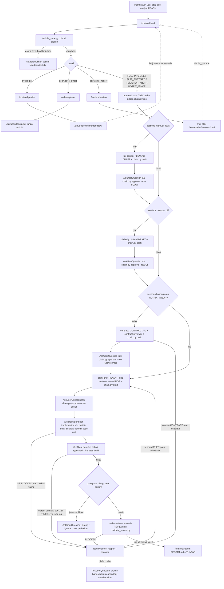
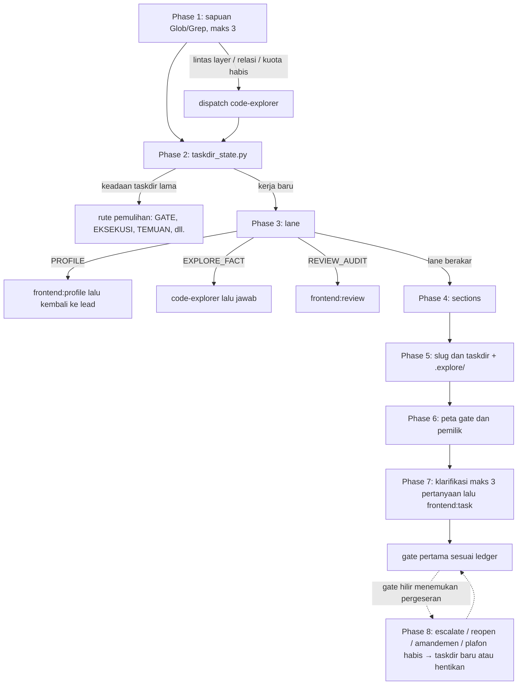
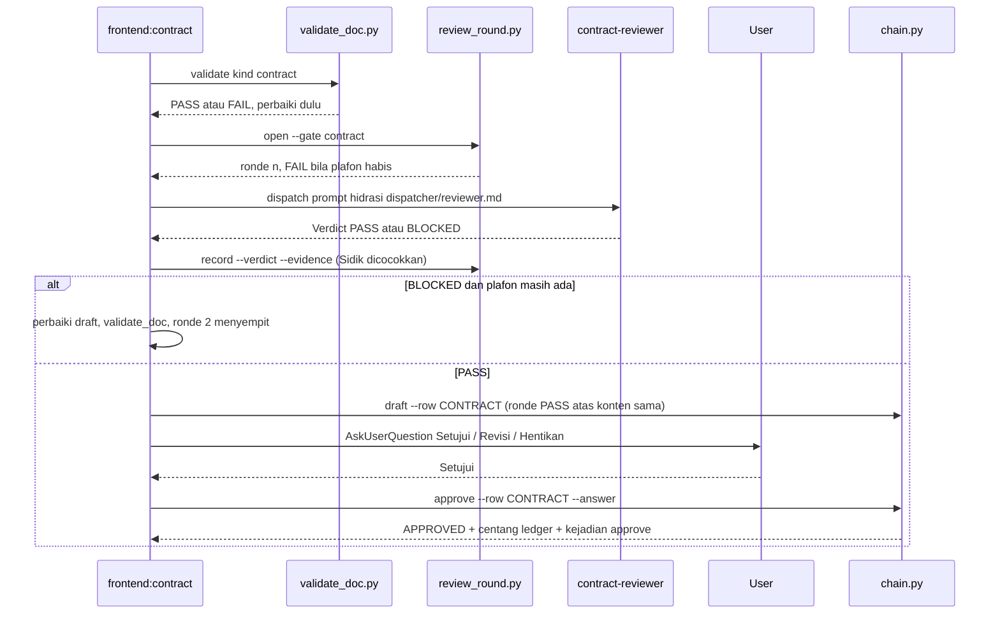
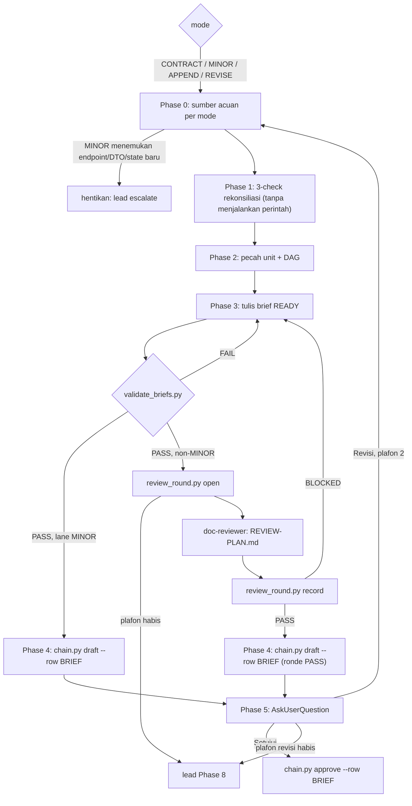
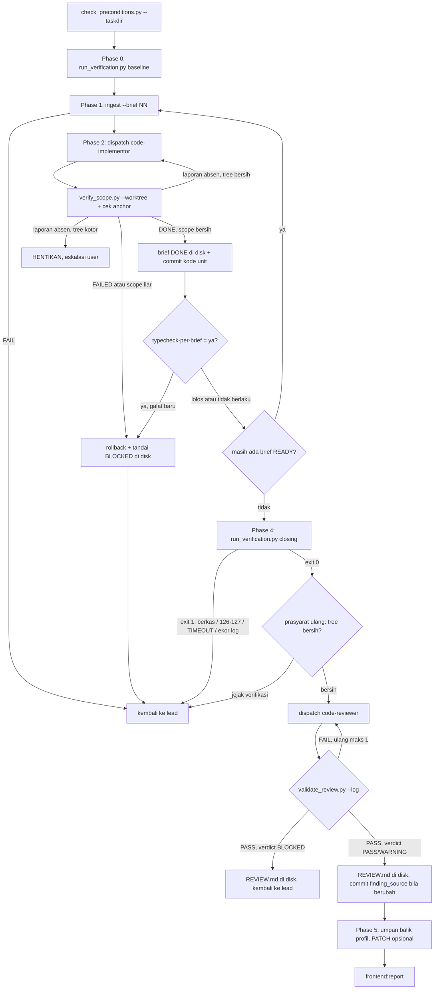
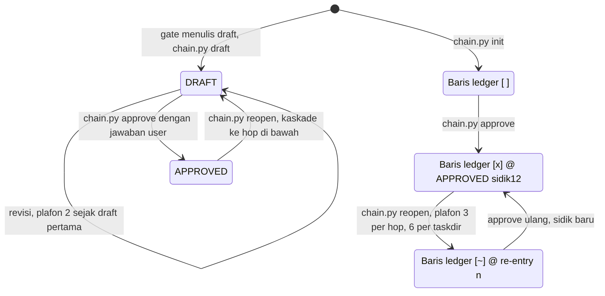
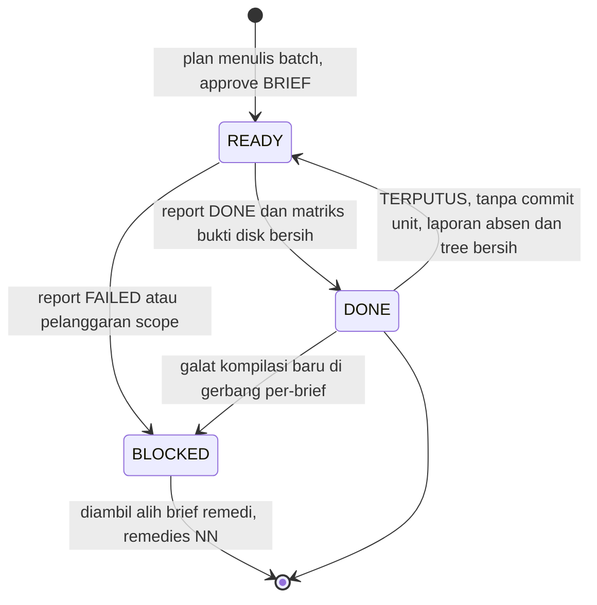
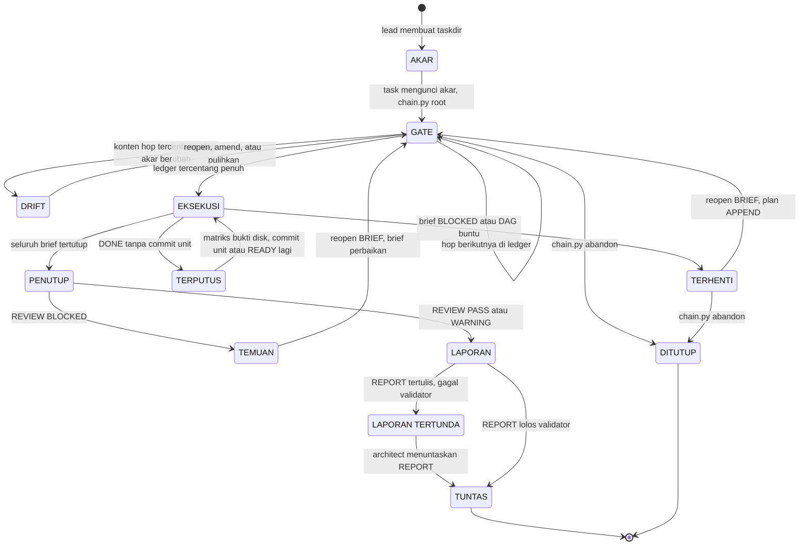

# Alur Plugin `frontend`

> Plugin `frontend` (v0.14.0, `src/plugins/frontend/.claude-plugin/plugin.json`) menangani kerja frontend di beberapa stack: React + Vite SPA, React Native/Expo, SvelteKit, dan Svelte + Vite. Next.js sengaja tidak dilayani. Isinya sepuluh skill dan lima subagent yang membawa permintaan kerja lewat rantai dokumen: akar `TASK.md` → `FLOW.md`/`UI.md` → `CONTRACT.md` → brief → eksekusi → `REVIEW.md` → `REPORT.md`. Tiap gate dikunci persetujuan user yang dimateraikan skrip `chain.py` sebagai kejadian `## Riwayat Rantai` di `TASK.md`, dan tiap hal yang dapat dicek mesin divonis validator, bukan diingat model. Dokumen taskdir (`frontenddev/docs/`) diabaikan git dan tidak pernah di-commit (Langkah 24). Yang di-commit hanya kode, laporan audit `frontenddev/reviews/`, dan profil, sedangkan cermin nataflow menjadi satu-satunya salinan dokumen taskdir di luar mesin kerja. Plugin ini dipakai di repo frontend yang terdeteksi hook `SessionStart`. Pintu masuknya selalu `/frontend:lead`. Hanya `lead`, `profile`, dan `review` yang muncul di menu `/`. Tujuh skill lainnya `user-invocable: false` dan dipanggil model lewat tool Skill (`README.md` § Ten Skills).

## Peta Komponen

| Komponen | Jenis | Peran singkat | Berkas |
|---|---|---|---|
| `frontend:lead` | skill (menu `/`) | Gerbang tiap permintaan. Memutuskan lane, sections, slug, dan taskdir, memulihkan sesi, lalu menangani eskalasi dan re-entry | `skills/lead/SKILL.md` |
| `frontend:profile` | skill (menu `/`) | Prasyarat sekali per repo. Mendeteksi stack, memindai 18 titik, mencatat baseline, dan menulis `.claude/profile/frontenddev/` | `skills/profile/SKILL.md` |
| `frontend:task` | skill | Menulis akar rantai `TASK.md` beserta ledger `## Chain`, lalu mengunci akar (`chain.py root`) | `skills/task/SKILL.md` |
| `frontend:ux-design` | skill | Gate Flow. Menulis `FLOW.md` (perjalanan layar, `DD-{n}`) | `skills/ux-design/SKILL.md` |
| `frontend:ui-design` | skill | Gate Design. Menulis `UI.md` (layout, P1–P3, enam cabang state `ST-{n}`) | `skills/ui-design/SKILL.md` |
| `frontend:contract` | skill | Gate Contract. Menulis `CONTRACT.md` (DTO, cache, layer 5-tier, `AC-{n}`) | `skills/contract/SKILL.md` |
| `frontend:plan` | skill | Gate Breakdown. Memecah kerja jadi `brief-<NN>-<unit>.md` READY dan menjalankan Plan Review | `skills/plan/SKILL.md` |
| `frontend:architect` | skill | Menjalankan brief satu per satu, verifikasi penutup, dan satu review independen | `skills/architect/SKILL.md` |
| `frontend:report` | skill | Menulis `REPORT.md`, penanda taskdir tuntas | `skills/report/SKILL.md` |
| `frontend:review` | skill (menu `/`) | Review ad-hoc di luar rantai aktif (lane `REVIEW_AUDIT`) | `skills/review/SKILL.md` |
| `code-explorer` | agent (sonnet) | Penelusur kode read-only. Mengembalikan bukti `file:baris` | `agents/code-explorer.md` |
| `contract-reviewer` | agent (sonnet) | Penilai `CONTRACT.md` read-only | `agents/contract-reviewer.md` |
| `doc-reviewer` | agent (sonnet) | Auditor batch brief lintas dokumen. Menulis `REVIEW-PLAN.md` | `agents/doc-reviewer.md` |
| `code-implementor` | agent (sonnet) | Menerapkan satu brief ke `src/` dan menulis `report-<NN>.md` | `agents/code-implementor.md` |
| `code-reviewer` | agent (opus) | Penilai independen diff rantai. Menulis `REVIEW.md` | `agents/code-reviewer.md` |
| `detect.py` | hook `SessionStart` | Mendeteksi stack dan profil, lalu menyuntik pengingat gate `frontend:lead` | `hooks/detect.py` (identik dengan milik `backend`) |
| `gate_text.py` | hook (teks) | Teks yang disuntik: aturan gate dan catatan status profil | `hooks/gate_text.py` |
| `guard_bash.py` | hook `PreToolUse` | Pagar read-only untuk `frontend:code-reviewer`; pagar tulis untuk `code-implementor`, `code-explorer`, dan `doc-reviewer` | `hooks/guard_bash.py` |
| `chain.py` | script | Satu-satunya penulis ledger, `## Riwayat Rantai`, `base_commit`, dan status `APPROVED`: `init`, `root`, `amend`, `draft`, `approve`, `reopen`, `escalate`, `abandon`, `files`, `revisions`, `verify`, `status`. Tidak pernah menjalankan git commit | `skills/_common/chain.py` |
| `review_round.py` | script | Plafon ronde reviewer dokumen (`open`, `record`, `status`, `rebuild`); ronde yang sudah diajukan dibaca dari field `review` kejadian Riwayat | `skills/_common/review_round.py` |
| `validate_doc.py` | script | Validator `FLOW.md`/`UI.md`/`CONTRACT.md`, termasuk keterlacakan dua arah di CONTRACT | `skills/_common/validate_doc.py` |
| `run_verification.py` | script | Menjalankan perintah verifikasi (mode `baseline`/`closing`) lewat `bash -o pipefail` dengan exit code, durasi, timeout, dan `head` baseline | `skills/_common/run_verification.py` |
| `verify_scope.py` | script | Vonis berkas yang berubah terhadap `files_touched` brief, dan kontrak brief terhadap `sidik_kontrak`-nya | `skills/_common/verify_scope.py` |
| `precondition_lib.py` | script (lib) | Primitif bersama semua skrip prasyarat, validator, dan `chain.py` | `skills/_common/precondition_lib.py` |
| `taskdir_state.py` | script | Memvonis keadaan tiap taskdir beserta satu rute berikutnya (pemulihan sesi) | `skills/lead/scripts/taskdir_state.py` |
| `sync_payload.py` | script | Argumen tool MCP nataflow (task, workdir, dokumen) untuk satu taskdir (isi disk) atau dokumen repo (isi `HEAD`); read-only, dua fase, ledger dibaca lewat `verify_chain_row` | `skills/_common/sync_payload.py` |
| `nataflow_sync.py` | pustaka | Config `.claude/nataflow.json`, identitas repo, isi disk atau blob `HEAD`, dan diff manifest remote. Salinan identik di keempat plugin | `skills/_common/nataflow_sync.py` |
| Prosedur sinkron nataflow | referensi | Urutan panggilan tool MCP dua fase dan tabel titik panggil | `skills/lead/references/nataflow-sync.md` |
| `check_preconditions.py` | script (×9) | Prasyarat tiap skill kecuali `lead` | `skills/<skill>/scripts/check_preconditions.py` |
| `validate_task.py` | script | Validator struktur akar `TASK.md` (`--amend` untuk amandemen) | `skills/task/scripts/validate_task.py` |
| `validate_briefs.py` | script | 16 check brief: S N D L T F B R V K O E C P G M | `skills/plan/scripts/validate_briefs.py` |
| `validate_review.py` | script | Validator `REVIEW.md`. Verdict diturunkan mekanis | `skills/architect/scripts/validate_review.py` |
| `validate_report.py` | script | Validator `REPORT.md` | `skills/report/scripts/validate_report.py` |
| `validate_audit.py` | script | Validator berkas audit `frontenddev/reviews/` | `skills/review/scripts/validate_audit.py` |
| `migrate_profile.py` | script | Memindahkan profil frontend dari lokasi lama `.claude/profile/` | `skills/profile/scripts/migrate_profile.py` |
| `docs_git.py` | script | Penanda ignore `frontenddev/docs/.gitignore`, status, dan migrasi sekali jalan dokumen taskdir yang masih ter-track. Salinan identik dengan `backend` | `skills/_common/docs_git.py` |
| Stack adapter | referensi | `react-vite`, `react-native`, `sveltekit`, `svelte-vite`, masing-masing dengan tujuh seksi tetap. Kontraknya di `_CONTRACT.md` | `skills/profile/stacks/*.md` |
| Template prompt subagent | referensi | Prompt hidrasi yang dipakai tiap gate saat mendispatch subagent | `skills/<skill>/dispatcher/*.md` |

Tujuh seksi adapter dan konsumennya (`README.md` § Stack Adapters):

| Seksi | Konsumen |
|---|---|
| `## Detection` | profile, hook |
| `## Commands` | profile, plan, architect |
| `## Layer taxonomy` | code-implementor, contract, plan |
| `## Navigation recipes` | profile, review |
| `## Review checklist` | code-reviewer, review |
| `## UI & navigation surface` | ux-design, ui-design |
| `## Failure signatures` | architect, code-reviewer, review |

## Alur Utama



Alurnya, secara ringkas:

1. **Gate tunggal.** Hook `SessionStart` mengingatkan model bahwa tiap permintaan kerja lewat `frontend:lead` dulu (`hooks/gate_text.py`). Lead tidak menyentuh `src/`. Tugasnya menyapu lokasi fitur dengan kuota ketat, memindai taskdir terbuka, memilih lane dan `sections`, lalu memprovisi taskdir `frontenddev/docs/<YYMMDDhhmm>-<slug>/`.
2. **Akar dulu.** Keempat lane yang berakar selalu mulai dari `frontend:task`, yang menulis `TASK.md` berisi `SC-{n}` terukur. `chain.py init` menulis ledger `## Chain` sesuai jadwal `sections`, lalu `chain.py root` mengunci akar: `base_commit` = `HEAD` dan kejadian `akar` di `## Riwayat Rantai`.
3. **Gate kondisional.** `flow` menjadwalkan Gate Flow, `ui` menjadwalkan Gate Design, `sections` yang tidak kosong menjadwalkan Gate Contract, dan Gate Breakdown selalu jalan. `HOTFIX_MINOR` hanya punya hop BRIEF dan tidak melewati Plan Review (`README.md` § Workflow).
4. **Pola tiap gate.** Draft `DRAFT` ditulis, lolos validator (dan ronde reviewer untuk CONTRACT/BRIEF non-MINOR), lalu dicatat `chain.py draft` sebagai kejadian Riwayat. Setelah itu gate bertanya ke user lewat `AskUserQuestion`. Kalau disetujui, `chain.py approve` menulis `APPROVED`, mencentang ledger `@ APPROVED <sidik12>`, dan mencatat kejadian `approve` yang memateraikan sidik konten (tanpa baris `status:`), ronde reviewer, sidik `SC-{n}`, dan jawaban user. Hilir menjangkarkan keutuhan pada kejadian itu; tidak ada commit dokumen. Approve PASS diikuti sinkron nataflow (`lead/references/nataflow-sync.md`), yang hasilnya masuk baris penutup gate sebagai segmen `nataflow <…>`.
5. **Eksekusi.** `architect` menjalankan brief satu per satu lewat `code-implementor`. Status unit divonis dari disk, dan lint, test, serta build hanya jalan sekali di penutup. Setelah itu `code-reviewer` menilai commit kode rantai sejak `base_commit`, lalu `report` menulis `REPORT.md`.
6. **Cacat diperbaiki di taskdir yang sama.** Perbaikan selalu lewat `chain.py reopen`/`escalate` yang diputuskan di lead Phase 8, tidak pernah dengan membuka taskdir baru.
7. **Plafon habis = rumuskan ulang.** Ronde reviewer, revisi, re-entry, dan eskalasi berplafon. Bila plafon habis, lead menanyakan user lewat `AskUserQuestion`: rumuskan ulang di taskdir baru (`chain.py abandon` taskdir lama) atau hentikan. Tidak ada jalan pintas yang me-reset plafon, termasuk amandemen akar dan `draft` ulang.
8. **Dokumen taskdir di luar git.** Prasyarat `task` (check 10) menulis penanda `frontenddev/docs/.gitignore` (berisi `*`, ikut mengabaikan dirinya sendiri). Repo yang masih men-track dokumen taskdir divonis `MIGRASI` oleh `taskdir_state.py` dan dimigrasikan sekali lewat `docs_git.py migrate` sesudah persetujuan user. Bukti `DONE` brief dan kesegaran review dibaca dari commit kode, bukan dari commit dokumen.

## Alur per Skill

### `frontend:lead`

- **Pemicu / kapan dipakai**: setiap permintaan kerja baru atau susulan di repo frontend, termasuk desain UI/UX, fitur, refaktor, bugfix, explore, review, dan melanjutkan artefak yang sudah ada. Parameternya `prompt` (wajib), `force_lane`, `target_app`, `finding_source`, `finding_ids`, dan `ticket_source`.
- **Prasyarat**:
  - Repo memakai stack yang didukung dan profil `.claude/profile/frontenddev/` ber-field `stack`. Kalau tidak ada, lead merutekan ke lane PROFILE — kecuali `EXPLORE_FACT`, yang berangkat tanpa profil (explorer terdegradasi). Satu repo punya satu profil untuk satu `target_app`/`stack` pada satu waktu.
  - Repo git dengan working tree bersih di luar `.explore/` dan `.frontenddev/`. Dokumen taskdir tidak pernah tampak kotor karena diabaikan git; repo yang masih men-track-nya keluar `FAIL MIGRASI` di `taskdir_state.py`.
  - `python3` tersedia.
  - Lead tidak punya `check_preconditions.py`. Keadaan taskdir dibaca dari `taskdir_state.py`.
- **Langkah**:
  1. **Sapuan lokasi fitur.** `Glob` nama path dari kata kunci, maksimal 3 panggilan `Glob`+`Grep`, tanpa membaca isi berkas. `code-explorer` wajib didispatch kalau kerja melintasi layer, yang dicari adalah relasi, simbol tidak ditemukan, atau kuota habis.
  2. **Pemulihan taskdir.** `taskdir_state.py` memvonis keadaan dan rute tiap taskdir (tabel di bawah). Kalau ada taskdir terbuka, user ditanya apakah melanjutkannya atau membuka yang baru.
  3. **Lane.** Pilih satu dari `PROFILE`, `FULL_PIPELINE`, `FAST_FORWARD`, `REFACTOR_ARCH`, `HOTFIX_MINOR`, `EXPLORE_FACT`, `REVIEW_AUDIT`.
  4. **Sections.** Ditentukan dari tabel lane × sections. Pasangan yang sah: `HOTFIX_MINOR` ⇔ sections kosong, `FAST_FORWARD`/`REFACTOR_ARCH` ⇔ tepat `architecture`, `FULL_PIPELINE` memuat `flow` atau `ui`.
  5. **Slug dan taskdir.** Buat `frontenddev/docs/<YYMMDDhhmm>-<slug>/` beserta `.explore/`, lalu salin laporan explorer ke `.explore/gate-<slug>.md`. Slug unik per repo; slug kembar diberi sufiks `-2`.
  6. **Gate dan pemiliknya.** Petakan checkpoint ke skill pemilik hop.
  7. **Klarifikasi dan kunci akar.** Ajukan maksimal 3 pertanyaan `AskUserQuestion`, lalu panggil `frontend:task` dengan `{ taskdir, lane, sections, request, evidence, clarification, finding_source, finding_ids, ticket_source }`.
  8. **Kanal eskalasi dan re-entry.** Jalankan `chain.py escalate`, `reopen`, `abandon`, atau `amend` (amandemen akar). Semuanya atas konfirmasi user. Plafon habis → `AskUserQuestion`: taskdir baru atau hentikan.
- **Subagent yang didispatch**: `code-explorer` (`subagent_type: frontend:code-explorer`) lewat `dispatcher/explorer.md` dengan `{laci}` kosong karena taskdir belum ada. Sebelum dispatch pertama, baris ignore diperiksa dengan `git check-ignore -q`, bukan dengan membaca `.gitignore`. Kalau hasilnya `confidence: low`, objective dipertajam lalu dispatch diulang sekali.
- **Output / artefak**: taskdir kosong beserta `.explore/`, dan satu baris handoff `LEAD — <lane> · sections … · <taskdir> · akar TASK.md @ base <sha7> · next <skill (mode)> · stack <id>`. Kalau tertahan, lead menyajikan blok `### LEAD — TERTAHAN`.
- **Gerbang & commit**:
  - Lead tidak pernah mencentang ledger dan tidak meng-commit dokumen.
  - Akar yang tertinggal (keadaan `AKAR`, `TASK.md` tertulis tetapi belum terkunci) dikunci lewat `chain.py root`. Amandemen akar lewat `chain.py amend --reason`, yang menjalankan `validate_task.py --amend` dan mencatat sidik akar baru.
  - Reopen, eskalasi, dan penutupan ditulis `chain.py` ke disk dan Riwayat.
  - Satu-satunya commit yang dijalankan lead adalah migrasi `docs_git.py migrate` (Failure path 7) sesudah persetujuan user.
- **Lanjut ke**: `frontend:profile`, `frontend:task` (lalu gate pertama), `frontend:review`, jawaban langsung (EXPLORE_FACT), atau skill pemilik hop sesuai rute pemulihan.

**Tabel lane → sections → hop ledger** (`skills/lead/SKILL.md` Phase 3–4):

| Kondisi | Lane | `sections` | Hop ledger |
|---|---|---|---|
| Fitur baru (layar + alur + API) | `FULL_PIPELINE` | `flow, ui` (+ `architecture`) | FLOW, UI, CONTRACT, BRIEF |
| Alur berubah, tampilan tetap | `FULL_PIPELINE` | `flow` | FLOW, CONTRACT, BRIEF |
| Tampilan berubah, alur tetap | `FULL_PIPELINE` | `ui` | UI, CONTRACT, BRIEF |
| Data/endpoint baru tanpa ubah UI | `FAST_FORWARD` | `architecture` | CONTRACT, BRIEF |
| Refaktor layer | `REFACTOR_ARCH` | `architecture` | CONTRACT, BRIEF |
| Perbaikan terisolasi (1 berkas, tanpa endpoint/DTO/query key/state baru) | `HOTFIX_MINOR` | kosong | BRIEF |
| Profil belum ada, tidak sah, atau di lokasi lama | `PROFILE` | tanpa taskdir | — |
| Pertanyaan faktual letak simbol | `EXPLORE_FACT` | tanpa taskdir | — |
| Penilaian kode di luar rantai aktif | `REVIEW_AUDIT` | tanpa taskdir | — |

**Keadaan taskdir (`taskdir_state.py`, urutan vonis: yang pertama cocok menang)**:

Sebelum memvonis per taskdir, skrip keluar `FAIL` bila repo bukan git, atau `FAIL MIGRASI` bila berkas `frontenddev/docs/` masih ter-track (lead Failure path 7).

| # | Keadaan | Rute |
|---|---|---|
| 1 | `RUSAK` (direktori tidak ada, nama di luar pola, artefak tanpa `TASK.md`) | Lapor ke user; direktori dipindah keluar `frontenddev/docs/` atau dihapus user (`chain.py` menolaknya). Akar dan ledger dilarang ditambal manual |
| 2 | `AKAR` (taskdir kosong) | `frontend:task` |
| 3 | `DITUTUP` (`status: ABANDONED`) | Tidak tampil di pemindaian |
| 4 | `RUSAK` (status akar selain `ACTIVE`/`ABANDONED`, atau `## Riwayat Rantai` rusak) | Lapor ke user; `AskUserQuestion`: `chain.py abandon` lalu taskdir baru (abandon tetap jalan walau Riwayat rusak), atau user memulihkan `TASK.md` |
| 5 | Akar belum terkunci (`base_commit` atau kejadian `akar` absen): `TUNTAS` bila ber-`REPORT.md` (warisan era git), `RUSAK` bila ber-centang atau ber-artefak (era git belum tuntas, hanya bisa `chain.py abandon`), selain itu `AKAR` | `AKAR`: lead menjalankan `chain.py root` (skrip menjalankan `validate_task.py` sendiri) |
| 6 | `RUSAK` (`base_commit` bukan leluhur `HEAD`, atau lane/sections tidak sah atau berubah di luar akar/eskalasi — Riwayat di-replay sejak kejadian `akar`) | Sama dengan #4 |
| 7 | `DRIFT` (sidik akar ≠ kejadian `akar`/`eskalasi`/`amandemen` terakhir: `TASK.md` disunting di luar `chain.py amend`) | Amandemen akar lewat lead (`chain.py amend`), atau kembalikan suntingan |
| 7a | `TUNTAS` (REVIEW PASS/WARNING, ledger penuh, nol brief READY, `REPORT.md` ada, dan review segar dengan laporan lolos validator atau `head` review tidak lagi di riwayat `HEAD`) — dinilai sebelum ledger, jadi squash-merge sesudah laporan tidak membuatnya `PENUTUP` | Selesai. Permintaan baru membuka taskdir baru |
| 8 | `RUSAK` (ledger ≠ jadwal sections) | Sama dengan #4 |
| 9 | `DRIFT` (konten hop `[x]` atau `SC-{n}` berubah sesudah disetujui, atau centang tanpa kejadian `approve` yang sah) | `chain.py reopen --row <ROW>` atau pulihkan isi yang disetujui |
| 10 | `GATE` (hop pertama yang belum `[x]`) | Skill pemilik hop (skrip menyebut mode untuk `plan`) |
| 10a | `TERPUTUS` (brief `DONE` di disk tanpa commit unit pembawa kode: sesi terputus di antara status dan commit, `DONE` diketik tangan, atau commit unit di-reset) | `architect` fase `TERPUTUS`: matriks bukti disk atas brief itu, tanpa dispatch |
| 11 | `TERHENTI` (brief `BLOCKED` tanpa remedi, atau `DAG`: brief READY ada tetapi tak satu pun dapat berangkat) | `reopen --row BRIEF` → `plan` APPEND brief remedi, atau perbaiki `depends_on` |
| 12 | `EKSEKUSI` (brief READY siap berangkat, `runnable_briefs`) | `frontend:architect` |
| 13 | `PENUTUP` (seluruh brief tertutup, `REVIEW.md` absen, basi — `head:` tidak sah atau commit kode mendarat sesudahnya — atau ber-verdict asing) | `architect` Phase 4 |
| 14 | `TEMUAN` (`REVIEW.md` BLOCKED) | `reopen --row BRIEF` → `plan` APPEND brief perbaikan → review ulang |
| 15 | `LAPORAN` (REVIEW PASS/WARNING, `REPORT.md` absen) | `architect` Phase 5 |
| 16 | `LAPORAN TERTUNDA` (`REPORT.md` tertulis tetapi gagal `validate_report.py`) | `architect` Phase 5 butir 4 |
| 17 | `TUNTAS` (`REPORT.md` lolos `validate_report.py`) | Selesai. Permintaan baru membuka taskdir baru |



**Pemicu Phase 8** (`skills/lead/SKILL.md` Phase 8):

| Pemicu | Tindakan |
|---|---|
| MINOR menemukan endpoint, DTO, query key, atau cabang state baru | `escalate --lane FAST_FORWARD --sections architecture` (atau `FULL_PIPELINE`). Kalau BRIEF sudah `[x]`, `reopen --row BRIEF` dulu |
| Contract menemukan alur atau layar baru | `escalate --lane FULL_PIPELINE`. Hop di bawahnya yang sudah `[x]` di-reopen dulu |
| Brief `BLOCKED` | `reopen --row BRIEF` → `plan` APPEND brief remedi (`remedies: "NN"`) |
| `REVIEW.md` BLOCKED, atau verifikasi penutup merah karena cacat eksekusi | `reopen --row BRIEF` → `plan` APPEND brief perbaikan → `architect` |
| Berkas yatim, remedi ketiga, atau DTO baru | `reopen --row CONTRACT` (kaskade membuka BRIEF). Di MINOR: `reopen BRIEF` → `escalate FAST_FORWARD` |
| `SC-{n}` berubah | Sunting SC, `chain.py amend --reason` (menjalankan `validate_task.py --amend`), lalu reopen hop tercentang teratas |
| Plafon habis (ronde, revisi, re-entry, eskalasi) | `AskUserQuestion`: rumuskan ulang di taskdir baru (`chain.py abandon` taskdir lama) atau hentikan |
| User berhenti | `chain.py abandon` → `DITUTUP` |

### `frontend:profile`

- **Pemicu / kapan dipakai**: `.claude/profile/frontenddev/` belum ada, tidak sah, tidak lengkap, atau perlu diperbarui. Bisa dipanggil lead lewat lane PROFILE (`force: true`, tanpa titik henti konfirmasi), diketik user sebagai `/frontend:profile`, atau dipanggil architect Phase 5 dengan `mode: "patch"` + `reported_drift`.
- **Prasyarat**:
  - `check_preconditions.py [--mode] [--stack] [--profile-dir]` harus 6/6.
  - Baris `Terselesaikan:` menetapkan `<stack-id>` dan mode (`GENERATE`/`REFRESH`/`MIGRATE`/`PATCH`) secara deterministik.
  - Repo di luar cakupan (Next.js, React/Svelte tanpa Vite) langsung FAIL.
- **Langkah**:
  1. **Phase 0.** Deteksi stack mengikuti urutan pemutus yang sama dengan `hooks/detect.py`, lalu baca satu adapter `stacks/<stack-id>.md`.
  2. **Phase 1.** Terapkan mode:
     - GENERATE: langsung ke Phase 2.
     - MIGRATE: jalankan `migrate_profile.py`, lalu lompat ke Phase 7.
     - REFRESH: minta konfirmasi dulu kecuali `force`. Profil ditulis ulang penuh, hanya `manual-notes.md` yang dipertahankan.
  3. **Phase P (hanya PATCH).** Normalisasi, deduplikasi, dan cek konflik baris drift, lalu susun resep `deteksi` dan tambahkan baris ke `drift.md` saja.
  4. **Phase 2.** Pindai 18 titik arsitektur (`references/scan-guide.md`): manifest, perintah, tsconfig, lima layer kanonik, surface map, state, HTTP client, token visual, test, konvensi commit, invariant, dan drift.
  5. **Phase 3.** Wawancara pola yang terbelah tanpa mayoritas, konfirmasi titik 18, lalu vonis `[MASIH HIDUP]`/`[PUNAH]` untuk baris drift lama.
  6. **Phase 4.** Eksekusi baseline nyata `typecheck`, `lint`, `test`, `build`. Status yang dicatat: `OK`, `FAIL (n errors)`, `UNVERIFIED_ENV_NOT_READY`, atau `TIMEOUT / UNVERIFIED` (lebih dari 5 menit). Keputusan `typecheck-per-brief` juga dicatat di sini.
  7. **Phase 5.** Pastikan baris berjangkar `/.frontenddev/` dan `frontenddev/docs/**/.explore/` berlaku di `.gitignore`, diputuskan dari exit code `git check-ignore`. Baris `.explore/` kini lapis cadangan, karena seluruh `frontenddev/docs/` sudah diabaikan penanda `docs_git.py`. Peringatkan user bila `frontenddev/reviews/` ikut di-ignore. Profile adalah pemilik tunggal baris itu.
  8. **Phase 6.** Tulis `index.json` + 9 berkas `.md`. Berkas yang datanya nihil tetap ditulis berisi `tidak terdeteksi`.
  9. **Phase 7.** Laporan penutupan: gap, drift, dan status baseline.
- **Subagent yang didispatch**: tidak ada.
- **Output / artefak**: `.claude/profile/frontenddev/` berisi `index.json`, `stack.md`, `structure.md`, `surface-map.md`, `invariants.md`, `commands.md`, `layer-adoption.md`, `visual.md`, `drift.md`, `manual-notes.md`. Laporan penutupnya `### FRONTEND PROFILE REPORT — …`.
- **Gerbang & commit**: satu commit atomik yang ikut membawa `.gitignore` kalau Phase 5 menulis ke sana. Subjeknya `docs: init frontend profile`, `docs: refresh frontend profile`, `docs: migrate frontend profile`, atau `docs: patch frontend profile (drift +<n>)`.
- **Lanjut ke**: `frontend:lead`, yang melanjutkan rute tertunda.

### `frontend:task`

- **Pemicu / kapan dipakai**: lead Phase 7 pada lane `FULL_PIPELINE`, `FAST_FORWARD`, `REFACTOR_ARCH`, atau `HOTFIX_MINOR`.
- **Prasyarat**:
  - `check_preconditions.py --taskdir --lane --sections [--finding-source] [--ticket-source]` harus 10/10.
  - Yang dicek: taskdir sah, profil, `TASK.md` belum ada, pasangan lane/sections sah, `finding_source` ter-commit, template tersedia, tree bersih, `ticket_source` READY dan terkunci (check 8), slug belum dipakai taskdir lain (check 9), dan dokumen taskdir di luar git (check 10). Check 10 FAIL `MIGRASI` bila `frontenddev/docs/` masih ter-track, dan bila tidak, ia menulis penanda ignore. Tanpa `.claude/nataflow.json` check 10 memberi `WARN` yang disebut ke user sekali (24 K2).
- **Langkah**:
  1. Serap framing dari lead. Petakan tiap `evidence` ke berkas nyata, lalu turunkan H1 `<Fitur> — <jenis kerja>`.
  2. Tulis `## Description` 2–4 kalimat dengan minimal satu `file:baris` nyata.
  3. Tulis `## Success Criteria` 1–7 butir berformat `- [ ] **SC-{n}**: <hasil> — verifikasi: <alat ukur>`. Alat ukur yang sah: `test`, `diff`, `typecheck`, `lint`, `build`, `QA manual:`.
     - Kalau ada `finding_source`, temuan yang kodenya sudah berubah ditandai `OBSOLETE`, dan tiap temuan tersisa dipikul tepat satu SC.
     - Kalau ada `ticket_source`, tiap `AC-{n}` kartu dirujuk sebagai `TAC-{n}` dan wajib dipikul SC atau dicatat di `## Out of Scope`.
  4. Tulis `## Out of Scope` minimal satu butir. Tulis `TASK.md` dari template, jalankan `chain.py init` untuk menulis `## Chain`, lalu `validate_task.py` dan self-test butir 5 dan 8. Terakhir, `chain.py root` mengunci akar.
- **Subagent yang didispatch**: tidak ada.
- **Output / artefak**: `TASK.md` dengan `status: ACTIVE`, `lane`, `sections`, dan ledger `[ ]`. Laporannya `### TASK ROOT LOCKED — <path> @ base <sha7> …`.
- **Gerbang & commit**: tidak ada gerbang approval dan tidak ada commit dokumen. Akar dikunci `chain.py root` (`base_commit` + kejadian `akar`). Berkas `finding_source` yang temuannya ditandai OBSOLETE di-commit tersendiri: `docs(review): tandai temuan OBSOLETE`.
- **Lanjut ke**: kembali ke `frontend:lead`, yang memberangkatkan gate pertama.

### `frontend:ux-design`

- **Pemicu / kapan dipakai**: `sections` `TASK.md` memuat `flow` (Gate Flow).
- **Prasyarat**:
  - `check_preconditions.py --taskdir` harus 9/9.
  - Akar sah dan `sections` ∋ `flow`. `FLOW.md` belum `APPROVED`.
  - Kalau ada draft `DRAFT` tertunda dari sesi lalu, skrip mengeluarkan `WARN` dan user ditanya.
- **Langkah**:
  1. **Orientasi navigasi.** Baca `surface-map.md` dan `## UI & navigation surface` adapter. Kuota sapuan 2 `Glob`+`Grep` dan 2 read ber-offset. Lewat dari itu, dispatch explorer.
  2. **Intent.** Rumuskan intent dari `SC-{n}`. Ajukan maksimal 3 pertanyaan kalau alur ambigu.
  3. **Lima dimensi.** Entry Points, Forward, Back & Cancel (dirty guard), Branches, dan Data Demands `DD-{n}`.
  4. **Opsi alur.** Tawarkan 2–3 opsi: Direct/Modal, Multi-Step/Wizard, atau Seamless In-Place. User memilih lewat `AskUserQuestion`.
  5. **Draft.** Tulis `FLOW.md` `DRAFT` dari template, jalankan `validate_doc.py --kind flow` sampai PASS, lalu `chain.py draft --row FLOW`.
  6. **Approval.** Sajikan ringkasan gerbang 3–4 kalimat beserta path `FLOW.md` (bukan tabel rute dan Data Demands), lalu tanyakan ke user: *Setujui*, *Revisi*, atau *Hentikan*.
- **Subagent yang didispatch**: `code-explorer` saat kuota habis atau relasi lintas berkas.
- **Output / artefak**: `FLOW.md` (`DRAFT` → `APPROVED`). Baris penutupnya `FLOW — APPROVED @ <sha konten> · <n> layar · <n> DD …`.
- **Gerbang & commit**:
  - Draft dan revisi dicatat `chain.py draft --row FLOW` sebagai kejadian Riwayat, tanpa commit.
  - Kalau disetujui, `chain.py approve --taskdir <t> --row FLOW --answer "<jawaban>"`.
  - Kalau direvisi, `chain.py revisions --row FLOW` menghitung plafon 2 sejak kejadian `draft` pertama, dan `chain.py draft` menegakkannya (`draft` ulang dan amandemen akar tidak me-reset). Plafon habis → lead Phase 8 (taskdir baru atau hentikan).
- **Lanjut ke**: `frontend:ui-design` kalau `sections` ∋ `ui`, selain itu `frontend:contract`.

### `frontend:ui-design`

- **Pemicu / kapan dipakai**: `sections` ∋ `ui` (Gate Design). Kalau `flow` ikut dijadwalkan, gate ini jalan sesudah hop FLOW tercentang.
- **Prasyarat**:
  - `check_preconditions.py --taskdir` harus 9/9.
  - Hop FLOW, kalau dijadwalkan, sudah `[x]` dan utuh. `UI.md` belum `APPROVED`.
- **Langkah**:
  1. **Hulu dan profil desain.** Baca `FLOW.md`, `TASK.md`, `visual.md`, dan `## UI & navigation surface` adapter. Telusuri komponen bersama dengan kuota yang sama seperti ux-design.
  2. **Orientasi design system.** Utamakan komponen yang sudah ada. Di web: responsif dan fokus keyboard. Di mobile: safe area, touch target ≥44 dp, dan keyboard avoidance.
  3. **Klarifikasi visual.** Maksimal 3 pertanyaan, masing-masing dengan pratinjau mockup ASCII.
  4. **Opsi tata letak.** Standard Card/List, Compact/Dense Table, atau Visual-Driven/Hero Metric.
  5. **Prioritas dan state.** Susun prioritas P1–P3 dan enam cabang state per layar (`ST-1..6` layar 1, `ST-7..12` layar 2, dan seterusnya): normal, loading (skeleton), kosong, error + *Coba Lagi*, idle, dan stale/mutating.
  6. **Draft.** Tulis `UI.md` `DRAFT`, jalankan `validate_doc.py --kind ui`, lalu `chain.py draft --row UI`.
  7. **Approval.** Sajikan ringkasan gerbang 3–4 kalimat beserta path `UI.md` (bukan mockup dan enam cabang per layar), lalu tanyakan ke user.
- **Subagent yang didispatch**: `code-explorer` bila perlu.
- **Output / artefak**: `UI.md` (`DRAFT` → `APPROVED`).
- **Gerbang & commit**: tanpa commit. Draft dan revisi dicatat `chain.py draft --row UI`, lalu `chain.py approve --row UI`. Plafon revisi 2.
- **Lanjut ke**: `frontend:contract`.

### `frontend:contract`

- **Pemicu / kapan dipakai**: setiap lane non-MINOR (`sections` tidak kosong), sesudah hop FLOW/UI yang dijadwalkan tercentang. Dijalankan juga saat re-entry (hop CONTRACT `[~]`).
- **Prasyarat**:
  - `check_preconditions.py --taskdir` harus 9/9.
  - Hop hulu `[x]` dan utuh. `CONTRACT.md` belum `APPROVED`.
  - Kalau ada draft tertunda, `review_round.py status --ready --gate contract` menentukan apakah draft itu boleh dicatat (`chain.py draft`).
- **Langkah**:
  1. **Serap hulu dan profil.** Baca `TASK.md`, `FLOW.md`/`UI.md`, `layer-adoption.md`, `invariants.md`, dan `## Layer taxonomy` adapter. Saat re-entry, alasan reopen dibaca dari kejadian `reopen` di `## Riwayat Rantai`, `REVIEW.md`, `.explore/closing-verification.md`, dan `## Triase` laporan unit.
  2. **Penelusuran kode.** Periksa HTTP client bersama, query key factory, dan adopsi View-Model/Controller. Kuota 2 `Glob`+`Grep` dan 2 read (≤50 baris). Lewat dari itu, dispatch explorer.
  3. **Kontrak data dan sapuan dua arah.** Tulis endpoint dan DTO. Sapuan maju memastikan tiap field response punya jalur ke `*UI`. Sapuan mundur memastikan tiap `DD`/kebutuhan UI terakomodasi. Tetapkan juga strategi cache dan invalidasi.
  4. **Layer shape 5-tier.** DTO → Service → API layer → View-Model → Controller → Presentation, dengan penamaan dari adapter.
  5. **Opsi arsitektur.** Strict 5-Layer, Colocated Controller & View-Model, atau Shared Service/Store yang sudah ada. User memilih lewat `AskUserQuestion`.
  6. **Draft dan review.** Tulis `CONTRACT.md` `DRAFT`. Tiap AC punya kolom *Sumber* berisi `SC`/`DD`/`ST`. Jalankan `validate_doc.py --kind contract` (keterlacakan dua arah), `review_round.py open`, dispatch `contract-reviewer`, lalu `review_round.py record`.
  7. **Catat dan approval.** `chain.py draft --row CONTRACT` mencatat draft beserta field `review` ronde terakhir, dan hanya lolos bila ronde itu PASS atas konten yang sama. Sajikan ringkasan gerbang 3–4 kalimat beserta path `CONTRACT.md` (bukan tabel DTO, Files Touched, dan AC), lalu tanyakan ke user dan jalankan `chain.py approve --row CONTRACT`.
- **Subagent yang didispatch**:
  - `code-explorer`.
  - `contract-reviewer`: vonis `PASS` atau `BLOCKED`, dengan `BLOCKER [MEKANIS]`/`[SEMANTIK]` dan `ADVISORY`, serta baris `- Sidik:` yang menggemakan sidik ronde dari `review_round.py open`. Maksimal 2 ronde per putaran dan 8 per taskdir; putaran baru sesudah draft PASS dicatat `chain.py draft`, sesudah reopen hop ini atau hop di atasnya, atau sesudah `escalate`. Ronde 2 menyempit ke `changed_sections`.
- **Output / artefak**: `CONTRACT.md` (`# Architecture`, `# Execution`: Files Touched, Proposed Units, AC). Balikan reviewer disimpan di `.explore/contract-review-r<n>.md`.
- **Gerbang & commit**:
  - Draft dan revisi dicatat hanya lewat `chain.py draft --row CONTRACT`, tanpa commit.
  - `chain.py approve` memvonis ulang validator dan ronde terakhir: harus PASS atas sidik konten yang sama dan tidak didahului reopen hop ini atau hop di atasnya.
  - Plafon revisi 2.
- **Lanjut ke**: `frontend:plan`, mode CONTRACT pada seri pertama atau APPEND kalau hop BRIEF `[~]`.



### `frontend:plan`

- **Pemicu / kapan dipakai**: sesudah hop CONTRACT tercentang, langsung pada lane `HOTFIX_MINOR`, atau sesudah hop BRIEF dibuka ulang. Parameter `mode` wajib diisi:
  - `CONTRACT`: seri pertama lane non-MINOR.
  - `MINOR`: seri pertama lane `HOTFIX_MINOR`.
  - `REVISE`: batch belum disetujui dan user meminta revisi.
  - `APPEND`: brief remedi, brief perbaikan, atau brief penampung berkas yatim.
- **Prasyarat**:
  - `check_preconditions.py --taskdir --mode` harus 9/9. `Terselesaikan:` menyerahkan `unit_berikutnya`, `lane`, dan `sections`.
  - Kalau batch sudah tercatat (`chain.py draft`) tapi belum disetujui, plan langsung ke Phase 5.
  - Kalau hop BRIEF `[~]` tanpa kerja baru, plan menjalankan approval ulang tanpa Plan Review.
- **Langkah**:
  1. **Sumber acuan per mode.** CONTRACT: `# Execution` `CONTRACT.md`. MINOR: `TASK.md` saja, dan penemuan endpoint, DTO, query key, atau state baru menghentikan plan untuk dieskalasi. REVISE: poin penolakan user. APPEND: `## Triase` dan `## Out of Scope / Mismatch` laporan unit, `REVIEW.md`, dan `closing-verification.md`.
  2. **Rekonsiliasi 3-check.** (a) Kecocokan repo: `CREATE`/`MODIFY` + `Anchor`, panen laci `.explore/`, dispatch explorer bila perlu. (b) Kelengkapan transitif: logic baru berpasangan test. (c) Baseline terminal: plan tidak menjalankan perintah apa pun; ia membaca status `commands.md` profil, sedangkan baseline diukur `architect` Phase 0.
  3. **Pemecahan unit dan DAG.** Unit 01 data & transport, 02 logic, 03 presentasi. Tiap brief kompilabel mandiri, dan `depends_on` hanya menunjuk nomor yang lebih kecil. Remedi tidak boleh bergantung pada unit asalnya (Check D).
  4. **Tulis brief dan Gate Plan Review.** Tulis `brief-<NN>-<unit>.md` `READY`, jalankan `validate_briefs.py [--contract]` sampai PASS. Pada lane non-MINOR, lanjutkan dengan `review_round.py open`, dispatch `doc-reviewer`, lalu `record`.
  5. **Catat batch.** `chain.py draft --row BRIEF` untuk seluruh brief baru (ditambah `REVIEW-PLAN.md` pada lane non-MINOR), tanpa commit.
  6. **Approval.** Sajikan ringkasan gerbang 3–4 kalimat beserta path brief dan `REVIEW-PLAN.md` (tabel unit baru dicetak `architect` sebelum eksekusi), tanyakan ke user, lalu `chain.py approve --row BRIEF`. Revisi (plafon 2) diulang dengan mode REVISE.
- **Subagent yang didispatch**:
  - `code-explorer` lewat `dispatcher/explorer.md` dengan `{laci}` = `<taskdir>/.explore/`.
  - `doc-reviewer` (non-MINOR): audit D1 Blast Radius, D2 Traceability, D3 Coverage & DAG, D4 Verification Baseline. Verdict `PASS` hanya kalau nol `BLOCKER`. Plafon ronde sama dengan contract.
- **Output / artefak**: `brief-<NN>-<unit>.md` dengan frontmatter `status: READY`, `stack`, `based_on`, `unit`, `total_units`, `depends_on`, `fulfills`, `covers`, `files_touched`, `verification`, dan opsional `remedies`. Plus `REVIEW-PLAN.md` (non-MINOR).
- **Gerbang & commit**:
  - Batch dicatat `chain.py draft --row BRIEF`. Lane non-MINOR yang punya brief `READY` menuntut ronde `doc-reviewer` terakhir PASS atas konten itu.
  - `chain.py approve --row BRIEF` menulis `sidik_kontrak` ke tiap brief `READY`; `verify_scope.py` memvonis kontrak brief terhadap sidik itu.
  - Brief `DONE`/`BLOCKED` tidak pernah disunting.
- **Lanjut ke**: `frontend:architect`.



### `frontend:architect`

- **Pemicu / kapan dipakai**: ledger tercentang penuh dan brief READY siap dieksekusi, atau rantai terputus di tengah (keadaan `EKSEKUSI`, `TERPUTUS`, `PENUTUP`, `LAPORAN`, `TEMUAN`, `LAPORAN TERTUNDA`).
- **Prasyarat**:
  - `check_preconditions.py --taskdir` harus 9/9.
  - Baris `Terselesaikan:` menentukan titik masuk: `fase=EKSEKUSI` → Phase 1, `TERPUTUS` (brief `DONE` tanpa commit unit; check 4 dan tree kotor `WARN`) → Phase 2 butir 2 atas `unit_berikutnya` tanpa dispatch, `PENUTUP` → Phase 4, `LAPORAN` → Phase 5 butir 2, `TEMUAN` → Phase 5 butir 1, `LAPORAN TERTUNDA` → Phase 5 butir 4. `TERHENTI (brief-NN BLOCKED)` dan `TERHENTI (DAG)` FAIL dengan rute `reopen BRIEF` → `plan` APPEND; brief BLOCKED tanpa remedi divonis sebelum `validate_briefs.py`, sehingga rutenya tidak tertutup galat validator.
  - Nilai `typecheck_per_brief` juga diambil dari baris ini.
- **Langkah**:
  1. **Phase 0.** Ambil baseline seluruh perintah `commands.md` sekali lewat `run_verification.py baseline` (Bash background) sebelum unit pertama mendarat, disimpan ke `.explore/verification-baseline.json` beserta `head`. Baseline hilang sesudah unit mendarat → ukur di worktree pada `base_commit` akar, bukan di HEAD. Sajikan tabel rantai.
  2. **Phase 1 (ingest).** Jalankan `check_preconditions.py --brief <NN>`. Check 10–13 menagih: brief READY dengan `stack` = profil, `depends_on` tertutup (`DONE` di disk ditambah commit `implement unit` pembawa kode sejak `base_commit`), `report-<NN>.md` belum ada, dan kesegaran `based_on` (hanya `WARN`).
  3. **Phase 2 (dispatch dan triase).**
     - Hidrasi `dispatcher/implementor.md` dan dispatch `code-implementor` tepat sekali.
     - Jalankan `verify_scope.py --brief <b> --worktree` dan pemeriksaan anchor (`git diff -U0`), lalu ambil tindakan dari matriks bukti disk.
     - Kalau `typecheck-per-brief = ya`, jalankan gerbang kompilasi per unit relatif baseline.
     - Unit DONE → ingest berikutnya. Unit BLOCKED → rantai berhenti.
  4. **Phase 3 (berkas yatim).** Berkas di luar union `files_touched` menghentikan rantai dan dirutekan ke kontrak.
  5. **Phase 4.**
     - Jalankan verifikasi penutup `run_verification.py closing` (`bash -o pipefail`; galat baru dihitung per kemunculan). Exit 0 berarti tidak ada merah baru, exit 1 berarti galat baru atau TIMEOUT.
     - Exit 1 diklasifikasi per perintah: galat baru menyebut berkas → cacat eksekusi atau berkas yatim; exit 126/127 → perintah profil salah (REFRESH lalu baseline ulang); `TIMEOUT` → ulang sekali dengan `--timeout` 3× lipat lalu `AskUserQuestion` (tidak ada opsi "terima"); MERAH tanpa berkas → ekor log disajikan ke user.
     - Kalau hijau, prasyarat dijalankan ulang: jejak verifikasi di tree (snapshot, coverage, `lint --fix`) disajikan ke user sebelum reviewer berangkat.
     - Tree bersih → dispatch `code-reviewer`, lalu `validate_review.py --log` (menagih `baseline_head` sebelum unit pertama dan tree bersih sesudah reviewer).
     - Kalau PASS, `REVIEW.md` tetap di disk. `finding_source` yang lolos `validate_audit.py --only-status-changed` di-commit `docs(<slug>): closing review <verdict>`.
  6. **Phase 5.**
     - Verdict BLOCKED → kembali ke lead.
     - PASS/WARNING → kumpulkan `preseden menyesatkan`. Kalau user setuju, teruskan ke `frontend:profile` mode PATCH. Lalu panggil `frontend:report`.
     - `REPORT.md` tertulis tetapi gagal validator (`LAPORAN TERTUNDA`) → butir 4: `validate_report.py`; FAIL → hapus `REPORT.md` dan panggil `report` sekali lagi.
- **Subagent yang didispatch**:
  - `code-implementor`: satu per brief, sekuensial, retry maksimal 1 hanya kalau laporan absen dan tree bersih. Balikannya `REPORT <unit>: DONE | FAILED`.
  - `code-reviewer`: sekali per penutup, dispatch ulang maksimal 1 kalau `REVIEW.md` absen atau validator FAIL. Verdict `PASS`, `WARNING`, atau `BLOCKED` diturunkan mekanis.
- **Output / artefak**:
  - Status brief `DONE`/`BLOCKED`, dan `report-<NN>.md` yang ditambahi `## Triase` oleh architect.
  - `REVIEW.md`.
  - Di `.explore/`: `verification-baseline.json`, `closing-verification.md`/`.json`, `gate-<NN>.md`, dan `verification-logs/`.
  - Baris penutup `ARCHITECT — COMPLETED …` atau blok `### ARCHITECT — BLOCKED | TERTAHAN`.
- **Gerbang & commit**:
  - Commit unit `feat(<slug>): implement unit <NN> - <nama>` membawa kode `files_touched` saja. Status brief `DONE` ditulis di disk tepat sebelumnya.
  - `BLOCKED` adalah suntingan status di disk, tanpa commit.
  - `REVIEW.md` tidak di-commit. Commit `docs(<slug>): closing review <verdict>` hanya ada bila `finding_source` berubah.
  - Staging selalu per path. Dokumen taskdir, termasuk `.explore/`, tidak pernah di-stage.
- **Lanjut ke**: `frontend:report`, atau `frontend:lead` Phase 8 kalau BLOCKED, merah, atau ada berkas yatim.

**Matriks bukti disk** (`skills/architect/references/execution-protocol.md` §3):

| `report-<NN>.md` | Disk vs `files_touched` | Tindakan |
|---|---|---|
| `DONE` | hanya `files_touched` (+ laporan) yang berubah, anchor sah | **Commit unit** (brief → `DONE` di disk, lalu commit kode) |
| `DONE` | ada berkas liar, atau hunk menyentuh simbol di luar `Anchor` | Pulihkan, tulis `## Triase`, brief → `BLOCKED`, **tandai BLOCKED** (disk) |
| `DONE` | `## Changes` menyebut berkas yang tidak berubah | Diperlakukan sebagai laporan rusak |
| `FAILED` | bersih | **Tandai BLOCKED** (disk) |
| `FAILED` | kotor di dalam `files_touched` | Architect melakukan rollback (`git restore --` untuk MODIFY, `rm --` untuk CREATE), lalu **tandai BLOCKED** (disk) |
| absen/rusak | bersih | Kegagalan dispatch. Hapus laporan rusak, ulangi maksimal sekali |
| absen/rusak | kotor | **HENTIKAN**, eskalasi ke user |



### `frontend:report`

- **Pemicu / kapan dipakai**: architect Phase 5, sesudah `REVIEW.md` lolos `validate_review.py` dan segar (`head` leluhur `HEAD`, tanpa commit kode sesudahnya) dengan verdict PASS/WARNING, dan seluruh brief tertutup.
- **Prasyarat**:
  - `check_preconditions.py --taskdir` harus 8/8. `Terselesaikan:` menyerahkan `akar`, `slug`, dan `berkas_rantai`.
  - Skrip FAIL kalau `REVIEW.md` basi, verdict BLOCKED, ledger belum penuh, `REPORT.md` sudah ada, atau tree kotor.
- **Langkah**:
  1. Serap H1 `TASK.md`. Salin vonis tiap `SC-{n}` aktif dari `## Cakupan Success Criteria` `REVIEW.md`, catat temuan `PLANNED`/`DEFERRED`, dan ambil `## Triase` tiap laporan unit.
  2. Turunkan `## Perubahan` (1–7 butir) hanya dari berkas rantai (`chain.py files`), dikelompokkan per layar, unit, atau modul.
  3. Tulis `## Ringkasan` satu kalimat. `## Catatan` hanya berisi SC manual, temuan yang belum tuntas, dan penyimpangan triase. Hapus heading itu kalau ketiganya kosong.
  4. Tulis `REPORT.md` dan jalankan `validate_report.py` (maksimal 2 putaran perbaikan). Tanpa commit.
- **Subagent yang didispatch**: tidak ada.
- **Output / artefak**: `REPORT.md`, penanda keadaan `TUNTAS`. Laporannya `### REPORT LOCKED — … · terbit · … · SC <n> terbukti / <n> manual / <n> belum`.
- **Gerbang & commit**: tanpa commit. `REPORT.md` yang lolos `validate_report.py` menandai `TUNTAS` dan dicerminkan ke nataflow. Yang tertulis tetapi gagal validator divonis `LAPORAN TERTUNDA` dan diselesaikan architect Phase 5 butir 4.
- **Lanjut ke**: kembali ke `frontend:architect`, lalu `frontend:lead`. Keputusan push, PR, dan merge tetap milik user.

### `frontend:review`

- **Pemicu / kapan dipakai**: lane `REVIEW_AUDIT` atau `/frontend:review`. Menilai kode di luar rantai aktif, dengan `target` berupa `diff` (rentang commit, default `HEAD~1..HEAD`), `path`, atau `taskdir` yang sudah tuntas. Review penutup taskdir aktif bukan milik skill ini, melainkan milik architect.
- **Prasyarat**: `check_preconditions.py --target … [--range|--path|--taskdir] [--write]` harus PASS. Taskdir yang belum tuntas ditolak.
- **Langkah**:
  1. Tetapkan lingkup: `git diff --name-only`, isi `path`, atau `chain.py files` untuk taskdir. Baca profil, lalu `## Review checklist` dan `## Failure signatures` adapter.
  2. Kalau `run_verification: true`, jalankan verifikasi opsional. Galat baru jadi temuan P1 dimensi 9.
  3. Nilai sembilan dimensi (`references/nine-dimensions-catalog.md`): Layer Boundaries, Data Flow & DTO, API Layer, State Scope, UI & 6-State, Platform Boundary, Error Handling, Performance & Leaks, Test Quality.
  4. Triase P1/P2/P3. Verdict `BLOCKED` ⇔ P1 > 0, `WARNING` ⇔ P2 > 0.
  5. Laporkan lewat chat, atau dengan `write: true` tulis `frontenddev/reviews/<YYMMDDhhmm>-<slug>.md`, jalankan `validate_audit.py`, lalu commit.
- **Subagent yang didispatch**: tidak ada.
- **Output / artefak**: laporan chat atau berkas audit dengan temuan `P{n}-{m}` ber-`> Status: PLANNED`.
- **Gerbang & commit**: commit `docs(review): audit <slug>`, hanya kalau `write`.
- **Lanjut ke**: temuan P1/P2 diajukan lewat `frontend:lead` dengan `finding_source <path>`, yang membuka taskdir perbaikan baru.

## Subagent

| Agent | Dipanggil oleh | Tools | Input | Output/vonis | Larangan |
|---|---|---|---|---|---|
| `code-explorer` | `lead`, `ux-design`, `ui-design`, `contract`, `plan` (via `dispatcher/explorer.md`) | Read, Grep, Glob, Write · sonnet | `Objective` spesifik, konteks, batas cakupan, slug, `Laci`, `Kedalaman`, blok `Format laporan` | Bentuk A: ringkasan 400–900 token dengan `confidence`. Bentuk B: artefak di `<taskdir>/.explore/<slug>.md` atau `.frontenddev/explore/` | Edit `src/`/`frontenddev/docs/`, merancang solusi, git, bertanya ke user, membaca adapter, membaca berkas utuh >100 baris |
| `contract-reviewer` | `contract` (via `dispatcher/reviewer.md`) | Read, Grep, Glob · sonnet | `taskdir`, `sections`, `stack`, `adapter_path`, `contract_template`, `round`, `sidik` (+ `previous_verdict`, `changed_sections` di ronde 2) | `## Contract Review`: `PASS`/`BLOCKED`, `- Sidik:`, BLOCKER `[MEKANIS]`/`[SEMANTIK]`, ADVISORY | Mengedit berkas, menulis `APPROVED`, merancang ulang, bertanya ke user, menghitung ulang predikat `validate_doc.py` |
| `doc-reviewer` | `plan`, lane non-MINOR (via `dispatcher/reviewer.md`) | Read, Grep, Glob, Write · sonnet | `taskdir`, `round`, `sections`, `profile_path`, `brief_berubah`, `previous_report`, blok `Format artefak` dan `Format balikan` | `REVIEW-PLAN.md` (D1–D4, temuan `RP-nn`, pemilik revisi, `sidik:` ronde) + payload 300–700 token. `PASS` ⇔ nol BLOCKER | Menulis selain `REVIEW-PLAN.md` (dipagar hook), mengedit dokumen planning dan `src/`, git, bertanya ke user, menghitung ulang 16 check `validate_briefs.py`, membaca adapter |
| `code-implementor` | `architect` (via `dispatcher/implementor.md`), satu per brief | Read, Grep, Glob, Edit, Write · sonnet (tanpa Bash) | `taskdir`, `unit_name`, `brief_path`, `report_path`, `adapter_path`, blok `Format laporan` | `report-<NN>.md` (`DONE`/`FAILED`) + satu baris `REPORT <unit>: …` | Menyentuh di luar `files_touched`/`Anchor` (tulisan di luar repo, `.git/`, atau path ter-ignore ditolak hook, kecuali `report-NN.md` taskdir-nya), terminal apa pun, commit, menyunting frontmatter brief, `@ts-ignore`/`eslint-disable`, mengubah config, bertanya ke user |
| `code-reviewer` | `architect` Phase 4 (via `dispatcher/reviewer.md`), sekali per penutup | Read, Grep, Glob, Bash, Write, Edit · opus (dipagar `guard_bash.py`) | `taskdir`, `base` (`base_commit` akar), `head` (`HEAD` yang dinilai), `verification_log`, `template`, `adapter_path`, `chain_py`, `finding_source` | `REVIEW.md` (9 dimensi, cakupan SC/AC, Done Criteria DITUNDA, umpan balik profil) + amplop ≤10 baris. `BLOCKED` ⇔ P1 atau SC belum terbukti atau verifikasi merah | Mengedit `src/`, build/test, commit, bertanya ke user. Bash hanya git baca (tanpa `git grep`), `ls`, dan `chain.py files` plugin ini |

Penulis dan penilai selalu berada di context terpisah. Sebabnya, penilai yang berbagi context dengan penulisnya akan menilai ingatannya sendiri, bukan dokumen di disk (`README.md` § Five Subagents). Tiap subagent dipanggil langsung lewat template `skills/<skill>/dispatcher/*.md`, tanpa skill pembungkus. Kalau prompt masih memuat slot `{...}` mentah, dispatch dibatalkan.

## Hooks & Guard

**`SessionStart` → `hooks/detect.py --plugin frontend`** (matcher `startup|resume|clear|compact`, timeout 5 detik):

- Menyuntik blok `<frontend-lead-gate>` sekali per sesi lewat `additionalContext`. Isinya:
  - stack yang terdeteksi dan kandidat lain di monorepo;
  - catatan status profil: lengkap, `ABSENT`/`OTHER_OWNER` (GENERATE; `EXPLORE_FACT` tetap berangkat tanpa profil), lokasi lama (MIGRATE), JSON rusak, `stack` tidak sah, field `plugin` asing, atau berkas hilang (REFRESH);
  - aturan `RULES`: `frontend:lead` jalan lebih dulu untuk tiap permintaan kerja, termasuk susulan kecil.
- Gate boleh dilewati hanya untuk empat hal (`hooks/gate_text.py`): jawaban yang memasok informasi ke rute yang sudah diputuskan, pertanyaan pengetahuan umum, operasi VCS atas kerja yang sudah selesai, dan alur `/analyst:*`, `/product:*`, `/quickdev:*`, atau `/nataflow:*` yang dipanggil eksplisit.
- Hook hanya menyala kalau profil frontend ada, atau manifest (root, workspace, `apps/*`, `packages/*`, `services/*`, anak langsung root, maksimal 200 kandidat) memuat penanda stack yang didukung. Next.js, CRA, dan React/Svelte tanpa Vite membuat hook diam.
- **Opt-out** lewat berkas `.claude/workflow` yang berisi daftar plugin yang boleh menggerbangi repo, dipisah spasi, koma, atau baris. Kalau nama plugin ini tidak ada di dalamnya (termasuk berkas kosong), hook diam (`detect.py` `opted_out`).
- **Root multi-repo** (21 F1): bila cwd bukan repo git dan punya ≥ 2 anak langsung ber-`.git` (mis. `wms/api`, `wms/frontend`), hook tidak menggerbangi. Bloknya hanya menyebut repo frontend di antara anak itu (dari profil atau manifest) beserta `/fullstack:explore`, karena skrip prasyarat skill frontend butuh repo git. Sejak 23 L5 penunjuk itu mencakup semua pemahaman kode repo anak dari root (peta, alur di dalam satu repo, jahitan lintas repo) dan menyebut bahwa subagent `Explore`/`general-purpose` bawaan tidak dipakai. Root tanpa anak frontend diam. Root multi-proyek (`company/<proyek>/<repo>`) di luar jangkauan deteksi dan tetap diam.
- `detect.py` identik byte-per-byte dengan milik `backend` dan diimpor skrip prasyarat lewat `precondition_lib.py`, sehingga vonis hook sama dengan vonis skrip.

**`PreToolUse` → `hooks/guard_bash.py hook`** (matcher `Bash|Edit|Write`, timeout 10 detik):

- Berlaku untuk `agent_type` `frontend:code-reviewer`, `frontend:code-implementor`, `frontend:code-explorer`, dan `frontend:doc-reviewer`. Main loop dan agent lain lolos tanpa keputusan.
- Allowlist `code-reviewer`:
  - **Bash**: git baca (`status`, `diff`, `log`, `show`, `rev-parse`, `ls-files`, `merge-base`, `blame`, dan `symbolic-ref` bentuk baca) tanpa `--output`/`--ext-diff`/`-O`, lalu `ls` dan `python3 <plugin ini>/skills/_common/chain.py files`. `git grep` keluar dari allowlist (pakai tool Grep). Opsi global git selain `--no-pager`, rantai perintah, pipe, pengalihan, substitusi/ekspansi, dan glob sebelum `--` ditolak.
  - **Write**: hanya `frontenddev/docs/<taskdir>/REVIEW.md`.
  - **Edit**: `REVIEW.md` yang sama dan `frontenddev/reviews/*.md` (baris `> Status:`).
- Hook ini fail-closed: galat internal pun menolak dengan exit 2.
- Penulis lain hanya dipagar Edit/Write: `code-explorer` hanya laci `.explore/`/`.frontenddev/explore/`, `doc-reviewer` hanya `REVIEW-PLAN.md`, `code-implementor` ditolak di luar repo, di `.git/`, atau pada path ter-ignore, kecuali `frontenddev/docs/<taskdir>/report-NN.md` (24 K13). Scope `files_touched` implementor tetap divonis `verify_scope.py` sesudah unit mendarat (lease ala backend sengaja tidak dibawa).

**Penjaga mekanis lain**, dijalankan skill, bukan hook:

- `check_preconditions.py` di tiap skill jalan sebelum Phase 0.
- `chain.py` menegakkan keutuhan konten yang disetujui, berjangkar pada kejadian `approve` hop itu di `## Riwayat Rantai` (sidik ledger = `sidik` kejadian): isi dokumen sekarang harus identik, kecuali baris `status:` (dan `sidik_kontrak` brief). Centang tanpa kejadian `approve` → DRIFT, remedi reopen + approve ulang. Sidik akar menangkap suntingan `TASK.md` di luar `chain.py amend`/`escalate`, dan Riwayat yang tak terurai atau bernomor loncat membuat semua gerbang FAIL.
- `review_round.py` menjaga plafon ronde reviewer (epoch = reopen hop ini atau hop di atasnya + `escalate`, dibaca dari Riwayat) dan mencocokkan sidik yang digemakan reviewer. `chain.py draft` CONTRACT/BRIEF non-MINOR hanya lolos bila ronde terakhir PASS atas konten itu.
- Validator `validate_doc.py`, `validate_task.py`, `validate_briefs.py`, `validate_review.py`, `validate_report.py`, dan `validate_audit.py` menagih struktur dan keterlacakan.

## Artefak & Siklus Status

```
.claude/profile/frontenddev/      profil repo (frontend:profile): index.json + 9 .md
.frontenddev/explore/             laci explorer sebelum taskdir lahir (gitignored)
frontenddev/
  docs/                           seluruhnya diabaikan git (Langkah 24)
    .gitignore                    penanda berisi * tulisan docs_git.py, ikut mengabaikan dirinya
    <YYMMDDhhmm>-<slug>/          taskdir
      TASK.md        akar + ledger ## Chain + ## Riwayat Rantai → task, chain.py (ACTIVE | ABANDONED)
      FLOW.md        perjalanan layar, DD-{n}      → ux-design           (DRAFT → APPROVED)
      UI.md          bentuk layar, ST-{n}          → ui-design           (DRAFT → APPROVED)
      CONTRACT.md    kontrak data + layer, AC-{n}  → contract            (DRAFT → APPROVED)
      brief-<NN>-<unit>.md  scope satu unit        → plan                (READY → DONE | BLOCKED)
      REVIEW-PLAN.md audit dokumen planning        → doc-reviewer
      report-<NN>.md laporan unit (+ ## Triase)    → code-implementor (+ architect)
      REVIEW.md      review penutup, base + head   → code-reviewer
      REPORT.md      laporan hasil, tanda tuntas   → report
      .explore/      scratch: gate-<slug>.md, <slug>.md (explorer),
                     contract/plan-review-state.json (+ .bak), contract-review-r<n>.md,
                     verification-baseline.json, closing-verification.md/.json,
                     gate-<NN>.md, verification-logs/
                     (baris .gitignore akar frontenddev/docs/**/.explore/ kini lapis cadangan)
  reviews/<YYMMDDhhmm>-<slug>.md  temuan review ad-hoc → calon finding_source (ter-commit)
```

Setiap dokumen membawa `based_on: <sha> (<tanggal>)` dan `stack: <stack-id>`. Brief yang lahir untuk satu stack tidak dieksekusi di profil stack lain: ingest `architect` check 10 menolaknya (`README.md` § Artifacts).

**Keterlacakan ID dari akar sampai laporan** (`README.md` § Success Criteria, End to End):

```
TASK.md SC-n ──► CONTRACT.md AC (kolom Sumber)        validate_doc.py  — tiap SC/DD/ST dipikul AC
             ──► brief fulfills: [SC-n], covers: [AC-n]  validate_briefs  — Check G
             ──► REVIEW.md ## Cakupan Success Criteria validate_review  — satu "belum terbukti" ⇒ BLOCKED
             ──► REPORT.md ## Catatan                  validate_report  — tiap SC manual tercatat
FLOW.md DD-n / UI.md ST-n ──► CONTRACT.md AC-n
TICKET.md AC-n (analyst) ──► TAC-n di SC-n atau ## Out of Scope TASK.md
```

**Siklus status dokumen gate (FLOW/UI/CONTRACT) dan baris ledger:**



**Siklus status brief** (`execution-protocol.md` §6):



Brief `BLOCKED` tidak pernah dinaikkan lagi, dan brief `DONE`/`BLOCKED` tidak pernah disunting — kecuali `DONE` yang tak pernah mendarat (fase `TERPUTUS`, 25 R6). Cacat pada unit `DONE` diambil alih brief perbaikan tanpa `remedies`.

**Siklus keadaan taskdir** (`taskdir_state.py`):



**Kejadian rantai** (`## Riwayat Rantai`, seksi terakhir `TASK.md`, hanya ditulis `chain.py`). Satu baris bernomor urut per kejadian: `- <n> · <jenis>[ <ROW>] · <field nilai> · … · waktu <ISO Z>[ · persetujuan:|alasan: <teks bebas satu baris>]`. Kejadian ini menggantikan subjek, badan, dan trailer commit dokumen sejak Langkah 24:

| Kejadian | Ditulis | Field |
|---|---|---|
| `akar` | `chain.py root` (`task`, atau lead di keadaan `AKAR`) | `base` (sha7 `base_commit`), `lane`, `sections`, `akar` (sidik akar) |
| `draft <ROW>` | `chain.py draft` (gate pemilik hop) | `sidik` konten (12 hex), `review <gate> r<n> t<total> PASS <sidik12>` untuk CONTRACT/BRIEF non-MINOR |
| `approve <ROW>` | `chain.py approve` | `sidik` konten (40 hex), `review`, `sc` (sidik `SC-{n}`); BRIEF juga `brief` dan `berkas` (status + sidik tiap brief); `persetujuan:` jawaban user |
| `reopen <ROW …>` | `chain.py reopen` | `target`, `berkas` (status + sidik tiap brief saat itu); `alasan:` |
| `eskalasi` | `chain.py escalate` | `lane A → B`, `sections A → B`, `akar` (sidik akar baru); `alasan:` |
| `amandemen` | `chain.py amend` | `akar` (sidik akar baru); `alasan:` |
| `abandon` | `chain.py abandon` | `alasan:` |

Plafon (reopen 3 per hop dan 6 per taskdir, eskalasi 2, revisi 2), epoch ronde reviewer, urutan Check M `validate_briefs.py`, dan replay lane/sections dibaca dari kejadian ini.

**Commit rantai** (README § Commits). Yang di-commit hanya kode dan dokumen tingkat repo, selalu dengan path eksplisit, tanpa `git add .`/`-A`, `commit -a`, `--no-verify`, push, atau pindah branch. Subjek commit kode rantai memuat `(<slug>)`, dan `chain.py files`, bukti `DONE`, serta ingest mengenali commit rantai dari situ:

| Titik | Subjek | Pemilik |
|---|---|---|
| Unit | `feat(<slug>): implement unit <NN> - <nama>` (kode `files_touched` saja) | `architect` |
| Review penutup | `docs(<slug>): closing review <verdict>` (hanya bila `finding_source` berubah) | `architect` |
| Temuan asal `OBSOLETE` | `docs(review): tandai temuan OBSOLETE` | `task` |
| Audit ad-hoc | `docs(review): audit <slug>` | `review` |
| Profil | `docs: init/refresh/migrate frontend profile` · `docs: patch frontend profile (drift +<n>)` | `profile` |
| Migrasi sekali jalan | `chore: lepas frontenddev/docs dari git` | `docs_git.py migrate` (lead Failure path 7) |

## Handoff Lintas Plugin

- **Cermin nataflow (opsional).** Satu taskdir = satu workdir `frontenddev:<repo>:<path taskdir>`. Taskdir bertiket menempel ke task tiket analyst (metadata `ticket_key` = direktori `ticket_source`), sehingga taskdir frontend dan backend dari satu tiket bernaung di satu task. Isi dokumen taskdir dibaca dari disk (metadata `commit` kosong, `head` = `HEAD` saat sinkron): `TASK.md` berakar terkunci; `FLOW.md`/`UI.md`/`CONTRACT.md` bila baris ledger-nya `[x]` dan tidak DRIFT; brief dan `REVIEW-PLAN.md` sesudah hop BRIEF disetujui (atau brief `DONE`/`BLOCKED`); `report-NN.md`, `REVIEW.md`, dan `REPORT.md`. Hop yang dibuka ulang tercermin dengan status terbarunya; hop DRIFT tidak didorong ulang. Berkas yang hilang dari disk tidak didorong dan dibiarkan dengan isi terakhirnya di server (24 G5). Tanpa config, dokumen taskdir hanya ada di disk ini (24 K2). Status workdir dari `taskdir_state.py` (`TUNTAS` → `done`, `DITUTUP` → `abandoned`, `TERHENTI`/`TEMUAN` → `blocked`). `frontenddev/reviews/` dan profil (ter-commit, isi `HEAD`) didorong ke workspace; yang dihapus dari git ditandai `removed: true`. Config `.claude/nataflow.json` dibaca bersama keempat plugin.

- **Dari `analyst` (tiket).**
  - Tiket READY diserahkan ke `/frontend:lead` lewat parameter `ticket_source` = `analyst/tickets/<YYMMDDhhmm>-<slug>/TICKET.md`. Parameter ini tidak boleh disimpulkan dari isi prompt. Kalau user menempel sesuatu yang mirip kartu tiket tanpa path, lead menanyakan path-nya.
  - Kalau terisi, `prompt` diisi kartu tiket apa adanya (H1 sampai akhir `## Lampiran`).
  - Prasyarat `task` check 8 (`ticket_source_verdict` di `precondition_lib.py`) menuntut tiket `status: READY` dan `elicitation: CLOSED`, serta terkunci. Tiket bersegel dicek lewat `approved_seal` yang cocok dengan isi. Tiket lama dicek dari commit terakhir bersubjek `docs(ticket): kunci TICKET <slug> READY` atau `docs(ticket): ref TICKET <slug>`. Suntingan sesudah kunci = DRIFT, dan tiket dikembalikan ke `analyst:spec`.
  - `AC-{n}`/`BR-{n}` kartu dirujuk sebagai `TAC-{n}`/`TBR-{n}` supaya tidak bertabrakan dengan `AC-{n}` CONTRACT. Tiap `TAC-{n}` wajib dipikul `SC-{n}` atau dicatat di `## Out of Scope` (misalnya "porsi backend"). `validate_task.py` check 7 menagihnya. `code-reviewer` tidak menerima test yang hanya menyebut `TAC-3` sebagai bukti `AC-3`.
  - Tiket `type: TECH` (kartu teknis lead engineer) berangkat dari lane `REFACTOR_ARCH`, atau `FAST_FORWARD` bila kartu menuntut endpoint, DTO, atau query key baru. `D-{n}`/`C-{n}` dirujuk `TD-{n}`/`TC-{n}` dan dihitung disepakati; tiap `TC-{n}` dijaga SC atau dinyatakan di `## Out of Scope`.
- **Dengan `backend`.**
  - `hooks/detect.py` dan `verify_scope.py` identik dengan milik backend.
  - Di repo fullstack, kedua hook menyala dan masing-masing menyuntik bloknya sendiri.
  - Profil backend di `.claude/profile/index.json` lama tidak pernah dibaca atau ditimpa. Profil frontend tinggal di `.claude/profile/frontenddev/`.
  - Backend yang dipanggil kontrak ini dikerjakan lewat plugin `backend` (`README.md` § Boundaries). TAC yang merupakan porsi backend dicatat di Out of Scope.
- **Dengan `quickdev` dan `analyst` (alur eksplisit).** Permintaan `/analyst:*`, `/product:*`, `/quickdev:*`, `/nataflow:*`, atau susulan di tengah skill mereka dikecualikan dari gate `frontend:lead`. Isi `.claude/workflow` menentukan plugin mana yang boleh menggerbangi repo. Contohnya, isi `quickdev` saja membuat hook `frontend` dan `backend` diam.
- **Batas dengan skill lain** (`README.md` § Boundaries With Other Skills):
  - UI dari nol tanpa codebase acuan → `frontend-design`.
  - Bug korektness, keamanan, atau efisiensi pada diff → `/code-review`.
  - Konvensi repo di luar rantai aktif → `frontend:review`.
  - Next.js → di luar cakupan.

## Titik Gagal & Pemulihan

| Kondisi | Penegak | Pemulihan |
|---|---|---|
| Profil tidak ada, tidak sah, tidak lengkap, atau di lokasi lama | hook + skrip prasyarat | Lead merutekan PROFILE (GENERATE/REFRESH/MIGRATE) lalu melanjutkan rute tertunda; `EXPLORE_FACT` berangkat tanpa profil |
| Stack tidak didukung (Next.js, CRA, React/Svelte tanpa Vite) | `detect.py`, prasyarat profile | Berhenti. Tidak ada taskdir atau profil yang dibuat |
| Working tree kotor, detached HEAD, rebase berhenti | prasyarat semua skill | User commit, stash, atau kembali ke branch sendiri. Plugin tidak pernah men-stash |
| Berkas `frontenddev/docs/` masih ter-track (repo era git) | `taskdir_state.py` (`FAIL MIGRASI`), prasyarat `task` check 10, `chain.py root` | lead Failure path 7: `docs_git.py status`, `AskUserQuestion`, lalu `docs_git.py migrate --answer -` (ditambah `--terima-terbuka` bila user menerima taskdir era git yang masih terbuka tidak dilanjutkan). Commit migrasi hanya berisi penghapusan dari index; berkas tetap di disk |
| Taskdir era git yang belum tuntas (tanpa `base_commit`, ber-centang atau ber-artefak) | `taskdir_state.py` `RUSAK` | `chain.py abandon` lalu taskdir baru. Taskdir era git ber-`REPORT.md` divonis `TUNTAS` (warisan) |
| Akar `TASK.md` disunting di luar `chain.py amend`/`escalate` (sidik akar berubah) | check akar tiap gate, `taskdir_state.py` `DRIFT`, mutasi `chain.py` | `chain.py amend --reason` atas persetujuan user, atau kembalikan suntingannya |
| `## Riwayat Rantai` rusak (baris tak terurai, nomor loncat, field ganda) atau `base_commit` bukan leluhur `HEAD` | semua gerbang, `taskdir_state.py` `RUSAK` | `chain.py abandon` (tetap jalan walau Riwayat rusak) lalu taskdir baru, atau user memulihkan `TASK.md`. Dilarang menambal Riwayat dengan tangan |
| Draft tertunda dari sesi lalu (dokumen `DRAFT` di disk belum tercatat `chain.py draft`) | prasyarat gate (`WARN`) | Catat lewat `chain.py draft` kalau sah. Untuk contract dan plan, hanya kalau `review_round.py status --ready` |
| Taskdir `RUSAK` | `taskdir_state.py` | Lapor ke user. Berakar → `chain.py abandon` lalu taskdir baru, atau user memulihkan `TASK.md`; tak berakar → direktori dipindah/dihapus user. Dilarang menambal akar atau ledger dengan tangan |
| `DRIFT` (dokumen tersetujui atau `SC` diubah) | `chain.py verify`, prasyarat hilir | `chain.py reopen --row <ROW>`, atau pulihkan isi yang disetujui |
| Validator FAIL (`validate_doc`, `validate_briefs`, `validate_task`, `validate_report`) | skrip | Perbaiki dokumen lalu ulangi. Tidak ada `draft` atau approval sebelum PASS |
| Revisi user melewati 2 | `chain.py revisions` | Gate berhenti, lalu lead Phase 8: `AskUserQuestion` taskdir baru (`abandon` yang lama) atau hentikan |
| Ronde reviewer melewati 2 per putaran atau 8 per taskdir | `review_round.py open` | Sajikan BLOCKER tanpa mencatat draft, lalu lead Phase 8: taskdir baru atau hentikan |
| State ronde rusak atau hilang | `review_round.py` | Pulihkan dari `.bak`, atau `rebuild` dari field `review` kejadian Riwayat. Dilarang menulis state dengan tangan |
| Plan MINOR menemukan endpoint, DTO, query key, atau state baru | `plan` Phase 0 | Lead `escalate --lane FAST_FORWARD` (atau FULL_PIPELINE) |
| Unit `BLOCKED` | matriks bukti disk | `reopen --row BRIEF`, lalu `plan` APPEND brief remedi (`remedies: "NN"`) |
| Brief `DONE` di disk tanpa commit unit pembawa kode (sesi terputus, `DONE` diketik tangan, atau commit unit di-reset) | `taskdir_state.py` `TERPUTUS`, architect check 4 `WARN` (`done_landed`) | Architect fase `TERPUTUS`, matriks bukti disk tanpa dispatch: laporan `DONE` + hanya `files_touched` → commit unit; laporan absen/rusak + tree bersih → status kembali `READY` lalu dispatch; berkas di luar `files_touched` atau laporan `FAILED` → HENTIKAN, eskalasi ke user |
| Rantai buntu (`TERHENTI (DAG)`: brief READY tak satu pun dapat berangkat) | `taskdir_state.py`, architect check 4, `validate_briefs.py` Check D | `reopen --row BRIEF`, lalu `plan` APPEND memperbaiki `depends_on` |
| Remedi ketiga atas unit yang sama | `validate_briefs.py` Check M | `reopen --row CONTRACT`. Di MINOR: `reopen BRIEF` lalu `escalate FAST_FORWARD` |
| Berkas yatim (di luar union `files_touched`) | architect Phase 3, `code-reviewer` P1 | `reopen --row CONTRACT`, lalu contract melengkapi Files Touched, lalu `plan` APPEND |
| Laporan unit absen dan tree bersih | matriks | Hapus laporan rusak, dispatch ulang maksimal sekali |
| Laporan unit absen dan tree kotor | matriks | HENTIKAN, tampilkan berkas kotor, eskalasi ke user |
| Galat kompilasi baru per brief | gerbang typecheck (§5) | Unit ditandai `BLOCKED` secara retroaktif, kode tetap di tree, lalu brief remedi |
| Verifikasi penutup merah atau `TIMEOUT` (default 300 detik) | `run_verification.py` exit 1 | Reviewer tidak didispatch. Galat di berkas dalam union: cacat eksekusi, lewat `reopen BRIEF` lalu brief perbaikan. Di luar union: berkas yatim, lewat rute kontrak. Exit 126/127: perintah profil salah → REFRESH + baseline ulang. `TIMEOUT`: ulang sekali `--timeout` 3× lipat, lalu `AskUserQuestion` (perbaiki perintah/lingkungan atau hentikan). MERAH tanpa berkas: ekor log ke user |
| Jejak verifikasi di tree sesudah penutup hijau | prasyarat architect check 8 (dijalankan ulang) | Sajikan path ke user sebelum reviewer: buang/pulihkan, pola ignore lewat REFRESH, atau brief perbaikan. Dilarang membersihkan otomatis |
| Log baseline/closing tanpa `head` (rantai dari 0.8.0) | `validate_review.py --log` | Ukur ulang baseline `--force` di worktree pada `base_commit` akar, lalu verifikasi penutup ulang |
| `REVIEW.md` BLOCKED | `validate_review.py` | Biarkan apa adanya di disk, `reopen BRIEF`, `plan` APPEND brief perbaikan, eksekusi, lalu review ulang yang menimpa `REVIEW.md` |
| Reviewer gagal dua kali (validator FAIL atau `REVIEW.md` absen) | architect | Bersihkan `REVIEW.md` dan `finding_source`, lapor review tidak tuntas. `report` tidak dipanggil |
| `REPORT.md` tertulis tetapi gagal `validate_report.py` (penulisan terputus) | `taskdir_state.py` `LAPORAN TERTUNDA` | architect Phase 5 butir 4: `validate_report.py`; FAIL → hapus dan panggil `report` sekali lagi |
| Prasyarat PATCH profil FAIL | profile | Architect mencatat `Umpan balik profil tertunda — butuh REFRESH` lalu melanjutkan penutupan |
| Reopen melewati 3 per hop atau 6 per taskdir, eskalasi melewati 2 | `chain.py` | `AskUserQuestion`: rumuskan ulang di taskdir baru (`chain.py abandon` → `DITUTUP`) atau hentikan |
| Centang ledger tanpa kejadian `approve` yang sah di Riwayat | `chain.py verify` → `DRIFT` | `reopen --row <hop tercentang teratas>` lalu approve ulang tiap hop (1 kuota reopen, 1 ronde reviewer untuk CONTRACT/BRIEF) |
| Commit kode gagal (hook, lock) | git | Perbaiki penyebabnya dan ulangi. Dilarang `--no-verify`. Status `DONE` yang sudah tertulis tanpa commit unit diselesaikan lewat matriks bukti disk |
| Disk kerja hilang | — | Rantai yang sedang berjalan ikut hilang (DRAFT dan `.explore/` tidak dicerminkan). Dokumen stabil tetap ada di nataflow; tidak ada fitur tarik balik |
| `.claude/nataflow.json` rusak, server MCP mati, tool galat, sha ditolak, atau task beridentitas sama lebih dari satu | Prosedur `nataflow-sync.md` (main loop) | Segmen `nataflow GAGAL: <sebab>` di baris penutup; gate dan eksekusi tetap lanjut. Perbaiki sebabnya lalu `/frontend:lead` "sinkron ulang taskdir <slug>" |
