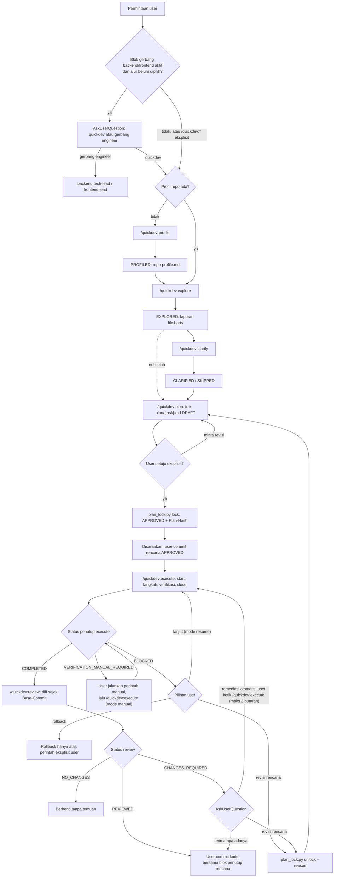
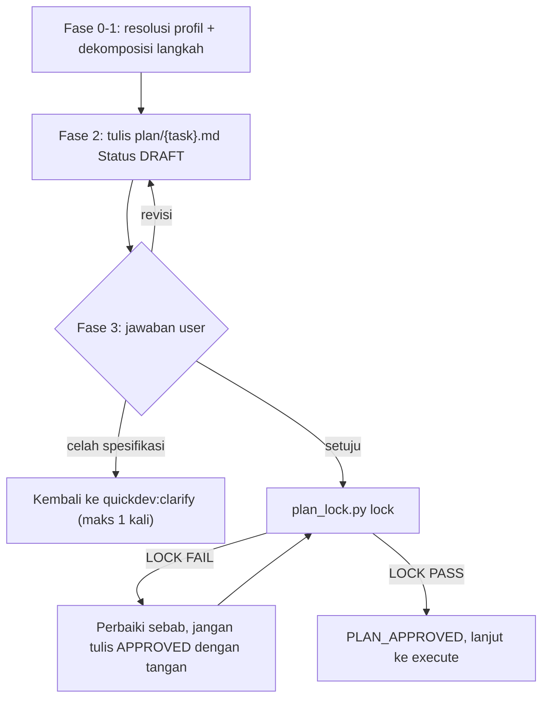
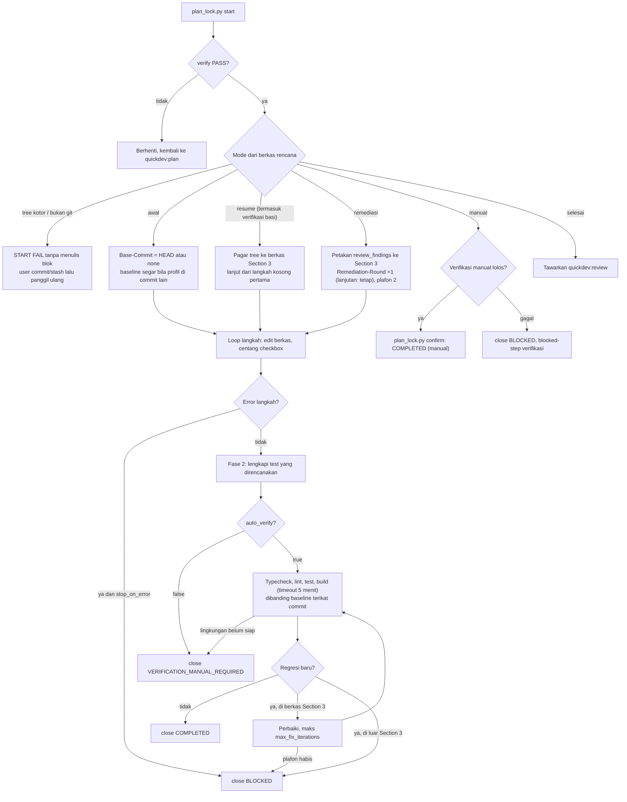
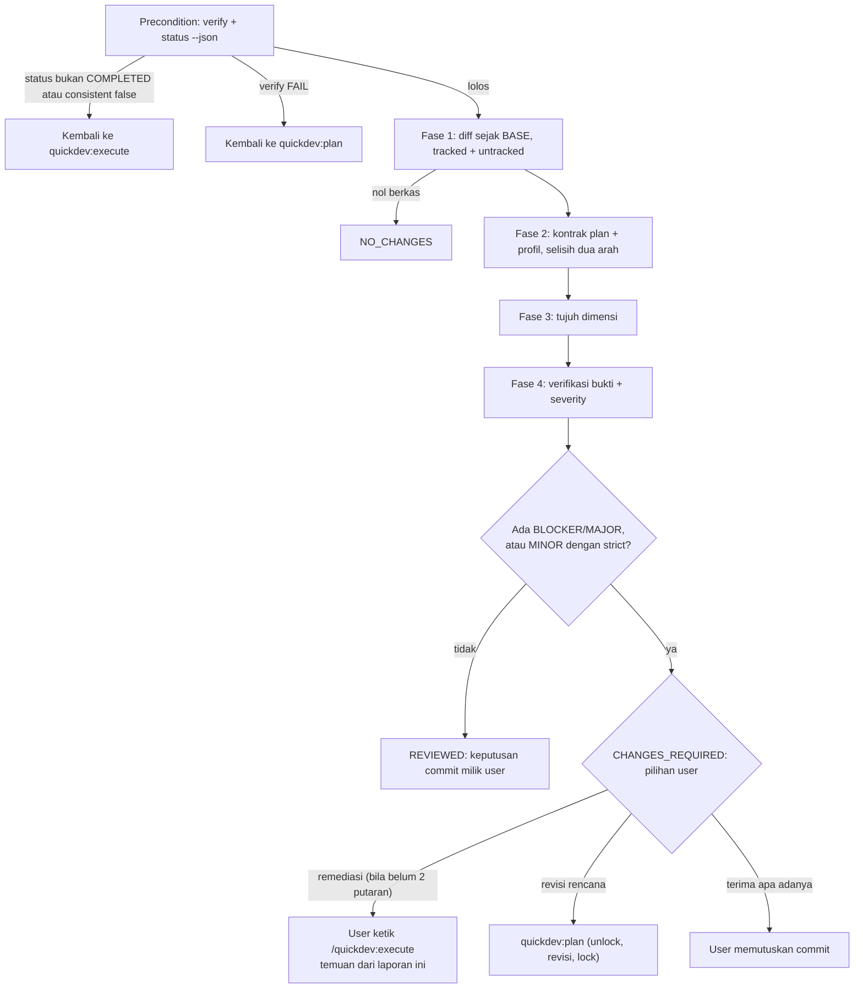
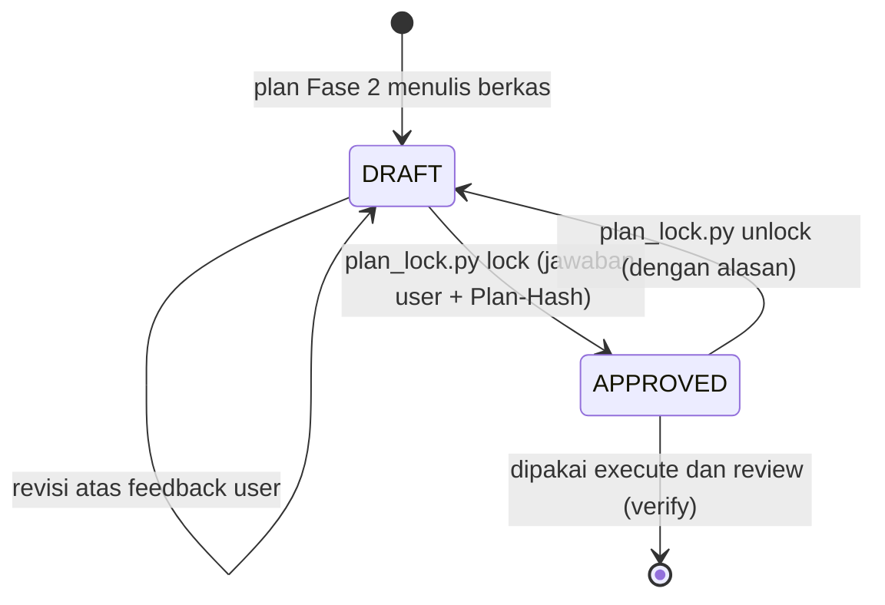

# Alur Plugin `quickdev`

> `quickdev` (v0.6.0) adalah alur kerja ringan untuk repo backend, frontend, dan fullstack. Plugin ini punya enam skill, tanpa taskdir, tanpa subagent, tanpa hook, dan hanya satu skrip pengunci rencana (ditambah pustaka sinkron nataflow opsional). Setiap tugas punya **satu berkas rencana** (`plan/<task>.md`), sedangkan perubahan kodenya boleh menyentuh banyak berkas dan layer. Pakai plugin ini untuk perubahan kecil sampai menengah yang tidak butuh BRD/PRD, ledger approval, atau review subagent. Plugin ini juga cocok untuk stack yang tidak dilayani `backend`/`frontend` (Next.js, FastAPI, Django, Rails), atau untuk kerja yang sengaja dibuat ringan di repo yang sudah memakai kedua plugin itu. Kerja berisiko (kontrak API, migrasi skema, perubahan lintas modul yang butuh jejak keputusan) sebaiknya naik ke `backend:tech-lead` atau `frontend:lead`.

## Peta Komponen

Path relatif terhadap `src/plugins/quickdev/`.

| Komponen | Jenis | Peran singkat | Berkas |
|---|---|---|---|
| `quickdev:profile` | skill | Mendeteksi tipe repo dan stack, memetakan layer, menjalankan baseline verifikasi (atas izin user), lalu menulis `repo-profile.md` | `skills/profile/SKILL.md` |
| `quickdev:explore` | skill | Menelusuri kode untuk satu `query` sampai `trace_depth`, dengan bukti `file:baris`, analisis dampak, dan daftar celah spesifikasi | `skills/explore/SKILL.md` |
| `quickdev:clarify` | skill | Menutup celah spesifikasi lewat batch `AskUserQuestion`, atau fast-path `SKIPPED` bila spesifikasi sudah jelas | `skills/clarify/SKILL.md` |
| `quickdev:plan` | skill | Menulis `plan/<task>.md` sebagai `DRAFT`, lalu menguncinya jadi `APPROVED` sesudah user menyetujui | `skills/plan/SKILL.md` |
| `quickdev:execute` | skill | Menerapkan langkah rencana, memverifikasi terhadap baseline profil, dan memperbaiki regresi dalam cakupan rencana | `skills/execute/SKILL.md` |
| `quickdev:review` | skill | Menilai diff sejak `Base-Commit` terhadap rencana dan profil dalam 7 dimensi. Read-only, hasilnya hanya laporan terminal | `skills/review/SKILL.md` |
| `plan_lock.py` | script | Pengunci rencana: sidik `Profile:` + Section 1–5 (`Plan-Hash`), penurunan mode eksekusi (termasuk predikat tree bersih mode `awal`), baseline segar terikat `Base-Commit`, segel verifikasi (`Verified-Hash`/`Tree-Hash`), penulisan blok `## Execution Status`, dan argumen sinkron nataflow (`sync-payload`, read-only) | `skills/_common/plan_lock.py` |
| `nataflow_sync.py` | pustaka | Config `.claude/nataflow.json`, identitas repo, argumen task/workdir/dokumen, dan diff manifest remote. Salinan identik di keempat plugin | `skills/_common/nataflow_sync.py` |
| Prosedur sinkron nataflow | referensi | Urutan panggilan tool MCP dua fase untuk rencana dan profil; dipakai `plan`, `execute`, dan `profile` | `skills/plan/references/nataflow-sync.md` |
| Templat profil backend | referensi | Enam section profil untuk repo backend | `skills/profile/references/backend-profile-template.md` |
| Templat profil frontend | referensi | Enam section profil untuk repo frontend | `skills/profile/references/frontend-profile-template.md` |
| Templat profil fullstack | referensi | Enam section profil untuk fullstack satu paket | `skills/profile/references/fullstack-profile-template.md` |
| Manifest plugin | konfigurasi | Nama, versi 0.6.0, deskripsi | `.claude-plugin/plugin.json` |

Keenam skill memakai `disable-model-invocation: true`. Artinya, skill hanya jalan bila **user** mengetik `/quickdev:<skill>`. Model tidak memanggilnya sendiri, termasuk dari skill quickdev lain. Setiap skill ditutup dengan status terminal, lalu **menawarkan** langkah berikutnya dan menunggu user.

## Alur Utama

Semua panah antar-skill adalah **tawaran**. Skill berikutnya baru jalan setelah user mengetik perintahnya sendiri. `profile` cukup dijalankan sekali per repo atau workspace. `explore` dan `clarify` menyiapkan bahan, dan keduanya tetap jalan dengan heuristik walaupun profil belum ada. Sebaliknya, `plan`, `execute`, dan `review` berhenti bila profil tidak ada. Titik tengah alur ini adalah `plan/<task>.md`. Isinya dikunci oleh sidik `Plan-Hash` saat user menyetujuinya. Setelah itu `execute` hanya boleh mengubah checkbox Section 3 dan blok `## Execution Status`. `review` menilai hasilnya terhadap rencana itu dan membuka tiga jalan: remediasi (maksimal 2 putaran), revisi rencana, atau terima apa adanya. quickdev sendiri tidak pernah meng-commit.

## Alur per Skill

### `quickdev:profile`

- **Pemicu / kapan dipakai**: repo belum punya `repo-profile.md`, profilnya perlu diperbarui (`mode=REFRESH`), atau `execute` menyarankan REFRESH karena profil lama belum punya tabel Section 5.
- **Prasyarat**: repo lokal bisa dibaca dan bisa menjalankan perintah. Manifest (`package.json`, `pyproject.toml`, `go.mod`, `Cargo.toml`, `pom.xml`, dll.) ada di root atau di `workspace_dir`. Runtime dan package manager sudah terpasang. Tiga templat profil tersedia di `references/`.
- **Langkah**:
  1. **Fase 0: mode dan deteksi.** Cocokkan `target_path` dengan `mode`:
     - profil belum ada + `GENERATE` → pindai penuh;
     - profil ada + `REFRESH` → perbarui bagian yang drift dan pertahankan catatan user;
     - profil ada + `GENERATE` → tanya dulu: pindah ke REFRESH, atau timpa;
     - profil belum ada + `REFRESH` → beralih ke `GENERATE`.

     Lalu pindai manifest dan klasifikasikan repo: backend, frontend, fullstack satu paket (butuh minimal satu berkas route server nyata), atau monorepo (tanyakan workspace, satu profil per workspace). Nilai `type` yang diisi eksplisit mengalahkan deteksi otomatis.
  2. **Fase 1: pemetaan layer.**
     - Backend: controller/route, service, repository, DTO, ORM, dan auth/middleware.
     - Frontend: pages, komponen, hooks, API client, state management, dan styling.
     - Fullstack: layer frontend ditambah route server, modul server-only, validasi, dan akses DB.

     Catat juga alias path compiler.
  3. **Fase 2: baseline verifikasi.** Kenali perintah typecheck, lint, test, dan build. Jenis yang tidak punya runner dicatat `TIDAK_ADA`.
     - Catat `git status --porcelain` sebagai keadaan awal dan HEAD sebagai `Baseline-Commit` (tree kotor → daftar berkasnya ikut dicatat).
     - Ajukan **satu** `AskUserQuestion` yang mendaftar tiap perintah beserta risikonya. Opsinya: *jalankan semua*, *lewati yang menyentuh DB/jaringan*, atau *lewati semua (SKIPPED)*.
     - Jalankan perintah yang disetujui satu per satu, masing-masing dengan timeout 300000 ms, dari kolom `Cwd`.
     - Catat Status, Durasi, dan Known issues (maksimal 10 baris penanda persis). `SKIPPED` membawa alasannya (`ditolak user: …` atau `skip_baseline_exec`) supaya `execute` meminta izin baru.
     - Bandingkan `git status` sesudahnya. Berkas baru dilaporkan sebagai "artefak build perlu di-ignore" dan tidak dihapus.
  4. **Fase 3: tulis profil.** Isi templat yang sesuai dengan keenam header persis. Ukuran total harus di bawah 10.000 karakter (`wc -m`). Bila lebih, ringkas daftar berkas dengan pola glob. Tulis ke `target_path`.
  5. **Fase 4: validasi dan handoff.** Periksa bahwa berkas ada, keenam header lengkap, dan ukurannya di bawah kuota. Jalankan sinkron nataflow varian profil (`sync-payload --repo-profile`, dokumen `PROFILE` di bawah workspace). Set status `PROFILED`. Bila blok gerbang engineer ada di konteks sesi, tawarkan penanda `.claude/workflow`. Terakhir, tawarkan `explore`.
- **Subagent yang didispatch**: Tidak ada.
- **Output / artefak**: `repo-profile.md` (atau `<workspace_dir>/repo-profile.md`; alternatif yang dikenali: `.dev/profile.md`) berisi 6 section, plus ringkasan terminal maksimal 17 baris. Status: `PROFILED`.
- **Gerbang & commit**:
  - Eksekusi baseline wajib seizin user lewat `AskUserQuestion`.
  - Migrasi dan perintah apa pun yang mengubah skema/data dilarang.
  - Kode sumber tidak disentuh.
  - `.claude/workflow` hanya ditulis bila user setuju.
  - Skill tidak meng-commit. README menganjurkan user meng-commit profil.
- **Lanjut ke**: `quickdev:explore`.

### `quickdev:explore`

- **Pemicu / kapan dipakai**: user ingin memahami area kode sebelum merencanakan perubahan. Parameter `query` wajib diisi.
- **Prasyarat**:
  - Repo bisa dibaca.
  - Profil dianjurkan. Bila tidak ada, skill memakai heuristik dan menyarankan `profile`.
  - Permintaan menyebut domain yang jelas.
  - Untuk pencarian: `Glob`/`Grep` bila tersedia. Bila tidak, Bash baca-saja (`git ls-files | grep`, `grep -rn`, `rg`).
- **Langkah**:
  1. **Fase 0.** Muat profil (tipe, pola folder, alias). Bila ada lebih dari satu `repo-profile.md`, tanyakan workspace mana. Ekstrak entitas domain dan kata kunci teknis, lalu tetapkan batas `scope_dir`. Tentukan **skala**:
     - `kecil`: ≤2 berkas, tanpa perubahan kontrak publik, skema, atau env → `trace_depth=1`, cukup pemanggil langsung;
     - `standar`: selain itu.
  2. **Fase 1: pemetaan.** Cari nama berkas (entitas + peran layer) dan teks (definisi simbol, route HTTP, pemakaian ORM). Urutkan kandidat menurut relevansi.
  3. **Fase 2: trace flow.** Baca signature, validasi, dan penanganan error, lalu telusuri rantai pemanggil sampai `trace_depth`:
     - Backend: route → middleware → service → repository → ORM → skema.
     - Frontend: page → layout → komponen → hook/state → API client → DTO.
  4. **Fase 3: analisis dampak.** Cari reverse dependency, dampak ke kontrak DTO, skema DB, dan env. Catat test terkait (bila `include_tests`) serta code smell.
  5. **Fase 4: laporan.** Susun laporan berisi tabel berkas kunci `file:baris`, data flow trace, impact matrix, test terkait, dan celah spesifikasi. Set status `EXPLORED`.
- **Subagent yang didispatch**: Tidak ada.
- **Output / artefak**: laporan di terminal (tidak menulis berkas) dengan ringkasan maksimal 17 baris (`SKALA`, `ALUR`, `DAMPAK`, `CELAH`, …). Status: `EXPLORED`.
- **Gerbang & commit**: murni read-only. Tidak ada approval dan tidak ada commit.
- **Lanjut ke**: `quickdev:clarify`, atau langsung `quickdev:plan` bila celahnya nol.

### `quickdev:clarify`

- **Pemicu / kapan dipakai**: sesudah `EXPLORED`, bila laporan menyisakan ambiguitas.
- **Prasyarat**:
  - `explore` berstatus `EXPLORED`, dengan laporan yang memuat berkas, alur, dan dampak.
  - Profil dianjurkan. Bila tidak ada, domain diambil dari `profile_type` dan laporan explore.
  - `AskUserQuestion` tersedia.
- **Langkah**:
  1. **Fase 0: uji fast-path.** Bandingkan laporan explore dengan permintaan user dari sisi scope, kompatibilitas arsitektur, dan trade-off desain.
     - Nol ambiguitas → `SKIPPED`. Bila `skip_if_clear=false`, ajukan dulu satu konfirmasi ringkasan.
     - Ada celah → lanjut ke Fase 1.
  2. **Fase 1: pilih domain pertanyaan.**
     - Backend: routing dan HTTP verb, skema payload, status code, dampak DB/migrasi, auth/RBAC.
     - Frontend: navigasi, tata letak, cabang state UI, sinkronisasi URL, validasi form.
     - Fullstack: gabungan keduanya, dengan fokus pada batas UI ↔ route server.
  3. **Fase 2: batching.** Satu batch berisi maksimal `batch_limit` pertanyaan (default 3, maksimal 4), dan maksimal 3 batch per pemanggilan. Setiap pertanyaan menyebut konteks kode dan memberi opsi konkret, dengan satu opsi bertanda `(Recommended)`. Bila ambiguitas masih tersisa sesudah batch ke-3, tanyakan: *Lanjut dengan asumsi tertulis di Section 1 rencana*, *Perkecil lingkup*, atau *Batal*.
  4. **Fase 3: alignment lock.** Petakan setiap jawaban ke spesifikasi. Untuk jawaban delegasi ("ikuti standar repo"):
     - `allow_assumptions=true` → pakai konvensi profil langsung;
     - `false` → tampilkan konvensi terpilih dalam satu konfirmasi.

     Susun spesifikasi terklarifikasi beserta batas out-of-scope. Set status `CLARIFIED`.
- **Subagent yang didispatch**: Tidak ada.
- **Output / artefak**: dokumen spesifikasi terklarifikasi di percakapan (tidak menulis berkas) dan ringkasan maksimal 17 baris. Status: `CLARIFIED` atau `SKIPPED`.
- **Gerbang & commit**: keputusan bisnis, desain, dan arsitektur milik user. Skill tidak menulis kode dan tidak meng-commit.
- **Lanjut ke**: `quickdev:plan`.

### `quickdev:plan`

- **Pemicu / kapan dipakai**: spesifikasi sudah terkunci dan tugas perlu dijadikan satu rencana.
- **Prasyarat**:
  - Status explore dan clarify terbaca dari percakapan. Bila tidak ada, jalankan Failure path 5.
  - Spesifikasi tanpa ambiguitas tersisa.
  - Izin tulis ke `plan/`.
  - **Profil wajib ada**. Bila tidak ada, berhenti dan arahkan ke `quickdev:profile`.
  - `python3` 3.9+.
- **Langkah**:
  1. **Fase 0.** Validasi `task_name` (kebab-case), buat `plan_dir`, lalu ambil urutan layer dan perintah baseline dari profil.
  2. **Fase 1: dekomposisi.** Pecah tugas jadi langkah atomik, hanya untuk layer yang benar-benar tersentuh. Urutan acuan:
     - Backend: DB/entity → DTO → repository → service → controller → test.
     - Frontend: types → API client/hooks → state → komponen → page/route → test.

     Setiap langkah menyebut path berkas, simbol, dan acceptance criteria. Bila explore menyebut konsumen terdampak, tambahkan langkah "sesuaikan konsumen".
  3. **Fase 2: tulis `<plan_dir>/<task_name>.md`.**
     - Metadata: `Status: DRAFT`, `Author`, `Date`, `Profile`, dan `Gates: explore=… clarify=…`.
     - Isi: Section 1 Overview & Objectives (termasuk keputusan clarify), 2 Architecture & Layer Impact, 3 Atomic Implementation Steps (checkbox `- [ ]`), 4 Verification & Testing Strategy, 5 Rollback & Contingency (bila `include_rollback`).
  4. **Fase 3: approval gate.** Sajikan ringkasan rencana, lalu minta persetujuan eksplisit.
     - User minta revisi → perbarui rencana, tetap `DRAFT`, ajukan ulang.
     - User minta revisi pada rencana yang sudah dieksekusi → langkah yang teksnya berubah dikembalikan ke `- [ ]`.
     - User setuju → jalankan `plan_lock.py lock --plan … --profile … --answer -` dengan jawaban user apa adanya lewat heredoc berkutip (`<<'QD_EOF'`), supaya shell tidak mengekspansi backtick atau `$`.
  5. **Fase 4.** Setelah `LOCK PASS`, jalankan sinkron nataflow (`references/nataflow-sync.md`), set status `PLAN_APPROVED`, dan tawarkan `/quickdev:execute`.
  6. **Rute sinkron ulang.** "sinkron ulang `<plan_path>`" hanya menjalankan prosedur sinkron atas rencana yang sudah ada, lalu menutup dengan `SINKRON — <plan_path> · nataflow <segmen>`, tanpa menyentuh rencana.
- **Subagent yang didispatch**: Tidak ada.

- **Output / artefak**: `plan/<task>.md` berstatus `APPROVED`, dengan `Hash-Scope`, `Approved-At`, `Approval` (kutipan jawaban user), dan `Plan-Hash` yang ditulis skrip. Ringkasan terminal memuat `KUNCI: Plan-Hash <12 hex>`. Status: `PLAN_APPROVED`.
- **Gerbang & commit**:
  - `Status: APPROVED` hanya boleh ditulis oleh `plan_lock.py lock`.
  - Section 1–5 dan `Profile:` rencana yang sudah `APPROVED` tidak boleh diubah langsung. Revisi harus lewat `unlock --reason`, lalu revisi, lalu `lock` lagi. Blok `## Execution Status` dipertahankan.
  - Rencana format lama (tanpa `Plan-Hash`) harus di-`unlock` dan disetujui ulang.
  - Skill tidak meng-commit. README menyarankan user meng-commit rencana `APPROVED` sebelum `execute`.
- **Lanjut ke**: `quickdev:execute` (`plan_path=<plan_dir>/<task_name>.md`).

### `quickdev:execute`

- **Pemicu / kapan dipakai**: rencana sudah `APPROVED`. Skill yang sama dipanggil ulang untuk melanjutkan kerja (`resume`), mencatat verifikasi manual (`manual`), atau memperbaiki temuan review (`remediasi`).
- **Prasyarat**:
  - `plan_lock.py verify` → `VERIFY PASS`.
  - Pagar working tree sesuai mode, lihat tabel mode di bawah.
  - Runtime dan toolchain aktif.
  - Profil ada.
  - Tool `Edit`/`Write`/`Bash` dan `python3` 3.9+.
- **Langkah**:
  1. **Fase 0.** Jalankan `plan_lock.py start --plan <plan_path>` (tambah `--findings --findings-text -` bila `review_findings` diisi; teks bebas selalu lewat stdin dengan heredoc berkutip) sebelum mengubah apa pun. `plan_path` kosong → diambil dari ringkasan quickdev terakhir di percakapan, atau dari `plan/*.md` lewat `status --json`. Skrip menjalankan `verify`, menurunkan mode, dan menulis blok `## Execution Status`.

     | Keadaan rencana | Mode | Tindakan |
     |---|---|---|
     | `verify` FAIL | — | berhenti, ke `quickdev:plan` |
     | tanpa blok, nol `[x]`, tree bersih selain direktori rencana dan profil | `awal` | `Base-Commit` = HEAD atau `none`; baseline segar bila `Baseline-Commit` profil ≠ `Base-Commit` |
     | tanpa blok, nol `[x]`, tree kotor atau bukan repo git | — | `START FAIL` **sebelum** blok ditulis; user commit/stash lalu memanggil ulang |
     | blok `IN_PROGRESS`/`BLOCKED`, ada `[x]` tanpa blok, blok terminal dengan langkah `[ ]` baru, atau segel penutup basi | `resume` | pagar tree ke berkas Section 3; batalkan centang terakhir yang berkasnya tidak berubah; lanjut dari `[ ]` pertama dengan edit idempoten; semua `[x]` → langsung Fase 3 |
     | blok `IN_PROGRESS`/`BLOCKED` dengan `Remediation-State: OPEN` | `remediasi` lanjutan | temuan dicetak ulang dari `Findings-<n>`; ronde tidak bertambah |
     | blok `COMPLETED` + `--findings` | `remediasi` | petakan temuan ke berkas Section 3; `Remediation-Round` +1, `Remediation-State: OPEN`, plafon 2 |
     | blok `VERIFICATION_MANUAL_REQUIRED`, semua `[x]`, segel cocok | `manual` | `AskUserQuestion`: lolos → `confirm`; gagal → `close --status BLOCKED --blocked-step verifikasi` |
     | blok `COMPLETED`, semua `[x]`, segel cocok, tanpa temuan | `selesai` | tidak ada kerja, tawarkan `review` |

     `start` mencetak `PERINGATAN:` bila `Base-Commit` bukan leluhur HEAD, `INFO:` bila HEAD maju, dan `BASELINE:` bila baseline segar sudah terkunci. Pada mode `awal` dengan profil yang diukur di commit lain, baseline dijalankan sebelum mutasi lalu dikunci lewat `plan_lock.py baseline`.
  2. **Fase 1: loop per langkah** (atau per temuan pada mode remediasi). Edit berkas sesuai konvensi profil, periksa sintaks dan impor, lalu centang `- [x]`. Bila terjadi error dan `stop_on_error=true`, jalankan `close --status BLOCKED --blocked-step <n>`. `stop_on_error=false` melanjutkan langkah yang tidak bergantung pada langkah gagal, lalu menutup `BLOCKED` di langkah gagal pertama. Kerja parsial dibiarkan di working tree.
  3. **Fase 2: test.** Lengkapi skenario Section 4, tetapi hanya di berkas test yang tercantum di rencana. Skenario tanpa berkas test dicatat sebagai celah rencana. Framework test baru tidak boleh dipasang.
  4. **Fase 3: full verification gate.** Jalankan typecheck, lint, test, dan build dari `Cwd`, masing-masing dengan timeout 300000 ms. Perintah yang ditolak user di profile (`SKIPPED`) ditanyakan lagi lewat `AskUserQuestion`; migrasi tidak pernah dijalankan. Lint `--fix` hanya boleh untuk berkas yang disentuh. Pembanding: baseline segar (`BASELINE:`), lalu profil bila `Baseline-Commit`-nya = `Base-Commit`, lalu profil commit lain (galat di luar berkas rencana = `UNVERIFIED`). Galat dicocokkan per berkas + aturan/nama test, tanpa nomor baris:
     - pembanding `PASSED` → galat apa pun sekarang = regresi;
     - pembanding `FAILED` → galat yang tercatat (jumlahnya tidak bertambah) = bawaan, galat lain = regresi;
     - pembanding `SKIPPED`, `TIMEOUT`, atau `UNVERIFIED_ENV_NOT_READY` → tidak ada pembanding; bila gagal karena lingkungan, hasil akhirnya `VERIFICATION_MANUAL_REQUIRED`.

     Regresi di berkas Section 3 diperbaiki, maksimal `max_fix_iterations` kali (default 3). Regresi yang menuntut berkas di luar Section 3 → `BLOCKED`.
  5. **Fase 4.** Jalankan `close --status COMPLETED|VERIFICATION_MANUAL_REQUIRED --verification -`. Skrip menolak `COMPLETED` bila masih ada `- [ ]`, menutup ronde remediasi yang `OPEN`, dan menyegel `Verified-Hash` + `Tree-Hash`. Susun laporan dan tawarkan `review`, dengan perubahan dibiarkan uncommitted.
  6. **Sinkron nataflow.** Sesudah **tiap** `close`/`confirm` yang PASS (termasuk `BLOCKED` di Fase 0, 1, 3, dan Failure path), prosedur sinkron mendorong rencana beserta blok eksekusinya. Hasilnya baris `NATAFLOW:` ringkasan; `GAGAL` tidak mengubah status terminal.
- **Subagent yang didispatch**: Tidak ada.

- **Output / artefak**:
  - Kode dan test yang berubah, dibiarkan uncommitted.
  - `plan_path` dengan checklist tercentang dan blok `## Execution Status` (`Status`, `Base-Commit`, `Remediation-Round`, `Remediation-State`, `Findings-<n>`, `Baseline`, `Baseline-Commit`, `Verification`, `Blocked-Step`, `Verified-Hash`, `Tree-Hash`, `Timestamp`).
  - Ringkasan maksimal 17 baris.
  - Status: `COMPLETED` | `VERIFICATION_MANUAL_REQUIRED` | `BLOCKED`.
- **Gerbang & commit**:
  - Rencana wajib lolos `verify`.
  - Di `plan_path`, hanya baris checkbox Section 3 dan blok eksekusi yang boleh berubah. Blok itu hanya ditulis `plan_lock.py`.
  - Perbaikan dibatasi ke berkas Section 3.
  - Skill **tidak commit dan tidak merge**.
  - Rollback (`git checkout`, `reset`, `stash`, hapus berkas) hanya dengan persetujuan eksplisit user.
- **Lanjut ke**:
  - `COMPLETED` → `quickdev:review`.
  - `VERIFICATION_MANUAL_REQUIRED` → user menjalankan perintah manual, lalu `quickdev:execute` (mode `manual`).
  - `BLOCKED` → `quickdev:execute` (mode `resume`, atau `remediasi` lanjutan bila ronde masih `OPEN`), `quickdev:plan` (revisi), atau rollback.

### `quickdev:review`

- **Pemicu / kapan dipakai**: eksekusi sudah `COMPLETED`/`COMPLETED (manual)` dan diff perlu dinilai sebelum user meng-commit.
- **Prasyarat**:
  - `plan_lock.py verify` → PASS.
  - `plan_lock.py status --json` → `execution.Status` ∈ {`COMPLETED`, `COMPLETED (manual)`} dan `consistent: true`. `consistent: false` mencakup segel basi (kode atau rencana berubah sesudah `close`) → kembali ke `execute` mode `resume`.
  - Direktori kerja adalah repo git yang valid.
  - Minimal satu berkas berubah di luar `plan/` dan profil. Bila nol, hasilnya `NO_CHANGES`.
  - Rencana dan profil ada.
  - `python3` 3.9+.
- **Langkah**:
  1. **Fase 1: diff.**
     - Tetapkan `<BASE>`: `base_ref`, lalu `Base-Commit`, lalu `HEAD`. Untuk `Base-Commit: none`, pakai tree kosong. `base_drift` ≠ `-` (base bukan leluhur HEAD) tanpa `base_ref` → berhenti dan tanyakan `base_ref` ke user.
     - Kumpulkan berkas tracked (`git diff <BASE>`) dan untracked (`git ls-files --others --exclude-standard`), tanpa `plan/` dan profil. Ambil diff `-U3`.
     - Terapkan filter `scope_paths`.
     - Bila review jalan di sesi yang sama dengan `execute`, tandai `sesi-sama=ya`.
  2. **Fase 2: kontrak pembanding.** Ekstrak langkah, berkas target, dan strategi verifikasi dari rencana, serta konvensi dari profil. Hitung selisih dua arah: *scope creep* (berkas berubah tapi tidak direncanakan) dan *langkah terlewat* (direncanakan tapi tidak berubah).
  3. **Fase 3: tujuh dimensi.** Setiap dimensi wajib diberi vonis `CLEAN` atau daftar temuan:
     1. Korektness Logika
     2. Kepatuhan Kontrak Plan
     3. Konvensi Profil & Layer
     4. Keamanan
     5. Error Handling
     6. Kualitas Test
     7. Regresi Cakupan (wajib mencari pemanggil secara nyata)
  4. **Fase 4: verifikasi bukti.** Buka ulang tiap baris kandidat temuan dan buang yang tidak terbukti. Beri severity `BLOCKER`/`MAJOR`/`MINOR`, deduplikasi, dan tulis rekomendasi imperatif (tanpa patch).
  5. **Fase 5: status.** Hasilnya `CHANGES_REQUIRED` bila ada minimal satu BLOCKER/MAJOR, atau MINOR dengan `strict=true`. Selain itu `REVIEWED`.
     - `CHANGES_REQUIRED` → `AskUserQuestion`: *Remediasi otomatis (putaran n+1/2)*, *Revisi rencana*, atau *Terima apa adanya*. Opsi pertama tidak ditawarkan bila `remediation_round` sudah 2. Review tidak memanggil `execute` (`disable-model-invocation`): opsi pertama ditutup dengan perintah `/quickdev:execute <plan_path>` untuk diketik user di sesi yang sama, dan `execute` mengambil temuan dari laporan ini.
     - `REVIEWED` → keputusan commit/merge diserahkan ke user.
- **Subagent yang didispatch**: Tidak ada. Konsekuensinya, independensi review bergantung pada sesi. README menyarankan menjalankan ulang `/quickdev:review` di sesi baru untuk putaran terakhir.

- **Output / artefak**: **laporan terminal saja**, tanpa berkas. Isinya blok per temuan (Lokasi, Bukti, Dimensi, Dampak, Rekomendasi), tabel cakupan 7 dimensi, dan ringkasan maksimal 17 baris. Status: `REVIEWED` | `CHANGES_REQUIRED` | `NO_CHANGES`.
- **Gerbang & commit**:
  - Read-only penuh. Git yang boleh dipakai hanya `diff`, `status`, `log`, `ls-files`, `rev-parse`, dan `hash-object -t tree /dev/null`. Dari `plan_lock.py` hanya `verify` dan `status`.
  - Rencana, profil, dan checklist tidak boleh diubah.
  - Severity tidak boleh diturunkan demi mendapat `REVIEWED`.
- **Lanjut ke**: `execute` (remediasi), `plan` (revisi), user (commit/merge), atau tidak ada (`NO_CHANGES`).

## Subagent

Tidak ada. README menyebutkan "semua kerja berlangsung di percakapan utama", dan `plugin.json` menegaskan "tanpa taskdir maupun subagent". Akibatnya:

- tidak ada reviewer independen seperti di `backend`/`frontend`;
- `review` hanya menandai `sesi-sama=ya` bila jalan di sesi yang sama dengan `execute`, lalu menyarankan putaran terakhir di sesi baru.

## Hooks & Guard

**Hooks: tidak ada.** quickdev tidak punya `hooks/`. Hook SessionStart milik `backend` dan `frontend` menyuntik blok gerbang (`<backend-tech-lead-gate>` / `<frontend-lead-gate>`) di repo yang manifestnya cocok. Teks gerbang itu (`hooks/gate_text.py` di kedua plugin) mengecualikan permintaan yang memanggil atau melanjutkan `/quickdev:*`.

**Guard dan pengaman lain:**

| Guard | Mekanisme |
|---|---|
| Pemanggilan hanya oleh user | `disable-model-invocation: true` di keenam skill. Tiap skill menawarkan langkah berikutnya, tidak memanggilnya sendiri |
| Koeksistensi | Blok gerbang engineer + `/quickdev:*` eksplisit → lanjut. Permintaan baru tanpa pilihan alur → tanya sekali (quickdev atau gerbang engineer). Dilarang memakai `backend:*`/`frontend:*` sebagai pengganti langkah |
| Penanda `.claude/workflow` | Berkas ini ada tetapi tidak memuat `quickdev` → skill melapor dan bertanya dulu sebelum lanjut |
| Kunci rencana (`plan_lock.py`) | Sidik sha256 atas baris `Profile:` (`Hash-Scope: profile+body`) dan `## 1.` sampai sebelum `## Execution Status` (CRLF → LF, spasi ujung dibuang, `[x]` dihitung sebagai `[ ]`). Heading dan checklist di dalam code fence diabaikan; fence tak tertutup → FAIL. Rencana 0.4.0 tanpa `Hash-Scope` diverifikasi dengan rumus lama. `execute`/`review` menolak rencana yang sidiknya berbeda |
| Penulisan atomik | `Plan.save()` menulis ke berkas sementara lalu `os.replace`, jadi sesi yang putus tidak meninggalkan rencana setengah tertulis. Mode berkas asli dipertahankan; isi yang tidak berubah tidak ditulis ulang |
| Pagar working tree | Mode `awal`: `start` sendiri menolak tree kotor di luar direktori rencana dan profil **sebelum** menulis `Base-Commit`. Mode `resume`/`remediasi`: perubahan hanya di berkas Section 3, `plan/`, dan profil |
| Pagar cakupan perbaikan | Perbaikan regresi dan temuan review hanya di berkas Section 3. Di luar itu → `BLOCKED` |
| Plafon | `max_fix_iterations` (default 3) per eksekusi. `REMEDIATION_CAP = 2` putaran remediasi (`start --findings` menolak putaran ke-3); ronde yang terputus dilanjutkan tanpa menambah hitungan |
| Baseline aman | Eksekusi baseline seizin user, timeout 5 menit per perintah, migrasi/pengubah data tidak pernah dijalankan (profile maupun execute). Perintah yang ditolak di profile ditanyakan ulang di execute |
| Baseline terikat commit | Profil mencatat `Baseline-Commit`; `plan_lock.py baseline` hanya menerima ringkasan di HEAD = `Base-Commit` dengan tree bersih. Galat dicocokkan tanpa nomor baris |
| Segel verifikasi | `close` menyegel `Verified-Hash` (= `Plan-Hash`) dan `Tree-Hash` (isi berkas yang berbeda dari `Base-Commit` + untracked). Berubah sesudahnya → `consistent: false`, `confirm` FAIL, `start` → `resume` |
| Teks bebas lewat stdin | Nilai `-` dibaca dari stdin (heredoc `<<'QD_EOF'`), satu per panggilan; `--blocked-step` dirapatkan satu baris; `--profile` berkarakter kontrol ditolak; kunci metadata/blok ganda → FAIL |
| Review read-only | Hanya perintah git baca dan `plan_lock.py verify`/`status` |

**Subperintah `plan_lock.py`:**

| Subperintah | Dipanggil oleh | Syarat | Efek |
|---|---|---|---|
| `lock` | `plan` Fase 3 | `Status: DRAFT`, `--answer` tidak kosong, Section 3 punya checkbox, Section 1–5 tidak kosong, fence tertutup | Tulis `Profile`, `Hash-Scope`, `Status: APPROVED`, `Approved-At`, `Approval` (dikutip, maks 300 karakter), `Plan-Hash` |
| `verify` | Precondition `execute`/`review`; juga dijalankan di dalam `start`/`baseline`/`close`/`confirm` | `APPROVED`, `Plan-Hash` ada dan sama dengan sidik sekarang (sesuai `Hash-Scope`) | `VERIFY PASS` / `VERIFY FAIL` |
| `start` | `execute` Fase 0 | `verify` lolos. Mode `awal` butuh repo git dan tree bersih di luar direktori rencana/profil. Remediasi baru butuh `COMPLETED`, `--findings-text`, dan putaran < 2 | Menurunkan mode, menulis blok (`IN_PROGRESS`, `Base-Commit`, `Remediation-Round`, `Remediation-State`, `Findings-<n>`). `Base-Commit` tidak pernah ditimpa. Bila `Base-Commit` belum ada saat resume, diisi dengan `Base-Note`. Mencetak `TEMUAN:`, `PERINGATAN:`, `INFO:`, `BASELINE:` |
| `baseline` | `execute` Fase 0 (mode `awal`) | Blok `IN_PROGRESS`, HEAD = `Base-Commit`, tree bersih, ringkasan tidak kosong | Tulis `Baseline` (maks 600 karakter) dan `Baseline-Commit` |
| `close` | `execute` (penutupan / BLOCKED) | Blok berstatus `IN_PROGRESS`, atau `VERIFICATION_MANUAL_REQUIRED` → `BLOCKED` | Tulis status terminal, `Verification`, `Blocked-Step`. Menolak `COMPLETED` bila masih ada `[ ]`. `BLOCKED` butuh `--blocked-step`. `COMPLETED`/`VERIFICATION_MANUAL_REQUIRED` menyegel `Verified-Hash` + `Tree-Hash` dan menutup ronde remediasi |
| `confirm` | `execute` mode `manual` | Semua `[x]`, blok `VERIFICATION_MANUAL_REQUIRED`, jawaban user tidak kosong, segel cocok | `COMPLETED (manual)` + `Manual-Confirmation` |
| `status` | `review` (`--json`) | — | Ringkasan: `hash_ok`, `hash_scope`, jumlah langkah, `remediation_round`/`remediation_open`/`open_findings`, `base_drift`/`commits_since_base`, `baseline`, `consistent`/`inconsistency` (termasuk segel basi), blok eksekusi |
| `unlock` | `plan` (revisi) | `APPROVED`, `--reason` tidak kosong | `Status: DRAFT`, `Plan-Hash: -`, `Unlock-Reason`. Blok eksekusi dipertahankan |
| `sync-payload` | prosedur sinkron (`plan`, `execute`, `profile`) | `.claude/nataflow.json` ada dan sah (absen → `SKIP` sebelum rencana dibaca). `--plan`: rencana pernah dikunci (`Approved-At`). `--repo-profile`: berkas ada | Read-only. Tanpa `--remote`: argumen `task`/`workdir`/`list_document` tanpa isi. `--remote -`: dokumen yang sha, tipe, atau metadatanya berbeda dari manifest remote |

**Keterbatasan yang diakui README**:

- Kunci rencana adalah bukti audit, bukan pencegahan mutlak: model tetap bisa memanggil `unlock` lalu `lock` sendiri. Keduanya tercatat di `Approval:`/`Unlock-Reason:`.
- `Findings-<n>` dipotong 300 karakter dan `Baseline` 600 karakter. Remediasi otomatis paling andal bila `/quickdev:execute` diketik di sesi yang sama dengan review.
- `Tree-Hash` tidak menyegel isi submodule dan berkas ter-ignore.
- Independensi review bergantung pada sesi.

## Artefak & Siklus Status

| Artefak | Lokasi | Ditulis oleh | Catatan |
|---|---|---|---|
| Profil repo | `repo-profile.md` (root) atau `<workspace_dir>/repo-profile.md`; alternatif `.dev/profile.md` | `profile` | 6 section, < 10.000 karakter. Terpisah dari `.claude/profile/<plugin>/` milik backend/frontend. **Di-commit** |
| Rencana | `plan/<task>.md` (`plan_dir`, `task_name` kebab-case) | `plan` (isi), `plan_lock.py` (metadata kunci + blok eksekusi), `execute` (checkbox) | Satu berkas per tugas dan satu-satunya sumber spesifikasi bagi `execute`/`review`. **Di-commit** |
| Penanda alur | `.claude/workflow` | `profile` Fase 4, atas persetujuan user | `quickdev` → hook backend/frontend diam. `frontend quickdev` → hanya hook frontend menyala |
| Laporan explore / spesifikasi clarify / laporan review | Terminal | `explore`, `clarify`, `review` | Tidak menjadi berkas |
| Perubahan kode | Working tree (uncommitted) | `execute` | Commit adalah keputusan user |
| Cermin nataflow (opsional) | Server MCP nataflow | prosedur sinkron | Workdir `quickdev:<repo>:<path rencana>` + task; dokumen `QUICKDEV_PLAN` (isi disk) dan `PROFILE` (workspace). Status workdir: `COMPLETED*` → `done`, `BLOCKED` → `blocked`, selain itu `active`; task `in_progress` sejak eksekusi dimulai, `done` saat `COMPLETED*` |

Header keenam section profil per templat:

| # | Backend | Frontend | Fullstack |
|---|---|---|---|
| 1 | Project Overview & Runtime | Project Overview & Runtime | Project Overview & Runtime |
| 2 | Architecture & Layering Pattern | UI Framework & State Management | UI Framework & State Management |
| 3 | Database, ORM & Migrations | Component & Layering Hierarchy | Component & Layering Hierarchy |
| 4 | API Contracts & Routing Conventions | Routing & Navigation Architecture | Server Routes, Data Access & Error Handling |
| 5 | Verification Baseline | Verification Baseline | Verification Baseline |
| 6 | Error Handling & Logging Standards | Styling & Design System Rules | Styling & Design System Rules |

Section 5 berupa baris `Baseline-Commit` dan tabel `Jenis | Perintah | Cwd | Status | Durasi | Known issues`. Nilai Status yang mungkin: `PASSED`, `FAILED`, `TIMEOUT`, `SKIPPED` (beserta alasan), `UNVERIFIED_ENV_NOT_READY`, `TIDAK_ADA`. `execute` memakai kolom Known issues sebagai pembanding hanya bila `Baseline-Commit` = `Base-Commit`; selain itu baseline segar diukur di `Base-Commit` sebelum mutasi.

**Siklus metadata `Status:` rencana:**

**Siklus blok `## Execution Status`:**

```mermaid
stateDiagram-v2
    state "COMPLETED (manual)" as COMPLETED_MANUAL
    [*] --> IN_PROGRESS : start mode awal (tulis Base-Commit)
    IN_PROGRESS --> COMPLETED : close, semua langkah tercentang, verifikasi hijau
    IN_PROGRESS --> VERIFICATION_MANUAL_REQUIRED : close, auto_verify false atau lingkungan belum siap
    IN_PROGRESS --> BLOCKED : close, error langkah, regresi di luar rencana, atau plafon perbaikan habis
    IN_PROGRESS --> IN_PROGRESS : start lagi (sesi putus; remediasi OPEN dilanjutkan)
    BLOCKED --> IN_PROGRESS : start mode resume, atau remediasi lanjutan bila ronde OPEN
    VERIFICATION_MANUAL_REQUIRED --> COMPLETED_MANUAL : confirm (user menyatakan lolos, segel cocok)
    VERIFICATION_MANUAL_REQUIRED --> BLOCKED : close BLOCKED (verifikasi manual gagal)
    VERIFICATION_MANUAL_REQUIRED --> IN_PROGRESS : start resume (langkah baru atau segel basi)
    COMPLETED --> IN_PROGRESS : start findings (remediasi, maks 2 putaran)
    COMPLETED --> IN_PROGRESS : start resume (langkah baru atau segel basi)
    COMPLETED_MANUAL --> IN_PROGRESS : start findings (remediasi) atau resume
    COMPLETED --> [*] : review REVIEWED, user commit
    COMPLETED_MANUAL --> [*] : review REVIEWED, user commit
```

Urutan git yang disarankan README: `plan` → commit rencana `APPROVED` → `execute` → `review` → commit kode bersama blok penutup rencana.

## Handoff Lintas Plugin

- **Naik ke plugin engineer.** Kerja berisiko (kontrak API, migrasi skema, perubahan lintas modul yang butuh jejak keputusan) sebaiknya lewat `backend:tech-lead` atau `frontend:lead`, yang memakai taskdir dan brief. quickdev tidak mengirim artefaknya ke plugin itu. Pilihan alur diambil user lewat `AskUserQuestion` bila blok gerbang engineer aktif dan permintaannya baru.
- **Tidak saling menggantikan.** Setiap skill quickdev dilarang memakai `backend:*`/`frontend:*` sebagai pengganti langkahnya. Contohnya, `backend:profile`/`frontend:profile` menulis `.claude/profile/<plugin>/`, bukan `repo-profile.md`, jadi tidak memenuhi prasyarat quickdev. Kedua jenis profil hidup berdampingan tanpa bertabrakan.
- **Hidup berdampingan dengan hook engineer.** Gerbang `backend`/`frontend` mengecualikan `/quickdev:*` dan susulan di tengah skill quickdev. Untuk repo yang sepenuhnya memakai quickdev, tulis `.claude/workflow`:

  | Isi `.claude/workflow` | Efek |
  |---|---|
  | `quickdev` | Hook backend dan frontend diam |
  | `frontend quickdev` | Hanya hook frontend yang menyala |
  | (berkas tidak ada) | Perilaku normal |

- **analyst.** Sumber quickdev tidak menyebut integrasi dengan tiket `analyst`. Task cermin nataflow quickdev selalu task baru ber-`workdir_key`, tidak pernah task tiket.
- **Config nataflow bersama.** `.claude/nataflow.json` yang sama dibaca `analyst`, `backend`, dan `frontend`; quickdev tidak membaca `analyst/nataflow.json` lama.

## Titik Gagal & Pemulihan

| Kondisi | Skill | Perilaku | Pemulihan |
|---|---|---|---|
| Manifest/konfigurasi tidak dikenali | profile | Berhenti sebelum menulis profil kosong | Isi parameter `type` secara manual |
| Dependensi belum terpasang saat baseline | profile | Status `UNVERIFIED_ENV_NOT_READY` + pesan satu baris | User memasang dependensi, lalu `profile mode=REFRESH` |
| Profil > 10.000 karakter | profile | — | Pangkas narasi, pakai glob dan tabel ringkas |
| `GENERATE` padahal profil sudah ada | profile | Berhenti sebelum menimpa | User memilih `REFRESH` atau timpa |
| Simbol/topik tidak ditemukan | explore | Perluas `scope_dir`, coba sinonim | Laporkan nol temuan + saran kata kunci |
| Simbol ada di > 10 modul | explore | Minta konfirmasi modul target | Persempit `scope_dir` |
| Profil absen | explore / clarify | Jalan dengan heuristik | Sarankan `quickdev:profile` |
| User tidak merespons | clarify | Blok `CLARIFY — TERTAHAN`, tanpa menulis berkas | Sesi berikutnya melanjutkan dari blok itu |
| Laporan explore kurang / ambiguitas tersisa sesudah batch ke-3 | clarify / plan | Explore ulang atau kembali ke clarify, maks 1 kali | Lalu `AskUserQuestion`: asumsi tertulis di Section 1, perkecil lingkup, atau batal |
| Explore/clarify tidak ada di percakapan | plan | `AskUserQuestion` | Jalankan explore, atau lanjut dengan `Gates: explore=DILEWATI clarify=DILEWATI` |
| Nama task sudah dipakai rencana `APPROVED` | plan | — | Tawarkan `<task>-v2` atau minta izin menimpa |
| `LOCK FAIL` | plan | Dilarang menulis `APPROVED` dengan tangan | Perbaiki sebabnya (bukan DRAFT, jawaban kosong, tanpa checkbox, Section kosong, fence tak tertutup, `--profile` berkarakter kontrol) |
| `VERIFY FAIL` (DRAFT, tanpa `Plan-Hash`, Section 1–5 atau `Profile:` berubah, `Hash-Scope` asing) | execute / review | Berhenti tanpa mengubah kode | Pulihkan teks, atau `unlock` → revisi → `lock` di `quickdev:plan` |
| Tree kotor di mode `awal`, atau bukan repo git | execute | `START FAIL` sebelum blok ditulis, tanpa `Base-Commit` | User meng-commit atau men-stash perubahan lain, lalu `/quickdev:execute` lagi |
| `Base-Commit` bukan leluhur HEAD (rebase/amend) | execute / review | `start` mencetak `PERINGATAN:`; review berhenti sebelum membaca diff | User memilih `base_ref`, atau memakai base tercatat dengan catatan di baris `MODE` |
| Kode atau rencana berubah sesudah `close` (segel basi) | execute / review | `consistent: false`, `confirm` FAIL | `/quickdev:execute` → mode `resume` → verifikasi ulang → `close` menyegel ulang |
| Ronde remediasi terputus (sesi putus / `BLOCKED`) | execute | `start` → `remediasi` lanjutan dengan `Findings-<n>` tercatat | Lanjutkan temuan; ronde tidak bertambah |
| Baseline segar ditolak (HEAD bergeser / tree kotor) | execute | `BASELINE FAIL` | Pakai profil; galat di luar berkas rencana dicatat `UNVERIFIED` |
| Berkas di luar Section 3 berubah (resume/remediasi) | execute | Berhenti | Tanyakan user |
| Error langkah + `stop_on_error` | execute | `close BLOCKED --blocked-step <n>` | `/quickdev:execute` lagi → mode `resume` |
| Regresi menuntut berkas di luar Section 3 | execute | `BLOCKED` "(di luar rencana)" | `plan` (`unlock` → tambah langkah → `lock`), lalu `execute` mode `resume` |
| `max_fix_iterations` habis | execute | `BLOCKED` + tawaran rollback | Rollback hanya atas persetujuan user, atau revisi rencana |
| Lingkungan tidak bisa menjalankan verifikasi | execute | `VERIFICATION_MANUAL_REQUIRED` + daftar perintah manual | User menjalankan perintahnya → `execute` mode `manual` → `confirm` |
| Temuan review di luar cakupan rencana | execute | `BLOCKED` dengan daftar temuan; ronde tetap `OPEN` | Revisi lewat `quickdev:plan`, lalu `/quickdev:execute` melanjutkan ronde yang sama |
| Plafon remediasi habis | execute | `START FAIL`, kode tidak diubah | User memutuskan: terima, revisi rencana, atau perbaikan manual |
| `Remediation-Round` rusak / kunci metadata atau blok ganda / rencana bukan UTF-8 | `plan_lock.py` | `FAIL` rapi | Pulihkan dari riwayat git, jangan menebak |
| Eksekusi belum `COMPLETED`, atau `consistent: false` | review | Berhenti tanpa membaca diff | Kembali ke `quickdev:execute` (mode `manual` bila `VERIFICATION_MANUAL_REQUIRED`) |
| Nol perubahan sejak base | review | `NO_CHANGES` | Bila hasil sudah di-commit, ulangi dengan `base_ref=<Base-Commit>` |
| Diff terlalu besar | review | Lapor jumlah berkas/baris | User mempersempit lewat `scope_paths` |
| Berkas biner/generated | review | `SKIPPED (binary/generated)` di tabel cakupan | — |
| Bukti baris tidak terkonfirmasi | review | Kandidat dibuang, jumlahnya dicatat | — |
| `.claude/nataflow.json` rusak, server MCP mati, tool galat, sha ditolak, atau task ber-`workdir_key` kembar | plan / execute / profile | Baris `NATAFLOW: GAGAL: <sebab>`; status terminal tidak berubah, berkas tidak disentuh | Perbaiki sebabnya, lalu `/quickdev:plan` "sinkron ulang `<plan_path>`" |
| Rencana belum pernah dikunci | `plan_lock.py sync-payload` | `FAIL`: rencana DRAFT tidak didorong | Kunci dulu lewat `quickdev:plan` |
