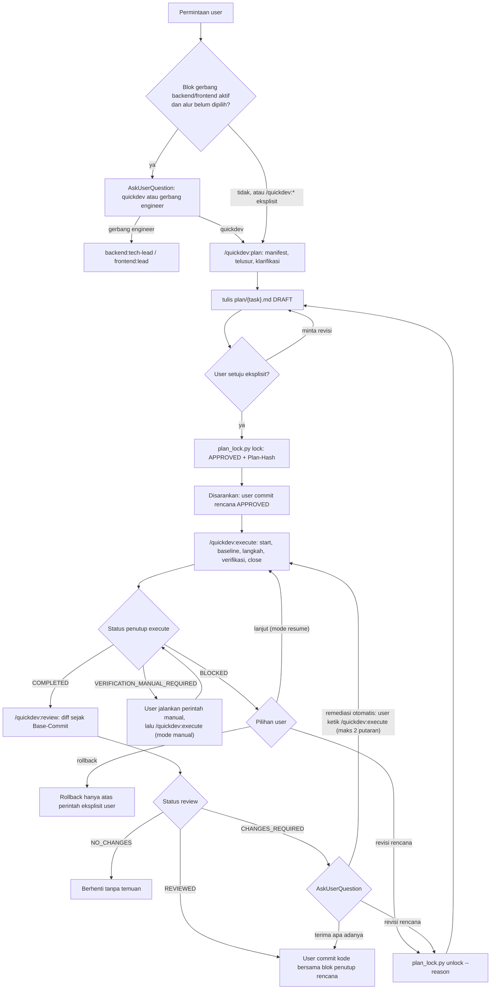
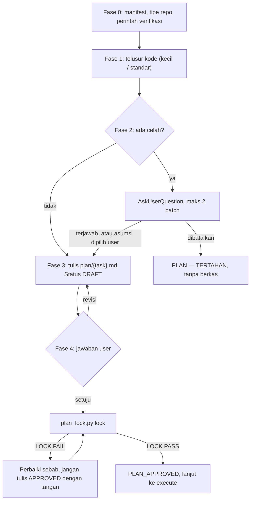
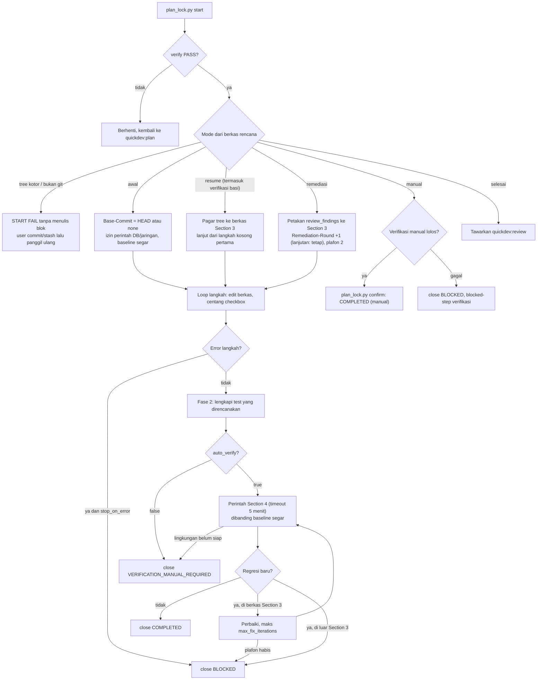
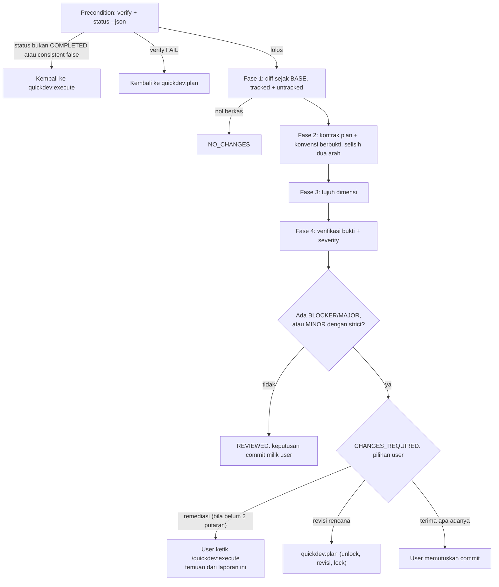
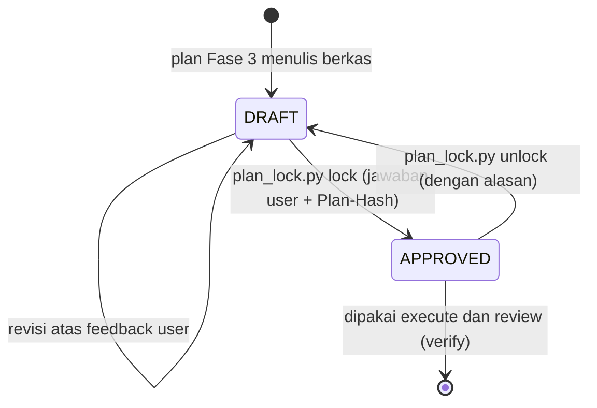

# Alur Plugin `quickdev`

> `quickdev` (v0.12.0) adalah alur kerja ringan untuk repo backend, frontend, dan fullstack, terutama repo kecil yang masih awal development. Plugin ini punya tiga skill (`plan → execute → review`), tanpa taskdir, tanpa subagent, tanpa hook, tanpa profil repo, dan hanya satu skrip pengunci rencana (ditambah pustaka sinkron nataflow opsional). Setiap tugas punya **satu berkas rencana** (`plan/<task>.md`), sedangkan perubahan kodenya boleh menyentuh banyak berkas dan layer. Pakai plugin ini untuk perubahan kecil sampai menengah yang tidak butuh BRD/PRD, ledger approval, atau review subagent. Plugin ini juga cocok untuk stack yang tidak dilayani `backend`/`frontend` (Next.js, FastAPI, Django, Rails), atau untuk kerja yang sengaja dibuat ringan di repo yang sudah memakai kedua plugin itu. Kerja berisiko (kontrak API, migrasi skema, perubahan lintas modul yang butuh jejak keputusan) sebaiknya naik ke `backend:tech-lead` atau `frontend:lead`. Sejak 0.12 (Langkah 34), `profile`, `explore`, dan `clarify` dihapus: penelusuran dan klarifikasi menjadi fase `plan`, dan perintah verifikasi dibaca dari manifest ke Section 4 rencana.

## Peta Komponen

Path relatif terhadap `src/plugins/quickdev/`.

| Komponen | Jenis | Peran singkat | Berkas |
|---|---|---|---|
| `quickdev:plan` | skill | Membaca manifest (tipe repo, perintah verifikasi), menelusuri kode terkait, mengklarifikasi celah, lalu menulis `plan/<task>.md` sebagai `DRAFT` dan menguncinya jadi `APPROVED` sesudah user menyetujui | `skills/plan/SKILL.md` |
| `quickdev:execute` | skill | Mengukur baseline segar, menerapkan langkah rencana, memverifikasi dengan perintah Section 4, dan memperbaiki regresi dalam cakupan rencana | `skills/execute/SKILL.md` |
| `quickdev:review` | skill | Menilai diff sejak `Base-Commit` terhadap rencana dan konvensi kode di sekitarnya dalam 7 dimensi. Read-only, hasilnya hanya laporan terminal | `skills/review/SKILL.md` |
| `plan_lock.py` | script | Pengunci rencana: sidik Section 1–5 (`Plan-Hash`, `Hash-Scope: body`), penurunan mode eksekusi (termasuk predikat tree bersih mode `awal`), baseline segar terikat `Base-Commit`, segel verifikasi (`Verified-Hash`/`Tree-Hash`), penulisan blok `## Execution Status`, dan sinkron nataflow (`sync-payload`) | `skills/_common/plan_lock.py` |
| `nataflow_sync.py` | pustaka | Config `.claude/nataflow.json`, identitas repo, argumen task/workdir/dokumen, dan diff manifest remote. Salinan identik lintas plugin | `skills/_common/nataflow_sync.py` |
| Prosedur sinkron nataflow | referensi | Satu perintah `sync-payload --push` untuk rencana; dipakai `plan` dan `execute` | `skills/plan/references/nataflow-sync.md` |
| Panduan migrasi | dokumen | Pindah dari 0.11 (enam skill, profil) ke 0.12 | `MIGRATION_v0.11.x_to_v0.12.0.md` |
| Manifest plugin | konfigurasi | Nama, versi, deskripsi | `.claude-plugin/plugin.json` |

Ketiga skill memakai `disable-model-invocation: true`. Artinya, skill hanya jalan bila **user** mengetik `/quickdev:<skill>`. Model tidak memanggilnya sendiri, termasuk dari skill quickdev lain. Setiap skill ditutup dengan status terminal, lalu **menawarkan** langkah berikutnya dan menunggu user.

## Alur Utama

Semua panah antar-skill adalah **tawaran**. Skill berikutnya baru jalan setelah user mengetik perintahnya sendiri. Tidak ada langkah persiapan tingkat repo: `plan` membaca manifest dan menelusuri kode untuk setiap tugas. Titik tengah alur ini adalah `plan/<task>.md`. Isinya, termasuk tabel perintah verifikasi Section 4, dikunci oleh sidik `Plan-Hash` saat user menyetujuinya. Setelah itu `execute` hanya boleh mengubah checkbox Section 3 dan blok `## Execution Status`. `review` menilai hasilnya terhadap rencana itu dan membuka tiga jalan: remediasi (maksimal 2 putaran), revisi rencana, atau terima apa adanya. quickdev sendiri tidak pernah meng-commit.

## Alur per Skill

### `quickdev:plan`

- **Pemicu / kapan dipakai**: user ingin mengerjakan fitur, bug, atau perubahan di repo lewat alur ringan.
- **Prasyarat**:
  - Permintaan menyebut area yang dapat ditelusuri.
  - Repo bisa dibaca. Untuk pencarian: `Glob`/`Grep` bila tersedia, bila tidak Bash baca-saja (`git ls-files | grep`, `grep -rn`, `rg`).
  - Izin tulis ke `plan/`.
  - `python3` 3.12+.
- **Langkah**:
  1. **Fase 0: konteks repo.** Validasi `task_name` (kebab-case). Pindai manifest di root atau `target_dir` (monorepo tanpa `target_dir` → tanyakan workspace). Tentukan tipe repo: backend, frontend, atau fullstack (butuh minimal satu berkas route server nyata). Baca perintah typecheck, lint, test, dan build dari `scripts`/konfigurasi runner; jenis tanpa runner dicatat `TIDAK_ADA`. Tandai Risiko `menyentuh DB/jaringan` atau `menulis artefak`. Tidak ada perintah yang dijalankan. Bila blok gerbang engineer ada dan `.claude/workflow` belum ada, tawarkan penanda itu (ditulis hanya atas persetujuan user).
  2. **Fase 1: telusur kode.** Tentukan **skala**:
     - `kecil`: ≤2 berkas, tanpa perubahan kontrak publik, skema, atau env → `trace_depth=1`, cukup definisi, pemanggil langsung, dan test berkas target;
     - `standar`: rantai pemanggil per layer (backend: route → middleware → service → data access → skema; frontend: page → komponen → hook/state → API client → DTO), konsumen simbol yang berubah, skema DB, env, dan test terkait.

     Setiap path dan simbol yang masuk rencana wajib terbukti (`path:baris`). Topik tidak ditemukan → perluas sekali, lalu lapor nol temuan. Simbol di > 10 modul → tanyakan modul target. Hasil telusur tidak dilaporkan tersendiri.
  3. **Fase 2: klarifikasi.** Nol celah → fast-path tanpa pertanyaan. Ada celah → batch `AskUserQuestion` maksimal `batch_limit` (default 3, maksimal 4) dan 2 batch, dengan konteks temuan dan satu opsi `(Recommended)`. Fokus mengikuti tipe repo (backend: endpoint, payload, status code, DB, auth; frontend: navigasi, tata letak, cabang state, URL, validasi form; fullstack: boundary UI ↔ route server). Jawaban delegasi → pola yang terbukti di kode, dikonfirmasi sekali. Celah tersisa sesudah batch ke-2 → *asumsi tertulis di Section 1*, *perkecil lingkup*, atau *batal*.
  4. **Fase 3: dekomposisi dan tulis rencana.** Langkah atomik hanya untuk layer tersentuh (backend: skema → DTO → data access → service → route → test; frontend: types → API client → state → komponen → page → test), masing-masing dengan path, simbol, dan kriteria selesai; konsumen terdampak → langkah "sesuaikan konsumen".
     - Metadata: `Status: DRAFT`, `Author`, `Date`.
     - Isi: Section 1 Overview & Objectives (keputusan klarifikasi, asumsi, out of scope), 2 Architecture & Layer Impact (modul berbukti `path:baris`, berkas acuan konvensi), 3 Atomic Implementation Steps (checkbox `- [ ]`), 4 Verification & Testing Strategy (tabel `Jenis | Perintah | Cwd | Risiko` + skenario test), 5 Rollback & Contingency (bila `include_rollback`).
  5. **Fase 4: approval gate.** Sajikan ringkasan gerbang 3–4 kalimat beserta path rencana (bukan daftar langkah), sebut perintah bertanda DB/jaringan, lalu `AskUserQuestion`: *Setujui rencana* atau *Revisi (sebut poinnya)*. Persetujuan mencakup izin menjalankan perintah Section 4 kecuali yang bertanda DB/jaringan.
     - User minta revisi → perbarui rencana, tetap `DRAFT`, ajukan ulang.
     - User minta revisi pada rencana yang sudah dieksekusi → langkah yang teksnya berubah dikembalikan ke `- [ ]`.
     - User setuju → jalankan `plan_lock.py lock --plan … --answer -` dengan jawaban user apa adanya lewat heredoc berkutip (`<<'QD_EOF'`).
  6. **Fase 5.** Setelah `LOCK PASS`, jalankan sinkron nataflow (`references/nataflow-sync.md`), set status `PLAN_APPROVED`, dan tawarkan `/quickdev:execute`.
  7. **Rute sinkron ulang.** "sinkron ulang `<plan_path>`" hanya menjalankan prosedur sinkron atas rencana yang sudah ada, lalu menutup dengan `SINKRON — <plan_path> · nataflow <segmen>`, tanpa menyentuh rencana.
- **Subagent yang didispatch**: Tidak ada.

- **Output / artefak**: `plan/<task>.md` berstatus `APPROVED`, dengan `Approved-At`, `Approval` (kutipan jawaban user), `Hash-Scope: body`, dan `Plan-Hash` yang ditulis skrip. Ringkasan terminal memuat `TIPE`, `KLARIFIKASI`, `VERIFIKASI`, dan `KUNCI: Plan-Hash <12 hex>`. Status: `PLAN_APPROVED`.
- **Gerbang & commit**:
  - `Status: APPROVED` hanya boleh ditulis oleh `plan_lock.py lock`.
  - Skill tidak menjalankan perintah verifikasi, build, test, atau migrasi.
  - Section 1–5 rencana yang sudah `APPROVED` tidak boleh diubah langsung. Revisi harus lewat `unlock --reason`, lalu revisi, lalu `lock` lagi. Blok `## Execution Status` dipertahankan.
  - Rencana format lama (tanpa `Plan-Hash`) harus di-`unlock` dan disetujui ulang.
  - Skill tidak meng-commit. README menyarankan user meng-commit rencana `APPROVED` sebelum `execute`.
- **Lanjut ke**: `quickdev:execute` (`plan_path=<plan_dir>/<task_name>.md`).

### `quickdev:execute`

- **Pemicu / kapan dipakai**: rencana sudah `APPROVED`. Skill yang sama dipanggil ulang untuk melanjutkan kerja (`resume`), mencatat verifikasi manual (`manual`), atau memperbaiki temuan review (`remediasi`).
- **Prasyarat**:
  - `plan_lock.py verify` → `VERIFY PASS`.
  - Pagar working tree sesuai mode, lihat tabel mode di bawah.
  - Runtime dan toolchain aktif.
  - Tool `Edit`/`Write`/`Bash` dan `python3` 3.12+.
- **Langkah**:
  1. **Fase 0.** Jalankan `plan_lock.py start --plan <plan_path>` (tambah `--findings --findings-text -` bila `review_findings` diisi; teks bebas selalu lewat stdin dengan heredoc berkutip) sebelum mengubah apa pun. `plan_path` kosong → diambil dari ringkasan quickdev terakhir di percakapan, atau dari `plan/*.md` lewat `status --json`. Skrip menjalankan `verify`, menurunkan mode, dan menulis blok `## Execution Status`.

     | Keadaan rencana | Mode | Tindakan |
     |---|---|---|
     | `verify` FAIL | — | berhenti, ke `quickdev:plan` |
     | tanpa blok, nol `[x]`, tree bersih selain direktori rencana | `awal` | `Base-Commit` = HEAD atau `none`; baseline segar sebelum mutasi pertama |
     | tanpa blok, nol `[x]`, tree kotor atau bukan repo git | — | `START FAIL` **sebelum** blok ditulis; user commit/stash lalu memanggil ulang |
     | blok `IN_PROGRESS`/`BLOCKED`, ada `[x]` tanpa blok, blok terminal dengan langkah `[ ]` baru, atau segel penutup basi | `resume` | pagar tree ke berkas Section 3; batalkan centang terakhir yang berkasnya tidak berubah; lanjut dari `[ ]` pertama dengan edit idempoten; semua `[x]` → langsung Fase 3 |
     | blok `IN_PROGRESS`/`BLOCKED` dengan `Remediation-State: OPEN` | `remediasi` lanjutan | temuan dicetak ulang dari `Findings-<n>`; ronde tidak bertambah |
     | blok `COMPLETED` + `--findings` | `remediasi` | petakan temuan ke berkas Section 3; `Remediation-Round` +1, `Remediation-State: OPEN`, plafon 2 |
     | blok `VERIFICATION_MANUAL_REQUIRED`, semua `[x]`, segel cocok | `manual` | `AskUserQuestion`: lolos → `confirm`; gagal → `close --status BLOCKED --blocked-step verifikasi` |
     | blok `COMPLETED`, semua `[x]`, segel cocok, tanpa temuan | `selesai` | tidak ada kerja, tawarkan `review` |

     `start` mencetak `PERINGATAN:` bila `Base-Commit` bukan leluhur HEAD, `INFO:` bila HEAD maju, dan `BASELINE:` bila baseline segar sudah terkunci. Mode `awal`: perintah Section 4 bertanda `menyentuh DB/jaringan` ditanyakan sekali (*Jalankan* · *Lewati*), lalu semua perintah dijalankan sebelum mutasi dan ringkasannya dikunci lewat `plan_lock.py baseline`.
  2. **Fase 1: loop per langkah** (atau per temuan pada mode remediasi). Edit berkas mengikuti berkas acuan konvensi di Section 2 rencana, periksa sintaks dan impor, lalu centang `- [x]`. Bila terjadi error dan `stop_on_error=true`, jalankan `close --status BLOCKED --blocked-step <n>`. `stop_on_error=false` melanjutkan langkah yang tidak bergantung pada langkah gagal, lalu menutup `BLOCKED` di langkah gagal pertama. Kerja parsial dibiarkan di working tree.
  3. **Fase 2: test.** Lengkapi skenario Section 4, tetapi hanya di berkas test yang tercantum di rencana. Skenario tanpa berkas test dicatat sebagai celah rencana. Framework test baru tidak boleh dipasang.
  4. **Fase 3: full verification gate.** Jalankan perintah tabel Section 4 dari `Cwd`, masing-masing dengan timeout 300000 ms. Perintah bertanda DB/jaringan yang belum diizinkan di pemanggilan ini ditanyakan lewat `AskUserQuestion`; migrasi tidak pernah dijalankan. Lint `--fix` hanya boleh untuk berkas yang disentuh. Pembanding: baseline segar (`BASELINE:`); tanpa baseline tercatat, galat di luar berkas rencana = `UNVERIFIED`. Galat dicocokkan per berkas + aturan/nama test, tanpa nomor baris:
     - pembanding `PASSED` → galat apa pun sekarang = regresi;
     - pembanding `FAILED` → galat yang tercatat (jumlahnya tidak bertambah) = bawaan, galat lain = regresi;
     - pembanding `SKIPPED`, `TIMEOUT`, atau baseline absen → tidak ada pembanding; bila gagal karena lingkungan, hasil akhirnya `VERIFICATION_MANUAL_REQUIRED`.

     Regresi di berkas Section 3 diperbaiki, maksimal `max_fix_iterations` kali (default 3). Regresi yang menuntut berkas di luar Section 3 → `BLOCKED`.
  5. **Fase 4.** Jalankan `close --status COMPLETED|VERIFICATION_MANUAL_REQUIRED --verification -`. Skrip menolak `COMPLETED` bila masih ada `- [ ]`, menutup ronde remediasi yang `OPEN`, dan menyegel `Verified-Hash` + `Tree-Hash`. Susun laporan dan tawarkan `review`, dengan perubahan dibiarkan uncommitted.
  6. **Sinkron nataflow.** Sesudah **tiap** `close`/`confirm` yang PASS (termasuk `BLOCKED` di Fase 0, 1, 3, dan Failure path), prosedur sinkron mendorong rencana beserta blok eksekusinya. Hasilnya baris `NATAFLOW:` ringkasan; `GAGAL` tidak mengubah status terminal.
- **Subagent yang didispatch**: Tidak ada.

- **Output / artefak**:
  - Kode dan test yang berubah, dibiarkan uncommitted.
  - `plan_path` dengan checklist tercentang dan blok `## Execution Status` (`Status`, `Base-Commit`, `Remediation-Round`, `Remediation-State`, `Findings-<n>`, `Baseline`, `Baseline-Commit`, `Verification`, `Blocked-Step`, `Verified-Hash`, `Tree-Hash`, `Timestamp`).
  - Ringkasan maksimal 17 baris.
  - Status: `COMPLETED` | `VERIFICATION_MANUAL_REQUIRED` | `BLOCKED`.
- **Gerbang & commit**:
  - Rencana wajib lolos `verify`.
  - Di `plan_path`, hanya baris checkbox Section 3 dan blok eksekusi yang boleh berubah. Blok itu hanya ditulis `plan_lock.py`.
  - Perbaikan dibatasi ke berkas Section 3.
  - Skill **tidak commit dan tidak merge**.
  - Rollback (`git checkout`, `reset`, `stash`, hapus berkas) hanya dengan persetujuan eksplisit user.
- **Lanjut ke**:
  - `COMPLETED` → `quickdev:review`.
  - `VERIFICATION_MANUAL_REQUIRED` → user menjalankan perintah manual, lalu `quickdev:execute` (mode `manual`).
  - `BLOCKED` → `quickdev:execute` (mode `resume`, atau `remediasi` lanjutan bila ronde masih `OPEN`), `quickdev:plan` (revisi), atau rollback.

### `quickdev:review`

- **Pemicu / kapan dipakai**: eksekusi sudah `COMPLETED`/`COMPLETED (manual)` dan diff perlu dinilai sebelum user meng-commit.
- **Prasyarat**:
  - `plan_lock.py verify` → PASS.
  - `plan_lock.py status --json` → `execution.Status` ∈ {`COMPLETED`, `COMPLETED (manual)`} dan `consistent: true`. `consistent: false` mencakup segel basi (kode atau rencana berubah sesudah `close`) → kembali ke `execute` mode `resume`.
  - Direktori kerja adalah repo git yang valid.
  - Minimal satu berkas berubah di luar `plan/`. Bila nol, hasilnya `NO_CHANGES`.
  - Rencana ada.
  - `python3` 3.12+.
- **Langkah**:
  1. **Fase 1: diff.**
     - Tetapkan `<BASE>`: `base_ref`, lalu `Base-Commit`, lalu `HEAD`. Untuk `Base-Commit: none`, pakai tree kosong. `base_drift` ≠ `-` (base bukan leluhur HEAD) tanpa `base_ref` → berhenti dan tanyakan `base_ref` ke user.
     - Kumpulkan berkas tracked (`git diff <BASE>`) dan untracked (`git ls-files --others --exclude-standard`), tanpa `plan/` (dan `Profile:` rencana 0.11 bila tercatat). Ambil diff `-U3`.
     - Terapkan filter `scope_paths`.
     - Bila review jalan di sesi yang sama dengan `execute`, tandai `sesi-sama=ya`.
  2. **Fase 2: kontrak pembanding.** Ekstrak langkah, berkas target, dan strategi verifikasi dari rencana. Rekonstruksi konvensi dari Section 2 rencana dan berkas sejenis di direktori yang sama, masing-masing dengan bukti `path:baris` di luar diff. Hitung selisih dua arah: *scope creep* (berkas berubah tapi tidak direncanakan) dan *langkah terlewat* (direncanakan tapi tidak berubah).
  3. **Fase 3: tujuh dimensi.** Setiap dimensi wajib diberi vonis `CLEAN` atau daftar temuan:
     1. Korektness Logika
     2. Kepatuhan Kontrak Plan
     3. Konvensi Repo & Layer (temuan mengutip bukti pembanding di luar diff)
     4. Keamanan
     5. Error Handling
     6. Kualitas Test
     7. Regresi Cakupan (wajib mencari pemanggil secara nyata)
  4. **Fase 4: verifikasi bukti.** Buka ulang tiap baris kandidat temuan dan buang yang tidak terbukti. Beri severity `BLOCKER`/`MAJOR`/`MINOR`, deduplikasi, dan tulis rekomendasi imperatif (tanpa patch).
  5. **Fase 5: status.** Hasilnya `CHANGES_REQUIRED` bila ada minimal satu BLOCKER/MAJOR, atau MINOR dengan `strict=true`. Selain itu `REVIEWED`.
     - `CHANGES_REQUIRED` → `AskUserQuestion`: *Remediasi otomatis (putaran n+1/2)*, *Revisi rencana*, atau *Terima apa adanya*. Opsi pertama tidak ditawarkan bila `remediation_round` sudah 2. Review tidak memanggil `execute` (`disable-model-invocation`): opsi pertama ditutup dengan perintah `/quickdev:execute <plan_path>` untuk diketik user di sesi yang sama, dan `execute` mengambil temuan dari laporan ini.
     - `REVIEWED` → keputusan commit/merge diserahkan ke user.
- **Subagent yang didispatch**: Tidak ada. Konsekuensinya, independensi review bergantung pada sesi. README menyarankan menjalankan ulang `/quickdev:review` di sesi baru untuk putaran terakhir.

- **Output / artefak**: **laporan terminal saja**, tanpa berkas. Isinya blok per temuan (Lokasi, Bukti, Dimensi, Dampak, Rekomendasi), tabel cakupan 7 dimensi, dan ringkasan maksimal 17 baris. Status: `REVIEWED` | `CHANGES_REQUIRED` | `NO_CHANGES`.
- **Gerbang & commit**:
  - Read-only penuh. Git yang boleh dipakai hanya `diff`, `status`, `log`, `ls-files`, `rev-parse`, dan `hash-object -t tree /dev/null`. Dari `plan_lock.py` hanya `verify` dan `status`.
  - Rencana dan checklist tidak boleh diubah.
  - Severity tidak boleh diturunkan demi mendapat `REVIEWED`.
- **Lanjut ke**: `execute` (remediasi), `plan` (revisi), user (commit/merge), atau tidak ada (`NO_CHANGES`).

## Subagent

Tidak ada. README menyebutkan "semua kerja berlangsung di percakapan utama", dan `plugin.json` menegaskan "tanpa taskdir, subagent, maupun profil repo". Akibatnya:

- tidak ada reviewer independen seperti di `backend`/`frontend`;
- `review` hanya menandai `sesi-sama=ya` bila jalan di sesi yang sama dengan `execute`, lalu menyarankan putaran terakhir di sesi baru.

## Hooks & Guard

**Hooks: tidak ada.** quickdev tidak punya `hooks/`. Hook SessionStart milik `backend` dan `frontend` menyuntik blok gerbang (`<backend-tech-lead-gate>` / `<frontend-lead-gate>`) di repo yang manifestnya cocok. Teks gerbang itu (`hooks/gate_text.py` di kedua plugin) mengecualikan permintaan yang memanggil atau melanjutkan `/quickdev:*`.

**Guard dan pengaman lain:**

| Guard | Mekanisme |
|---|---|
| Pemanggilan hanya oleh user | `disable-model-invocation: true` di ketiga skill. Tiap skill menawarkan langkah berikutnya, tidak memanggilnya sendiri |
| Koeksistensi | Blok gerbang engineer + `/quickdev:*` eksplisit → lanjut. Permintaan baru tanpa pilihan alur → tanya sekali (quickdev atau gerbang engineer). Dilarang memakai `backend:*`/`frontend:*` sebagai pengganti langkah |
| Penanda `.claude/workflow` | Berkas ini ada tetapi tidak memuat `quickdev` → skill melapor dan bertanya dulu sebelum lanjut |
| Kunci rencana (`plan_lock.py`) | Sidik sha256 atas `## 1.` sampai sebelum `## Execution Status` (CRLF → LF, spasi ujung dibuang, `[x]` dihitung sebagai `[ ]`), ditandai `Hash-Scope: body`. Heading dan checklist di dalam code fence diabaikan; fence tak tertutup → FAIL. Rencana 0.4.0 tanpa `Hash-Scope` dan rencana 0.5–0.11 ber-`Hash-Scope: profile+body` (sidik ditambah baris `Profile:`) diverifikasi dengan rumusnya masing-masing. `execute`/`review` menolak rencana yang sidiknya berbeda |
| Perintah verifikasi terkunci | Tabel Section 4 ikut disidik, jadi perintah yang dijalankan `execute` adalah perintah yang disetujui user |
| Penulisan atomik | `Plan.save()` menulis ke berkas sementara lalu `os.replace`, jadi sesi yang putus tidak meninggalkan rencana setengah tertulis. Mode berkas asli dipertahankan; isi yang tidak berubah tidak ditulis ulang |
| Pagar working tree | Mode `awal`: `start` sendiri menolak tree kotor di luar direktori rencana (dan `Profile:` rencana 0.11 bila tercatat) **sebelum** menulis `Base-Commit`. Mode `resume`/`remediasi`: perubahan hanya di berkas Section 3 dan `plan/` |
| Pagar cakupan perbaikan | Perbaikan regresi dan temuan review hanya di berkas Section 3. Di luar itu → `BLOCKED` |
| Plafon | `max_fix_iterations` (default 3) per eksekusi. `REMEDIATION_CAP = 2` putaran remediasi (`start --findings` menolak putaran ke-3); ronde yang terputus dilanjutkan tanpa menambah hitungan |
| Baseline aman | `plan` tidak menjalankan perintah apa pun. `execute` menanyakan perintah bertanda `menyentuh DB/jaringan` sebelum dijalankan, timeout 5 menit per perintah, migrasi/pengubah data tidak pernah dijalankan |
| Baseline terikat commit | `plan_lock.py baseline` hanya menerima ringkasan di HEAD = `Base-Commit` dengan tree bersih, satu-satunya pembanding regresi. Galat dicocokkan tanpa nomor baris |
| Segel verifikasi | `close` menyegel `Verified-Hash` (= `Plan-Hash`) dan `Tree-Hash` (isi berkas yang berbeda dari `Base-Commit` + untracked). Berubah sesudahnya → `consistent: false`, `confirm` FAIL, `start` → `resume` |
| Teks bebas lewat stdin | Nilai `-` dibaca dari stdin (heredoc `<<'QD_EOF'`), satu per panggilan; `--blocked-step` dirapatkan satu baris; kunci metadata/blok ganda → FAIL |
| Review read-only | Hanya perintah git baca dan `plan_lock.py verify`/`status` |

**Subperintah `plan_lock.py`:**

| Subperintah | Dipanggil oleh | Syarat | Efek |
|---|---|---|---|
| `lock` | `plan` Fase 4 | `Status: DRAFT`, `--answer` tidak kosong, Section 3 punya checkbox, Section 1–5 tidak kosong, fence tertutup | Tulis `Status: APPROVED`, `Approved-At`, `Approval` (dikutip, maks 300 karakter), `Hash-Scope: body`, `Plan-Hash` |
| `verify` | Precondition `execute`/`review`; juga dijalankan di dalam `start`/`baseline`/`close`/`confirm` | `APPROVED`, `Plan-Hash` ada dan sama dengan sidik sekarang (sesuai `Hash-Scope`) | `VERIFY PASS` / `VERIFY FAIL` |
| `start` | `execute` Fase 0 | `verify` lolos. Mode `awal` butuh repo git dan tree bersih di luar direktori rencana. Remediasi baru butuh `COMPLETED`, `--findings-text`, dan putaran < 2 | Menurunkan mode, menulis blok (`IN_PROGRESS`, `Base-Commit`, `Remediation-Round`, `Remediation-State`, `Findings-<n>`). `Base-Commit` tidak pernah ditimpa. Bila `Base-Commit` belum ada saat resume, diisi dengan `Base-Note`. Mencetak `TEMUAN:`, `PERINGATAN:`, `INFO:`, `BASELINE:` |
| `baseline` | `execute` Fase 0 (mode `awal`) | Blok `IN_PROGRESS`, HEAD = `Base-Commit`, tree bersih, ringkasan tidak kosong | Tulis `Baseline` (maks 600 karakter) dan `Baseline-Commit` |
| `close` | `execute` (penutupan / BLOCKED) | Blok berstatus `IN_PROGRESS`, atau `VERIFICATION_MANUAL_REQUIRED` → `BLOCKED` | Tulis status terminal, `Verification`, `Blocked-Step`. Menolak `COMPLETED` bila masih ada `[ ]`. `BLOCKED` butuh `--blocked-step`. `COMPLETED`/`VERIFICATION_MANUAL_REQUIRED` menyegel `Verified-Hash` + `Tree-Hash` dan menutup ronde remediasi |
| `confirm` | `execute` mode `manual` | Semua `[x]`, blok `VERIFICATION_MANUAL_REQUIRED`, jawaban user tidak kosong, segel cocok | `COMPLETED (manual)` + `Manual-Confirmation` |
| `status` | `review` (`--json`) | — | Ringkasan: `hash_ok`, `hash_scope`, `profile` (rencana 0.11; `-` untuk rencana baru), jumlah langkah, `remediation_round`/`remediation_open`/`open_findings`, `base_drift`/`commits_since_base`, `baseline`, `consistent`/`inconsistency` (termasuk segel basi), blok eksekusi |
| `unlock` | `plan` (revisi) | `APPROVED`, `--reason` tidak kosong | `Status: DRAFT`, `Plan-Hash: -`, `Unlock-Reason`. Blok eksekusi dipertahankan |
| `sync-payload` | prosedur sinkron (`plan`, `execute`) | `.claude/nataflow.json` ada dan sah (absen → `SKIP` sebelum rencana dibaca). `--plan`: rencana pernah dikunci (`Approved-At`) | Tidak menulis berkas. `--push` (prosedur): memanggil server sendiri dan mencetak satu baris segmen (29). Tanpa `--push`: argumen `task`/`workdir`/`list_document` tanpa isi; `--remote -`: dokumen yang sha, tipe, atau metadatanya berbeda dari manifest remote |

**Keterbatasan yang diakui README**:

- Kunci rencana adalah bukti audit, bukan pencegahan mutlak: model tetap bisa memanggil `unlock` lalu `lock` sendiri. Keduanya tercatat di `Approval:`/`Unlock-Reason:`.
- Konteks repo dideteksi ulang di setiap rencana; murah di repo kecil, berulang di repo besar.
- `Findings-<n>` dipotong 300 karakter dan `Baseline` 600 karakter. Remediasi otomatis paling andal bila `/quickdev:execute` diketik di sesi yang sama dengan review.
- `Tree-Hash` tidak menyegel isi submodule dan berkas ter-ignore.
- Independensi review bergantung pada sesi.

## Artefak & Siklus Status

| Artefak | Lokasi | Ditulis oleh | Catatan |
|---|---|---|---|
| Rencana | `plan/<task>.md` (`plan_dir`, `task_name` kebab-case) | `plan` (isi), `plan_lock.py` (metadata kunci + blok eksekusi), `execute` (checkbox) | Satu berkas per tugas dan satu-satunya sumber spesifikasi dan perintah verifikasi bagi `execute`/`review`. **Di-commit** |
| Penanda alur | `.claude/workflow` | `plan` Fase 0, atas persetujuan user | `quickdev` → hook backend/frontend diam. `frontend quickdev` → hanya hook frontend menyala |
| Laporan review | Terminal | `review` | Tidak menjadi berkas |
| Perubahan kode | Working tree (uncommitted) | `execute` | Commit adalah keputusan user |
| Cermin nataflow (opsional) | Server MCP nataflow | prosedur sinkron | Workdir `quickdev:<repo>:<path rencana>` + task; dokumen `quickdev.plan` (isi disk). Status workdir: `COMPLETED*` → `done`, `BLOCKED` → `blocked`, selain itu `active`; task `in_progress` sejak rencana terkunci (workdir terbit, 28 T1), `done` saat `COMPLETED*` |

Section 4 rencana berupa tabel `Jenis | Perintah | Cwd | Risiko` (typecheck, lint, test, build; `TIDAK_ADA` bila tanpa runner), lalu skenario test. Ringkasan baseline di blok eksekusi memakai format `<jenis>=<status>[<berkas> <aturan/nama test>×<n>; …]` dengan status `PASSED`, `FAILED`, `TIMEOUT`, `SKIPPED`, atau `TIDAK_ADA`.

**Siklus metadata `Status:` rencana:**

**Siklus blok `## Execution Status`:**

```mermaid
stateDiagram-v2
    state "COMPLETED (manual)" as COMPLETED_MANUAL
    [*] --> IN_PROGRESS : start mode awal (tulis Base-Commit)
    IN_PROGRESS --> COMPLETED : close, semua langkah tercentang, verifikasi hijau
    IN_PROGRESS --> VERIFICATION_MANUAL_REQUIRED : close, auto_verify false atau lingkungan belum siap
    IN_PROGRESS --> BLOCKED : close, error langkah, regresi di luar rencana, atau plafon perbaikan habis
    IN_PROGRESS --> IN_PROGRESS : start lagi (sesi putus; remediasi OPEN dilanjutkan)
    BLOCKED --> IN_PROGRESS : start mode resume, atau remediasi lanjutan bila ronde OPEN
    VERIFICATION_MANUAL_REQUIRED --> COMPLETED_MANUAL : confirm (user menyatakan lolos, segel cocok)
    VERIFICATION_MANUAL_REQUIRED --> BLOCKED : close BLOCKED (verifikasi manual gagal)
    VERIFICATION_MANUAL_REQUIRED --> IN_PROGRESS : start resume (langkah baru atau segel basi)
    COMPLETED --> IN_PROGRESS : start findings (remediasi, maks 2 putaran)
    COMPLETED --> IN_PROGRESS : start resume (langkah baru atau segel basi)
    COMPLETED_MANUAL --> IN_PROGRESS : start findings (remediasi) atau resume
    COMPLETED --> [*] : review REVIEWED, user commit
    COMPLETED_MANUAL --> [*] : review REVIEWED, user commit
```

Urutan git yang disarankan README: `plan` → commit rencana `APPROVED` → `execute` → `review` → commit kode bersama blok penutup rencana.

## Handoff Lintas Plugin

- **Naik ke plugin engineer.** Kerja berisiko (kontrak API, migrasi skema, perubahan lintas modul yang butuh jejak keputusan) dan repo besar dengan konvensi mapan sebaiknya lewat `backend:tech-lead` atau `frontend:lead`, yang memakai taskdir, brief, dan profil repo. quickdev tidak mengirim artefaknya ke plugin itu. Pilihan alur diambil user lewat `AskUserQuestion` bila blok gerbang engineer aktif dan permintaannya baru.
- **Tidak saling menggantikan.** Setiap skill quickdev dilarang memakai `backend:*`/`frontend:*` sebagai pengganti langkahnya. quickdev tidak membaca `.claude/profile/<plugin>/` milik backend/frontend.
- **Hidup berdampingan dengan hook engineer.** Gerbang `backend`/`frontend` mengecualikan `/quickdev:*` dan susulan di tengah skill quickdev. Untuk repo yang sepenuhnya memakai quickdev, tulis `.claude/workflow`:

  | Isi `.claude/workflow` | Efek |
  |---|---|
  | `quickdev` | Hook backend dan frontend diam |
  | `frontend quickdev` | Hanya hook frontend yang menyala |
  | (berkas tidak ada) | Perilaku normal |

- **analyst.** Sumber quickdev tidak menyebut integrasi dengan tiket `analyst`. Task cermin nataflow quickdev selalu task baru ber-`workdir_key`, tidak pernah task tiket.
- **Config nataflow bersama.** `.claude/nataflow.json` yang sama dibaca `analyst`, `backend`, dan `frontend`; quickdev tidak membaca `analyst/nataflow.json` lama.

## Titik Gagal & Pemulihan

| Kondisi | Skill | Perilaku | Pemulihan |
|---|---|---|---|
| Permintaan tanpa area yang dapat ditelusuri | plan | Bertanya sebelum Fase 0 | User menyebut fitur, bug, atau berkas |
| Monorepo tanpa `target_dir` | plan | `AskUserQuestion` workspace target | Pilih workspace |
| Manifest tanpa runner untuk suatu jenis | plan | Baris Section 4 `TIDAK_ADA`, tidak dikarang | — |
| Topik tidak ditemukan | plan | Perluas sekali, lalu lapor nol temuan | User menyebut berkas/simbol, rencanakan berkas baru bersama user, atau batal |
| Simbol ada di > 10 modul | plan | Minta konfirmasi modul target | — |
| Celah tersisa sesudah batch ke-2 | plan | `AskUserQuestion` | Asumsi tertulis di Section 1, perkecil lingkup, atau batal |
| Dialog klarifikasi dibatalkan | plan | Blok `PLAN — TERTAHAN`, tanpa menulis berkas | `/quickdev:plan` berikutnya melanjutkan dari blok itu |
| Nama task sudah dipakai rencana `APPROVED` | plan | — | Tawarkan `<task>-v2` atau revisi lewat `unlock` |
| `LOCK FAIL` | plan | Dilarang menulis `APPROVED` dengan tangan | Perbaiki sebabnya (bukan DRAFT, jawaban kosong, tanpa checkbox, Section kosong, fence tak tertutup) |
| `VERIFY FAIL` (DRAFT, tanpa `Plan-Hash`, Section 1–5 berubah, `Profile:` rencana 0.11 berubah, `Hash-Scope` asing) | execute / review | Berhenti tanpa mengubah kode | Pulihkan teks, atau `unlock` → revisi → `lock` di `quickdev:plan` |
| Tree kotor di mode `awal`, atau bukan repo git | execute | `START FAIL` sebelum blok ditulis, tanpa `Base-Commit` | User meng-commit atau men-stash perubahan lain, lalu `/quickdev:execute` lagi |
| `Base-Commit` bukan leluhur HEAD (rebase/amend) | execute / review | `start` mencetak `PERINGATAN:`; review berhenti sebelum membaca diff | User memilih `base_ref`, atau memakai base tercatat dengan catatan di baris `MODE` |
| Kode atau rencana berubah sesudah `close` (segel basi) | execute / review | `consistent: false`, `confirm` FAIL | `/quickdev:execute` → mode `resume` → verifikasi ulang → `close` menyegel ulang |
| Ronde remediasi terputus (sesi putus / `BLOCKED`) | execute | `start` → `remediasi` lanjutan dengan `Findings-<n>` tercatat | Lanjutkan temuan; ronde tidak bertambah |
| Baseline segar ditolak (HEAD bergeser / tree kotor) atau tidak tercatat | execute | `BASELINE FAIL` / baris `BASELINE:` absen | Lanjut tanpa pembanding; galat di luar berkas rencana dicatat `UNVERIFIED` |
| Perintah DB/jaringan ditolak user | execute | `<jenis>=SKIPPED` | Status akhir `VERIFICATION_MANUAL_REQUIRED`; user menjalankan manual → `execute` mode `manual` |
| Berkas di luar Section 3 berubah (resume/remediasi) | execute | Berhenti | Tanyakan user |
| Error langkah + `stop_on_error` | execute | `close BLOCKED --blocked-step <n>` | `/quickdev:execute` lagi → mode `resume` |
| Regresi menuntut berkas di luar Section 3 | execute | `BLOCKED` "(di luar rencana)" | `plan` (`unlock` → tambah langkah → `lock`), lalu `execute` mode `resume` |
| `max_fix_iterations` habis | execute | `BLOCKED` + tawaran rollback | Rollback hanya atas persetujuan user, atau revisi rencana |
| Lingkungan tidak bisa menjalankan verifikasi | execute | `VERIFICATION_MANUAL_REQUIRED` + daftar perintah manual | User menjalankan perintahnya → `execute` mode `manual` → `confirm` |
| Temuan review di luar cakupan rencana | execute | `BLOCKED` dengan daftar temuan; ronde tetap `OPEN` | Revisi lewat `quickdev:plan`, lalu `/quickdev:execute` melanjutkan ronde yang sama |
| Plafon remediasi habis | execute | `START FAIL`, kode tidak diubah | User memutuskan: terima, revisi rencana, atau perbaikan manual |
| `Remediation-Round` rusak / kunci metadata atau blok ganda / rencana bukan UTF-8 | `plan_lock.py` | `FAIL` rapi | Pulihkan dari riwayat git, jangan menebak |
| Eksekusi belum `COMPLETED`, atau `consistent: false` | review | Berhenti tanpa membaca diff | Kembali ke `quickdev:execute` (mode `manual` bila `VERIFICATION_MANUAL_REQUIRED`) |
| Nol perubahan sejak base | review | `NO_CHANGES` | Bila hasil sudah di-commit, ulangi dengan `base_ref=<Base-Commit>` |
| Diff terlalu besar | review | Lapor jumlah berkas/baris | User mempersempit lewat `scope_paths` |
| Berkas biner/generated | review | `SKIPPED (binary/generated)` di tabel cakupan | — |
| Bukti baris tidak terkonfirmasi | review | Kandidat dibuang, jumlahnya dicatat | — |
| `.claude/nataflow.json` rusak, server MCP mati, tool galat, sha ditolak, atau task ber-`workdir_key` kembar | plan / execute | Baris `NATAFLOW: GAGAL: <sebab>`; status terminal tidak berubah, berkas tidak disentuh | Perbaiki sebabnya, lalu `/quickdev:plan` "sinkron ulang `<plan_path>`" |
| Rencana belum pernah dikunci | `plan_lock.py sync-payload` | `FAIL`: rencana DRAFT tidak didorong | Kunci dulu lewat `quickdev:plan` |
