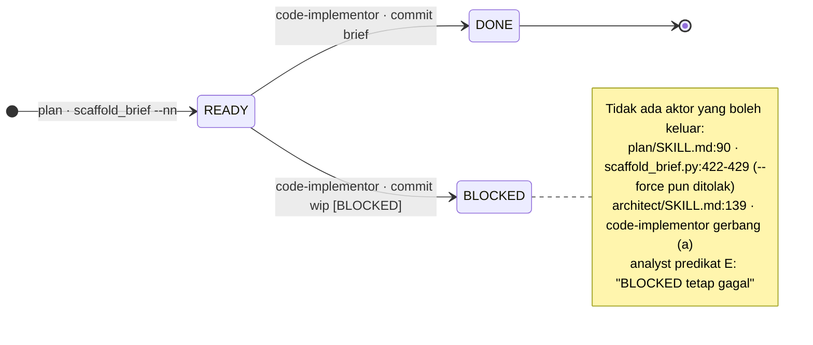
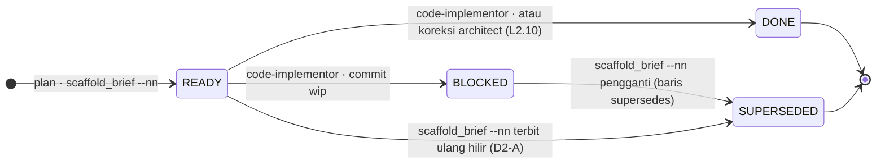
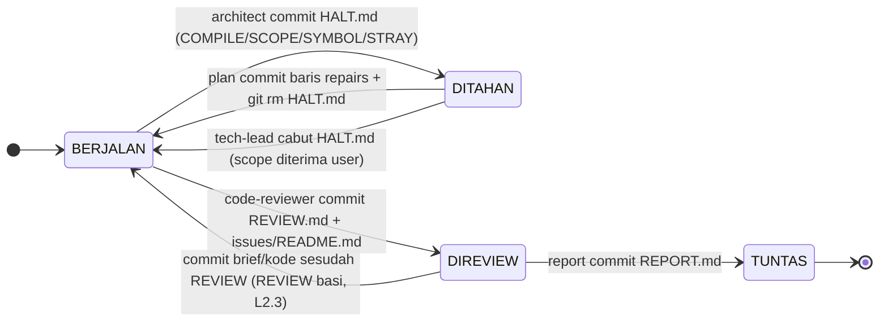
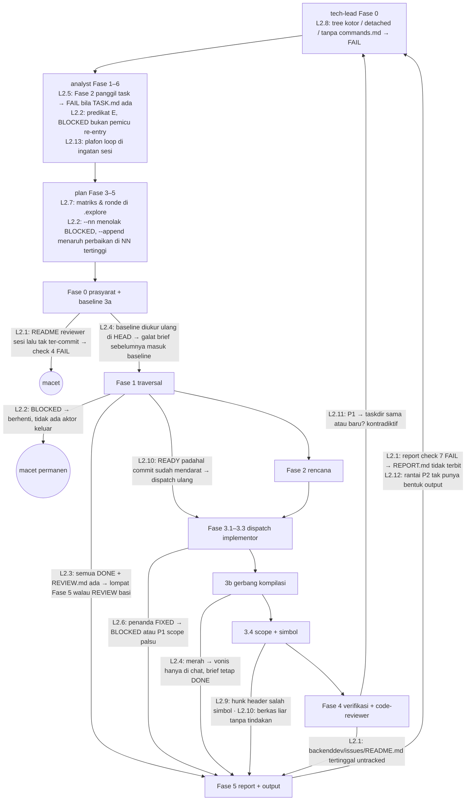

# Langkah 2 — Jalan Buntu & Alur Macet backenddev (rincian L2.1–L2.13)

> Sumber: `ISSUES.md` bagian "Langkah 2". Nomor baris mengacu commit `34684ee`. Semua path relatif terhadap root repo; `S=src/plugins/backenddev/skills`.
> Reproduksi dijalankan 2026-09-24 dengan git 2.47.3 dan Python 3.13.5. Path `mktemp` pada keluaran ditulis `<tmp>`; SHA berbeda tiap kali dijalankan.

## Tujuan langkah

Setiap titik henti di siklus eksekusi backenddev — brief `BLOCKED`, gerbang kompilasi merah, pelanggaran scope/simbol, review `P1`, sesi yang putus — punya **satu aktor pemilik**, **keadaan yang tercatat di disk (ter-commit)**, dan **jalan kembali sampai `REPORT.md`** tanpa commit manual oleh user dan tanpa improvisasi model.

## Urutan pengerjaan, dependensi, dan estimasi

| Urutan | Item | Severity | Estimasi | Bergantung pada | Alasan urutan |
|---|---|---|---|---|---|
| 1 | L2.1 | Kritis | 0,5 hari | — | Menghentikan kegagalan di **setiap** rantai normal; paling murah |
| 2 | L2.11 | Sedang | 0,25 hari | keputusan D1 | Rute perbaikan harus dikunci sebelum mesin status didesain |
| 3 | L2.2 | Kritis | 3 hari | L2.11; L5.1 bila sudah ada | Fondasi `SUPERSEDED` + pustaka `_common/brief_status.py` |
| 4 | L2.3 | Tinggi | 0,75 hari | L2.2 (pustaka) | Putaran perbaikan tidak bisa menutup tanpa review ulang |
| 5 | L2.4 | Tinggi | 2 hari | L2.2 | `HALT.md` + terbit ulang brief hilir memakai mekanisme L2.2 |
| 6 | L2.10 | Sedang | 0,5 hari | L2.4 (`HALT.md verdict: STRAY`) | |
| 7 | L2.5 | Tinggi | 1 hari | — | Jalur re-entry analyst dipakai skenario e2e |
| 8 | L2.7 | Tinggi | 1,5 hari | L2.2 | `--append` harus jalan di clone baru |
| 9 | L2.6 | Tinggi | 1 hari | keputusan D3 | |
| 10 | L2.9 | Tinggi | 1,5 hari | L2.4 (`verdict: SYMBOL`) | |
| 11 | L2.12 | Sedang | 0,25 hari | L2.2 | |
| 12 | L2.13 | Sedang | 1 hari | L2.5 | Fase 0 analyst membaca counter |
| 13 | L2.8 | Tinggi | 2 hari | koordinasi L1.3/L1.4 (hook yang sama) | Paling mandiri; boleh paralel |
| | **Total** | | **±15,25 hari kerja** | | |

**Dependensi dengan langkah lain**

- **Langkah 5 (L5.1, L5.3, 8.B B6):** L2.2 membutuhkan pembaca frontmatter yang hanya membaca blok `---` pertama. Bila L5.1 belum dikerjakan, L2.2 membuat `skills/_common/brief_status.py` (prototipe di L2.2) dan L5.1 memperluasnya — jangan membuat dua parser.
- **Langkah 6 (L6.1):** belum ada infrastruktur test. Langkah ini membuat `src/plugins/backenddev/tests/conftest.py` minimal (lihat "Infrastruktur test" di bawah); L6.1 memperluasnya.
- **Langkah 3 (L3.6):** L2.1 dan L3.6 menyunting baris commit yang sama di `agents/code-reviewer.md:80` — kerjakan dalam satu perubahan.
- **Langkah 8.B (B1):** skema `backenddev/issues/README.md` bentrok antara audit dan reviewer; L2.1 membuat reviewer meng-commit berkas itu, jadi B1 sebaiknya menyusul segera agar tabel rusak tidak ikut terkunci.
- **Langkah 1 (L1.3, L1.4):** L2.8 mengubah teks `hooks/tech-lead-gate.sh:78` dan `:88-96` yang juga disentuh L1.3/L1.4.

## Keputusan desain yang butuh user

| ID | Item | Pilihan | Rekomendasi |
|---|---|---|---|
| D1 | L2.11 | Perbaikan `P1` review: taskdir **sama** vs taskdir baru | Taskdir sama (selaras aturan BLOCKED, `Consumes`/`Produces` tidak putus) |
| D2 | L2.2, L2.4 | Urutan brief perbaikan vs brief `READY` sisa: **(A)** brief `READY` hilir diterbitkan ulang sesudah perbaikan dan versi lamanya `SUPERSEDED`, sehingga urutan `NN` = urutan eksekusi; **(B)** field `repairs` membuat traversal menjalankan brief perbaikan lebih dulu | (A): DAG linear dan Check C tetap berlaku tanpa pengecualian |
| D3 | L2.6 | Penanda `FIXED`: di-stage implementor vs dipindah ke akhir rantai | Staging oleh implementor; lihat alasan deadlock alat ukur SC di L2.6 |
| D4 | L2.4, L2.10 | `architect` memperoleh dua commit miliknya sendiri: `HALT.md` dan koreksi status `READY → DONE` | Setuju — keduanya karya `architect`, konsisten dengan "commit milik penulisnya" |
| D5 | L2.7, L2.13 | Tempat counter ter-commit: trailer commit vs blok `## Counters` di `TASK.md` | Ronde brief → trailer commit `plan`; loop analyst → `## Counters` `TASK.md` |
| D6 | L2.10 | Berkas liar sesudah commit implementor: hentikan + laporkan vs `git restore` ber-scope | Hentikan + laporkan (nondestruktif) |
| D7 | L2.8 | Jalur baca-kode saat profil belum ada: lolos terdegradasi vs tetap berhenti | Lolos terdegradasi, tawarkan `backenddev:profile` |

## Koreksi terhadap ISSUES.md (ringkas)

- **L2.1:** ada pemilik ketiga yang bertentangan — `lifecycle-recovery.md:149-150` menyuruh architect "catat ke `issues/README.md`".
- **L2.2:** skrip prasyarat architect **PASS** saat brief `BLOCKED` diikuti brief `READY`, bertentangan dengan `SKILL.md` Fase 1.
- **L2.3:** REVIEW.md tidak punya field `head` (HEAD tercatat di `range:`); REVIEW basi ber-`P1` menghasilkan loop tanpa ujung.
- **L2.7:** `brief-review-state.json` milik `validate_briefs.py:136-137`/`:275-276`, bukan `scaffold_brief.py:532-545`; plafon saat ini 2/generasi + 4/taskdir.
- **L2.9:** driver bahasa (`diff=java` dll.) pun salah melekatkan perubahan baris signature dan method baru ke simbol sebelumnya.
- **L2.11:** `lifecycle-recovery.md:99` membahas `BLOCKED`, bukan `P1`; kontradiksi tambahan di `tech-lead/SKILL.md:121`, `gate-lifecycle.md:17`, `decisions.md:105`; `reentry_reason` tidak diteruskan.
- **L2.13:** hitungan re-entry, transisi chain, dan amandemen sudah berjejak di git (ledger/subjek commit); yang tanpa jejak adalah penolakan user, pengembalian Open questions, dan ronde reviewer BRD/PRD.

## Ringkasan berkas yang disentuh

| Berkas | Item |
|---|---|
| `src/plugins/backenddev/skills/_common/brief_status.py` **(baru)** | L2.2, L2.3, L2.4, L2.6, L2.10 |
| `$S/architect/scripts/check_preconditions.py` | L2.2, L2.3, L2.4, L2.10 |
| `$S/architect/scripts/symbol_map.py` **(baru)** | L2.9 |
| `$S/report/scripts/check_preconditions.py` | L2.2, L2.3 |
| `$S/plan/scripts/scaffold_brief.py` | L2.2, L2.4, L2.6, L2.7 |
| `$S/plan/scripts/validate_briefs.py` | L2.2, L2.7 |
| `$S/analyst/scripts/check_preconditions.py` | L2.5, L2.13 |
| `$S/analyst/scripts/chain_counters.py` **(baru)** | L2.13 |
| `$S/tech-lead/scripts/check_preconditions.py` | L2.8 |
| `src/plugins/backenddev/hooks/tech-lead-gate.sh` | L2.8 |
| `$S/architect/SKILL.md` | L2.1, L2.2, L2.3, L2.4, L2.6, L2.9, L2.10, L2.12 |
| `$S/architect/references/lifecycle-recovery.md` | L2.1, L2.2, L2.3, L2.4, L2.10, L2.11 |
| `$S/architect/dispatcher/reviewer.md` | L2.1, L2.3, L2.11 |
| `$S/architect/dispatcher/implementor.md` | L2.9 |
| `src/plugins/backenddev/agents/code-reviewer.md` | L2.1, L2.2 |
| `src/plugins/backenddev/agents/code-implementor.md` | L2.6 |
| `$S/plan/SKILL.md`, `$S/plan/templates/brief-template.md`, `$S/plan/references/review-and-commit.md` | L2.2, L2.4, L2.6, L2.7, L2.9 |
| `$S/analyst/SKILL.md`, `$S/analyst/references/chain-rules.md` | L2.2, L2.5, L2.11, L2.13 |
| `$S/report/SKILL.md` | L2.2 |
| `$S/task/SKILL.md`, `$S/task/templates/task-template.md` | L2.6, L2.13 |
| `$S/tech-lead/SKILL.md`, `references/gate-scope.md`, `references/gate-lifecycle.md`, `references/decisions.md` | L2.1, L2.2, L2.4, L2.8, L2.11, L2.12 |
| `$S/tech-lead/references/explore-fact.md` **(baru)** | L2.8 |
| `$S/business-analysis/SKILL.md`, `$S/system-analysis/SKILL.md` | L2.13 |
| `src/plugins/backenddev/tests/**` **(baru)** | semua |

## Mesin status brief: sekarang vs usulan

**Sekarang** — `BLOCKED` tidak punya transisi keluar (bukti rantai lengkap di L2.2):



**Usulan** — `SUPERSEDED` sebagai status tertutup yang hanya ditulis skrip `plan`:



**Siapa boleh menulis transisi apa**

| Dari → Ke | Penulis tunggal | Mekanisme | Commit | Syarat |
|---|---|---|---|---|
| (lahir) → `READY` | `plan` | `scaffold_brief.py --nn <NN>` | `docs(plan): add <N> briefs for <slug>` | Baris matriks lolos `--write-matrix` |
| `READY` → `DONE` | `code-implementor` | frontmatter lalu commit | `commit_message` brief | Seluruh `## Steps` tuntas |
| `READY` → `BLOCKED` | `code-implementor` | frontmatter + `report-NN.md` | `wip(<domain>): brief-NN-<unit> [BLOCKED]` | Stop condition |
| `READY` → `DONE` (koreksi) | `architect` | `set_frontmatter` + `git add` brief saja | `chore(<slug>): koreksi status brief-NN ke DONE (<sha7>)` | Commit ber-`commit_message` brief ada, `report-NN.md` tidak ada, tree bersih (L2.10) |
| `BLOCKED` → `SUPERSEDED` | `plan` (hanya skrip) | `scaffold_brief.py --nn <pengganti>` membaca `supersedes` | ikut commit agregat `plan` | Pengganti ber-NN lebih besar; tautan dua arah `superseded_by`/`supersedes` |
| `READY` → `SUPERSEDED` | `plan` (hanya skrip) | idem, untuk brief hilir yang diterbitkan ulang | ikut commit agregat `plan` | Ada brief `BLOCKED` atau `HALT.md` ber-NN lebih kecil |
| `DONE` → apa pun | — | dilarang | — | Kerja yang mendarat adalah riwayat; kerusakannya diperbaiki brief `repairs` (L2.4) |
| `SUPERSEDED` → apa pun | — | dilarang | — | Terminal |

**Penanda tingkat taskdir** (bukan status brief) yang diperkenalkan L2.1/L2.3/L2.4:



## Siklus eksekusi architect (Fase 0–5) dan titik putusnya



## Infrastruktur test (minimal, sebelum L6.1)

`src/plugins/backenddev/tests/conftest.py` — dipakai semua test di berkas ini:

```python
import os, subprocess, sys
from pathlib import Path
import pytest

SKILLS = Path(__file__).resolve().parents[1] / "skills"
TD = "backenddev/docs/2609240900-order-fix"

def sh(cwd, *args):
    return subprocess.run(args, cwd=cwd, capture_output=True, text=True, check=True).stdout

@pytest.fixture
def repo(tmp_path):
    sh(tmp_path, "git", "init", "-q", "-b", "main")
    sh(tmp_path, "git", "config", "user.email", "t@t"); sh(tmp_path, "git", "config", "user.name", "t")
    (tmp_path / ".gitignore").write_text(".explore/\n")
    prof = tmp_path / ".claude/profile"; prof.mkdir(parents=True)
    (prof / "index.json").write_text('{"base_branch":"main","commit_convention":"conventional",'
                                     '"source_root":"src","stack":"go"}\n')
    (prof / "commands.md").write_text("## Commands\n- build: go build ./...\n- test: go test ./...\n")
    (prof / "invariants.md").write_text("# Invariants\n")
    td = tmp_path / TD; td.mkdir(parents=True)
    (td / "TASK.md").write_text("---\nchain: BRIEF\nrisk: MINOR\nstatus: ACTIVE\n---\n# Order fix\n"
                                "## Success Criteria\n- SC-1 lock\n- SC-2 endpoint\n")
    (tmp_path / "src").mkdir(); (tmp_path / "src/order.go").write_text("package order\n")
    return tmp_path

def brief(repo, nn, unit, status, **extra):
    fm = "".join(f"{k}: {v}\n" for k, v in extra.items())
    (repo / TD / f"brief-{nn}-{unit}.md").write_text(
        f"---\ntitle: {unit}\nsource: TASK.md\nrisk: MINOR\nstatus: {status}\n"
        f'commit_message: "fix(order): implement {unit}"\n{fm}---\n# Brief\n')

def commit(repo, msg, *paths):
    sh(repo, "git", "add", *(paths or ["-A"])); sh(repo, "git", "commit", "-qm", msg)

def run(repo, skill_script, *args):
    env = {**os.environ, "PYTHONDONTWRITEBYTECODE": "1"}
    return subprocess.run([sys.executable, str(SKILLS / skill_script), *args],
                          cwd=repo, capture_output=True, text=True, env=env)
```

## Definisi selesai langkah ini

1. Ke-13 item tercentang dan kriteria "Selesai bila" masing-masing terpenuhi.
2. `pytest src/plugins/backenddev/tests -q` hijau, memuat seluruh test yang dinamai di bawah.
3. Skrip reproduksi di tiap item, dijalankan ulang di atas kode baru, menghasilkan vonis kebalikan dari keluaran yang tercatat di sini (mis. `r21`: `git status` kosong dan `report [7] PASS`).
4. **Skenario end-to-end** lulus dua kali: sekali sebagai test skrip (`tests/test_e2e_langkah2.py::test_blocked_supersede_review_report`, langkah LLM disimulasikan dengan suntingan berkas), sekali sebagai verifikasi manual di sesi Claude Code nyata.

**Skenario e2e — brief BLOCKED → perbaikan → review → report tuntas**

| # | Keadaan / aksi | Vonis yang diharapkan |
|---|---|---|
| 0 | Fixture: `TASK.md` (`chain: BRIEF`, SC-1, SC-2, ledger `BRIEF` `[x]`), brief-01 `DONE`, brief-02 `BLOCKED` (commit `wip` + `report-02.md`), brief-03 `READY`; `.explore/` dihapus (clone baru) | — |
| 1 | `architect/scripts/check_preconditions.py` | `[3] FAIL (Brief BLOCKED menahan rantai: brief-02-endpoint.md)` — bukan PASS seperti sekarang (L2.2) |
| 2 | `tech-lead/scripts/check_preconditions.py --re-entry` → rute `PLANNING` taskdir sama, `reentry_reason: "brief-02 BLOCKED: <sebab report-02.md>"` | PASS |
| 3 | `analyst/scripts/check_preconditions.py` | `[7] PASS (Resume: ledger tercentang penuh — butuh reentry_reason)`; `task` tidak dipanggil (L2.5); analyst meng-commit `- [~] BRIEF … @ re-entry 1` dan menaikkan counter `reentry` (L2.13) |
| 4 | `scaffold_brief.py --write-matrix --append --spec` dengan baris 04 `supersedes: ["02"]` saja | `FAIL … brief READY hilir brief-03 akan berjalan sebelum pengganti` (D2-A) |
| 5 | Spec yang sama + baris 05 `supersedes: ["03"]` | `PASS` — matriks lama direkonstruksi dari disk (L2.7) |
| 6 | `scaffold_brief.py --nn 04` lalu `--nn 05` | brief-02 dan brief-03 → `status: SUPERSEDED` + `superseded_by`; brief-04/05 membawa `supersedes` |
| 7 | `validate_briefs.py --taskdir …` | Check S tidak lagi menolak `SUPERSEDED`; Check C lolos tautan; G tidak menghitung klaim brief-02/03 |
| 8 | Commit agregat `plan` (brief-02..05); analyst predikat E | E PASS (`READY`/`DONE`/`SUPERSEDED` bertaut) |
| 9 | `architect/scripts/check_preconditions.py` | `[3] PASS (Titik mulai brief-04 …)`, `[7] PASS (Tidak ada HALT.md)` |
| 10 | Simulasi commit implementor brief-04 dan brief-05 (`DONE`) | `[3] PASS … entry FASE_4` |
| 11 | Simulasi `code-reviewer`: `git add {taskdir}/REVIEW.md backenddev/issues/README.md` + commit | `git status --porcelain` kosong (L2.1); `[3] … entry FASE_5` |
| 12 | `report/scripts/check_preconditions.py` | `7/7 PASS`, check 4 `3 DONE · 2 SUPERSEDED`, check 7 bersih |
| 13 | Simulasi commit `REPORT.md` | `[3] … entry TUNTAS` |
| 14 | Varian negatif: commit brief baru sesudah REVIEW (langkah 11) | `[3] … REVIEW.md basi … entry FASE_4` dan `report [3] FAIL` (L2.3) |

---

## L2.1 [Kritis] Reviewer meninggalkan `backenddev/issues/README.md` tanpa commit ✔ diverifikasi ulang
- [ ] Selesai

**Plugin:** backenddev · **Estimasi:** 0,5 hari · **Bergantung pada:** — (sunting bersama L3.6; B1 menyusul) · **Memblokir:** L2.3 (review ulang harus berakhir bersih), skenario e2e langkah 11–12

### Konteks
`code-reviewer` Fase 3 butir 3 selalu menambah baris ke `backenddev/issues/README.md` (dan membuat direktorinya bila belum ada), tetapi Fase 4 hanya men-stage `REVIEW.md`. Jalur normal — termasuk review `CLEAN` — berakhir dengan tree kotor. `architect` Fase 5 lalu memanggil `report`, yang menolak di check 7; sesi berikutnya `architect` menolak di check 4. `tech-lead --re-entry` menganggap `backenddev/issues/` zona artefak (lolos), tetapi daftar commit Fase 5 butir 2-nya hanya menyebut indeks milik `audit`, jadi tidak ada yang meng-commit baris milik reviewer.

**Tambahan terhadap ISSUES.md:** ada klaim pemilik ketiga — `lifecycle-recovery.md:149-150` menulis kolom "Tindakan Architect" untuk `P2`/`P3` sebagai "catat ke `issues/README.md`", padahal architect tidak pernah menulis berkas itu. Dan Fase 4 butir 3 reviewer sendiri menjalankan `git status` tanpa tindakan bila hasilnya kotor.

### Lokasi & kode saat ini
`src/plugins/backenddev/agents/code-reviewer.md:75`, `:80`, `:82`, `:87`
```markdown
3. Saring temuan sesuai `target_severity`, lalu tambahkan satu baris riwayat baru di `backenddev/issues/README.md`. Buat direktori `backenddev/issues/` dan seed `README.md` berisi header `# Issues Index` plus baris tabel `| Date | Issue ID | Target | Severity | Status |` bila belum ada.
1. Jalankan `git add {taskdir}/REVIEW.md` lalu `git commit -m "docs(<slug>): add final review report"`, `<slug>` dari nama taskdir. Staging path eksplisit — dilarang `git add .`/`-A`, dan `src/**` dilarang ikut ter-stage.
3. Jalankan `git status --porcelain` untuk memastikan tidak ada berkas liar. Berkas di bawah segmen `.explore/` bukan berkas liar.
- **Batas tulis**: `Write` HANYA `{taskdir}/REVIEW.md` dan `backenddev/issues/README.md`.
```
`$S/architect/dispatcher/reviewer.md:17-18`, `:22-23`, `:54`
```markdown
- Pencatatan Isu: Tambahkan baris temuan di `backenddev/issues/README.md` dengan `target` menyebut
  path file kode riil.
- Commit: Commit sendiri `{taskdir}/REVIEW.md` dengan pesan `docs(<slug>): add final review report`
  sesudah laporan selesai ditulis.
| Balikan menyebut `git commit` gagal, atau `REVIEW.md` ada tetapi uncommitted | Kunci sendiri berkas itu dengan staging path eksplisit dan pesan `docs(<slug>): add final review report`, lalu catat penyimpangannya — `## Failure path` butir 6 |
```
`$S/tech-lead/references/gate-scope.md:57`, `:59`
```markdown
| `backenddev/issues/<file>.md` + `README.md` | Laporan audit selesai ditulis | `tech-lead` | `docs(audit): record findings for <target>` |
| `{taskdir}/REVIEW.md` | Reviewer selesai menilai seluruh rantai | **`code-reviewer`** | `docs(<slug>): add final review report` |
```
`$S/architect/references/lifecycle-recovery.md:62`, `:149-150`
```markdown
| `{taskdir}/REVIEW.md` | `code-reviewer` | `docs(<slug>): add final review report` |
| **`P2`**    | Pelanggaran invariant arsitektur, anti-pola stack         | Laporkan di summary akhir, catat ke `issues/README.md` | Ditangani pada siklus perbaikan rilis berikutnya       |
| **`P3`**    | Style konvensi lokal, redundansi minor                      | Laporkan di summary akhir, catat ke `issues/README.md` | Non-blocking backlog                                   |
```
`$S/tech-lead/SKILL.md:142` (kutipan awal): "Commit artefak yang masih menunggu: profil dari `backenddev:profile`, laporan dan indeks `backenddev/issues/` dari `audit`, serta `RCA.md` dari `debug`."

### Reproduksi
```bash
#!/usr/bin/env bash
# L2.1 — reviewer menulis backenddev/issues/README.md tapi hanya men-stage REVIEW.md
set -u
REPO=/home/fakhrulnugroho/work/natakode/nataflow/agentic-workflow
S=$REPO/src/plugins/backenddev/skills
export PYTHONDONTWRITEBYTECODE=1
tmp=$(mktemp -d); cd "$tmp"
git init -q -b main; git config user.email t@t; git config user.name t
TD=backenddev/docs/2609240900-order-fix
mkdir -p .claude/profile src $TD
printf '{"base_branch":"main","commit_convention":"conventional","source_root":"src","stack":"go"}\n' > .claude/profile/index.json
printf '## Commands\n- build: go build ./...\n- test: go test ./...\n' > .claude/profile/commands.md
printf '# Invariants\n' > .claude/profile/invariants.md
printf -- '---\nchain: BRIEF\nrisk: MINOR\nstatus: ACTIVE\n---\n# Order fix\n## Success Criteria\n- SC-1 x\n' > $TD/TASK.md
printf -- '---\ntitle: lock\nsource: TASK.md\nrisk: MINOR\nstatus: DONE\ncommit_message: "fix(order): implement lock"\n---\n# Brief\n' > $TD/brief-01-lock.md
echo 'package order' > src/order.go
git add -A; git commit -qm init
# --- simulasi code-reviewer Fase 3 + Fase 4 persis seperti instruksinya ---
printf -- '---\nhighest: CLEAN\n---\n# Review\n' > $TD/REVIEW.md                      # Fase 3 butir 1
mkdir -p backenddev/issues                                                          # Fase 3 butir 3
printf '# Issues Index\n| Date | Issue ID | Target | Severity | Status |\n' > backenddev/issues/README.md
git add $TD/REVIEW.md && git commit -qm "docs(order-fix): add final review report"   # Fase 4 butir 1
echo "== git status --porcelain"; git status --porcelain
echo "== report check_preconditions"; python3 $S/report/scripts/check_preconditions.py --taskdir $TD; echo "exit=$?"
echo "== architect check_preconditions (re-entry sesi berikutnya)"; python3 $S/architect/scripts/check_preconditions.py --taskdir $TD; echo "exit=$?"
```
Keluaran aktual:
```text
== git status --porcelain
?? backenddev/issues/
== report check_preconditions
PRECONDITION CHECK: report [FAIL] (6/7 passed)
[1] Taskdir Format & Existence       : PASS (Taskdir terverifikasi: backenddev/docs/2609240900-order-fix)
[2] Root TASK.md Contract            : PASS (TASK.md valid (memuat 1 H1 dan Success Criteria))
[3] REVIEW.md Closure Report         : PASS (REVIEW.md terverifikasi di taskdir)
[4] All Briefs Status DONE           : PASS (Seluruh 1 brief berstatus DONE)
[5] Profile Commit Convention        : PASS (Profil valid (base_branch: main))
[6] REPORT.md Target Absence         : PASS (Berkas REPORT.md belum ada (siap ditulis baru))
[7] Git Working Tree Cleanliness     : FAIL (Working tree git kotor sebelum penulisan REPORT.md)
    * Tindakan: Bersihkan atau commit perubahan git sebelum merumuskan REPORT.md.
exit=1
== architect check_preconditions (re-entry sesi berikutnya)
PRECONDITION CHECK: architect [FAIL] (5/6 passed)
[3] Brief Set & Readiness            : PASS (Seluruh 1 brief DONE dan REVIEW.md terbit, REPORT.md belum ada)
[4] Git Worktree & Status            : FAIL (Working tree git kotor sebelum rantai orkestrasi dimulai)
    * Tindakan: Bersihkan atau simpan perubahan uncommitted sebelum memulai orkestrasi architect.
exit=1
```
(baris check 1, 2, 5, 6 architect PASS dipangkas.)

### Dampak
Setiap rantai yang sampai ke review — jalur bahagia — berakhir tanpa `REPORT.md`; sesi berikutnya macet di check 4 sampai user meng-commit manual. Karena tiga dokumen menyebut pemilik berbeda (reviewer, architect, tidak disebut di matriks gerbang), model di sesi berikutnya cenderung meng-commit sendiri dengan pesan acak atau berhenti.

### Rencana perbaikan
1. **`agents/code-reviewer.md` Fase 4** — ganti butir 1 dan 3:
   > 1. Jalankan `git add {taskdir}/REVIEW.md backenddev/issues/README.md` lalu `git commit -m "docs(<slug>): add final review report"` — **satu commit, dua path eksplisit**, `<slug>` dari nama taskdir. `README.md` ikut di-stage juga saat baru diseed di Fase 3 butir 3. Dilarang `git add .`/`-A`, dan `src/**` dilarang ikut ter-stage.
   > 3. Jalankan `git status --porcelain`. Sisa di luar segmen `.explore/` → balikan `Commit: SKIPPED (tree tidak bersih: <path>)`; severity tidak berubah.

   Dan Kalibrasi `:86`: "…plus `git add`/`git commit` atas `{taskdir}/REVIEW.md` **dan** `backenddev/issues/README.md`." (Bila L3.6 dikerjakan bersamaan: tambahkan penolakan detached HEAD/branch = base dan pesan dari `commit_convention` di butir yang sama.)
2. **`$S/architect/dispatcher/reviewer.md`** — `:22-23`:
   > - Commit: Commit sendiri `{taskdir}/REVIEW.md` **dan** `backenddev/issues/README.md` dalam satu commit berpesan `docs(<slug>): add final review report` sesudah laporan selesai ditulis.

   `:54` kolom kiri menjadi "Balikan menyebut `git commit` gagal, atau `REVIEW.md`/`backenddev/issues/README.md` ada tetapi uncommitted", kolom kanan "Kunci sendiri **kedua** berkas itu …".
3. **`$S/tech-lead/references/gate-scope.md:59`** — ganti baris matriks:
   > | `{taskdir}/REVIEW.md` + baris riwayat review di `backenddev/issues/README.md` | Reviewer selesai menilai seluruh rantai | **`code-reviewer`** | `docs(<slug>): add final review report` |
4. **`$S/architect/references/lifecycle-recovery.md`** — `:62` sama seperti butir 3; `:149-150` kolom "Tindakan Architect" menjadi "Laporkan di summary akhir (baris indeks sudah ditulis dan di-commit `code-reviewer`)".
5. **`$S/architect/SKILL.md` Fase 4 butir 2** — tambah sub-butir: "Sesudah balikan, pastikan `git status --porcelain` kosong di luar `.explore/`. Sisa `REVIEW.md` atau `backenddev/issues/README.md` → baris commit gagal `### Penanganan Balikan`."

### Test yang ditambahkan
- `tests/test_l21_reviewer_commit.py::test_reviewer_staging_leaves_tree_clean` — fixture `repo`, jalankan persis perintah `git add` yang diekstrak dari baris Fase 4 butir 1 `agents/code-reviewer.md` (regex atas baris ber-`git add`), lalu assert `git status --porcelain` kosong, `report` check 7 `PASS`, `architect` check 4 `PASS`.
- `…::test_staging_line_names_issue_index` — assert baris staging di `code-reviewer.md` dan `dispatcher/reviewer.md` sama-sama memuat `backenddev/issues/README.md`.
- `…::test_commit_matrix_owner_single` — assert `gate-scope.md` bagian 3 dan `lifecycle-recovery.md` bagian 2 menyebut `code-reviewer` sebagai pemilik baris README, dan `lifecycle-recovery.md` bagian 4 tidak lagi memuat "catat ke `issues/README.md`" di kolom architect.
- `…::test_regression_only_review_staged_fails` — skenario reproduksi di atas (hanya `REVIEW.md` di-stage) tetap menghasilkan `report [7] FAIL`, sebagai dokumentasi mode gagal.

### Verifikasi manual
Jalankan satu rantai `EXEC_BRIEF` berisi satu brief di repo contoh sampai reviewer selesai. Periksa `git show --stat HEAD` memuat `REVIEW.md` dan `backenddev/issues/README.md`, `git status --porcelain` kosong, lalu `report` terbit tanpa intervensi.

### Selesai bila
Sesudah reviewer selesai, `git status --porcelain` bersih dan prasyarat `report` check 7 `PASS`; ketiga dokumen menyebut satu pemilik.

### Risiko & catatan
- B1 (skema README bentrok dengan audit) belum diperbaiki → reviewer akan meng-commit tabel yang kolomnya tidak cocok. Tidak memblokir L2.1, tetapi kerjakan B1 di sprint yang sama.
- Bila user punya perubahan tak ter-commit di `README.md` sebelum review, gerbang masuk 6 reviewer sudah menolak (tree kotor) — tidak ada risiko ikut meng-commit kerja user.

---

## L2.2 [Kritis] Brief BLOCKED tidak bisa diubah aktor mana pun — taskdir macet permanen
- [ ] Selesai

**Plugin:** backenddev · **Estimasi:** 3 hari · **Bergantung pada:** L2.11 (D1), L5.1 bila sudah ada · **Memblokir:** L2.3 (putaran perbaikan), L2.4 butir 3 & 5, L2.7, L2.12, skenario e2e

### Konteks
Instruksi dan skrip sepakat bahwa brief `BLOCKED` harus diperbaiki "di taskdir yang sama lewat brief perbaikan", tetapi tidak ada satu aktor pun yang boleh mengubah status brief itu, dan setiap gerbang yang memindai taskdir menganggap `BLOCKED` sebagai kegagalan. Brief perbaikan yang ditambahkan `plan` tidak pernah membuat taskdir lolos: `architect` Fase 1 berhenti di brief `BLOCKED` sebelum mencapai brief perbaikan, analyst predikat E gagal, dan `report` check 4 gagal selamanya.

Temuan tambahan dari reproduksi: skrip prasyarat `architect` justru **PASS** saat brief-02 `BLOCKED` dan brief-03 `READY` (ia hanya menghitung `READY > 0`), sementara `SKILL.md` Fase 1 berhenti di brief-02 — skrip dan instruksi saling bertentangan pada keadaan yang sama.

Desain usulan: status transisi `SUPERSEDED` (diagram dan tabel penulis di bagian kepala). Rute P1 mengikuti L2.11.

### Lokasi & kode saat ini
`$S/architect/SKILL.md:46-49`
```markdown
   - Status `DONE`: Lewati, lanjut ke `NN` berikutnya.
   - Status `READY`: Tetapkan sebagai titik mulai rantai aktif.
   - Status `BLOCKED`: Hentikan eksekusi segera, laporkan status terblokir ke gerbang.
   - Nilai di luar `READY|DONE|BLOCKED`: Hentikan eksekusi segera, laporkan nilai terbaca beserta path briefnya.
```
`$S/architect/references/lifecycle-recovery.md:24-27`, `:105-107`
```markdown
| `READY`     | Seluruh `## Steps` tuntas + cek statis lolos | `DONE`      | `code-implementor` | Catat SHA dari amplop, lanjut ke `NN+1`      |
| `READY`     | Kena stop condition / cacat statis di luar scope | `BLOCKED` | `code-implementor` | Jalankan matriks bukti disk bagian 3       |
| `DONE`      | Traversal sesi baru (re-entrancy)           | `DONE`       | —                  | Lewati unit, pertahankan commit eksisting    |
| `BLOCKED`   | Traversal sesi baru (re-entrancy)           | `BLOCKED`    | —                  | **BERHENTI SEGERA**, eskalasi ke `tech-lead` |
> `architect` → `tech-lead` → lane `PLANNING` → `analyst` re-entry (Fase 3 butir 0) dengan
> `reentry_reason` menyebut brief yang terblokir → brief perbaikan menyusul di `NN` berikutnya pada
> taskdir yang sama.
```
`$S/plan/SKILL.md:90`
```markdown
- **SELURUH BRIEF STATUS READY**: brief terbit `status: READY`; `DONE` dan `BLOCKED` hanya dimutasi `code-implementor` saat brief dieksekusi.
```
`src/plugins/backenddev/agents/code-implementor.md:13` (potongan): "hentikan sebelum menyentuh berkas bila — (a) status bukan `READY`; …"

`$S/analyst/SKILL.md:59` (potongan) dan `:117`
```markdown
0. **Re-entry — ledger sudah tercentang penuh.** … Tiga pemicunya: vonis `NOT_READY_FOR_IMPLEMENTATION` yang dikembalikan gerbang, verifikasi penutup `architect` merah karena cacat perencanaan (`architect` Failure path 4b), dan berkas terdampak yang tak dimiliki `## File scope` brief mana pun.
   | E | Tiap `brief-*.md` berstatus `READY` **atau** `DONE`, dan yang `READY` ter-commit satu batch; verdict `brief-reviewer` `Approved` terlampir apa adanya. `BLOCKED` tetap gagal |
```
`$S/plan/scripts/scaffold_brief.py:176-179`, `:422-429`
```python
            s = re.search(r"^status:\s*([A-Za-z_-]+)\s*$", text, re.MULTILINE)
            status = (s.group(1).strip().upper() if s else "")
            if status in ("DONE", "BLOCKED"):
                locked[m.group(1)] = status
        locked = self.locked_briefs()
        if nn in locked:
            raise SystemExit(
                f"brief-{nn} berstatus `{locked[nn]}` — kerangkanya tidak ditulis ulang, "
                f"`--force` sekalipun. Brief yang sudah dieksekusi adalah riwayat; "
                f"pekerjaan susulan atasnya ditampung brief bernomor baru lewat "
                f"`--write-matrix --append`."
            )
```
`$S/plan/scripts/validate_briefs.py:157`, `:766-771`
```python
LOCKED_STATUSES = ("DONE", "BLOCKED")
            status = (fm.get("status") or "").upper()
            if status and status != "READY":
                problems.append(
                    f"{b['name']}: `status: {status}` — brief terbit `READY`; "
                    f"`DONE`/`BLOCKED` milik code-implementor, `DRAFT`/`APPROVED` bukan status brief"
                )
```
`$S/architect/scripts/check_preconditions.py:276-292`
```python
        if ready_count == 0:
            self.results.append({
                "id": check_id,
                "name": name,
                "status": "FAIL",
                "summary": f"Nol brief berstatus READY (DONE: {done_count}, BLOCKED: {blocked_count}, OTHER: {other_count})",
                "action": "Pastikan minimal satu brief berstatus READY atau selesaikan status BLOCKED.",
            })
            return

        self.results.append({
            "id": check_id,
            "name": name,
            "status": "PASS",
            "summary": f"{len(brief_files)} brief terdeteksi ({ready_count} READY, {done_count} DONE)",
```
`$S/report/scripts/check_preconditions.py:244-251`
```python
        not_done = []
        for bf in brief_files:
            try:
                content = bf.read_text(encoding="utf-8")
                match = re.search(r"^status:\s*([A-Z_]+)", content, re.MULTILINE)
                st = match.group(1) if match else "UNKNOWN"
                if st != "DONE":
                    not_done.append(f"{bf.name} ({st})")
```
`$S/tech-lead/SKILL.md:118` dan `$S/tech-lead/references/gate-lifecycle.md:14` merutekan `BLOCKED` ke analyst ("Dahulukan brief perbaikan via `backenddev:analyst`"), padahal pemicu re-entry analyst (`analyst/SKILL.md:59`) tidak memuat `BLOCKED`.

### Reproduksi
```bash
#!/usr/bin/env bash
# L2.2 — brief BLOCKED tidak bisa diubah aktor mana pun
set -u
REPO=/home/fakhrulnugroho/work/natakode/nataflow/agentic-workflow
S=$REPO/src/plugins/backenddev/skills
export PYTHONDONTWRITEBYTECODE=1
tmp=$(mktemp -d); SP=$(mktemp -d); cd "$tmp"
git init -q -b main; git config user.email t@t; git config user.name t
printf ".explore/\n" > .gitignore
TD=backenddev/docs/2609240900-order-fix
mkdir -p .claude/profile src $TD/.explore
printf '{"base_branch":"main","commit_convention":"conventional","source_root":"src","stack":"go"}\n' > .claude/profile/index.json
printf '## Commands\n- build: go build ./...\n- test: go test ./...\n' > .claude/profile/commands.md
printf '# Invariants\n' > .claude/profile/invariants.md
printf -- '---\nchain: BRIEF\nrisk: MINOR\nstatus: ACTIVE\n---\n# Order fix\n## Success Criteria\n- SC-1 lock\n- SC-2 endpoint\n' > $TD/TASK.md
brief(){ printf -- '---\ntitle: %s\nsource: TASK.md\nrisk: MINOR\nstatus: %s\ncommit_message: "fix(order): implement %s"\n---\n# Brief\n' "$2" "$3" "$2" > $TD/brief-$1-$2.md; }
brief 01 lock DONE; brief 02 endpoint BLOCKED; brief 03 recap READY
cat > $TD/.explore/brief-matrix.json <<'J'
{"briefs":[
 {"nn":"01","unit":"lock","title":"lock","risk":"MINOR","fulfills":["SC-1"]},
 {"nn":"02","unit":"endpoint","title":"endpoint","risk":"MINOR","fulfills":["SC-2"]},
 {"nn":"03","unit":"recap","title":"recap","risk":"MINOR","fulfills":["SC-2"]}]}
J
echo 'package order' > src/order.go
git add -A; git commit -qm "init + wip(order): brief-02-endpoint [BLOCKED]"

echo "== [A] architect prasyarat saat brief-02 BLOCKED, brief-03 READY"
python3 $S/architect/scripts/check_preconditions.py --taskdir $TD | sed -n '1p;4p'
echo "== [B] plan menulis ulang brief-02 (--nn 02 --force)"
python3 $S/plan/scripts/scaffold_brief.py --taskdir $TD --nn 02 --force 2>&1 | tail -1
echo "== [C] plan --append memakai nn 03 (perbaikan sebelum brief READY tersisa)"
echo '{"briefs":[{"nn":"03","unit":"endpoint-fix","title":"fix","risk":"MINOR","fulfills":["SC-2"]}]}' > $SP/spec03.json
python3 $S/plan/scripts/scaffold_brief.py --taskdir $TD --write-matrix --append --spec $SP/spec03.json | head -4
echo "== [D] plan --append memakai nn 04"
echo '{"briefs":[{"nn":"04","unit":"endpoint-fix","title":"fix","risk":"MINOR","fulfills":["SC-2"]}]}' > $SP/spec04.json
python3 $S/plan/scripts/scaffold_brief.py --taskdir $TD --write-matrix --append --spec $SP/spec04.json | head -5
echo "== [E] brief-03 & brief-04 dieksekusi DONE, REVIEW terbit — brief-02 tetap BLOCKED"
brief 03 recap DONE; brief 04 endpoint-fix DONE
printf -- '---\nhighest: CLEAN\n---\n# Review\n' > $TD/REVIEW.md
git add $TD; git commit -qm "brief 03,04 + review"
python3 $S/architect/scripts/check_preconditions.py --taskdir $TD | sed -n '1p;4,5p'
python3 $S/report/scripts/check_preconditions.py  --taskdir $TD | sed -n '1p;5,6p'
echo "== [F] status SUPERSEDED ditulis tangan di brief-02 (usulan L2.2 tanpa perubahan skrip)"
sed -i 's/^status: BLOCKED/status: SUPERSEDED\nsuperseded_by: brief-04/' $TD/brief-02-endpoint.md
git add $TD; git commit -qm supersede
python3 $S/architect/scripts/check_preconditions.py --taskdir $TD | sed -n '4,5p'
python3 $S/report/scripts/check_preconditions.py  --taskdir $TD | sed -n '5p'
python3 $S/plan/scripts/validate_briefs.py --taskdir $TD --brief 02 | grep -m1 -A1 'SUPERSEDED'
```
Keluaran aktual:
```text
== [A] architect prasyarat saat brief-02 BLOCKED, brief-03 READY
PRECONDITION CHECK: architect [PASS] (6/6 passed)
[3] Brief Set & Readiness            : PASS (3 brief terdeteksi (1 READY, 1 DONE))
== [B] plan menulis ulang brief-02 (--nn 02 --force)
brief-02 berstatus `BLOCKED` — kerangkanya tidak ditulis ulang, `--force` sekalipun. Brief yang sudah dieksekusi adalah riwayat; pekerjaan susulan atasnya ditampung brief bernomor baru lewat `--write-matrix --append`.
== [C] plan --append memakai nn 03 (perbaikan sebelum brief READY tersisa)
BRIEF MATRIX: [FAIL] 1 pelanggaran alokasi
    - brief 03: sudah ada di matriks. `--append` menambah baris baru, bukan menimpa baris lama

Perbaiki alokasinya lebih dulu. Matriks yang bolong di sini menjadi coverage yang bolong sesudah seluruh brief ditulis — dan pada titik itu perbaikannya menuntut pembongkaran slicing.
== [D] plan --append memakai nn 04
BRIEF MATRIX: [PASS] 4 brief di matriks (1 baru); plafon risk MINOR
    dipertahankan : 3 baris lama (brief-01, brief-02, brief-03)
    baris baru    : 1
    terkunci      : brief-01=DONE, brief-02=BLOCKED
    matriks : <tmp>/backenddev/docs/2609240900-order-fix/.explore/brief-matrix.md
== [E] brief-03 & brief-04 dieksekusi DONE, REVIEW terbit — brief-02 tetap BLOCKED
PRECONDITION CHECK: architect [FAIL] (5/6 passed)
[3] Brief Set & Readiness            : FAIL (Nol brief berstatus READY (DONE: 3, BLOCKED: 1, OTHER: 0))
    * Tindakan: Pastikan minimal satu brief berstatus READY atau selesaikan status BLOCKED.
PRECONDITION CHECK: report [FAIL] (6/7 passed)
[4] All Briefs Status DONE           : FAIL (Terdapat brief yang belum DONE: brief-02-endpoint.md (BLOCKED))
    * Tindakan: Selesaikan seluruh brief hingga berstatus DONE sebelum menerbitkan REPORT.md.
== [F] status SUPERSEDED ditulis tangan di brief-02 (usulan L2.2 tanpa perubahan skrip)
[3] Brief Set & Readiness            : FAIL (Nol brief berstatus READY (DONE: 3, BLOCKED: 0, OTHER: 1))
    * Tindakan: Pastikan minimal satu brief berstatus READY atau selesaikan status BLOCKED.
[4] All Briefs Status DONE           : FAIL (Terdapat brief yang belum DONE: brief-02-endpoint.md (SUPERSEDED))
    - brief-02-endpoint.md: `status: SUPERSEDED` — brief terbit `READY`; `DONE`/`BLOCKED` milik code-implementor, `DRAFT`/`APPROVED` bukan status brief
    - brief-02-endpoint.md: seksi wajib `## Objective` tidak ada
```
Bacaan: [A] skrip PASS padahal SKILL berhenti; [B]–[D] satu-satunya jalan `plan` adalah NN baru **sesudah** brief `READY` tersisa (lihat L2.4 butir 5); [E] sesudah semua kerja mendarat pun taskdir tidak bisa ditutup; [F] menulis `SUPERSEDED` tanpa mengubah skrip tidak cukup — empat konsumen harus mengenalnya.

### Dampak
Satu kegagalan implementor mengunci taskdir selamanya. Aturan "dilarang memindahkan ke taskdir baru" (`lifecycle-recovery.md:99`, `tech-lead/SKILL.md:165`) menutup satu-satunya jalan keluar yang tersisa, sehingga user terpaksa menyunting frontmatter tangan — pelanggaran batas yang tidak tercatat di mana pun.

### Rencana perbaikan
1. **Pustaka bersama baru `src/plugins/backenddev/skills/_common/brief_status.py`** (prototipe diuji di scratchpad: tautan dua arah, BOM, CRLF dipertahankan). Dipakai `architect`, `report`, `plan`; di-bootstrap seperti `tech-lead/scripts/check_preconditions.py:34`.
   ```python
   BRIEF_STATUSES = ("READY", "DONE", "BLOCKED", "SUPERSEDED")
   CLOSED = ("DONE", "SUPERSEDED")                 # tidak dieksekusi lagi, tidak menahan rantai
   LOCKED = ("DONE", "BLOCKED", "SUPERSEDED")      # alokasi tidak boleh ditulis ulang plan
   SUPERSEDABLE = ("BLOCKED", "READY")             # asal sah transisi -> SUPERSEDED
   _FM = re.compile(r"^(?---\r?\n)(.*?)(\r?\n---[ \t]*\r?\n)", re.S)

   def read_frontmatter(path: Path) -> Dict[str, str]:
       """Hanya blok `---` pertama (selaras L5.1)."""
       m = _FM.match(path.read_bytes().decode("utf-8"))
       if not m:
           return {}
       out = {}
       for line in m.group(2).splitlines():
           kv = re.match(r"^([A-Za-z_][A-Za-z0-9_]*):\s*(.*?)\s*$", line)
           if kv:
               out[kv.group(1)] = kv.group(2).strip('"').strip("'")
       return out

   def set_frontmatter(path: Path, **fields: str) -> None:
       text = path.read_bytes().decode("utf-8")      # bytes: CRLF dipertahankan
       m = _FM.match(text)
       if not m:
           raise ValueError(f"{path.name}: frontmatter tidak terbaca")
       nl = "\r\n" if "\r\n" in m.group(1) else "\n"
       body = m.group(2)
       for key, val in fields.items():
           pat = re.compile(rf"^{key}:[^\r\n]*", re.M)   # bukan `.*$`: `.` ikut memakan `\r`
           body = pat.sub(f"{key}: {val}", body, count=1) if pat.search(body) else body + f"{nl}{key}: {val}"
       path.write_bytes((m.group(1) + body + m.group(3) + text[m.end():]).encode("utf-8"))

   def scan_briefs(taskdir: Path) -> List[Dict]:
       out = []
       for p in sorted(taskdir.glob("brief-*.md")):
           m = re.match(r"^brief-(\d{2})-", p.name)
           if not m:
               continue
           fm = read_frontmatter(p)
           refs = lambda k: re.findall(r"brief-(\d{2})", fm.get(k, ""))
           out.append({"nn": m.group(1), "name": p.name, "path": p,
                       "status": (fm.get("status") or "").upper() or "UNKNOWN",
                       "superseded_by": refs("superseded_by"), "supersedes": refs("supersedes"),
                       "repairs": refs("repairs"), "commit_message": fm.get("commit_message", "")})
       return out

   def validate_links(briefs: List[Dict]) -> List[str]:
       """SUPERSEDED wajib bertaut dua arah ke pengganti ber-NN lebih besar yang READY/DONE."""
       by_nn, problems = {b["nn"]: b for b in briefs}, []
       for b in briefs:
           if b["status"] == "SUPERSEDED":
               tgt = by_nn.get(b["superseded_by"][0]) if len(b["superseded_by"]) == 1 else None
               if not tgt:
                   problems.append(f"{b['name']}: SUPERSEDED tanpa `superseded_by: brief-NN` yang ada")
               elif int(tgt["nn"]) <= int(b["nn"]) or b["nn"] not in tgt["supersedes"]:
                   problems.append(f"{b['name']}: tautan ke {tgt['name']} tidak dua arah atau NN tidak naik")
               elif tgt["status"] not in ("READY", "DONE"):
                   problems.append(f"{tgt['name']}: pengganti berstatus {tgt['status']}")
           for s in b["supersedes"]:
               if by_nn.get(s, {}).get("status") != "SUPERSEDED":
                   problems.append(f"{b['name']}: supersedes brief-{s} yang tidak berstatus SUPERSEDED")
       return problems
   ```
2. **`$S/plan/templates/brief-template.md` bagian 2 butir 2** — ganti seluruh butir:
   > 2. **Status Siklus Hidup Brief (Frontmatter)** — empat nilai, tiap transisi punya satu penulis:
   >    - `READY`: Ditulis `backenddev:plan` lewat `scaffold_brief.py --nn`. Seluruh brief lahir siap eksekusi tanpa fase draft.
   >    - `DONE`: Ditulis `code-implementor` sesudah seluruh `## Steps` tuntas, tepat sebelum ia meng-commit brief bersama perubahan `src/**`-nya. Koreksi `READY → DONE` oleh `architect` sah hanya pada baris "commit ada, status tertinggal" matriks bukti disk (`architect/references/lifecycle-recovery.md` bagian 3).
   >    - `BLOCKED`: Ditulis `code-implementor` saat terhenti oleh *stop condition*. Brief `BLOCKED` menahan rantai sampai digantikan.
   >    - `SUPERSEDED`: Ditulis **hanya** oleh `scaffold_brief.py --nn <NN-pengganti>` atas brief yang disebut kolom `supersedes` baris pengganti. Asal sah: `BLOCKED`, atau `READY` hilir yang diterbitkan ulang sesudah perbaikan supaya urutan `NN` tetap urutan eksekusi. Brief lama menerima `superseded_by: brief-<NN>`, brief pengganti membawa `supersedes: brief-<NN>[, brief-<NN>]`. `SUPERSEDED` tertutup: dilewati traversal `architect`, tidak dihitung predikat cakupan `Covers:`/`Fulfills:`, dan tidak pernah kembali ke status lain.
   >
   >    *(Dilarang memakai `DRAFT` atau `APPROVED` pada brief, dan dilarang menulis `SUPERSEDED` dengan tangan — Check C `validate_briefs.py` menolak tautan yang tidak dua arah.)*
3. **`$S/plan/scripts/scaffold_brief.py`**
   - `locked_briefs()` (`:178`): `if status in LOCKED:` (menambah `SUPERSEDED`).
   - `merge_spec()` — sesudah loop `incoming` (`:207-218`), validasi `supersedes` dan kewajiban menutup `BLOCKED`:
     ```python
     disk = {b["nn"]: b for b in scan_briefs(self.taskdir)}
     claimed = {str(t) for b in incoming for t in (b.get("supersedes") or [])}
     for b in incoming:
         for t in b.get("supersedes") or []:
             st = disk.get(str(t), {}).get("status", "tidak ada")
             if st not in SUPERSEDABLE:
                 problems.append(f"brief {b.get('nn')}: `supersedes` brief-{t} berstatus `{st}` — "
                                 f"hanya BLOCKED atau READY yang dapat digantikan")
     pivot = min((int(n) for n, b in disk.items() if b["status"] == "BLOCKED"), default=None)
     pivot = pivot if pivot is not None else self.halted_nn()          # L2.4
     for n, b in disk.items():
         if b["status"] == "BLOCKED" and n not in claimed:
             problems.append(f"brief-{n} BLOCKED belum digantikan — tambah baris ber-`supersedes: [\"{n}\"]`")
         if pivot is not None and b["status"] == "READY" and int(n) > pivot and n not in claimed:
             problems.append(f"brief READY hilir brief-{n} akan berjalan sebelum pengganti/perbaikan — "
                             f"terbitkan ulang sesudahnya (baris `supersedes: [\"{n}\"]`)")
     ```
   - `validate_spec()` — sumbu `covers`/`fulfills` dinilai atas baris yang **tidak** sedang/sudah digantikan (baris lama yang NN-nya ada di `claimed` atau berstatus `SUPERSEDED` di disk dibuang sebelum `_validate_axis`).
   - `scaffold()` — frontmatter pengganti dan transisi pada brief lama (sesudah `path.write_text`, `:482`):
     ```python
     sup = [str(t) for t in (row.get("supersedes") or [])]
     # ... sesudah blok `lines` (`:444-455`) disusun, sisipkan sebelum "---" penutup frontmatter:
     if sup:
         lines.insert(lines.index("---", 1), "supersedes: " + ", ".join(f"brief-{t}" for t in sup))
     # sesudah path.write_text(...):
     disk = {b["nn"]: b for b in scan_briefs(self.taskdir)}
     staged = [path.name]
     for t in sup:
         old = disk.get(t)
         if not old or old["status"] not in SUPERSEDABLE:
             raise SystemExit(f"brief-{t} berstatus `{old and old['status']}` — transisi ke SUPERSEDED ditolak")
         set_frontmatter(old["path"], status="SUPERSEDED", superseded_by=f"brief-{nn}")
         staged.append(old["name"])
     note += f"\nStage bersama di commit agregat: {', '.join(staged)}"
     ```
   - Docstring `:16-22`: ganti kalimat "alokasi brief berstatus `DONE`/`BLOCKED` dilarang didefinisikan ulang" menjadi "alokasi brief `DONE`/`BLOCKED`/`SUPERSEDED` dilarang didefinisikan ulang; brief `BLOCKED` dan brief `READY` hilirnya ditutup lewat baris pengganti ber-`supersedes`".
4. **`$S/plan/scripts/validate_briefs.py`**
   - `:157` `LOCKED_STATUSES = ("DONE", "BLOCKED", "SUPERSEDED")`.
   - Check S `:770`: pesan menjadi "`DONE`/`BLOCKED` milik code-implementor, `SUPERSEDED` milik `scaffold_brief.py`, `DRAFT`/`APPROVED` bukan status brief".
   - Check C (`_check_cross_brief`, sesudah loop `:1265-1315`): tambah tautan dan larangan `Consumes` dari brief yang digantikan:
     ```python
     for b in self.briefs:
         fm = b["frontmatter"]
         if b["status"] == "SUPERSEDED":
             refs = re.findall(r"brief-(\d{2})", fm.get("superseded_by", ""))
             tgt = by_nn.get(int(refs[0])) if len(refs) == 1 else None
             if not tgt or tgt["nn"] <= b["nn"] or f"brief-{b['nn']:02d}" not in tgt["frontmatter"].get("supersedes", ""):
                 problems.append(f"{b['name']}: SUPERSEDED tanpa tautan dua arah ke pengganti ber-NN lebih besar")
         if b["status"] == "READY":
             for line in b["interfaces"]["consumes"]:
                 for ref in re.findall(r"brief-(\d{2})", line):
                     src = by_nn.get(int(ref))
                     if src and src["status"] == "SUPERSEDED":
                         problems.append(f"{b['name']}: `Consumes` menunjuk brief-{ref} yang SUPERSEDED — rujuk penggantinya")
     ```
   - Check G/H/I/J: iterasi `for b in self.briefs` diganti `for b in self.briefs if b["status"] != "SUPERSEDED"` — klaim brief yang digantikan tidak menutup AC/SC.
5. **`$S/architect/scripts/check_preconditions.py` check 3** — ganti isi `_check_3_brief_readiness` (`:199-292`) dan bootstrap `_common`:
   ```python
   sys.path.insert(0, str(Path(__file__).resolve().parents[2] / "_common"))
   from brief_status import BRIEF_STATUSES, CLOSED, scan_briefs, validate_links  # noqa: E402

       def _check_3_brief_readiness(self):
           cid, name = 3, "Brief Set & Readiness"
           td = self._resolve_taskdir()
           briefs = scan_briefs(td) if td and td.exists() else []
           if not briefs:
               return self._add(cid, name, "FAIL", "Tidak ditemukan berkas brief-* di taskdir",
                                "Jalankan skill `backenddev:plan` untuk merumuskan brief sebelum orkestrasi.")
           bad = [f"{b['name']} ({b['status']})" for b in briefs if b["status"] not in BRIEF_STATUSES]
           bad += validate_links(briefs)
           if bad:
               return self._add(cid, name, "FAIL", "; ".join(bad),
                                "Kembalikan ke `backenddev:plan`; architect dilarang menyunting frontmatter brief.")
           blocked = [b["name"] for b in briefs if b["status"] == "BLOCKED"]
           if blocked:
               return self._add(cid, name, "FAIL", f"Brief BLOCKED menahan rantai: {', '.join(blocked)}",
                                "Kembalikan ke `backenddev:tech-lead` → lane PLANNING taskdir yang sama "
                                "(`reentry_reason` = brief + sebab `report-NN.md`); `plan` menerbitkan pengganti ber-`supersedes`.")
           start = next((b for b in briefs if b["status"] not in CLOSED), None)
           if start:
               return self._add(cid, name, "PASS", f"Titik mulai brief-{start['nn']} ({start['name']})",
                                entry=f"FASE_3:{start['nn']}")
           self._all_closed(cid, name, td, briefs)      # L2.3
   ```
   (`_add(cid, name, status, summary, action="", entry="")` adalah helper kecil pengganti blok `self.results.append({...})` yang berulang.)
6. **`$S/report/scripts/check_preconditions.py` check 4** — ganti `:244-271`:
   ```python
           briefs = scan_briefs(taskdir_path)
           open_ = [f"{b['name']} ({b['status']})" for b in briefs if b["status"] not in CLOSED]
           problems = open_ + validate_links(briefs)
           if not any(b["status"] == "DONE" for b in briefs):
               problems.append("nol brief DONE")
           if problems:
               return self._add(4, "All Briefs Closed", "FAIL", f"Brief belum tertutup: {'; '.join(problems)}",
                                "Selesaikan lewat `backenddev:architect`; SUPERSEDED sah hanya bila bertaut ke pengganti.")
           n_done = sum(b["status"] == "DONE" for b in briefs)
           self._add(4, "All Briefs Closed", "PASS", f"{n_done} DONE · {len(briefs) - n_done} SUPERSEDED")
   ```
7. **`$S/plan/SKILL.md`**
   - `:90` diganti:
     > - **STATUS BRIEF MILIK PENULISNYA**: brief terbit `status: READY`; `DONE` dan `BLOCKED` hanya dimutasi `code-implementor`. Satu-satunya mutasi status milik skill ini adalah `BLOCKED|READY → SUPERSEDED` yang ditulis `scaffold_brief.py --nn` atas brief yang disebut `supersedes` baris pengganti. Dilarang menyuntingnya tangan dan dilarang menyentuh brief `DONE`.
   - `:57` diganti:
     > **Taskdir yang sudah punya brief `DONE`/`BLOCKED`/`SUPERSEDED` atau `HALT.md`** — re-entry `analyst` Fase 3 butir 0, berkas yatim `architect` Fase 3 butir 5, brief `BLOCKED`, penanda henti `architect` — memakai `--write-matrix --append --spec <spec.json>`. Baris lama dipertahankan dan unit baru ditambahkan di `NN` berikutnya. Brief `BLOCKED` beserta brief `READY` hilirnya ditutup lewat baris pengganti ber-`supersedes`; brief `DONE` yang ditahan `HALT.md` diperbaiki lewat baris ber-`repairs` (L2.4). Skrip menolak batch yang meninggalkan brief `BLOCKED` tanpa pengganti, atau brief `READY` hilir yang akan berjalan sebelum perbaikannya. `--nn` menolak menulis ulang brief `DONE`/`BLOCKED`/`SUPERSEDED` sekalipun diberi `--force`.
   - `:97` diganti:
     > - **COMMIT TERBATAS PADA BRIEF**: commit skill ini memuat `brief-*.md` taskdir aktif — brief baru **dan** brief yang baru ditandai `SUPERSEDED` — ditambah `git rm -q {taskdir}/HALT.md` bila baris `repairs` menghapusnya. Staging path eksplisit; dilarang `git add .`/`-A`, `push`, `merge`, `rebase`, `branch`, maupun `checkout`.
8. **`$S/plan/references/review-and-commit.md`** — tabel "Batch aktif vs brief terkunci" `:18`: `| terkunci | \`DONE\` · \`BLOCKED\` · \`SUPERSEDED\` | **dilewati** | ditagih penuh (kecuali \`SUPERSEDED\`: tidak dihitung) |`; bagian 6 butir 2 contoh staging menyebut brief lama yang ditandai `SUPERSEDED`; butir 5 menyamai teks `plan/SKILL.md:97` di atas.
9. **`$S/architect/SKILL.md`**
   - Fase 1 butir 2 (`:45-53`) diganti:
     > 2. Tetapkan titik masuk dari baris `entry` check 3 skrip prasyarat, lalu konfirmasi dengan frontmatter:
     >    - `DONE` atau `SUPERSEDED`: Lewati, lanjut ke `NN` berikutnya. `SUPERSEDED` sah hanya bila bertaut dua arah ke pengganti ber-NN lebih besar — skrip sudah menagihnya.
     >    - `READY`: Tetapkan sebagai titik mulai rantai aktif.
     >    - `BLOCKED`: Hentikan eksekusi, laporkan ke gerbang. Brief itu ditutup `plan` lewat brief pengganti, bukan oleh skill ini.
     >    - Nilai di luar `READY|DONE|BLOCKED|SUPERSEDED`: Hentikan eksekusi, laporkan nilai terbaca beserta path briefnya.
     >    - Seluruh brief tertutup (`DONE`/`SUPERSEDED`): ikuti `entry` check 3 — `FASE_4` (REVIEW.md belum ada **atau basi**), `FASE_5` (REVIEW.md segar, REPORT.md belum ada), `TUNTAS`. Dilarang menilai kesegaran REVIEW.md sendiri dari keberadaan berkas (L2.3).
   - Precondition `:21`: tambahkan remediasi "brief `BLOCKED` → `backenddev:tech-lead` (lane `PLANNING`, taskdir sama)".
10. **`$S/architect/references/lifecycle-recovery.md` bagian 1** — diagram `:11-15` diganti:
    ```
    [ brief-NN ] ─► READY ─┬─► DONE ──────────────────────────────► lanjut NN+1
                           ├─► BLOCKED ─► (plan: pengganti) ─► SUPERSEDED ─► dilewati
                           └─► SUPERSEDED (plan: terbit ulang hilir) ─────► dilewati
    ```
    dan matriks `:22-27` ditambah tiga baris; baris `BLOCKED` diubah:
    ```markdown
    | `BLOCKED`   | Traversal sesi baru, belum digantikan        | `BLOCKED`    | —                  | **BERHENTI**, eskalasi ke `tech-lead` (lane `PLANNING`, taskdir sama) |
    | `BLOCKED`   | `scaffold_brief.py --nn` baris pengganti     | `SUPERSEDED` | `plan` (skrip)     | Lewati; pengganti dieksekusi di NN-nya       |
    | `READY`     | Terbit ulang sesudah perbaikan (D2-A)        | `SUPERSEDED` | `plan` (skrip)     | Lewati                                       |
    | `SUPERSEDED`| Traversal sesi baru                          | `SUPERSEDED` | —                  | Lewati                                       |
    ```
11. **`$S/analyst/SKILL.md`**
    - `:117` predikat E diganti:
      > | E | Tiap `brief-*.md` berstatus `READY`, `DONE`, atau `SUPERSEDED` bertaut (Check C `validate_briefs.py` tanpa pelanggaran tautan); yang `READY` ter-commit satu batch; verdict `brief-reviewer` `Approved` terlampir apa adanya. `BLOCKED` tetap gagal — ia wajib sudah digantikan brief ber-`supersedes` |
    - `:59` kalimat pemicu diganti: "Empat pemicunya: vonis `NOT_READY_FOR_IMPLEMENTATION` …, verifikasi penutup `architect` merah karena cacat perencanaan …, berkas terdampak yang tak dimiliki `## File scope` brief mana pun, dan brief `BLOCKED` atau `HALT.md` di taskdir — `reentry_reason` menyebut brief-NN beserta sebab dari `report-NN.md`/`HALT.md`, dan hop pemiliknya `BRIEF`." (Pemicu kelima, temuan `P1` REVIEW.md, ditambahkan L2.11.)
    - `:66` tambah kalimat: "Brief `BLOCKED` juga tidak dibuka: `plan` menutupnya jadi `SUPERSEDED` lewat brief pengganti."
12. **`tech-lead`** — `SKILL.md:118`: "Berangkatkan lane `PLANNING` pada taskdir yang sama dengan `reentry_reason` terisi jika taskdir memuat brief `BLOCKED` atau `HALT.md`." `SKILL.md:121` dan `references/gate-lifecycle.md:17`: "Seluruh brief `DONE`/`SUPERSEDED` **dan** `REPORT.md` terbit, atau permintaan memang baru → taskdir baru". `gate-lifecycle.md:14` dan `references/decisions.md:102` menyebut `HALT.md` bersama `BLOCKED`.
13. **`agents/code-reviewer.md` Fase 0 butir 2 dan Fase 1 butir 3** — union `## File scope` mencakup brief `DONE` **dan** `SUPERSEDED` (commit `wip` brief yang digantikan tetap di rentang diff); Steps Completeness hanya menilai brief `DONE`, brief `SUPERSEDED` dicatat di *Verification notes* beserta penggantinya.
14. **`$S/report/SKILL.md:10`, `:21`, `:90`** — "seluruh brief berstatus `DONE`" menjadi "seluruh brief tertutup (`DONE`, atau `SUPERSEDED` yang bertaut ke pengganti)".

### Test yang ditambahkan
- `tests/test_brief_status.py::test_read_frontmatter_ignores_body_status` — baris `status: DONE` di badan tidak terbaca; BOM + CRLF terbaca.
- `…::test_set_frontmatter_preserves_crlf_and_body` — byte badan identik, CRLF bertahan.
- `…::test_validate_links_requires_bidirectional` — `superseded_by` tanpa `supersedes` balik, NN turun, pengganti `BLOCKED` → masing-masing satu pelanggaran.
- `tests/test_l22_architect_readiness.py::test_blocked_before_ready_fails` — keadaan [A] reproduksi → `[3] FAIL (Brief BLOCKED menahan rantai…)`.
- `…::test_superseded_is_skipped_and_ready_is_start` — brief-02 `SUPERSEDED`→04, brief-04 `READY` → `PASS … brief-04`, `entry == "FASE_3:04"`.
- `tests/test_l22_report.py::test_done_plus_superseded_passes` — check 4 `PASS` "3 DONE · 2 SUPERSEDED"; `SUPERSEDED` tanpa tautan → `FAIL`.
- `tests/test_l22_scaffold.py::test_append_requires_supersede_for_blocked` — `--append` tanpa baris `supersedes` saat ada `BLOCKED` → `FAIL`.
- `…::test_append_requires_reissue_of_downstream_ready` — langkah 4 skenario e2e → `FAIL … brief READY hilir brief-03`.
- `…::test_nn_writes_transition_and_links` — `--nn 04` menulis `supersedes: brief-02` di brief-04 dan `status: SUPERSEDED`/`superseded_by: brief-04` di brief-02.
- `…::test_nn_refuses_superseding_done` — baris `supersedes: ["01"]` atas brief `DONE` → `SystemExit`.
- `tests/test_l22_validate.py::test_superseded_not_counted_for_coverage` — SC-2 hanya diklaim brief `SUPERSEDED` → Check G `FAIL`.
- `…::test_consumes_from_superseded_fails` — Check C `FAIL`.
- `…::test_check_s_accepts_superseded_as_locked` — tidak ada pesan "brief terbit `READY`" untuk brief `SUPERSEDED`.
- `tests/test_e2e_langkah2.py::test_blocked_supersede_review_report` — skenario e2e di bagian kepala.

### Verifikasi manual
Sesi nyata dengan fixture e2e langkah 0: panggil `backenddev:tech-lead` "lanjutkan taskdir order-fix". Periksa (a) gerbang merutekan `PLANNING` taskdir sama dengan `reentry_reason` menyebut brief-02; (b) analyst tidak memanggil `task` dan membuka `[~] BRIEF`; (c) `plan` mengisi spec dengan `supersedes` untuk brief-02 dan brief-03, lalu commit agregat memuat keempat brief; (d) analyst memvonis predikat E lolos; (e) architect melewati brief-02/03 dan mengeksekusi brief-04/05.

### Selesai bila
Skenario "brief-02 BLOCKED → plan `--append` brief pengganti → analyst predikat E PASS → architect menjalankan pengganti → review → report" berjalan tuntas, sebagai test skrip dan sesi manual.

### Risiko & catatan
- **D2** menentukan bentuk `merge_spec`. Opsi (B) `repairs`-dulu membutuhkan pengecualian di Check C (DAG) dan di traversal; tidak direkomendasikan.
- Commit `wip` brief `BLOCKED` bisa memuat perubahan `src/` parsial. Brief pengganti ditulis di atas kondisi disk itu: `plan` Fase 2 wajib memetakan ulang berkas brief lama, dan `## File scope` pengganti mencakup berkas yang disentuh `wip` (reviewer menilai union termasuk brief `SUPERSEDED`).
- Transisi `SUPERSEDED` ditulis sebelum `brief-reviewer` memvonis. Bila self-review gagal, perubahan itu tertinggal uncommitted bersama brief baru — sama seperti batch gagal lainnya (`plan` Failure path 8); `architect` check 4 menahan karena tree kotor.
- `scan_briefs` membaca frontmatter saja; bila L5.1 selesai lebih dulu, pakai `read_frontmatter` dari sana.

---

## L2.3 [Tinggi] Re-entry architect memakai REVIEW.md basi
- [ ] Selesai

**Plugin:** backenddev · **Estimasi:** 0,75 hari · **Bergantung pada:** L2.2 (pustaka `brief_status.py`, helper `_add`), L2.11 · **Memblokir:** skenario e2e langkah 10–14

### Konteks
Re-entry `architect` memutuskan "lompat ke Fase 5" hanya dari **keberadaan** `REVIEW.md`. Pada rute perbaikan `P1` di taskdir yang sama (`tech-lead/SKILL.md:154`), `REVIEW.md` lama tetap ada saat brief perbaikan mendarat, sehingga brief itu lolos tanpa verifikasi penutup dan tanpa review independen. `report` check 3 juga hanya memeriksa keberadaan berkas.

Temuan tambahan: bila `REVIEW.md` basi bervonis `P1`, rantai **berputar tanpa ujung** — architect lompat ke Fase 5 dan dilarang mendispatch reviewer, `report` Fase 1 butir 4 menolak karena `P1`, gerbang Fase 5 butir 4 merutekan `P1` ke `PLANNING` lagi, dan seterusnya. Selain itu `format_text()` hanya mencetak `Tindakan` bila status `FAIL` (`check_preconditions.py:479`), jadi tindakan "Lompat ke Fase 5" pada keadaan PASS hanya terlihat lewat `--json`.

**Catatan atas usulan ISSUES.md:** frontmatter `REVIEW.md` tidak punya field `head`; HEAD tercatat di `range: <sha merge-base>..<sha HEAD>` (`agents/code-reviewer.md:116`), ditulis model. Usulan di bawah memakai riwayat git (tidak bergantung pada teks yang dikarang model) dan sudah diuji.

### Lokasi & kode saat ini
`$S/architect/SKILL.md:50-52`
```markdown
   - Seluruh brief `DONE`: Periksa `{taskdir}/REVIEW.md` lebih dulu, lalu `{taskdir}/REPORT.md`. Rantai dinyatakan tuntas hanya ketika **kedua** berkas itu ada.
     - `REVIEW.md` belum ada: Lompat ke Fase 4 untuk review penutup.
     - `REVIEW.md` ada, `REPORT.md` belum ada: Lompat ke Fase 5 untuk memanen laporan rantai yang belum terbit — … dilarang mendispatch ulang implementor maupun reviewer yang keluarannya sudah mendarat.
```
`$S/architect/references/lifecycle-recovery.md:45-49`
```markdown
   | Seluruh brief `DONE` | `REVIEW.md` | `REPORT.md` | Titik masuk sesi ini |
   | --- | --- | --- | --- |
   | ya | tidak ada | — | Fase 4 — jalankan gerbang verifikasi lalu review penutup |
   | ya | ada | tidak ada | Fase 5 — panen laporan rantai lewat `backenddev:report`; commit trail direkonstruksi dari `git log`, severity dibaca dari `REVIEW.md`, dan tidak ada satu pun subagent didispatch ulang |
   | ya | ada | ada | Rantai tuntas — laporkan apa adanya, jangan menulis ulang artefak yang sudah terbit |
```
`$S/architect/scripts/check_preconditions.py:245-256`
```python
        review_file = taskdir_path / "REVIEW.md"
        report_file = taskdir_path / "REPORT.md"
        if ready_count == 0 and done_count == len(brief_files) and review_file.exists():
            # Rantai tuntas menuntut DUA artefak penutup. REVIEW.md yang berdiri sendiri
            # berarti `report` gagal commit atau tak pernah berangkat di sesi sebelumnya;
            # Fase 1 menjemputnya di Fase 5, bukan memvonis rantai selesai.
            if report_file.exists():
                summary = f"Seluruh {done_count} brief DONE; REVIEW.md dan REPORT.md sudah terbit (rantai tuntas)"
                action = ""
            else:
                summary = f"Seluruh {done_count} brief DONE dan REVIEW.md terbit, REPORT.md belum ada"
                action = "Lompat ke Fase 5 untuk memanen laporan rantai lewat `backenddev:report`; dilarang mendispatch ulang implementor atau reviewer."
```
`$S/report/scripts/check_preconditions.py:206-215` — check 3 hanya `if not review_file.exists(): FAIL`.

`$S/tech-lead/SKILL.md:154`
```markdown
4. Perlakukan severity `P1` dari `architect` sebagai permintaan kerja baru pada taskdir sama; dilarang memperbaiki di gerbang. Klasifikasikan ulang lewat Keputusan 2, lalu rutekan ke lane `PLANNING` dengan `finding_source` berisi `{taskdir}/REVIEW.md`.
```

### Reproduksi
```bash
#!/usr/bin/env bash
# L2.3 — REVIEW.md basi diterima sebagai penutup sesudah brief perbaikan mendarat
set -u
REPO=/home/fakhrulnugroho/work/natakode/nataflow/agentic-workflow
S=$REPO/src/plugins/backenddev/skills
export PYTHONDONTWRITEBYTECODE=1
tmp=$(mktemp -d); cd "$tmp"
git init -q -b main; git config user.email t@t; git config user.name t
TD=backenddev/docs/2609240900-order-fix
mkdir -p .claude/profile src $TD
printf '{"base_branch":"main","commit_convention":"conventional","source_root":"src","stack":"go"}\n' > .claude/profile/index.json
printf '## Commands\n- build: go build ./...\n- test: go test ./...\n' > .claude/profile/commands.md
printf '# Invariants\n' > .claude/profile/invariants.md
printf -- '---\nchain: BRIEF\nrisk: MINOR\nstatus: ACTIVE\n---\n# Order fix\n## Success Criteria\n- SC-1 x\n' > $TD/TASK.md
brief(){ printf -- '---\ntitle: %s\nsource: TASK.md\nrisk: MINOR\nstatus: %s\ncommit_message: "fix(order): implement %s"\n---\n# Brief\n' "$2" "$3" "$2" > $TD/brief-$1-$2.md; }
echo 'package order' > src/order.go; git add -A; git commit -qm base
git checkout -qb fix/order
brief 01 lock DONE; brief 02 endpoint DONE; echo '// v1' >> src/order.go
git add -A; git commit -qm "fix(order): implement lock+endpoint"
printf -- '---\nrange: aaa..bbb (1 commit)\nhighest: P1\n---\n# Review\n' > $TD/REVIEW.md
git add $TD/REVIEW.md; git commit -qm "docs(order-fix): add final review report"
REVIEW_SHA=$(git rev-parse --short HEAD)
# tech-lead:154 — P1 dirutekan ke PLANNING taskdir yang sama; brief-03 perbaikan lalu dieksekusi
brief 03 endpoint-fix DONE; echo '// fix P1' >> src/order.go
git add -A; git commit -qm "fix(order): implement endpoint-fix"
echo "== log"; git log --oneline main..HEAD
echo "== architect prasyarat (teks)"; python3 $S/architect/scripts/check_preconditions.py --taskdir $TD | sed -n '1p;4p'
echo "== architect prasyarat (--json, check 3)"
python3 $S/architect/scripts/check_preconditions.py --taskdir $TD --json | python3 -c 'import json,sys; c=json.load(sys.stdin)["checks"][2]; print(c["status"], "|", c["action"])'
echo "== apakah REVIEW keturunan commit brief terakhir? (usulan)"
LAST_BRIEF=$(git log -1 --format=%h -- $TD/brief-*.md)
git merge-base --is-ancestor $LAST_BRIEF $REVIEW_SHA && echo "REVIEW sah" || echo "REVIEW basi: $REVIEW_SHA bukan keturunan $LAST_BRIEF"
echo "== usulan: commit sesudah REVIEW yang menyentuh brief atau kode (di luar backenddev/ & .claude/)"
RV=$(git log -1 --format=%H -- $TD/REVIEW.md)
echo "brief  : $(git rev-list --abbrev-commit $RV..HEAD -- "$TD/brief-*.md" | tr '\n' ' ')"
echo "kode   : $(git rev-list --abbrev-commit $RV..HEAD -- . ':(exclude)backenddev' ':(exclude).claude' | tr '\n' ' ')"
```
Keluaran aktual:
```text
== log
dbe08da fix(order): implement endpoint-fix
e37cbab docs(order-fix): add final review report
3b35be1 fix(order): implement lock+endpoint
== architect prasyarat (teks)
PRECONDITION CHECK: architect [PASS] (6/6 passed)
[3] Brief Set & Readiness            : PASS (Seluruh 3 brief DONE dan REVIEW.md terbit, REPORT.md belum ada)
== architect prasyarat (--json, check 3)
PASS | Lompat ke Fase 5 untuk memanen laporan rantai lewat `backenddev:report`; dilarang mendispatch ulang implementor atau reviewer.
== apakah REVIEW keturunan commit brief terakhir? (usulan)
REVIEW basi: e37cbab bukan keturunan dbe08da
== usulan: commit sesudah REVIEW yang menyentuh brief atau kode (di luar backenddev/ & .claude/)
brief  : dbe08da 
kode   : dbe08da 
```
Kontrol negatif (commit `.claude/profile/` saja sesudah REVIEW tidak boleh membuat REVIEW basi), juga dijalankan:
```bash
tmp=$(mktemp -d); cd "$tmp"; git init -q -b main; git config user.email t@t; git config user.name t
TD=backenddev/docs/2609240900-order-fix; mkdir -p $TD src .claude/profile
echo a > src/a.go; echo 'status: DONE' > $TD/brief-01-x.md; git add -A; git commit -qm brief
echo r > $TD/REVIEW.md; git add -A; git commit -qm review
echo p > .claude/profile/index.json; git add -A; git commit -qm profile
RV=$(git log -1 --format=%H -- $TD/REVIEW.md)
echo "brief: [$(git rev-list $RV..HEAD -- "$TD/brief-*.md")] kode: [$(git rev-list $RV..HEAD -- . ':(exclude)backenddev' ':(exclude).claude')]"
```
```text
brief: [] kode: []
```

### Dampak
Brief perbaikan `P1` mendarat tanpa build/test penutup dan tanpa review — kebalikan tujuan gerbang penutup. Dengan `REVIEW.md` basi ber-`P1`, rantai berputar architect → report → tech-lead → PLANNING tanpa pernah menutup.

### Rencana perbaikan
1. **`_common/brief_status.py`** — tambah (prototipe diuji: segar / commit profil saja tetap segar / commit brief+kode basi):
   ```python
   def git(root: Path, *args: str) -> str:
       r = subprocess.run(["git", *args], cwd=root, capture_output=True, text=True)
       return r.stdout.strip() if r.returncode == 0 else ""

   def review_freshness(root: Path, taskdir_rel: str) -> Tuple[bool, str]:
       """REVIEW.md sah hanya bila tak ada commit brief/kode sesudah commit REVIEW.md."""
       rv = git(root, "log", "-1", "--format=%H", "--", f"{taskdir_rel}/REVIEW.md")
       if not rv:
           return False, "REVIEW.md belum ter-commit"
       later = set(git(root, "rev-list", f"{rv}..HEAD", "--", f"{taskdir_rel}/brief-*.md").split())
       later |= set(git(root, "rev-list", f"{rv}..HEAD", "--", ".",
                        ":(exclude)backenddev", ":(exclude).claude").split())
       if later:
           return False, f"{len(later)} commit brief/kode mendarat sesudah REVIEW.md @ {rv[:7]}"
       return True, f"REVIEW.md @ {rv[:7]} menutup HEAD"
   ```
   Kumpulan yang dikecualikan (`backenddev/`, `.claude/`) sama dengan yang dikecualikan reviewer (`code-reviewer.md:37`), sehingga `REPORT.md`, `HALT.md`, `TASK.md`, dan indeks issues tidak membuat REVIEW basi, sedangkan brief baru atau kode baru selalu membuatnya basi.
2. **`$S/architect/scripts/check_preconditions.py`** — cabang "seluruh brief tertutup" (dipanggil dari check 3 baru di L2.2):
   ```python
       def _all_closed(self, cid, name, td, briefs):
           done = sum(b["status"] == "DONE" for b in briefs)
           if not (td / "REVIEW.md").exists():
               return self._add(cid, name, "PASS", f"{done} brief DONE, REVIEW.md belum ada",
                                "Jalankan Fase 4 (verifikasi penutup lalu review).", entry="FASE_4")
           fresh, why = review_freshness(self.root, self._get_rel_taskdir_str())
           if not fresh:
               return self._add(cid, name, "PASS", f"REVIEW.md basi — {why}",
                                "Jalankan Fase 4 ulang: verifikasi penutup lalu SATU review baru; dilarang lompat ke Fase 5.",
                                entry="FASE_4")
           if (td / "REPORT.md").exists():
               return self._add(cid, name, "PASS", f"{why}; REPORT.md terbit (rantai tuntas)", entry="TUNTAS")
           return self._add(cid, name, "PASS", f"{why}; REPORT.md belum ada",
                            "Lompat ke Fase 5 untuk memanen laporan lewat `backenddev:report`.", entry="FASE_5")
   ```
   `format_text()` (`:477-480`): cetak `action` juga saat PASS dengan label berbeda — `lines.append(f"    * {'Tindakan' if r['status'] == 'FAIL' else 'Titik masuk'}: {r['action']}")`; `to_json()` menyertakan `entry`.
3. **`$S/report/scripts/check_preconditions.py` check 3** — sesudah cek keberadaan:
   ```python
           fresh, why = review_freshness(self.root, self._get_rel_taskdir_str())
           if not fresh:
               return self._add(3, name, "FAIL", f"REVIEW.md basi — {why}",
                                "Kembalikan ke `backenddev:architect` Fase 4 (review ulang); REPORT.md atas review basi dilarang.")
   ```
4. **`$S/architect/SKILL.md`** — sub-butir Fase 1 sudah diganti di L2.2 butir 9 (`entry` `FASE_4` untuk REVIEW basi). Guardrail `:128` diganti:
   > - **SATU REVIEW PER PUTARAN**: Reviewer didispatch tepat sekali di akhir tiap putaran rantai. REVIEW.md yang dinyatakan basi oleh check 3 menandai putaran baru (brief/kode mendarat sesudahnya), dan tepat satu review baru wajib berangkat sesudah verifikasi penutup hijau.
5. **`$S/architect/references/lifecycle-recovery.md:45-49`** — tabel diganti:
   ```markdown
   | Seluruh brief tertutup | `REVIEW.md` | Segar (check 3)? | `REPORT.md` | Titik masuk sesi ini |
   | --- | --- | --- | --- | --- |
   | ya | tidak ada | — | — | Fase 4 — verifikasi lalu review penutup |
   | ya | ada | **tidak** (commit brief/kode sesudahnya) | — | Fase 4 — verifikasi lalu **satu review baru**; REVIEW.md lama ditimpa reviewer |
   | ya | ada | ya | tidak ada | Fase 5 — panen laporan lewat `backenddev:report`, tanpa dispatch ulang |
   | ya | ada | ya | ada | Rantai tuntas — laporkan apa adanya |
   ```
6. **`$S/architect/dispatcher/reviewer.md:38`** — kalimat "Dilarang mendispatch per brief maupun mengulang review untuk temuan yang sama" diganti: "Dilarang mendispatch per brief. Review ulang sah tepat sekali per putaran, yaitu saat check 3 menyatakan REVIEW.md basi."

### Test yang ditambahkan
- `tests/test_brief_status.py::test_review_freshness_matrix` — tiga kasus: (a) segar, (b) commit `.claude/profile` + `backenddev/issues` saja → segar, (c) commit brief + `src` → basi, (d) `REVIEW.md` untracked → "belum ter-commit".
- `tests/test_l23_architect_entry.py::test_stale_review_routes_to_phase4` — reproduksi di atas → `entry == "FASE_4"`, ringkasan memuat "REVIEW.md basi".
- `…::test_fresh_review_routes_to_phase5` dan `…::test_review_and_report_tuntas`.
- `…::test_action_printed_on_pass` — keluaran teks memuat "Titik masuk:".
- `tests/test_l23_report.py::test_report_rejects_stale_review` — check 3 `FAIL`.

### Verifikasi manual
Pada fixture e2e langkah 14: jalankan `backenddev:architect`. Model wajib menjalankan verifikasi penutup dan mendispatch reviewer sekali, lalu `REVIEW.md` baru ter-commit, bukan langsung memanggil `report`.

### Selesai bila
Fixture di atas menghasilkan titik masuk "Fase 4 (review ulang)", bukan "Lompat ke Fase 5", dan `report` menolak REVIEW basi.

### Risiko & catatan
- Pathspec `brief-*.md` adalah glob git (bukan shell) — wajib dikutip di perintah shell; di Python `subprocess` aman.
- Rebase/amend oleh user sesudah REVIEW mengubah SHA; hasilnya "basi" (konservatif, benar).
- Commit `chore(<slug>): koreksi status …` milik architect (L2.10) menyentuh brief → REVIEW basi. Itu diinginkan: koreksi hanya terjadi sebelum review.

---

## L2.4 [Tinggi] Vonis gerbang kompilasi dan scope hanya ada di laporan, tidak di disk
- [ ] Selesai

**Plugin:** backenddev · **Estimasi:** 2 hari · **Bergantung pada:** L2.2 (`supersedes`, `scan_briefs`, D2-A) · **Memblokir:** L2.9 (`verdict: SYMBOL`), L2.10 (`verdict: STRAY`)

### Konteks
Gerbang kompilasi per-brief (Fase 3 butir 3b) dan pemeriksaan scope/simbol (butir 4) memvonis **sesudah** implementor meng-commit brief sebagai `DONE`. Vonis henti hanya muncul di laporan percakapan. Sesi berikutnya melihat brief itu `DONE`, memilih `NN+1` sebagai titik mulai, dan mengukur ulang baseline di HEAD — galat brief sebelumnya ikut masuk baseline sehingga gerbang tidak lagi menangkapnya. Brief perbaikan dari `--append` selalu mendapat NN tertinggi, jadi baru dieksekusi **sesudah** brief `READY` yang bergantung pada kode rusak.

### Lokasi & kode saat ini
`$S/architect/SKILL.md:37` (potongan), `:83`, `:89` (potongan)
```markdown
3a. **Baseline kompilasi.** `typecheck-per-brief` bernilai `ya` → jalankan perintah kompilasinya sekali di sini, sebelum brief pertama berangkat, dan simpan hasilnya sebagai baseline Fase 3 butir 3b. …
   - **Merah baru → `BLOCKED (di brief-NN)`**: brief itu melanggar lantai "titik hijau mandiri" (`plan/references/slicing-and-scan.md` bagian 3A butir 1) — ia menerbitkan kondisi kode yang tidak kompilabel dan mewariskannya ke brief berikutnya. Hentikan rantai, laporkan galat kompilator apa adanya, kendali ke `backenddev:tech-lead`. Dilarang menambal sendiri dan dilarang melanjutkan ke `NN+1`.
   - … Berkas di luar daftar → **hentikan rantai di brief ini**: catat sebagai temuan `P1 — berkas di luar scope`, lewati Fase 4, bawa ke Fase 5 dengan `Status: TERTAHAN (scope brief-NN)` …
```
`$S/plan/scripts/scaffold_brief.py:138-159` — `next_nn()` selalu melanjutkan NN tertinggi; reproduksi L2.2 [C] menunjukkan `--append` dengan `nn: "03"` ditolak ("sudah ada di matriks"), jadi perbaikan pasti bernomor sesudah brief `READY` sisa.

### Reproduksi
```bash
#!/usr/bin/env bash
# L2.4 — vonis gerbang kompilasi hanya di percakapan; sesi baru melanjutkan di atas kode rusak
set -u
REPO=/home/fakhrulnugroho/work/natakode/nataflow/agentic-workflow
S=$REPO/src/plugins/backenddev/skills
export PYTHONDONTWRITEBYTECODE=1
tmp=$(mktemp -d); cd "$tmp"
git init -q -b main; git config user.email t@t; git config user.name t
TD=backenddev/docs/2609240900-order-fix
mkdir -p .claude/profile src $TD
printf '{"base_branch":"main","commit_convention":"conventional","source_root":"src","stack":"go"}\n' > .claude/profile/index.json
# "typecheck" fiktif agar gerbang dapat disimulasikan tanpa toolchain: py_compile atas src/
printf '## Commands\n- build: python3 -m py_compile src/order.py\n- test: true\n- typecheck-per-brief: ya\n' > .claude/profile/commands.md
printf '# Invariants\n' > .claude/profile/invariants.md
printf -- '---\nchain: BRIEF\nrisk: MINOR\nstatus: ACTIVE\n---\n# Order fix\n## Success Criteria\n- SC-1 x\n' > $TD/TASK.md
brief(){ printf -- '---\ntitle: %s\nsource: TASK.md\nrisk: MINOR\nstatus: %s\ncommit_message: "fix(order): implement %s"\n---\n# Brief\n' "$2" "$3" "$2" > $TD/brief-$1-$2.md; }
brief 01 lock READY; brief 02 endpoint READY; brief 03 recap READY
echo 'def lock(): return 1' > src/order.py
git add -A; git commit -qm "docs(plan): add 3 briefs"
typecheck(){ python3 -m py_compile src/order.py 2>&1 >/dev/null | tail -1; }
echo "== sesi 1, Fase 0 butir 3a baseline: [$(typecheck)]  (kosong = hijau)"
brief 01 lock DONE; echo 'def lock2(): return 2' >> src/order.py; git add -A; git commit -qm "fix(order): implement lock"
brief 02 endpoint DONE; echo 'def endpoint(:' >> src/order.py; git add -A; git commit -qm "fix(order): implement endpoint"
echo "== sesi 1, gerbang 3b sesudah brief-02: [$(typecheck)]  -> BLOCKED (di brief-02), hanya di laporan chat"
echo "== sesi 2: disk tidak menyimpan vonis"
git status --porcelain; ls $TD
python3 $S/architect/scripts/check_preconditions.py --taskdir $TD | sed -n '1p;4p'
echo "== sesi 2, Fase 0 butir 3a baseline diukur ulang di HEAD: [$(typecheck)]"
echo "   -> galat brief-02 masuk baseline; gerbang sesudah brief-03 hanya menagih galat BARU"
```
Keluaran aktual:
```text
== sesi 1, Fase 0 butir 3a baseline: []  (kosong = hijau)
== sesi 1, gerbang 3b sesudah brief-02: [SyntaxError: invalid syntax]  -> BLOCKED (di brief-02), hanya di laporan chat
== sesi 2: disk tidak menyimpan vonis
brief-01-lock.md
brief-02-endpoint.md
brief-03-recap.md
TASK.md
PRECONDITION CHECK: architect [PASS] (6/6 passed)
[3] Brief Set & Readiness            : PASS (3 brief terdeteksi (1 READY, 2 DONE))
== sesi 2, Fase 0 butir 3a baseline diukur ulang di HEAD: [SyntaxError: invalid syntax]
   -> galat brief-02 masuk baseline; gerbang sesudah brief-03 hanya menagih galat BARU
```
Pembanding usulan baseline — diukur di merge-base lewat worktree sementara, tree kerja tidak tersentuh (dijalankan):
```bash
tmp=$(mktemp -d); cd "$tmp"; git init -q -b main; git config user.email t@t; git config user.name t
mkdir src; echo 'def lock(): return 1' > src/order.py; git add -A; git commit -qm base
git checkout -qb fix/order
echo 'def endpoint(:' >> src/order.py; git add -A; git commit -qm "fix(order): implement endpoint"
MB=$(git merge-base main HEAD)
wt=$(mktemp -d)/wt
git worktree add -q --detach "$wt" "$MB"
echo "baseline@$(git rev-parse --short $MB): [$(cd "$wt" && python3 -m py_compile src/order.py 2>&1 >/dev/null | tail -1)]"
echo "HEAD@$(git rev-parse --short HEAD): [$(python3 -m py_compile src/order.py 2>&1 >/dev/null | tail -1)]"
git worktree remove --force "$wt"
echo "status sesudah: [$(git status --porcelain)] branch: $(git branch --show-current) worktree: $(git worktree list | wc -l)"
```
```text
baseline@61a8be1: []
HEAD@d12d407: [SyntaxError: invalid syntax]
status sesudah: [] branch: fix/order worktree: 1
```

### Dampak
Pemulihan lintas sesi — yang justru dirancang matriks recovery — melanjutkan eksekusi di atas kode yang diketahui rusak, dan brief sesudahnya ikut ter-commit `DONE` di atas galat yang sudah dimaafkan baseline.

### Rencana perbaikan
1. **Penanda henti ter-commit `{taskdir}/HALT.md`** — rumah kanonik baru `lifecycle-recovery.md` bagian "3a. Penanda Henti":
   ```markdown
   ---
   brief: brief-02-endpoint.md
   verdict: COMPILE | SCOPE | SYMBOL | STRAY
   sha: <sha7 commit brief yang divonis>
   baseline: <sha7 merge-base> · <hijau | merah (n galat) | TERDEGRADASI (alasan)>
   ---
   # HALT — brief-02-endpoint

   ## Galat
   <maks 40 baris: keluaran kompilator | berkas/simbol di luar scope beserta file:baris | path berkas liar>

   ## Rute
   COMPILE/SYMBOL/STRAY → tech-lead → PLANNING taskdir sama (reentry_reason = berkas ini) → plan: baris `repairs: "02"` + terbit ulang brief READY hilir.
   SCOPE → tech-lead tanyakan ke user: terima (cabut HALT) atau reset.
   ```
   Commit milik architect: `git add {taskdir}/HALT.md && git commit -m "chore(<slug>): tahan rantai di brief-NN (<verdict>)"`.
2. **`$S/architect/SKILL.md`**
   - `:83` diganti:
     > - **Merah baru → `BLOCKED (di brief-NN)`**: brief itu melanggar lantai "titik hijau mandiri" (…). Tulis `{taskdir}/HALT.md` menurut `references/lifecycle-recovery.md` bagian 3a (`verdict: COMPILE`, galat ≤40 baris), kunci dengan `git add {taskdir}/HALT.md` lalu `git commit -m "chore(<slug>): tahan rantai di brief-NN (COMPILE)"`, lalu hentikan rantai dan serahkan ke `backenddev:tech-lead`. Status brief tetap `DONE` — kodenya memang mendarat; `HALT.md` yang menahan sesi berikutnya. Dilarang menambal sendiri dan dilarang melanjutkan ke `NN+1`.
   - `:89`–`:90`: sebelum "lewati Fase 4, bawa ke Fase 5", sisipkan "tulis dan commit `HALT.md` (`verdict: SCOPE` untuk berkas, `SYMBOL` untuk simbol)".
   - Guardrail `:130` diganti:
     > - **COMMIT MILIK PENULISNYA**: Skill ini tidak meng-commit `src/**`, `{taskdir}/REVIEW.md`, maupun `{taskdir}/REPORT.md`. Dua commit milik skill ini sendiri: penanda henti `{taskdir}/HALT.md` (bagian 3a `references/lifecycle-recovery.md`) dan koreksi status `READY → DONE` (bagian 3 baris "commit ada, status tertinggal"). Commit susulan atas karya penulis lain hanya saat commit hilir terbukti gagal, dengan staging path eksplisit tanpa wildcard.
   - Precondition `:20`: "`PASS` (7/7 checks)"; `:21` tambah remediasi "`HALT.md` ada → `backenddev:tech-lead`".
3. **`$S/architect/scripts/check_preconditions.py`** — check 7 baru, dipanggil di `run_all()`:
   ```python
       def _check_7_halt_marker(self):
           cid, name = 7, "Halt Marker"
           td = self._resolve_taskdir()
           halt = td / "HALT.md" if td else None
           if halt and halt.exists():
               fm = read_frontmatter(halt)
               return self._add(cid, name, "FAIL",
                   f"HALT.md menahan rantai di {fm.get('brief', '?')} (verdict {fm.get('verdict', '?')} @ {fm.get('sha', '?')})",
                   "Kembalikan ke `backenddev:tech-lead`: SCOPE → tanya user terima/reset; COMPILE/SYMBOL/STRAY → "
                   "lane PLANNING taskdir sama, `plan` menambah baris `repairs`. Architect dilarang menghapus HALT.md.")
           self._add(cid, name, "PASS", "Tidak ada HALT.md")
   ```
4. **`$S/plan/scripts/scaffold_brief.py`** — kolom spec `repairs` dan pencabutan penanda:
   ```python
       def halted_nn(self) -> Optional[int]:
           halt = self.taskdir / "HALT.md"
           refs = re.findall(r"brief-(\d{2})", read_frontmatter(halt).get("brief", "")) if halt.exists() else []
           return int(refs[0]) if refs else None

       # merge_spec(), sesudah validasi supersedes (L2.2):
       held = self.halted_nn()
       if held is not None and not any(str(b.get("repairs") or "") == f"{held:02d}" for b in incoming):
           problems.append(f"HALT.md menahan brief-{held:02d} — batch --append wajib memuat baris `\"repairs\": \"{held:02d}\"`")

       # scaffold(), saat menyusun `lines` (sebelum path.write_text):
       if row.get("repairs"):
           lines.insert(lines.index("---", 1), f"repairs: brief-{row['repairs']}")
       # scaffold(), sesudah path.write_text(...):
       halt = self.taskdir / "HALT.md"
       if row.get("repairs") and halt.exists() and self.halted_nn() == int(row["repairs"]):
           halt.unlink()
           staged.append("HALT.md (dihapus — stage dengan `git rm -q`)")
   ```
   `pivot` di `merge_spec` L2.2 memakai `halted_nn()` bila tidak ada brief `BLOCKED`, sehingga brief `READY` hilir wajib diterbitkan ulang sesudah perbaikan.
5. **Urutan eksekusi (butir 5 ISSUES)** — diselesaikan D2-A: contoh spec perbaikan untuk reproduksi di atas:
   ```json
   {"briefs": [
     {"nn": "04", "unit": "endpoint-compile-fix", "title": "Perbaiki kompilasi endpoint", "risk": "MINOR",
      "repairs": "02", "fulfills": ["— (perbaikan brief-02, HALT COMPILE)"]},
     {"nn": "05", "unit": "recap", "title": "recap", "risk": "MINOR",
      "supersedes": ["03"], "fulfills": ["SC-1"]}
   ]}
   ```
   Hasil urutan: 01 `DONE`, 02 `DONE`, 03 `SUPERSEDED`, 04 `READY` (perbaikan), 05 `READY` (terbit ulang 03). Urutan NN = urutan eksekusi; Check C tetap menegakkan `Consumes` ke NN lebih kecil.
6. **`$S/plan/SKILL.md:97` & `references/review-and-commit.md` bagian 6** — sudah mencakup `git rm -q {taskdir}/HALT.md` (L2.2 butir 7–8).
7. **`$S/tech-lead/SKILL.md:150`** diganti:
   > - Pengirim `architect` menutup `TERTAHAN (scope brief-NN)`: sajikan berkas atau simbol di luar scope beserta SHA-nya dari `{taskdir}/HALT.md`, tanyakan via `AskUserQuestion` apakah commit itu di-reset user atau diterima. Diterima → `git rm -q {taskdir}/HALT.md` lalu `git commit -m "docs(<slug>): cabut HALT brief-NN (scope diterima user)"`, kemudian berangkatkan ulang `backenddev:architect`. Di-reset → user me-reset (commit `HALT.md` ikut hilang bila reset melewatinya), lalu klasifikasikan ulang brief itu lewat lane `PLANNING`. Dilarang menjalankan reset dari gerbang.

   `references/gate-scope.md` bagian 3 ditambah dua baris: `{taskdir}/HALT.md` (pemilik `architect`, `chore(<slug>): tahan rantai di brief-NN (<verdict>)`) dan pencabutan HALT scope (pemilik `tech-lead`).
8. **Baseline dikunci ke merge-base** — `$S/architect/SKILL.md:37` diganti:
   > 3a. **Baseline kompilasi dikunci ke merge-base.** `typecheck-per-brief` bernilai `ya` → baseline adalah hasil kompilasi pada `$(git merge-base <base_branch> HEAD)`, bukan pada HEAD sesi ini. Pakai `{taskdir}/.explore/baseline-<sha7>.txt` bila ada. Tidak ada dan HEAD = merge-base → kompilasi di tempat dan simpan. Tidak ada dan HEAD ≠ merge-base → ukur di worktree sementara di luar repo: `wt=$(mktemp -d)/wt; git worktree add -q --detach "$wt" <merge-base>; (cd "$wt" && <perintah kompilasi>); git worktree remove --force "$wt"`, lalu simpan. Worktree tidak dapat dibangun (dependensi di luar git, mis. `node_modules`) → catat `Baseline kompilasi: TERDEGRADASI (<alasan>)` dan ukur di HEAD sebelum brief pertama sesi ini berangkat — `HALT.md` tetap menahan brief yang sudah divonis merah. Tulis baris baseline di laporan penutup dan di `HALT.md`.

   Dengan baseline di merge-base, semua galat yang diperkenalkan brief mana pun di taskdir ini terhitung "baru" sampai diperbaiki — perilaku yang diinginkan.

### Test yang ditambahkan
- `tests/test_l24_halt.py::test_halt_blocks_architect` — `HALT.md` ada → check 7 `FAIL` memuat brief dan verdict.
- `…::test_append_requires_repairs_row_when_halted` — `--append` tanpa `repairs` → `FAIL`.
- `…::test_append_requires_reissue_of_ready_after_halt` — brief-03 `READY` tanpa baris `supersedes` → `FAIL … brief READY hilir brief-03`.
- `…::test_scaffold_repairs_removes_halt` — `--nn 04` menghapus `HALT.md`, frontmatter brief-04 memuat `repairs: brief-02`.
- `…::test_halt_under_taskdir_keeps_review_fresh` — commit `HALT.md` tidak membuat REVIEW basi (dikecualikan `backenddev/`).

### Verifikasi manual
Fixture reproduksi (py_compile sebagai typecheck): sesi 1 jalankan `backenddev:architect` sampai gerbang 3b merah → periksa `HALT.md` ter-commit. Sesi 2 (baru) jalankan architect → harus berhenti di prasyarat check 7 dan merutekan ke gerbang, bukan mengeksekusi brief-03.

### Selesai bila
Gerbang kompilasi merah di brief-02 → sesi baru → architect menolak lanjut ke brief-03 sampai brief perbaikan ada dan `HALT.md` dicabut oleh `plan`.

### Risiko & catatan
- **D4**: architect memperoleh commit sendiri; perbarui juga baris `lifecycle-recovery.md` bagian 2 dan guardrail agar tidak bertentangan.
- `git worktree add` menulis metadata di `.git/worktrees/` (bukan tree kerja) dan dibersihkan `worktree remove`. Bila sesi putus di tengah, sisa worktree dibersihkan `git worktree prune` — sebutkan di Failure path architect.
- `HALT.md` di bawah `backenddev/docs/` termasuk zona artefak `tech-lead --re-entry`, jadi gerbang tidak menolak karenanya.

---

## L2.5 [Tinggi] analyst tidak punya jalur resume saat TASK.md sudah ada
- [ ] Selesai

**Plugin:** backenddev · **Estimasi:** 1 hari · **Bergantung pada:** — · **Memblokir:** L2.13 (Fase 0 membaca counter), skenario e2e langkah 3

### Konteks
analyst Fase 1–2 selalu berjalan dan Fase 2 butir 1 selalu memanggil `backenddev:task`, sedangkan prasyarat `task` check 3 gagal bila `TASK.md` sudah ada. analyst dipanggil ulang pada taskdir yang sama dalam tiga keadaan normal: (1) taskdir memuat `BRD.md`/`PRD.md` `DRAFT` (`tech-lead/SKILL.md:120`); (2) sesudah amandemen akar (`tech-lead/SKILL.md:146`, "berangkatkan ulang lane `PLANNING` pada taskdir yang sama"); (3) sesudah rantai tertahan (`tech-lead/SKILL.md:194`, Failure path 7). Hanya ledger tercentang penuh yang punya jalur (Fase 3 butir 0), dan jalur itu pun baru dicapai sesudah Fase 1–2.

### Lokasi & kode saat ini
`$S/analyst/SKILL.md:45-47`
```markdown
1. Panggil `backenddev:task` dengan `taskdir`, `lane` terminal chain (matriks bagian 1.3 `references/chain-rules.md`, kolom keempat), `risk`, `request`, `evidence`, `clarification`, `chain`, dan `finding_source` apa adanya.
2. Tangkap laporan `### TASK ROOT LOCKED`; `Uji Akar` bukan `9/9 lolos` atau `Commit` bernilai `GAGAL` → `## Failure path` butir 2.
3. Verifikasi `TASK.md` memuat frontmatter `chain:` sesuai Fase 1 dan seksi `## Chain` berisi tepat hop chain itu, seluruhnya belum tercentang.
```
`$S/task/scripts/check_preconditions.py:271-280`
```python
        task_file = taskdir_path / "TASK.md"
        if task_file.exists():
            self.results.append({
                "id": check_id,
                "name": name,
                "status": "FAIL",
                "summary": f"{self._get_rel_taskdir_str()}/TASK.md sudah ada di disk",
                "action": "Hentikan eksekusi segera. Amandemen dan backfill TASK.md adalah wewenang gerbang `backenddev:tech-lead`.",
            })
            return
```
`$S/analyst/SKILL.md:31` (potongan): "`reentry_reason` … Terisi → Fase 3 butir 0 berangkat lebih dulu." — hanya untuk ledger penuh.

### Reproduksi
```bash
#!/usr/bin/env bash
# L2.5 — analyst dipanggil ulang pada taskdir ber-TASK.md: Fase 2 memanggil task, task menolak
set -u
REPO=/home/fakhrulnugroho/work/natakode/nataflow/agentic-workflow
S=$REPO/src/plugins/backenddev/skills
export PYTHONDONTWRITEBYTECODE=1
tmp=$(mktemp -d); cd "$tmp"
git init -q -b main; git config user.email t@t; git config user.name t
TD=backenddev/docs/2609240900-order-split
mkdir -p .claude/profile src $TD
printf '{"base_branch":"main","commit_convention":"conventional","source_root":"src","stack":"go"}\n' > .claude/profile/index.json
printf '## Commands\n- build: go build ./...\n- test: go test ./...\n' > .claude/profile/commands.md
printf '# Invariants\n' > .claude/profile/invariants.md
# keadaan 1 (tech-lead Fase 3): TASK.md terkunci, PRD.md masih DRAFT, ledger hop PRD belum tercentang
printf -- '---\nchain: PRD_BRIEF\nrisk: MAJOR\nstatus: ACTIVE\n---\n# Order split\n## Success Criteria\n- SC-1 x\n## Chain\n- [ ] PRD — backenddev:system-analysis → PRD.md\n- [ ] BRIEF — backenddev:plan → brief-*.md\n' > $TD/TASK.md
printf -- '---\nstatus: DRAFT\n---\n# PRD\n' > $TD/PRD.md
echo 'package order' > src/order.go
git add -A; git commit -qm "docs(order-split): kunci TASK + draft PRD"
echo "== analyst prasyarat"; python3 $S/analyst/scripts/check_preconditions.py --taskdir $TD --risk MAJOR --chain PRD_BRIEF | sed -n '1p'
echo "== analyst Fase 2 butir 1 -> backenddev:task prasyarat"
python3 $S/task/scripts/check_preconditions.py --taskdir $TD --lane PRD_CONVERSION --chain PRD_BRIEF | sed -n '1p;/\[3\]/,+1p'
```
Keluaran aktual:
```text
== analyst prasyarat
PRECONDITION CHECK: analyst [PASS] (6/6 passed)
== analyst Fase 2 butir 1 -> backenddev:task prasyarat
PRECONDITION CHECK: task [FAIL] (5/6 passed)
[3] TASK.md Absence                     : FAIL (backenddev/docs/2609240900-order-split/TASK.md sudah ada di disk)
    * Tindakan: Hentikan eksekusi segera. Amandemen dan backfill TASK.md adalah wewenang gerbang `backenddev:tech-lead`.
```

### Dampak
Ketiga keadaan normal berakhir `FAIL` di prasyarat `task`; model harus mengimprovisasi (melompati Fase 2 tanpa aturan, atau mengembalikan ke gerbang yang lalu mengirim balik) — tepat di jalur yang dipakai rantai perbaikan L2.2/L2.11.

### Rencana perbaikan
1. **`$S/analyst/SKILL.md`** — sisipkan fase baru sebelum Fase 1:
   > ### Fase 0 — Resume Taskdir Berakar
   >
   > Jalankan sebelum Fase 1 tiap kali skill ini berangkat.
   >
   > 1. `{taskdir}/TASK.md` tidak ada → lanjut ke Fase 1 (rantai baru).
   > 2. `TASK.md` ada → **dilarang memanggil `backenddev:task`** dan dilarang menurunkan `chain` ulang. Pakai `chain:` dan `risk:` frontmatter; parameter gerbang yang berbeda sudah ditolak prasyarat check 4. Baca baris `Resume:` check 7 prasyarat.
   > 3. Titik masuk dari ledger `## Chain`: ada hop `[ ]`/`[~]` → Fase 3 pada hop teratas itu, dan artefak hop yang sudah ada (`BRD.md`/`PRD.md` `DRAFT` ter-commit penulisnya) langsung masuk Fase 4 atasnya alih-alih ditulis ulang; ledger tercentang penuh → Fase 3 butir 0 dengan `reentry_reason` (kosong → `## Failure path` butir 9).
   > 4. Plafon yang berjalan dibaca dari `## Counters` `TASK.md` (L2.13), bukan dari ingatan sesi.
2. **`$S/analyst/SKILL.md:47`** — butir 3 diganti: "Verifikasi `TASK.md` **yang baru diterbitkan `task` di giliran ini** memuat frontmatter `chain:` sesuai Fase 1 dan seksi `## Chain` berisi tepat hop chain itu, seluruhnya belum tercentang. Butir ini tidak berlaku pada jalur resume Fase 0."
3. **`$S/analyst/scripts/check_preconditions.py`** — check 7 informatif (selalu `PASS`), agar titik resume dihitung skrip, bukan model:
   ```python
       def _check_7_resume_point(self):
           td = self._resolve_taskdir()
           task = td / "TASK.md" if td else None
           if not task or not task.exists():
               return self._add(7, "Resume Point", "PASS", "TASK.md belum ada — rantai baru (Fase 1)")
           text = task.read_text(encoding="utf-8")
           hops = re.findall(r"^- \[( |x|~)\] (BRD|PRD|BRIEF)\b", text, re.M)
           top = next((h for mark, h in hops if mark in (" ", "~")), None)
           if top:
               return self._add(7, "Resume Point", "PASS", f"Resume: hop {top} (TASK.md ada; `task` tidak dipanggil)")
           self._add(7, "Resume Point", "PASS", "Resume: ledger tercentang penuh — butuh reentry_reason (Fase 3 butir 0)")
   ```
   `analyst/SKILL.md:19` menjadi "`PASS` (7/7 checks)".
4. **`$S/analyst/references/chain-rules.md` bagian 2a** — tambah satu kalimat: "Taskdir yang sudah berakar masuk lewat Fase 0 Resume; `task` hanya dipanggil pada taskdir tanpa `TASK.md`."

### Test yang ditambahkan
- `tests/test_l25_analyst_resume.py::test_resume_point_new_taskdir` — tanpa `TASK.md` → "rantai baru".
- `…::test_resume_point_draft_prd` — fixture reproduksi → `[7] … Resume: hop PRD`.
- `…::test_resume_point_reentry_marker` — ledger `- [~] BRIEF` → `Resume: hop BRIEF`.
- `…::test_resume_point_full_ledger` — semua `[x]` → "butuh reentry_reason".
- `…::test_task_precondition_still_rejects_existing_task` — kontrak `task` check 3 tidak dilonggarkan (pengaman agar resume tidak diselesaikan dengan melemahkan `task`).

### Verifikasi manual
Untuk ketiga keadaan (PRD `DRAFT`; sesudah commit amandemen akar; hop tertahan), panggil `backenddev:tech-lead` "lanjutkan taskdir order-split": analyst tidak memanggil `task`, melanjutkan di hop yang disebut baris `Resume:`, dan PRD `DRAFT` masuk gerbang dokumen Fase 4.

### Selesai bila
Ketiga keadaan melanjutkan rantai tanpa memanggil `task`.

### Risiko & catatan
- Pola hop `^- \[( |x|~)\] (BRD|PRD|BRIEF)\b` bergantung pada bentuk ledger `task-template.md:22-24`; bila L5.x mengubah parser markdown bersama, pakai parser itu.
- Resume tidak memverifikasi ulang self-test akar; akar yang sudah ter-commit dianggap sah (ditagih predikat A di Fase 6).

---

## L2.6 [Tinggi] Instruksi penandaan FIXED implementor bertentangan dengan aturan staging
- [ ] Selesai

**Plugin:** backenddev · **Estimasi:** 1 hari · **Bergantung pada:** keputusan D3 (Log Keputusan ISSUES.md) · **Memblokir:** setiap rantai ber-`finding_source` (audit dan rute P1 L2.11)

### Konteks
Fokus 5 `code-implementor` menyuruh menandai temuan asal `> Status: FIXED …`, lalu hanya men-stage path `## File scope` + brief, lalu menuntut `git status` bersih. Berkas temuan diubah tapi tidak boleh di-stage: langkah (d) memvonis `BLOCKED`. Bila berkas itu ikut di-stage, `git show --stat` architect memvonis "P1 berkas di luar scope".

**Tambahan terhadap ISSUES.md (menentukan D3):**
- Alat ukur akar menuntut penanda itu: `task/SKILL.md:69` — tiap `SC-{n}` pemikul temuan memakai alat ukur "`baris > Status: FIXED atas <ID temuan> di <finding_source>`". Reviewer menilai cakupan `## Success Criteria` (`code-reviewer.md:74`) dan architect Fase 5 butir 2 menahan rantai bila ada butir tanpa bukti. Memindahkan penandaan ke akhir rantai (opsi 2 ISSUES.md) membuat butir itu "belum terbukti" saat review → rantai `TERTAHAN` → `report` tidak pernah jalan → penanda tidak pernah ditulis: **deadlock**, kecuali semantik alat ukur ikut diubah.
- `finding_source = {taskdir}/REVIEW.md` (rute P1) membuat implementor menyunting `REVIEW.md`, padahal reviewer menulis ulang berkas itu utuh di putaran berikutnya (`code-reviewer.md:73`) dan `report` dilarang mengeditnya (`report/SKILL.md:69`) — penanda hilang sendiri.
- `plan` Fase 2 juga menandai `OBSOLETE`/`DROPPED` di berkas temuan (`plan/references/slicing-and-scan.md:15`, `:21`), sementara commit `plan` terbatas pada `brief-*.md` (`review-and-commit.md` bagian 6 butir 5) — masalah staging yang sama.

### Lokasi & kode saat ini
`src/plugins/backenddev/agents/code-implementor.md:16` (potongan) dan `:20` (potongan)
```markdown
5. **Status & commit atomik**: … Set tiap item `## Work status` jadi `FIXED`, dan tandai temuan asal `> Status: FIXED <yyyy-mm-dd> — lihat brief-{NN}` bila brief lahir dari `backenddev/issues/` atau `REVIEW.md`. Lalu urutan mengikat: **(a)** frontmatter brief jadi `status: DONE`; **(b)** `git add` tiap path `## File scope` + berkas brief satu per satu; **(c)** `git commit -m "<commit_message brief>"`; **(d)** pastikan `git status --porcelain` bersih. … `BLOCKED` pula bila `git status` menyisakan berkas akibat perubahan di luar scope; …
- **Batas tulis**: `Edit`/`Write` hanya pada path yang terdaftar di tabel `## File scope` brief, ditambah frontmatter `status` dan kolom `## Work status` brief, temuan `backenddev/issues/`, `{taskdir}/REVIEW.md`, dan `{taskdir}/report-{NN}.md`. …
```
`$S/architect/SKILL.md:89` (potongan): "Jalankan `git show --stat <sha>` dan bandingkan daftar berkasnya dengan `## File scope` brief. Berkas di luar daftar → **hentikan rantai di brief ini** …"

`$S/task/SKILL.md:69` (potongan): "… alat ukurnya ditambah `baris > Status: FIXED atas <ID temuan> di <finding_source>` di samping alat ukur lane-nya."

### Reproduksi
```bash
#!/usr/bin/env bash
# L2.6 — penandaan FIXED di berkas temuan vs aturan staging implementor
set -u
tmp=$(mktemp -d); cd "$tmp"
git init -q -b main; git config user.email t@t; git config user.name t
TD=backenddev/docs/2609051120-warehouse-stock-fix
mkdir -p src $TD backenddev/issues
printf '# Temuan\n### P1-1 stok negatif\n- file: src/stock.go:3\n' > backenddev/issues/2026-09-05-001-issues.md
printf -- '---\nstatus: READY\ncommit_message: "fix(stock): implement guard"\n---\n## File scope\n| Path | Aksi | Anchor |\n|---|---|---|\n| src/stock.go | modify | Deduct |\n' > $TD/brief-01-guard.md
printf 'package stock\nfunc Deduct(n int) int {\n\treturn n\n}\n' > src/stock.go
git add -A; git commit -qm base
# --- code-implementor Fokus 5, dibaca harfiah ---
sed -i 's/return n/if n < 0 { return 0 }\n\treturn n/' src/stock.go
printf '> Status: FIXED 2026-09-24 — lihat brief-01\n' >> backenddev/issues/2026-09-05-001-issues.md  # tandai temuan asal
sed -i 's/^status: READY/status: DONE/' $TD/brief-01-guard.md                                      # (a)
git add src/stock.go $TD/brief-01-guard.md                                                          # (b) File scope + brief
git commit -qm "fix(stock): implement guard"                                                        # (c)
echo "== (d) git status --porcelain (harus bersih):"; git status --porcelain
echo "== varian: berkas temuan ikut di-stage -> architect Fase 3 butir 4 membandingkan git show --stat"
git add backenddev/issues/2026-09-05-001-issues.md; git commit -q --amend --no-edit
git show --stat --format= HEAD | sed '$d'
echo "   File scope brief: src/stock.go  -> berkas di luar daftar = P1 berkas di luar scope, rantai TERTAHAN"
```
Keluaran aktual:
```text
== (d) git status --porcelain (harus bersih):
 M backenddev/issues/2026-09-05-001-issues.md
== varian: berkas temuan ikut di-stage -> architect Fase 3 butir 4 membandingkan git show --stat
 backenddev/docs/2609051120-warehouse-stock-fix/brief-01-guard.md | 2 +-
 backenddev/issues/2026-09-05-001-issues.md                       | 1 +
 src/stock.go                                                     | 1 +
   File scope brief: src/stock.go  -> berkas di luar daftar = P1 berkas di luar scope, rantai TERTAHAN
```
(Catatan: berkas brief sendiri juga muncul di `--stat` dan tidak tercantum di `## File scope`; SKILL architect tidak menyebut pengecualiannya secara eksplisit.)

### Dampak
Setiap rantai yang lahir dari temuan audit atau review patah di brief pertama: `BLOCKED` palsu (varian 1) atau `TERTAHAN (scope)` palsu (varian 2). Kedua jalan berakhir di L2.2/L2.4.

### Rencana perbaikan (rekomendasi D3: staging oleh implementor)
1. **`$S/plan/scripts/scaffold_brief.py`** — tulis `finding_source` ke frontmatter brief dari field spec tingkat atas (satu baris di blok `lines`, `:444-451`):
   ```python
   if matrix.get("finding_source"):
       lines.insert(lines.index("---", 1), f"finding_source: {matrix['finding_source']}")
   ```
   Dan `plan/SKILL.md:55`: daftar field spec ditambah `finding_source` (disalin dari parameter skill, kosong pada kerja biasa).
2. **`agents/code-implementor.md:16`** — ganti kalimat penandaan dan langkah (b):
   > … Set tiap item `## Work status` jadi `FIXED`. Bila frontmatter brief memuat `finding_source` di bawah `backenddev/issues/`, tambahkan baris `> Status: FIXED <yyyy-mm-dd> — lihat brief-{NN}` tepat di bawah heading tiap temuan yang disebut `## Objective` brief; **jangan** menyentuh baris lain berkas itu. `finding_source` = `{taskdir}/REVIEW.md` → jangan tandai apa pun (REVIEW.md ditulis ulang reviewer; bukti perbaikannya adalah review berikutnya). Lalu urutan mengikat: **(a)** frontmatter brief jadi `status: DONE`; **(b)** `git add` tiap path `## File scope` + berkas brief + berkas `finding_source` (bila ditandai), satu per satu; **(c)** …

   `:20` Batas tulis: "…temuan `backenddev/issues/` **hanya** baris `> Status: FIXED` pada berkas `finding_source`" dan hapus `{taskdir}/REVIEW.md` dari daftar.
3. **`$S/architect/SKILL.md:89`** — bandingkan dengan himpunan yang diizinkan, bukan `## File scope` saja:
   > - Jalankan `git show --stat <sha>`. Himpunan sah: path `## File scope` brief, berkas brief itu sendiri, `{taskdir}/report-NN.md` (jalur gagal), dan berkas `finding_source` frontmatter brief **asalkan** diff-nya hanya menambah baris `> Status: FIXED` — periksa dengan `git show <sha> -U0 -- <finding_source> | grep -E '^[+-][^+-]' | grep -vc '^+> Status: FIXED'` yang wajib `0`. Berkas di luar himpunan → **hentikan rantai di brief ini** …
4. **`$S/task/SKILL.md:69`** — alat ukur temuan dari `{taskdir}/REVIEW.md` diganti: "`finding_source` = `{taskdir}/REVIEW.md` → alat ukurnya `ID temuan tidak muncul di REVIEW.md putaran berikutnya`, bukan penanda `FIXED`." (`task-template.md:56` self-test butir 3 disesuaikan.)
5. **`$S/plan/references/review-and-commit.md` bagian 6 butir 5** — commit agregat boleh memuat berkas `finding_source` bila Fase 2 menambahkan penanda `OBSOLETE`/`DROPPED`, dengan staging path eksplisit.

(Opsi 2 ISSUES.md — pemilik tunggal di akhir rantai — hanya sah bila butir 4 diperluas ke semua sumber temuan: alat ukur SC berubah menjadi "ditandai `report`", dan `report/SKILL.md:67-69` diizinkan menyunting berkas temuan. Perubahannya lebih luas; tidak direkomendasikan.)

### Test yang ditambahkan
- `tests/test_l26_fixed_marker.py::test_implementor_staging_includes_finding_source` — ulangi reproduksi dengan staging baru → `git status --porcelain` kosong.
- `…::test_scope_check_allows_only_fixed_lines` — fungsi pemeriksa (dipindah ke `_common/brief_status.py` sebagai `finding_diff_ok(root, sha, path)`) menerima diff `+> Status: FIXED …` dan menolak diff yang juga mengubah baris lain.
- `…::test_scaffold_writes_finding_source` — spec ber-`finding_source` → frontmatter brief memuatnya.

### Verifikasi manual
Rantai audit → `PLANNING` dengan `finding_source` `backenddev/issues/<file>.md`: brief pertama commit berisi `src/…`, brief, dan satu baris `> Status: FIXED`; architect tidak memvonis P1 scope; reviewer menilai SC pemikul temuan "terbukti".

### Selesai bila
Rantai dari `backenddev/issues/…` berjalan sampai `REPORT.md` tanpa `BLOCKED` dan tanpa P1 scope palsu; rantai P1 dari `REVIEW.md` tidak menyunting `REVIEW.md`.

### Risiko & catatan
- Catat keputusan D3 di Log Keputusan `ISSUES.md` saat dikerjakan (bukan di langkah ini — berkas itu tidak diubah di sini).
- Pemeriksa baris `+> Status: FIXED` sensitif terhadap format; tetapkan satu format di `audit/templates/issues-template.md` bersama B1.

---

## L2.7 [Tinggi] State plan disimpan di `.explore/` yang di-gitignore — scaffold buntu permanen
- [ ] Selesai

**Plugin:** backenddev · **Estimasi:** 1,5 hari · **Bergantung pada:** L2.2 (`LOCKED`, `scan_briefs`) · **Memblokir:** skenario e2e langkah 5 (clone baru)

### Konteks
`scaffold_brief.py` menyimpan matriks alokasi di `{taskdir}/.explore/brief-matrix.json`, dan `validate_briefs.py` menyimpan hitungan ronde self-review di `{taskdir}/.explore/brief-review-state.json`. `.explore/` di-gitignore oleh `backenddev:profile` dan dikecualikan semua gerbang git, jadi keduanya hilang di clone baru, mesin lain, atau saat laci dibersihkan. Sesudah ada brief tereksekusi, `--write-matrix` penuh ditolak dan `--append` menuntut matriks yang sudah hilang: jalan buntu permanen. Plafon ronde (2 per generasi, 4 per taskdir) ikut ter-reset diam-diam.

**Koreksi terhadap ISSUES.md:** `brief-review-state.json` tidak ada di `scaffold_brief.py:532-545`; berkas itu milik `validate_briefs.py:136-137` (konstanta) dan `:275-276` (`_state_path`). Plafon ronde saat ini "2 per generasi batch dan 4 per taskdir" (`validate_briefs.py:139-150`), bukan hanya "per taskdir" — keduanya ter-reset (lihat keluaran `taskdir 0/4`).

### Lokasi & kode saat ini
`$S/plan/scripts/scaffold_brief.py:189-196`, `:532-545` (potongan)
```python
        existing = self.load_matrix()
        problems: List[str] = []
        if not existing or not existing.get("briefs"):
            return spec, [], [
                "`--append` menuntut matriks eksisting di "
                f"{self.taskdir / LACI / MATRIX_JSON}; tidak ada yang dapat ditambahi. "
                "Kunci batch pertamanya dengan `--write-matrix` tanpa `--append`."
            ]
        elif locked:
            # Menulis ulang matriks penuh di atas brief yang sudah dieksekusi
            ...
            print(f"BRIEF MATRIX: [FAIL] {len(locked)} brief sudah dieksekusi di taskdir ini")
```
`$S/plan/scripts/validate_briefs.py:136-137`, `:149-150`, `:275-276`
```python
LACI = ".explore"
REVIEW_STATE = "brief-review-state.json"
MAX_ROUNDS = 2
MAX_ROUNDS_TASKDIR = 4
    def _state_path(self) -> Path:
        return self.taskdir / LACI / REVIEW_STATE
```

### Reproduksi
```bash
#!/usr/bin/env bash
# L2.7 — state plan di .explore/ (tak ter-commit): matriks & hitungan ronde hilang bersama laci
set -u
REPO=/home/fakhrulnugroho/work/natakode/nataflow/agentic-workflow
S=$REPO/src/plugins/backenddev/skills
export PYTHONDONTWRITEBYTECODE=1
tmp=$(mktemp -d); SP=$(mktemp -d); cd "$tmp"
git init -q -b main; git config user.email t@t; git config user.name t
printf '.explore/\n' > .gitignore          # baris yang dipasang backenddev:profile
TD=backenddev/docs/2609240900-order-fix
mkdir -p .claude/profile src $TD
printf '{"base_branch":"main","commit_convention":"conventional","source_root":"src","stack":"go"}\n' > .claude/profile/index.json
printf -- '---\nchain: BRIEF\nrisk: MINOR\nstatus: ACTIVE\n---\n# Order fix\n## Success Criteria\n- SC-1 lock\n- SC-2 recap\n' > $TD/TASK.md
echo '{"briefs":[{"nn":"01","unit":"lock","title":"lock","risk":"MINOR","fulfills":["SC-1","SC-2"]}]}' > $SP/s1.json
python3 $S/plan/scripts/scaffold_brief.py --taskdir $TD --write-matrix --spec $SP/s1.json | head -1
python3 $S/plan/scripts/scaffold_brief.py --taskdir $TD --nn 01 | head -1
echo "== ronde self-review dimateraikan 2x"
python3 $S/plan/scripts/validate_briefs.py --taskdir $TD --open-round >/dev/null; python3 $S/plan/scripts/validate_briefs.py --taskdir $TD --record-round "Issues Found" >/dev/null
python3 $S/plan/scripts/validate_briefs.py --taskdir $TD --open-round >/dev/null; python3 $S/plan/scripts/validate_briefs.py --taskdir $TD --record-round "Issues Found" | head -1
echo "== git melihat laci?"; git status --porcelain --ignored | grep explore
sed -i 's/^status: READY/status: DONE/' $TD/brief-01-lock.md
git add -A; git commit -qm "brief-01 DONE"
echo "== clone baru / laci dibersihkan"; rm -rf $TD/.explore
python3 $S/plan/scripts/validate_briefs.py --taskdir $TD --review-state | head -1
echo '{"briefs":[{"nn":"02","unit":"recap","title":"recap","risk":"MINOR","fulfills":["SC-2"]}]}' > $SP/s2.json
echo "-- --write-matrix (tanpa --append):"; python3 $S/plan/scripts/scaffold_brief.py --taskdir $TD --write-matrix --spec $SP/s2.json | head -2
echo "-- --write-matrix --append:";          python3 $S/plan/scripts/scaffold_brief.py --taskdir $TD --write-matrix --append --spec $SP/s2.json | head -3
```
Keluaran aktual:
```text
BRIEF MATRIX: [PASS] 1 brief teralokasi; plafon risk MINOR
SCAFFOLD: [PASS]
== ronde self-review dimateraikan 2x
REVIEW STATE: generasi batch b048158bbdc6 — ronde terpakai 2/2 (sisa 0) · taskdir 2/4
== git melihat laci?
!! backenddev/docs/2609240900-order-fix/.explore/
== clone baru / laci dibersihkan
REVIEW STATE: generasi batch b048158bbdc6 — ronde terpakai 0/2 (sisa 2) · taskdir 0/4
-- --write-matrix (tanpa --append):
BRIEF MATRIX: [FAIL] 1 brief sudah dieksekusi di taskdir ini
    - brief-01: `DONE`
-- --write-matrix --append:
BRIEF MATRIX: [FAIL] 2 pelanggaran alokasi
    - `--append` menuntut matriks eksisting di <tmp>/backenddev/docs/2609240900-order-fix/.explore/brief-matrix.json; tidak ada yang dapat ditambahi. Kunci batch pertamanya dengan `--write-matrix` tanpa `--append`.
    - `SC-1` tidak dialokasikan ke satu pun brief — petakan ke brief yang mengerjakannya atau tambah brief
```
Pelanggaran kedua menunjukkan rekonstruksi wajib memuat klaim `Fulfills:`/`Covers:` baris lama, bukan hanya nomornya.

### Dampak
Setiap re-entry (berkas yatim, brief `BLOCKED`, `HALT.md`, P1) di clone baru tidak bisa menambah brief sama sekali — seluruh mekanisme perbaikan L2.2/L2.4 mati. Plafon ronde yang ter-reset membuka loop self-review tanpa batas.

### Rencana perbaikan
1. **`$S/plan/scripts/scaffold_brief.py`** — rekonstruksi matriks dari brief di disk bila JSON laci tidak ada:
   ```python
   def reconstruct_matrix(self) -> Optional[Dict[str, Any]]:
       """Baris matriks dari brief ter-commit: frontmatter + baris Covers:/Fulfills: + ## Interfaces."""
       rows = []
       for b in scan_briefs(self.taskdir):                     # _common/brief_status.py
           text = _read(b["path"]) or ""
           fm = read_frontmatter(b["path"])
           axis = lambda k: [t.strip() for t in (re.search(rf"^{k}:\s*(.+)$", text, re.M) or [None, ""])[1].split(",") if t.strip()]
           iface = _doc_section(text, "Interfaces") or ""
           rows.append({
               "nn": b["nn"], "unit": re.sub(r"^brief-\d{2}-|\.md$", "", b["name"]),
               "title": fm.get("title", ""), "risk": fm.get("risk", "MINOR"),
               "covers": [t for t in axis("Covers") if t.startswith("AC-")],
               "fulfills": [t for t in axis("Fulfills") if t.startswith("SC-")],
               "consumes": re.findall(r"^- Consumes:\s*(.+)$", iface, re.M),
               "produces": re.findall(r"^- Produces:\s*(.+)$", iface, re.M),
               "reconstructed": True,
           })
       return {"briefs": rows, "reconstructed_from": "brief di disk"} if rows else None

   def load_matrix(self) -> Optional[Dict[str, Any]]:
       text = _read(self.taskdir / LACI / MATRIX_JSON)
       if text:
           try:
               return json.loads(text)
           except Exception:
               pass
       return self.reconstruct_matrix()
   ```
   Penegasan bernalar `— (<alasan>)` pada baris lama ikut disalin apa adanya (token tunggal yang tidak berawalan `AC-`/`SC-` disimpan di `covers_note`/`fulfills_note`). Keluaran `--append` mencetak `dipertahankan : n baris lama (direkonstruksi dari brief di disk)` agar terlihat.
2. **Hitungan ronde ter-commit (D5)** — trailer pada commit agregat `plan`, dibaca kembali `validate_briefs.py`. Format trailer yang diuji terbaca git:
   ```bash
   git commit -m "docs(plan): add 2 briefs for order-fix" -m "Brief-Review-Rounds: gen=b048158bbdc6 rounds=2 total=2"
   git log --format='%(trailers:key=Brief-Review-Rounds,valueonly)' -- <taskdir> | sed '/^$/d'
   ```
   Keluaran aktual (dua commit uji): `gen=9f1c2d3e4a5b rounds=1 total=3` / `gen=b048158bbdc6 rounds=2 total=2`.
   - `review-and-commit.md` bagian 6 butir 2: pesan commit agregat wajib membawa trailer `Brief-Review-Rounds: gen=<generasi> rounds=<n> total=<n>` dari keluaran `--review-state`.
   - `validate_briefs.py::_load_state()` — gabungkan: `total_rounds = max(json_total, max(total dari trailer))`, dan untuk generasi yang sama `rounds = max(json, trailer)`:
     ```python
     def _trailer_rounds(self) -> Dict[str, int]:
         out = subprocess.run(["git", "log", "--format=%(trailers:key=Brief-Review-Rounds,valueonly)",
                               "--", str(self.taskdir)], cwd=self.root, capture_output=True, text=True).stdout
         best: Dict[str, int] = {"_total": 0}
         for m in re.finditer(r"gen=(\w+) rounds=(\d+) total=(\d+)", out):
             best[m.group(1)] = max(best.get(m.group(1), 0), int(m.group(2)))
             best["_total"] = max(best["_total"], int(m.group(3)))
         return best
     ```
   Ronde yang gagal dan tidak pernah di-commit tetap hanya di JSON laci — kehilangan itu terbatas pada satu generasi yang belum terkunci, bukan plafon taskdir.

### Test yang ditambahkan
- `tests/test_l27_plan_state.py::test_append_reconstructs_matrix_without_explore` — reproduksi di atas dengan kode baru → `--append` `PASS`, SC-1 dianggap diklaim brief-01.
- `…::test_reconstruct_keeps_assertion_tokens` — brief lama `Covers: — (akar absen)` tidak memicu pelanggaran.
- `…::test_review_state_survives_explore_loss` — commit dengan trailer, hapus laci → `--review-state` melaporkan `taskdir 2/4`, bukan `0/4`.
- `…::test_trailer_parse_ignores_other_trailers`.

### Verifikasi manual
Clone baru repo contoh yang taskdir-nya punya brief `DONE`, lalu jalankan rute berkas yatim dari `architect`: `plan` menambah brief di `NN` berikutnya tanpa meminta matriks lama, dan `--review-state` menampilkan hitungan dari trailer.

### Selesai bila
Skenario "laci dihapus" tetap bisa `--append`, dan plafon ronde tidak ter-reset.

### Risiko & catatan
- Rekonstruksi tidak memulihkan kolom `explore` (laporan explorer memang laci). Brief lama tidak lagi dinilai predikat rencana, jadi kehilangan itu tidak berpengaruh.
- Trailer bergantung pada commit agregat yang benar-benar mendarat; commit gagal (`plan` Failure path 9) tidak menulis trailer.

---

## L2.8 [Tinggi] Gerbang tech-lead memblokir pertanyaan read-only dan terlalu berat untuk tiap permintaan
- [ ] Selesai

**Plugin:** backenddev · **Estimasi:** 2 hari · **Bergantung pada:** koordinasi L1.3/L1.4 (hook sama), keputusan D7 · **Memblokir:** —

### Konteks
Gerbang Masuk dan hook mewajibkan gerbang untuk "memahami" kode, dan Fase 0 berhenti pada `FAIL` apa pun. Prasyarat gerbang menolak tree kotor, detached HEAD, dan `commands.md` yang hilang — ketiganya tidak relevan untuk pertanyaan "di mana X dipanggil?". Fase 1 butir 5 (`SKILL.md:64`) sebenarnya menyuruh menjawab pertanyaan faktual langsung, tetapi Fase 0 sudah berhenti sebelum sampai sana. Biaya muat per permintaan: `SKILL.md` 27.560 byte + `dispatcher/explorer.md` 10.335 byte.

Tambahan: pada detached HEAD, `git symbolic-ref -q` keluar dengan kode 1 → `CalledProcessError`, sehingga cabang "HEAD detached" di `check_preconditions.py:179-187` tidak pernah tercapai dan pesannya jatuh ke `:200-201` ("HEAD detached atau repositori rusak").

### Lokasi & kode saat ini
`$S/tech-lead/SKILL.md:43`, `:50`
```markdown
1. Aktifkan gerbang dan lanjut ke Fase 0 untuk permintaan pemahaman kode, perubahan perilaku, bugfix, audit, eksekusi artefak, susulan cakupan, atau koreksi arah.
1. Jalankan skrip `check_preconditions.py`. Hentikan eksekusi segera jika skrip menghasilkan `FAIL`.
```
`$S/tech-lead/scripts/check_preconditions.py:172-177`, `:272-278`, `:333-341`
```python
            branch_out = subprocess.check_output(
                ["git", "symbolic-ref", "-q", "--short", "HEAD"],
                cwd=self.root,
                stderr=subprocess.DEVNULL,
                universal_newlines=True
            ).strip()
                self.results.append({
                    "id": check_id,
                    "name": name,
                    "status": "FAIL",
                    "summary": f"Working tree kotor ({len(dirty_paths)} berkas uncommitted)",
                    "action": "Minta user stash atau commit perubahan sebelum membuat taskdir/branch."
                })
        if not commands_file.exists():
            self.results.append({
                "id": check_id,
                "name": name,
                "status": "FAIL",
                "summary": "Berkas .claude/profile/commands.md tidak ditemukan",
```
`src/plugins/backenddev/hooks/tech-lead-gate.sh:78`, `:88-89`
```sh
  profile_note='Profile repo `.claude/profile/` BELUM ADA. Tiap rute selain baca-kode berhenti di Phase 0 karenanya. Tawarkan `backenddev:profile` di giliran ini juga, jangan tunggu rutenya mentok dulu.'
WAJIB lewat gerbang:
- permintaan kerja apa pun: memahami, mengubah, menambah, memperbaiki, mengaudit, mendokumentasikan
```
(Teks hook `:78` sendiri mengklaim "rute selain baca-kode berhenti", padahal skrip menghentikan baca-kode juga.)

### Reproduksi
```bash
#!/usr/bin/env bash
# L2.8 — gerbang tech-lead menolak pertanyaan baca-kode di tree kotor / detached HEAD / tanpa commands.md
set -u
REPO=/home/fakhrulnugroho/work/natakode/nataflow/agentic-workflow
S=$REPO/src/plugins/backenddev/skills
export PYTHONDONTWRITEBYTECODE=1
tmp=$(mktemp -d); cd "$tmp"
git init -q -b main; git config user.email t@t; git config user.name t
mkdir -p .claude/profile src
printf '{"root_namespace":"x","source_root":"src","base_branch":"main","branch_convention":"feat/<slug>","commit_convention":"conventional","stack":"go","architecture":"layered"}\n' > .claude/profile/index.json
printf '## Commands\n- build: go build ./...\n- test: go test ./...\n' > .claude/profile/commands.md
printf '# Invariants\n' > .claude/profile/invariants.md; printf '# Modules\n' > .claude/profile/module-structure.md
printf 'package order\nfunc Submit() {}\n' > src/order.go
git add -A; git commit -qm base
tl(){ python3 $S/tech-lead/scripts/check_preconditions.py "$@" | grep -E 'PRECONDITION|FAIL'; echo "exit=${PIPESTATUS[0]}"; }
echo "== [A] 1 baris diubah di src/ lalu tanya 'di mana Submit dipanggil?'"
echo '// wip' >> src/order.go; tl
git checkout -q -- src/order.go
echo "== [B] detached HEAD (mis. sedang bisect)"
git checkout -q --detach; tl; git checkout -q main
echo "== [C] commands.md belum ada"
git rm -q .claude/profile/commands.md; git commit -qm rm; tl
echo "== ukuran yang dimuat per permintaan (byte)"
wc -c $S/tech-lead/SKILL.md $S/tech-lead/dispatcher/explorer.md | sed "s#$S/##"
```
Keluaran aktual:
```text
== [A] 1 baris diubah di src/ lalu tanya 'di mana Submit dipanggil?'
PRECONDITION CHECK: tech-lead [FAIL] (5/6 passed)
[3] Git Clean Working Tree       : FAIL (Working tree kotor (1 berkas uncommitted))
exit=1
== [B] detached HEAD (mis. sedang bisect)
PRECONDITION CHECK: tech-lead [FAIL] (5/6 passed)
[2] Git Worktree & HEAD State    : FAIL (Gagal membaca status git (HEAD detached atau repositori rusak))
exit=1
== [C] commands.md belum ada
PRECONDITION CHECK: tech-lead [FAIL] (5/6 passed)
[5] Profile Commands             : FAIL (Berkas .claude/profile/commands.md tidak ditemukan)
exit=1
== ukuran yang dimuat per permintaan (byte)
27560 tech-lead/SKILL.md
10335 tech-lead/dispatcher/explorer.md
37895 total
```

### Dampak
Pertanyaan baca-kode di tengah pengeditan berakhir dengan permintaan stash/commit. Gerbang yang mahal dan ketat untuk hal sepele mendorong model/user melewatinya, sehingga ia kehilangan wibawa pada kasus yang penting.

### Rencana perbaikan
1. **`$S/tech-lead/scripts/check_preconditions.py`** — mode `--read-only` dan perbaikan deteksi detached:
   ```python
   parser.add_argument("--read-only", action="store_true",
                       help="Jalur baca-kode: tree kotor, detached HEAD, izin tulis, dan commands.md tidak dinilai")

   def _soft(self, cid, name, summary):
       self.results.append({"id": cid, "name": name, "status": "PASS",
                            "summary": f"{summary} (tidak dinilai: mode read-only)", "action": ""})

   # _check_2: ganti check_output symbolic-ref
   r = subprocess.run(["git", "symbolic-ref", "-q", "--short", "HEAD"], cwd=self.root,
                      capture_output=True, text=True)
   branch_out = r.stdout.strip() if r.returncode == 0 else ""
   if not branch_out:
       return self._soft(check_id, name, "HEAD detached") if self.read_only else self.results.append({
           "id": check_id, "name": name, "status": "FAIL", "summary": "HEAD detached",
           "action": "Checkout ke branch aktif (misal base_branch) sebelum melanjutkan."})
   # _check_3: dirty + read_only -> self._soft(check_id, name, f"{len(dirty_paths)} berkas uncommitted")
   # _check_4, _check_5: if self.read_only: return self._soft(check_id, name, "izin tulis/commands.md")
   # _check_1 (D7): profil absen + read_only -> self._soft(1, name, "profil absen — jawab dari sapuan manual, tawarkan backenddev:profile")
   ```
2. **`$S/tech-lead/SKILL.md`**
   - Precondition `:18-21` diganti:
     > 1. Fase 0 (tiap permintaan): `python3 ${CLAUDE_PLUGIN_ROOT}/skills/tech-lead/scripts/check_preconditions.py --read-only`. `FAIL` di mode ini berarti repo tak terbaca (bukan git, profil corrupt) → hentikan.
     > 2. Fase 3 butir 0 (hanya lane yang memprovisi taskdir/branch: `PLANNING`, `DEFECT_RCA`, `EXEC_BRIEF`, `AUDIT_SWEEP`, `API_DOCS`): jalankan skrip yang sama tanpa `--read-only` (`--re-entry` bila masuk lewat Fase 5). `FAIL` → remediasi seperti sebelumnya.
   - `:43` diganti: "Aktifkan gerbang untuk permintaan perubahan perilaku, bugfix, audit, eksekusi artefak, susulan cakupan, atau koreksi arah. Pertanyaan baca-kode murni (letak simbol, pemanggil, tracing) juga lewat gerbang, tetapi hanya menjalankan Fase 0 `--read-only` lalu jalur cepat `references/explore-fact.md`."
   - `:50` diganti: "Jalankan `check_preconditions.py --read-only`; pemeriksaan tree bersih, branch, dan `commands.md` pindah ke Fase 3 butir 0."
   - Fase 3 ditambah butir 0: "Jalankan prasyarat penuh sebelum provisi taskdir. `FAIL` → `## Failure path` butir 1–2."
3. **Pangkas muatan** — pindahkan tabel Keputusan 1 + presedensi (`:74-94`), Keputusan 2 (`:96-110`), dan rincian Fase 5 (`:137-155`) ke `references/decisions.md` dan `references/gate-lifecycle.md`; `SKILL.md` menyisakan pemicu, Fase 0–1, pointer ke references, Output, Failure path. Jalur cepat EXPLORE_FACT (kuota sapuan, dispatch wajib, format jawaban) ditulis ringkas di `references/explore-fact.md` baru. Target: `SKILL.md` ≤ 14.000 byte.
4. **`hooks/tech-lead-gate.sh`** — `:78`:
   > `profile_note='Profile repo `.claude/profile/` BELUM ADA. Pertanyaan baca-kode tetap dijawab lewat jalur cepat gerbang (terdegradasi); rute yang mengubah kode berhenti di prasyarat. Tawarkan `backenddev:profile` di giliran ini juga.'`

   dan `:88-89`:
   > `WAJIB lewat gerbang:`
   > `- permintaan kerja: mengubah, menambah, memperbaiki, mengaudit, mendokumentasikan`
   > `- pertanyaan memahami kode — lewat jalur cepat read-only; tidak menuntut tree bersih atau branch`

### Test yang ditambahkan
- `tests/test_l28_tech_lead.py::test_read_only_dirty_tree_passes` — kasus [A] + `--read-only` → exit 0, ringkasan memuat "tidak dinilai".
- `…::test_read_only_detached_passes` dan `…::test_read_only_missing_commands_passes`.
- `…::test_full_mode_still_fails_dirty` — tanpa flag, kasus [A] tetap `FAIL` (perilaku lama untuk lane mutasi).
- `…::test_detached_message_reachable` — mode penuh pada detached HEAD → ringkasan tepat "HEAD detached".
- `…::test_skill_size_budget` — `len(SKILL.md.encode()) <= 14000`.
- `…::test_hook_mentions_read_only` — jalankan hook dengan stdin `{"cwd": <repo dengan profil>}`, JSON `additionalContext` memuat "read-only".

### Verifikasi manual
Di repo contoh dengan satu berkas `src/` termodifikasi, tanya "di mana `Submit` dipanggil?": gerbang menjawab dengan `file:baris` tanpa meminta stash/commit. Lalu minta "tambahkan validasi di Submit": gerbang berhenti di Fase 3 butir 0 dengan permintaan stash/commit.

### Selesai bila
Pertanyaan baca-kode di tree kotor dijawab tanpa diminta stash/commit, dan ukuran `SKILL.md` yang dimuat per permintaan turun di bawah anggaran test.

### Risiko & catatan
- Memindahkan tabel ke references berarti model harus membacanya saat memutuskan lane; pastikan `SKILL.md` menyebut kapan tepatnya (Keputusan 1) agar tidak dilewati.
- L1.3/L1.4 mengubah daftar LEWATI dan catatan profil di hook yang sama — gabungkan dalam satu PR agar teks tidak saling menimpa.

---

## L2.9 [Tinggi] Cek "simbol di luar anchor" lewat hunk header tidak andal untuk method terindentasi
- [ ] Selesai

**Plugin:** backenddev · **Estimasi:** 1,5 hari · **Bergantung pada:** L2.4 (`HALT.md verdict: SYMBOL`) · **Memblokir:** —

### Konteks
architect Fase 3 butir 4 membaca konteks hunk header `git show <sha> -U0` untuk menentukan simbol yang disunting. Driver diff bawaan git memilih baris konteks = baris terakhir sebelum hunk yang **tidak diawali spasi**; method Java/PHP/Kotlin/TS dan `fn` di dalam `impl` Rust terindentasi, sehingga header menyebut nama kelas. Akibatnya ganda: P1 palsu (nama kelas tidak ada di `Anchor`) sekaligus kebocoran (dua method dalam satu kelas tak bisa dibedakan).

Hasil uji tambahan (belum ada di ISSUES.md): **driver bahasa pun tidak cukup**. Perubahan pada baris signature method dan method yang baru ditambahkan dilekatkan ke method **sebelumnya**, karena konteks header diambil dari baris sebelum hunk di berkas lama. Go tidak terdampak (method `func (r *T) M()` ada di kolom 0).

### Lokasi & kode saat ini
`$S/architect/SKILL.md:90`
```markdown
   - **Bandingkan simbolnya, bukan hanya berkasnya.** Jalankan `git show <sha> -U0 -- <path>` atas tiap berkas beraksi `modify` dan periksa tiap hunk header (`@@ … @@ <konteks>`) menyebut simbol yang terdaftar di kolom `Anchor` baris berkas itu. Hunk pada simbol tak terdaftar adalah temuan `P1 — simbol di luar anchor`; sebut simbol dan `file:baris`-nya, lalu hentikan rantai dengan perlakuan yang sama seperti berkas di luar scope. Berkas beraksi `create` dikecualikan: seluruh isinya memang ditulis brief itu.
```
Rujukan yang sama: `$S/architect/dispatcher/implementor.md:50` ("membandingkannya dengan hunk header `git show -U0`") dan `$S/plan/templates/brief-template.md:166` ("`architect` membandingkan hunk header commit terhadap kolom ini").

### Reproduksi
Perintah `git -c core.attributesFile=<tmp>` diuji di fixture Java dan PHP (plus Go/Rust/Kotlin/TS):
```bash
#!/usr/bin/env bash
# L2.9 — hunk header "@@ ... @@ <konteks>" untuk method terindentasi, dengan & tanpa driver diff bawaan
set -u
tmp=$(mktemp -d); cd "$tmp"
git init -q -b main; git config user.email t@t; git config user.name t
attr=$(mktemp)   # berkas atribut sementara, DI LUAR repo; .gitattributes repo tidak disentuh
printf '*.java diff=java\n*.php diff=php\n*.go diff=golang\n*.rs diff=rust\n*.kt diff=kotlin\n*.ts diff=ts\n' > "$attr"
TSFN='^[\t ]*((export[\t ]+)?(default[\t ]+)?(abstract[\t ]+)?(class|interface|enum|function)[\t ]+[A-Za-z_$][A-Za-z0-9_$]*.*|((public|private|protected|static|async|readonly)[\t ]+)*[A-Za-z_$][A-Za-z0-9_$]*[\t ]*\(.*\)[\t ]*(:[^={]*)?\{?[\t ]*)$'
mkdir -p src
cat > src/OrderService.java <<'EOF'
package com.acme.order;

public class OrderService {
    private final Repo repo;

    public OrderService(Repo repo) {
        this.repo = repo;
    }

    public void submit(Order o) {
        validate(o);
        repo.save(o);
    }

    public void cancel(Order o) {
        o.setStatus("CANCELLED");
        repo.save(o);
    }
}
EOF
cat > src/OrderService.php <<'EOF'
<?php
namespace App\Order;

class OrderService
{
    public function submit(Order $o): void
    {
        $this->validate($o);
        $this->repo->save($o);
    }

    public function cancel(Order $o): void
    {
        $o->status = 'CANCELLED';
        $this->repo->save($o);
    }
}
EOF
git add -A; git commit -qm base
# brief hanya meng-anchor `submit`; implementor ikut menyunting `cancel`
sed -i 's/        validate(o);/        validate(o);\n        audit(o);/; s/        o.setStatus("CANCELLED");/        o.setStatus("CANCELLED");\n        audit(o);/' src/OrderService.java
sed -i 's/        \$this->validate(\$o);/        $this->validate($o);\n        $this->audit($o);/; s/        \$o->status = .CANCELLED.;/&\n        $this->audit($o);/' src/OrderService.php
git add -A; git commit -qm "feat(order): implement submit audit"
for f in src/OrderService.java src/OrderService.php; do
  echo "== $f — bawaan (tanpa driver)"
  git show -U0 --format= HEAD -- "$f" | grep '^@@'
  echo "== $f — git -c core.attributesFile=<tmp> show -U0"
  git -c core.attributesFile="$attr" show -U0 --format= HEAD -- "$f" | grep '^@@'
done
echo "== kasus tepi Java: ubah BARIS SIGNATURE cancel + tambah method baru refund sesudah cancel"
sed -i 's/public void cancel(Order o) {/public void cancel(Order o, String reason) {/' src/OrderService.java
sed -i 's/^}$/\n    public void refund(Order o) {\n        repo.refund(o);\n    }\n}/' src/OrderService.java
git add -A; git commit -qm edge
git -c core.attributesFile="$attr" show -U0 --format= HEAD -- src/OrderService.java | grep '^@@'
echo "== .gitattributes repo tetap tidak ada: $(ls -a | grep -c gitattributes) berkas; status: [$(git status --porcelain)]"
echo "== bahasa lain (driver bawaan golang/rust/kotlin, TS lewat -c diff.ts.xfuncname)"
printf 'package order\n\ntype S struct{}\n\nfunc (s *S) Submit() {\n\tx := 1\n\t_ = x\n}\n' > src/o.go
printf 'pub struct S;\n\nimpl S {\n    pub fn submit(&self) {\n        let x = 1;\n    }\n}\n' > src/o.rs
printf 'class S {\n    fun submit() {\n        val x = 1\n    }\n}\n' > src/o.kt
printf 'export class S {\n  submit(o: Order): void {\n    const x = 1;\n  }\n}\n' > src/o.ts
git add -A; git commit -qm langs
sed -i 's/\tx := 1/\tx := 2/' src/o.go; sed -i 's/let x = 1;/let x = 2;/' src/o.rs; sed -i 's/val x = 1/val x = 2/' src/o.kt; sed -i 's/const x = 1;/const x = 2;/' src/o.ts
git add -A; git commit -qm langs2
for f in src/o.go src/o.rs src/o.kt src/o.ts; do
  printf '%-10s bawaan: %-28s driver: %s\n' "$f" \
    "$(git show -U0 --format= HEAD -- $f | grep '^@@' | sed 's/^@@ [^@]* @@ //')" \
    "$(git -c core.attributesFile="$attr" -c diff.ts.xfuncname="$TSFN" show -U0 --format= HEAD -- $f | grep '^@@' | sed 's/^@@ [^@]* @@ //')"
done
rm -f "$attr"
```
Keluaran aktual:
```text
== src/OrderService.java — bawaan (tanpa driver)
@@ -11,0 +12 @@ public class OrderService {
@@ -16,0 +18 @@ public class OrderService {
== src/OrderService.java — git -c core.attributesFile=<tmp> show -U0
@@ -11,0 +12 @@ public void submit(Order o) {
@@ -16,0 +18 @@ public void cancel(Order o) {
== src/OrderService.php — bawaan (tanpa driver)
@@ -8,0 +9 @@ class OrderService
@@ -14,0 +16 @@ class OrderService
== src/OrderService.php — git -c core.attributesFile=<tmp> show -U0
@@ -8,0 +9 @@ public function submit(Order $o): void
@@ -14,0 +16 @@ public function cancel(Order $o): void
== kasus tepi Java: ubah BARIS SIGNATURE cancel + tambah method baru refund sesudah cancel
@@ -16 +16 @@ public void submit(Order o) {
@@ -20,0 +21,4 @@ public void cancel(Order o) {
== .gitattributes repo tetap tidak ada: 0 berkas; status: []
== bahasa lain (driver bawaan golang/rust/kotlin, TS lewat -c diff.ts.xfuncname)
src/o.go   bawaan: func (s *S) Submit() {       driver: func (s *S) Submit() {
src/o.rs   bawaan: impl S {                     driver: pub fn submit(&self) {
src/o.kt   bawaan: class S {                    driver: fun submit() {
src/o.ts   bawaan: export class S {             driver: submit(o: Order): void {
```
Bacaan: `-c core.attributesFile` mengaktifkan driver tanpa menyentuh repo (0 `.gitattributes`, tree bersih) dan membedakan `submit`/`cancel`; tetapi signature `cancel` yang diubah tercatat sebagai `submit`, dan method baru `refund` tercatat sebagai `cancel` (versi signature lama).

Prototipe `symbol_map.py` (sub-tugas 2) atas fixture yang sama — dijalankan dari scratchpad, **belum** ada di repo:
```text
src/OrderService.java: [{"side": "new", "line": 12, "symbol": "submit", "kind": "fn", "decl_line": 10}, {"side": "new", "line": 18, "symbol": "cancel", "kind": "fn", "decl_line": 16}]
src/OrderService.php: [{"side": "new", "line": 9, "symbol": "submit", "kind": "fn", "decl_line": 6}, {"side": "new", "line": 16, "symbol": "cancel", "kind": "fn", "decl_line": 13}]
tepi : [{"side": "new", "line": 13, "symbol": "submit", ...}, {"side": "new", "line": 16, "symbol": "cancel", "kind": "fn", "decl_line": 16}, {"side": "new", "line": 19, "symbol": "cancel", ...}, {"side": "new", "line": 20, "symbol": "cancel", ...}, {"side": "new", "line": 21, "symbol": "OrderService", "kind": "type", "decl_line": 3}, {"side": "new", "line": 22, "symbol": "refund", "kind": "fn", "decl_line": 22}, {"side": "new", "line": 23, "symbol": "refund", "kind": "fn", "decl_line": 22}]
@@ -13 +13 @@ public class OrderService {
@@ -16 +16 @@ public class OrderService {
@@ -19 +19,5 @@ public class OrderService {
```
(commit tepi pada prototipe juga mengosongkan satu baris `repo.save(o);` di `submit` dan `cancel`; tiga header terakhir = header bawaan untuk commit yang sama.) Baris signature (16) → `cancel`, method baru (22–23) → `refund`.

### Dampak
Untuk java-spring, php, php-codeigniter, node/bun (class TS), dan rust: P1 palsu yang menghentikan rantai sah, dan penyuntingan method tak terdaftar yang lolos — justru bentuk kebocoran scope yang pemeriksaan ini dirancang tangkap.

### Rencana perbaikan
1. **Tambalan cepat (bila skrip belum siap)** — `$S/architect/SKILL.md:90` memakai driver lewat atribut sementara:
   ```bash
   attr=$(mktemp)
   printf '*.java diff=java\n*.php diff=php\n*.go diff=golang\n*.rs diff=rust\n*.kt diff=kotlin\n*.ts diff=ts\n*.js diff=ts\n' > "$attr"
   git -c core.attributesFile="$attr" -c diff.ts.xfuncname='<pola TSFN di atas>' show -U0 --format= <sha> -- <path> | grep '^@@'
   rm -f "$attr"
   ```
   dengan catatan wajib: "baris signature dan method baru dilekatkan ke simbol sebelumnya — periksa baris `+` yang cocok pola deklarasi secara terpisah".
2. **Skrip baru `$S/architect/scripts/symbol_map.py`** (stdlib; prototipe di atas lolos Java/PHP termasuk kasus tepi). Inti algoritmanya:
   ```python
   FN = {  # nama fungsi/method per ekstensi; .js memakai pola .ts
       ".java": r"^\s*(?:@\w+(?:\([^)]*\))?\s+)*(?:(?:public|protected|private|static|final|abstract|synchronized|native|default)\s+)*(?:<[^>]+>\s+)?[\w<>\[\],.?]+\s+(\w+)\s*\(",
       ".kt":   r"^\s*(?:(?:public|private|protected|internal|override|open|suspend|inline)\s+)*fun\s+(?:<[^>]+>\s*)?(?:\w+\.)?(\w+)\s*\(",
       ".php":  r"^\s*(?:(?:public|protected|private|static|abstract|final)\s+)*function\s+&?(\w+)\s*\(",
       ".ts":   r"^\s*(?:export\s+)?(?:(?:public|private|protected|static|async|readonly|override)\s+)*(?:function\s+)?(\w+)\s*(?:<[^>]*>)?\s*\([^;]*$",
       ".go":   r"^func\s+(?:\([^)]*\)\s*)?(\w+)\s*\(",
       ".rs":   r"^\s*(?:pub(?:\([^)]*\))?\s+)?(?:async\s+)?(?:unsafe\s+)?fn\s+(\w+)",
   }
   TYPE = r"^\s*(?:export\s+)?(?:(?:public|private|protected|abstract|final|static|pub|data|sealed|open)\s+)*(?:class|interface|enum|trait|struct|impl|object)\s+(?:<[^>]*>\s*)?(\w+)"
   CONTROL = {"if", "for", "while", "switch", "catch", "return", "new", "else", "synchronized", "try", "do"}

   def blocks(text, ext):
       """Deklarasi + rentang [baris deklarasi, baris kurawal penutup] dari pencocokan kurawal
       (string dan komentar // dibuang lebih dulu; deklarasi tanpa badan dilewati)."""

   def enclosing(blks, line):
       inside = [b for b in blks if b["start"] <= line <= b["end"]]
       fns = [b for b in inside if b["kind"] == "fn"]
       return max(fns or inside, key=lambda b: b["start"]) if inside else None

   def changed(root, sha, path):
       """Dari `git show -U0`: baris +c..c+d-1 dipetakan di sisi baru (`git show sha:path`);
       hunk hapus murni (d == 0) dipetakan di sisi lama (`git show sha^:path`)."""
   ```
   Keluaran JSON per baris: `side`, `line`, `symbol`, `kind` (`fn`|`type`), `decl_line`. Karena rentang blok dihitung di sisi baru, baris signature masuk blok method itu sendiri dan method baru menjadi simbol baru.
3. **`$S/architect/SKILL.md:90`** diganti:
   > - **Bandingkan simbolnya, bukan hanya berkasnya.** Jalankan `python3 ${CLAUDE_PLUGIN_ROOT}/skills/architect/scripts/symbol_map.py --sha <sha> --path <path>` atas tiap berkas beraksi `modify`. Simbol `kind: fn` yang tidak disebut kolom `Anchor` baris berkas itu adalah temuan `P1 — simbol di luar anchor`; baris `kind: type` (field, import, anotasi di tingkat kelas) sah hanya bila nama kelas atau field-nya ada di `Anchor`. Sebut simbol dan `file:baris`-nya, tulis `HALT.md` `verdict: SYMBOL`, lalu hentikan rantai seperti berkas di luar scope. Berkas beraksi `create` dikecualikan. Skrip gagal atau ekstensi tak dikenal → tambalan driver (`git -c core.attributesFile=<tmp> show -U0`) dan catat `Cek simbol: TERDEGRADASI (hunk header)` di laporan.
4. **`dispatcher/implementor.md:50`** dan **`brief-template.md:166`** — ganti "hunk header `git show -U0`" menjadi "peta simbol `symbol_map.py`".

### Test yang ditambahkan
- `tests/test_l29_symbol_map.py::test_java_two_methods_distinct` — fixture reproduksi → simbol `{submit, cancel}`.
- `…::test_php_psr12_brace_next_line` — PHP dengan kurawal di baris berikut → `{submit, cancel}`.
- `…::test_signature_change_maps_to_own_method` — baris signature `cancel` → `cancel`.
- `…::test_new_method_maps_to_new_symbol` — `refund` baru → `refund`.
- `…::test_pure_deletion_maps_old_side` — hunk hapus murni dipetakan ke simbol di `sha^`.
- `…::test_go_rust_kotlin_ts` — satu kasus per ekstensi.
- `…::test_string_with_brace_ignored` — `"{"` di dalam string tidak menggeser rentang blok.

### Verifikasi manual
Rantai contoh java-spring dengan brief yang meng-anchor `submit` saja, implementor sengaja diminta (lewat brief yang ambigu) ikut mengubah `cancel`: architect memvonis `P1 — simbol di luar anchor: cancel (src/…/OrderService.java:18)`, bukan `OrderService`.

### Selesai bila
Fixture dua method menghasilkan dua simbol berbeda, perubahan di method yang tidak ada di `Anchor` terdeteksi, dan signature/method baru dilekatkan ke simbol yang benar.

### Risiko & catatan
- Pencocokan kurawal tidak memahami komentar blok `/* { */` dan template literal TS multi-baris; test `test_string_with_brace_ignored` menagih kasus string, kasus lain dicatat sebagai batas yang diketahui dan jatuh ke mode terdegradasi bila rentang tidak seimbang.
- `core.attributesFile` berprioritas lebih rendah dari `.gitattributes` repo; repo yang sudah menetapkan `diff=` sendiri memakai driver repo — itu justru diinginkan.
- Lambda/arrow function TS (`const f = () => {}`) belum masuk pola `.ts`; tambahkan bila adapter node/bun memakainya sebagai anchor.

---

## L2.10 [Sedang] Celah matriks recovery
- [ ] Selesai

**Plugin:** backenddev · **Estimasi:** 0,5 hari · **Bergantung pada:** L2.4 (`HALT.md`), keputusan D4 dan D6 · **Memblokir:** —

### Konteks
Tiga keadaan disk tidak punya tindakan yang mengubah disk: (1) commit implementor ada tetapi frontmatter brief masih `READY` — baris "perlakukan `DONE`" tidak menulis apa pun dan architect dilarang mengedit brief, jadi sesi berikutnya mendispatch ulang implementor; (2) commit ada **dan** working tree kotor tidak punya baris; (3) "sisa berkas liar" (Fase 3 butir 4) tidak punya tindakan. REVIEW basi (baris keempat di ISSUES.md) ditutup L2.3.

### Lokasi & kode saat ini
`$S/architect/references/lifecycle-recovery.md:115-121`
```markdown
| `report-<NN>.md` ada? | Commit brief ada di `git log`? | Tindakan `architect` |
| --- | --- | --- |
| ya | ya | Vonis dan penandanya sudah mendarat — **HENTIKAN RANTAI**, lompat ke Fase 5 sebagai `BLOCKED (di brief-<NN>)` tanpa melewati Fase 4 |
| ya | tidak | Vonis ada, commit gagal — kunci sendiri `wip(<domain>): brief-<NN>-<unit> [BLOCKED]`, catat penyimpangan, **HENTIKAN RANTAI**, lompat ke Fase 5 sebagai `BLOCKED (di brief-<NN>)` |
| tidak | ya | Kerja mendarat lengkap, vonisnya yang tak sampai — perlakukan `DONE`, ambil SHA dari `git log`, **dilarang retry**, lanjut ke `NN+1` |
| tidak | tidak, `git status` bersih | Dispatch tak pernah berangkat — brief tetap `READY`, ulangi dispatch sebanyak `max_retries_per_brief`; masih gagal ⇒ eskalasi ke user |
| tidak | tidak, `git status` kotor | Perubahan parsial tanpa vonis — **HENTIKAN**, eskalasi ke user; dilarang meng-commit apa pun |
```
`$S/architect/SKILL.md:88`, `:139`
```markdown
   - Jalankan `git status --porcelain`. Sisa berkas liar menandakan perubahan tak terkunci. Berkas di bawah segmen `.explore/` dikecualikan sesuai Fase 0 butir 4 dan tidak pernah dihitung sebagai sisa.
  - Dilarang mengedit berkas brief sama sekali; frontmatter `status` ditulis `code-implementor`.
```

### Reproduksi
```bash
#!/usr/bin/env bash
# L2.10 — baris matriks "tidak | ya -> perlakukan DONE" tidak mengubah disk
set -u
REPO=/home/fakhrulnugroho/work/natakode/nataflow/agentic-workflow
S=$REPO/src/plugins/backenddev/skills
export PYTHONDONTWRITEBYTECODE=1
tmp=$(mktemp -d); cd "$tmp"
git init -q -b main; git config user.email t@t; git config user.name t
TD=backenddev/docs/2609240900-order-fix
mkdir -p .claude/profile src $TD
printf '{"base_branch":"main","commit_convention":"conventional","source_root":"src","stack":"go"}\n' > .claude/profile/index.json
printf '## Commands\n- build: go build ./...\n- test: go test ./...\n' > .claude/profile/commands.md
printf '# Invariants\n' > .claude/profile/invariants.md
printf -- '---\nchain: BRIEF\nrisk: MINOR\nstatus: ACTIVE\n---\n# Order fix\n## Success Criteria\n- SC-1 x\n' > $TD/TASK.md
printf -- '---\ntitle: lock\nsource: TASK.md\nrisk: MINOR\nstatus: READY\ncommit_message: "fix(order): implement lock"\n---\n# Brief\n' > $TD/brief-01-lock.md
echo 'package order' > src/order.go; git add -A; git commit -qm "docs(plan): add 1 briefs for order-fix"
# implementor meng-commit kode dengan commit_message brief, tetapi langkah (a) status: DONE terlewat
echo '// lock' >> src/order.go; git add src/order.go; git commit -qm "fix(order): implement lock"
echo "== bukti disk: report-01.md? $(ls $TD/report-01.md 2>/dev/null || echo tidak) · commit brief: $(git log --format=%h --grep='^fix(order): implement lock$')"
echo "== sesi berikutnya:"
python3 $S/architect/scripts/check_preconditions.py --taskdir $TD | sed -n '1p;4p'
grep '^status:' $TD/brief-01-lock.md
echo "   -> Fase 1 memilih brief-01 (READY) sebagai titik mulai: implementor didispatch ulang atas kerja yang sudah mendarat"
```
Keluaran aktual:
```text
== bukti disk: report-01.md? tidak · commit brief: 5ce192f
== sesi berikutnya:
PRECONDITION CHECK: architect [PASS] (6/6 passed)
[3] Brief Set & Readiness            : PASS (1 brief terdeteksi (1 READY, 0 DONE))
status: READY
   -> Fase 1 memilih brief-01 (READY) sebagai titik mulai: implementor didispatch ulang atas kerja yang sudah mendarat
```

### Dampak
Dispatch ulang atas kerja yang sudah mendarat menghasilkan commit ganda atau konflik; keadaan "commit + tree kotor" dan berkas liar diimprovisasi model (sering `git add` luas atau `git restore` tanpa izin).

### Rencana perbaikan
1. **`lifecycle-recovery.md:115-121`** — matriks diganti (kolom status brief dan `git status` eksplisit):
   ```markdown
   | `report-<NN>.md`? | Commit brief di `git log`? | `status` brief di disk | `git status` | Tindakan `architect` |
   | --- | --- | --- | --- | --- |
   | ya | ya | `BLOCKED` | bersih | **HENTIKAN**, Fase 5 `BLOCKED (di brief-NN)`; brief ditutup `plan` lewat pengganti (L2.2) |
   | ya | tidak | apa pun | apa pun | Kunci sendiri `wip(<domain>): brief-NN-<unit> [BLOCKED]`, catat penyimpangan, **HENTIKAN** |
   | tidak | ya | `DONE` | bersih | Normal — ambil SHA, lanjut `NN+1` |
   | tidak | ya | `READY` | bersih | **Koreksi status**: `status: DONE` di brief, `git add {taskdir}/brief-NN-<unit>.md`, `git commit -m "chore(<slug>): koreksi status brief-NN ke DONE (<sha7>)"`; dilarang retry; lanjut `NN+1` |
   | tidak | ya | apa pun | kotor | **HENTIKAN**, tulis `HALT.md` `verdict: STRAY` berisi `git status --porcelain`; eskalasi ke user; dilarang meng-commit berkas selain `HALT.md` |
   | tidak | tidak | `READY` | bersih | Dispatch tak pernah berangkat — ulangi sebanyak `max_retries_per_brief`, lalu eskalasi |
   | tidak | tidak | apa pun | kotor | Perubahan parsial tanpa vonis — **HENTIKAN**, eskalasi ke user; dilarang meng-commit apa pun |
   ```
   Pembeda commit brief tetap subjek = `commit_message` frontmatter (dibandingkan persis, bukan `--grep` regex).
2. **`$S/architect/SKILL.md:88`** diganti:
   > - Jalankan `git status --porcelain`. Sisa berkas di luar segmen `.explore/` → hentikan rantai di brief ini: tulis `HALT.md` `verdict: STRAY` berisi daftar path, commit hanya `HALT.md`, lalu kembalikan ke `backenddev:tech-lead`. Dilarang `git restore`, `git clean`, atau `git stash` sendiri (D6).
3. **`$S/architect/SKILL.md:139`** diganti:
   > - Dilarang mengedit berkas brief, kecuali koreksi `status: READY → DONE` pada baris "commit ada, status tertinggal" matriks bukti disk — satu commit korektif yang men-stage berkas brief itu saja.
4. **`$S/architect/scripts/check_preconditions.py`** — check 3 mendeteksi keadaan itu sebelum model memilih titik mulai (pakai `scan_briefs` L2.2):
   ```python
   def landed_sha(root: Path, commit_message: str) -> str:
       """SHA commit yang subjeknya persis commit_message brief (bukan regex)."""
       for line in git(root, "log", "--format=%h%x09%s").splitlines():
           sha, _, subj = line.partition("\t")
           if subj == commit_message:
               return sha
       return ""
   # di _check_3, sebelum memilih `start`:
   if start and start["status"] == "READY" and (sha := landed_sha(self.root, start["commit_message"])):
       return self._add(cid, name, "PASS", f"brief-{start['nn']} READY tetapi commit {sha} sudah mendarat",
                        "Jalankan koreksi status (matriks bukti disk baris 4); dilarang dispatch ulang.",
                        entry=f"KOREKSI:{start['nn']}:{sha}")
   ```

### Test yang ditambahkan
- `tests/test_l210_recovery.py::test_ready_with_landed_commit_detected` — reproduksi di atas → `entry` diawali `KOREKSI:01:`.
- `…::test_landed_sha_exact_subject` — subjek `fix(order): implement lock-v2` tidak dianggap cocok dengan `fix(order): implement lock`.

### Verifikasi manual
Fixture reproduksi: jalankan `backenddev:architect` → model menulis commit korektif `chore(order-fix): koreksi status brief-01 ke DONE (…)` dan tidak mendispatch implementor.

### Selesai bila
Tiap keadaan (commit + READY, commit + tree kotor, berkas liar) punya satu baris matriks dengan tindakan yang mengubah disk atau menghentikan rantai secara tercatat.

### Risiko & catatan
- Koreksi status menyentuh `brief-*.md` → REVIEW yang sudah ada menjadi basi (L2.3). Keadaan ini hanya terjadi sebelum review, jadi tidak berdampak di jalur normal.

---

## L2.11 [Sedang] Rute perbaikan P1 kontradiktif
- [ ] Selesai

**Plugin:** backenddev · **Estimasi:** 0,25 hari · **Bergantung pada:** keputusan D1 · **Memblokir:** L2.2 (desain status mengandaikan taskdir sama), L2.3

### Konteks
Tiga dokumen memberi rute berbeda untuk perbaikan temuan `P1` review: `dispatcher/reviewer.md` menyebut "taskdir baru", `tech-lead/SKILL.md:154` menyebut "taskdir sama", dan aturan provisi taskdir menyuruh membuat taskdir baru bila seluruh brief `DONE` — keadaan yang selalu benar sesudah review.

**Koreksi terhadap ISSUES.md:** `lifecycle-recovery.md:99` bukan tentang `P1`, melainkan aturan "taskdir tidak pernah berpindah karena `BLOCKED`"; baris `P1` di berkas itu `:148` (tanpa menyebut taskdir secara eksplisit). Kontradiksi yang tidak tercantum di ISSUES.md: `tech-lead/SKILL.md:121`, `references/gate-lifecycle.md:17`, dan `references/decisions.md:105`/`:115` (seluruh brief `DONE` → taskdir baru). Selain itu `tech-lead/SKILL.md:154` tidak meneruskan `reentry_reason`, padahal taskdir berledger penuh tanpa parameter itu berhenti di analyst (`analyst/SKILL.md:31`), dan temuan `P1` tidak termasuk pemicu re-entry analyst (`analyst/SKILL.md:59`).

### Lokasi & kode saat ini
- `$S/architect/dispatcher/reviewer.md:57` (potongan): "… temuan severity apa pun dilarang ditambal `architect` sendiri di `src/`, dan perbaikannya berjalan sebagai taskdir baru lewat gerbang."
- `$S/tech-lead/SKILL.md:154`: "Perlakukan severity `P1` dari `architect` sebagai permintaan kerja baru pada taskdir sama; … rutekan ke lane `PLANNING` dengan `finding_source` berisi `{taskdir}/REVIEW.md`."
- `$S/tech-lead/SKILL.md:121`: "Buat taskdir bertimestamp baru untuk permintaan baru atau jika seluruh brief berstatus `DONE`."
- `$S/tech-lead/references/gate-lifecycle.md:17`: "| Seluruh brief `DONE`, atau permintaannya memang baru | Buat taskdir bertimestamp baru |"
- `$S/tech-lead/references/decisions.md:105`: "| 4. Semua Brief DONE / Baru ──► Buat taskdir baru jika ada request pekerjaan baru |"
- `$S/architect/references/lifecycle-recovery.md:148` (kolom terakhir): "Eskalasi ke `tech-lead`; ia merutekannya ke lane `PLANNING` dengan `finding_source` `{taskdir}/REVIEW.md`"

### Reproduksi
Belum dijalankan — kontradiksi teks instruksi LLM; buktinya kutipan baris di atas.

### Dampak
Model memilih rute secara acak. Rute "taskdir baru" memutus `Consumes`/`Produces` dari brief yang sudah `DONE` dan meninggalkan taskdir lama dengan REVIEW `P1` yang tidak pernah ditutup; rute "taskdir sama" berhenti di analyst karena `reentry_reason` kosong.

### Rencana perbaikan (rekomendasi D1: taskdir sama)
1. **`dispatcher/reviewer.md:57`** — akhir kalimat diganti: "…dan perbaikan `P1` berjalan di **taskdir yang sama** lewat gerbang (`tech-lead` Fase 5 butir 4 → lane `PLANNING` → `analyst` re-entry → `plan --append`), lalu satu review baru di putaran berikutnya (REVIEW basi, L2.3)."
2. **`tech-lead/SKILL.md:154`** diganti:
   > 4. Perlakukan severity `P1` dari `architect` sebagai kerja lanjutan pada **taskdir yang sama**; dilarang memperbaiki di gerbang dan dilarang memprovisi taskdir baru (Fase 3 butir 1 tidak berlaku). Klasifikasikan ulang lewat Keputusan 2, seleksi temuan lewat `references/gate-scope.md` bagian 6, lalu berangkatkan lane `PLANNING` dengan `finding_source` `{taskdir}/REVIEW.md` **dan** `reentry_reason` `REVIEW P1: <ID temuan terpilih>`.
3. **`tech-lead/SKILL.md:121`, `gate-lifecycle.md:17`, `decisions.md:105`, `:115`** — syarat taskdir baru menjadi "seluruh brief `DONE`/`SUPERSEDED` **dan** `REPORT.md` terbit, atau permintaan memang baru"; tambah catatan "`REVIEW.md` ber-`P1` bukan rantai selesai".
4. **`analyst/SKILL.md:59`** — pemicu kelima: "temuan `P1` `REVIEW.md` yang dikembalikan gerbang (hop pemilik: `BRIEF`, atau `PRD` bila temuan menunjuk kontrak)".
5. **`lifecycle-recovery.md:148`** — kolom terakhir: "Eskalasi ke `tech-lead`; ia merutekannya ke lane `PLANNING` **pada taskdir yang sama** dengan `finding_source` `{taskdir}/REVIEW.md` dan `reentry_reason`".

### Test yang ditambahkan
- `tests/test_l211_route_lint.py::test_no_new_taskdir_for_p1` — lint teks: `dispatcher/reviewer.md` tidak memuat "taskdir baru"; `tech-lead/SKILL.md` butir P1 memuat `reentry_reason`; `gate-lifecycle.md` baris taskdir baru memuat `REPORT.md`.

### Verifikasi manual
Fixture: rantai dengan REVIEW `P1` ter-commit. Panggil `backenddev:tech-lead` dengan balikan architect `P1`: gerbang tidak membuat direktori baru, meneruskan `reentry_reason`, analyst membuka hop `BRIEF` `[~]`.

### Selesai bila
Keempat dokumen menyebut satu rute (taskdir sama) dan parameter yang dibutuhkan analyst diteruskan.

### Risiko & catatan
- Plafon re-entry analyst dua kali per taskdir (`analyst/SKILL.md:68`) kini juga dipakai putaran `P1`; rantai dengan dua putaran P1 berturut-turut akan menembus plafon dan kembali ke gerbang — itu perilaku yang dimaksud, tetapi sebutkan di Output analyst.

---

## L2.12 [Sedang] Output architect tidak punya bentuk untuk rantai selesai ber-P2
- [ ] Selesai

**Plugin:** backenddev · **Estimasi:** 0,25 hari · **Bergantung pada:** L2.2 (hitungan `SUPERSEDED` di baris output) · **Memblokir:** —

### Konteks
Baris ringkas `COMPLETED` hanya menerima review `CLEAN`/`P3`; rantai yang selesai dengan temuan tertinggi `P2` terpaksa memakai blok berjudul `BLOCKED | TERTAHAN`, padahal gerbang memperlakukan `P2` sebagai rantai selesai (`tech-lead/SKILL.md:151`) dan `report` tetap terbit.

### Lokasi & kode saat ini
`$S/architect/SKILL.md:145` (potongan), `:148`, `:153`
```markdown
Verifikasi PASS, seluruh brief DONE, dan review CLEAN/P3 → tutup satu baris tanpa blok: `### ARCHITECT EXECUTION REPORT — COMPLETED · <taskdir> · Branch <nama> · Brief <n>/<n> DONE · Verifikasi PASS · Review <CLEAN | P3 (<n>)> · REVIEW.md @ <sha> · REPORT.md @ <sha>`, … Selain itu, sajikan blok berikut …
### ARCHITECT EXECUTION REPORT — <BLOCKED | TERTAHAN>
- **Review**: P2 | P1 (wajib eskalasi) | tidak dinilai · REVIEW.md @ <sha> | dilewati (<alasan>)
```
`$S/tech-lead/SKILL.md:151` (potongan): "Pengirim `architect` menutup severity `P2`, `P3`, atau `CLEAN`: Nyatakan rantai selesai …"

### Reproduksi
Belum dijalankan — bentuk keluaran LLM; bukti kutipan di atas.

### Dampak
Rantai `P2` yang sukses dilaporkan dengan judul `BLOCKED | TERTAHAN`; gerbang atau user bisa salah membaca sebagai gagal, atau model memilih bentuk `COMPLETED` dengan melanggar enum `Review`.

### Rencana perbaikan
1. **`$S/architect/SKILL.md:145`** diganti:
   > Verifikasi PASS, seluruh brief tertutup, dan review `CLEAN`/`P3`/`P2` → tutup satu baris tanpa blok: `### ARCHITECT EXECUTION REPORT — <COMPLETED | COMPLETED (WARNING)> · <taskdir> · Branch <nama> · Brief <n> DONE (+<m> SUPERSEDED) · Verifikasi PASS · Review <CLEAN | P3 (<n>) | P2 (<n>): <ID, ID>> · REVIEW.md @ <sha> · REPORT.md @ <sha>`, ditambah baris `Umpan balik profil` bila ada. `COMPLETED (WARNING)` dipakai tepat bila severity tertinggi `P2`; daftar ID `P2` wajib tertulis, dan `report` membawanya ke `## Catatan`. Blok di bawah hanya untuk `BLOCKED | TERTAHAN`:
2. **`:153`** — enum menjadi `- **Review**: P1 (wajib eskalasi) | tidak dinilai · REVIEW.md @ <sha> | dilewati (<alasan>)` (hapus `P2`).
3. **`$S/tech-lead/SKILL.md:151`** — "Pengirim `architect` menutup `COMPLETED` atau `COMPLETED (WARNING)`: nyatakan rantai selesai; pada `WARNING`, sebut ID `P2` beserta tawaran taskdir perbaikan baru (tidak otomatis)."

### Test yang ditambahkan
- `tests/test_l212_output_lint.py::test_completed_warning_form_documented` — lint: `architect/SKILL.md` memuat `COMPLETED (WARNING)` dan blok `BLOCKED | TERTAHAN` tidak lagi mencantumkan `P2`.

### Verifikasi manual
Rantai contoh dengan reviewer yang mengembalikan `P2`: keluaran architect satu baris `COMPLETED (WARNING)` berisi ID `P2`, `REPORT.md` memuat temuan itu di `## Catatan`, gerbang menyatakan selesai.

### Selesai bila
Rantai `P2` selesai memakai bentuk `COMPLETED (WARNING)` dan gerbang memetakannya sebagai selesai.

### Risiko & catatan
- Konsumen hilir yang mencocokkan string `COMPLETED ·` persis (bila ada) perlu menerima varian `(WARNING)`.

---

## L2.13 [Sedang] Plafon loop hanya tersimpan di ingatan sesi
- [ ] Selesai

**Plugin:** backenddev · **Estimasi:** 1 hari · **Bergantung pada:** L2.5 (Fase 0 membaca counter), keputusan D5 · **Memblokir:** —

### Konteks
analyst memegang lima plafon (re-entry, transisi chain, amandemen akar, penolakan user per hop, pengembalian `## Open questions` per hop), dan `business-analysis`/`system-analysis` masing-masing plafon ronde reviewer (maks 2). Hanya ronde brief yang dimateraikan skrip. Setelah compaction atau pemanggilan ulang (diperparah L2.5), siklus gerbang ↔ analyst berpotensi tanpa batas.

**Koreksi sebagian terhadap ISSUES.md:** tiga hitungan sebenarnya meninggalkan jejak git, hanya tidak ada skrip yang membacanya: re-entry (penanda ledger `@ re-entry <n>` di `analyst/SKILL.md:62` dan subjek `docs(<slug>): re-entry hop <HOP> ke-<n>` di `:63`), transisi chain (subjek `docs(<slug>): eskalasi chain <asal> ke <hasil>`, `gate-scope.md:51`), amandemen akar (subjek `docs(<slug>): amandemen akar TASK`, `tech-lead/SKILL.md:146`). Yang benar-benar tanpa jejak: penolakan user per hop (`analyst/SKILL.md:85`, Failure path 4 `:173`), pengembalian Open questions (`:82`), dan ronde reviewer BRD/PRD (`business-analysis/SKILL.md:86`, `system-analysis/SKILL.md:96`).

### Lokasi & kode saat ini
- `$S/analyst/SKILL.md:68`: "**Plafon dua re-entry per taskdir**, dihitung terpisah dari eskalasi chain Fase 5 dan amandemen akar Fase 4a."
- `:82` (potongan): "Plafon dua pengembalian per hop; pengembalian ketiga → `## Failure path` butir 7."
- `:95`: "Plafon dua amandemen per taskdir; permintaan ketiga → `## Failure path` butir 8."
- `:102` (potongan): "Plafon dua transisi `chain` per taskdir; …"
- `:173`: "**Approval tertahan berulang**: hop yang sama ditolak user dua kali → hentikan rantai …"
- `$S/analyst/references/chain-rules.md:137`, `:155`, `:177` — rumah kanonik plafon yang sama.
- `$S/task/templates/task-template.md:7-46` — template `TASK.md` tanpa tempat hitungan.

### Reproduksi
Belum dijalankan — plafon dipegang model; bukti: tidak ada skrip yang membaca atau menulis hitungan-hitungan di atas (satu-satunya materai ronde ada di `validate_briefs.py`, lihat L2.7).

### Dampak
Loop analyst ↔ gerbang (penolakan user, Open questions, reviewer BRD/PRD) bisa melewati plafon tanpa terdeteksi sesudah compaction; plafon kehilangan fungsinya sebagai pemutus loop.

### Rencana perbaikan (rekomendasi D5: blok `## Counters` di `TASK.md`)
1. **`$S/task/templates/task-template.md` bagian 1** — tambah seksi terakhir (ditulis `task` berisi header saja; dikecualikan dari self-test struktur):
   ```markdown
   ## Counters

   <!-- ditulis analyst/scripts/chain_counters.py; dilarang disunting tangan -->
   | Kunci | Nilai | Plafon |
   |---|---|---|
   ```
2. **Skrip baru `$S/analyst/scripts/chain_counters.py`**:
   ```python
   PLAFON = {"reentry": 2, "chain_transition": 2, "root_amendment": 2,
             "reject": 2, "oq_return": 2, "review_round": 2}      # reject/oq_return/review_round ber-hop: reject:PRD

   def parse(text):
       sec = re.search(r"^## Counters\s*\n(.*?)(?=^## |\Z)", text, re.M | re.S)
       return {m.group(1): int(m.group(2))
               for m in re.finditer(r"^\|\s*([\w:]+)\s*\|\s*(\d+)\s*\|", sec.group(1) if sec else "", re.M)}

   def bump(task: Path, key: str) -> int:
       base = key.split(":")[0]
       if base not in PLAFON:
           sys.exit(f"COUNTER: [FAIL] kunci tak dikenal: {key}")
       text = task.read_text(encoding="utf-8")
       counters = parse(text)
       n = counters.get(key, 0) + 1
       if n > PLAFON[base]:
           print(f"COUNTER: [FAIL] {key} {n}/{PLAFON[base]} — plafon habis, jalankan Failure path analyst"); sys.exit(1)
       counters[key] = n
       task.write_text(render(text, counters), encoding="utf-8")   # tulis ulang tabel, seksi lain utuh
       print(f"COUNTER: [PASS] {key} {n}/{PLAFON[base]}"); return n
   ```
   CLI: `--taskdir <td> --bump <kunci>` dan `--check` (cetak semua kunci; exit 1 bila ada yang melebihi plafon).
3. **`$S/analyst/SKILL.md`** — tiap titik loop memanggil skrip **sebelum** mengulang: Fase 3 butir 0 (`reentry`), Fase 4 butir 2 (`oq_return:<HOP>`), butir 5 (`reject:<HOP>`), Fase 4a (`root_amendment`), Fase 5 (`chain_transition`). `FAIL` → Failure path yang sesuai. Perubahan `TASK.md` ikut commit ledger/pembaruan `TASK.md` berikutnya milik analyst (staging path eksplisit `{taskdir}/TASK.md`); prasyarat analyst check 6 sudah mengabaikan berkas kotor di dalam taskdir.
4. **`business-analysis/SKILL.md:74` dan `system-analysis/SKILL.md:83`** — sebelum dispatch reviewer ronde ke-n: `chain_counters.py --bump review_round:<BRD|PRD>`; `FAIL` → Failure path skill itu (plafon ronde habis).
5. **`$S/analyst/scripts/check_preconditions.py`** — check 7 (L2.5) ikut mencetak baris `Counters: reentry 1/2 · reject:PRD 2/2 …` agar Fase 0 membacanya dari skrip.
6. **`chain-rules.md:137`, `:155`, `:177`** — tambah kalimat: "Hitungan dimateraikan `chain_counters.py` di `## Counters` `TASK.md`, bukan di ingatan sesi."

### Test yang ditambahkan
- `tests/test_l213_counters.py::test_bump_until_ceiling` — dua kali `--bump reject:PRD` `PASS`, ketiga `FAIL` exit 1.
- `…::test_counters_survive_rewrite` — seksi lain `TASK.md` byte-identik sesudah bump.
- `…::test_unknown_key_rejected`.
- `…::test_check_reports_over_ceiling` — tabel yang disunting tangan melebihi plafon → `--check` exit 1.

### Verifikasi manual
Tolak approval PRD dua kali di sesi nyata, jalankan `/compact`, lalu tolak lagi: analyst berhenti di Failure path 4 karena skrip menolak bump ketiga.

### Selesai bila
Seluruh plafon loop analyst dan ronde reviewer BRD/PRD dibaca-tulis skrip dari `TASK.md`, dan skrip prasyarat menagih plafon dari sana.

### Risiko & catatan
- Menambah seksi ke `TASK.md` menyentuh self-test akar `task` (9 butir) dan predikat struktur lain; pastikan `## Counters` dikecualikan eksplisit.
- Bump ronde reviewer terjadi sebelum draft ter-commit; bila sesi putus sebelum commit berikutnya, hitungan bertahan di working tree (lintas compaction), tetapi tidak lintas clone — batas yang diterima.

---
