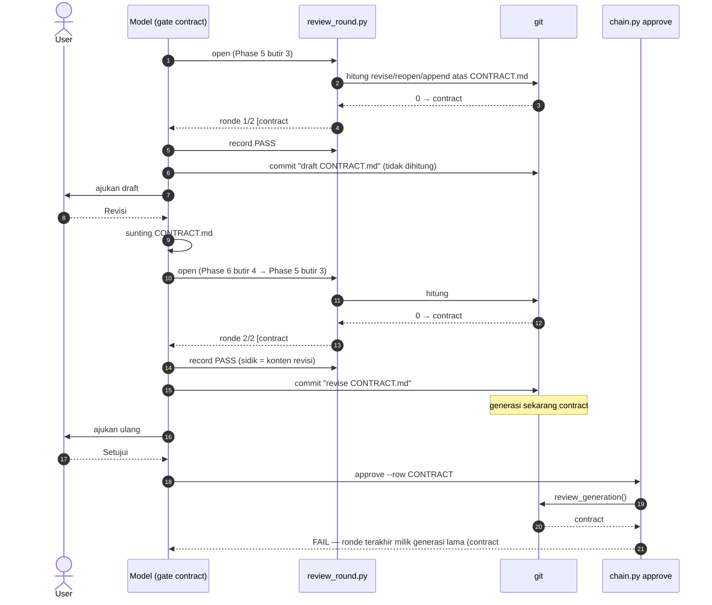
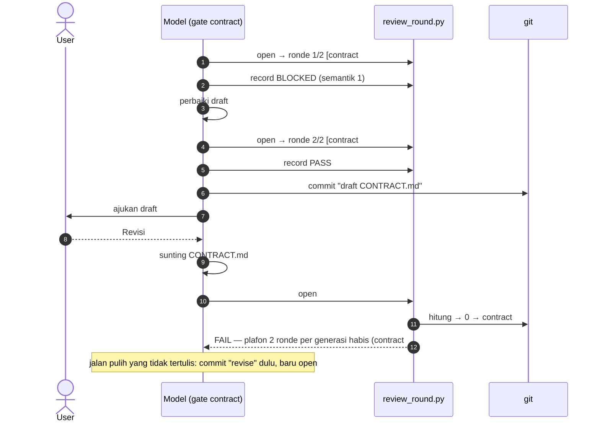

# Langkah 4 — frontenddev: Deadlock Revisi & Validator Substansi

> Versi detail L4.1–L4.10 dari `ISSUES.md` (Langkah 4). Nomor baris mengacu commit `34684ee` dan sudah dicek ulang terhadap kode pada 2026-09-24. Semua reproduksi di berkas ini dijalankan ulang terhadap kode saat ini; keluarannya ditempel apa adanya (sha commit di keluaran berbeda tiap jalan).

## Tujuan

1. Revisi user atas `CONTRACT.md` dan breakdown brief (REVISE/APPEND) bisa sampai `chain.py approve` lewat urutan yang tertulis di SKILL, tanpa membakar ronde reviewer dan tanpa langkah improvisasi.
2. `validate_review.py` dan `validate_report.py` menilai isi, bukan hanya bentuk: verdict, status dimensi, Summary, dan Catatan REPORT diturunkan dari isi dokumen dan dicek silang.
3. Jalan buntu kecil di sekitar ledger (`reopen` crash, REPORT gagal commit, remedi MINOR, kuota reopen, berkas `finding_source`) punya jalur pulih yang sah dan teruji.

## Urutan pengerjaan

| Urutan | ID | Severity | Estimasi | Alasan urutan |
|---|---|---|---|---|
| 1 | L4.1 | Tinggi | 10–14 jam | Jalan buntu paling sering dilalui. Menambah field `epoch`/`head` di state ronde yang dipakai L4.3 dan L4.8. |
| 2 | L4.3 | Sedang | 3–4 jam (+6 jam opsi trailer) | Berkas sama dengan L4.1 (`review_round.py`); kerjakan selagi konteksnya segar. |
| 3 | L4.8 | Sedang | 2–3 jam | Memakai `review_round.py status --ready` dari L4.1/L4.3. |
| 4 | L4.5 | Sedang | 2–3 jam | Terisolasi di `chain.py reopen`; sekalian menyentuh baris yang sama dengan L4.9. |
| 5 | L4.9 | Rendah | 1–2 jam | Satu regex di `chain.py reopen`, satu blok dengan L4.5. |
| 6 | L4.4 | Sedang | 1–2 jam | Satu regex di Check M; memakai pola subjek `eskalasi lane` yang sama. |
| 7 | L4.7 | Sedang | 3–4 jam (+3 jam `validate_audit.py`) | Mengubah daftar berkas rantai yang dibaca `validate_report.py`; harus beres sebelum L4.6 dan L4.2 menguji REPORT. |
| 8 | L4.6 | Sedang | 5–7 jam | Menyentuh `validate_report.py`/fase architect; sesudah L4.7 agar fixture REPORT stabil. |
| 9 | L4.2 | Tinggi | 14–20 jam (10–14 tanpa butir log mesin) | Paling besar; butir log mesin menunggu L3.3. Aturan REPORT bertumpu pada L4.6/L4.7. |
| 10 | L4.10 | Sedang | 3–4 jam | Independen; bisa disisipkan kapan saja. |

**Total estimasi:** 44–63 jam fokus (±6–8 hari kerja), termasuk test regresi dan verifikasi manual.

## Dependensi

**Dengan langkah lain**

| Item | Butuh / bersinggungan dengan | Jenis |
|---|---|---|
| L4.2 butir 7 (verifikasi penutup vs log mesin) | **L3.3** — `run_verification.py` + baseline per perintah. Tanpa L3.3 butir itu hanya bisa dicek bentuknya. | keras |
| Semua test di berkas ini | **L6.1** — struktur `src/plugins/frontenddev/tests/` + `conftest.py`. Test di sini ditulis untuk struktur itu. | lunak (test bisa ditulis dulu) |
| L4.1, L4.3 (`precondition_lib.py`) | **L5.5/L5.9** menyentuh pustaka yang sama (duplikasi, parsing code fence/BOM). Koordinasikan agar tidak konflik. | koordinasi |
| L4.2 (nama 9 dimensi) | **8.C C7** — nama dimensi belum seragam antara template, agent, dan `_CONTRACT`. L4.2 menetapkan nama template sebagai kanonik. | koordinasi |
| L4.2 (label keluaran `validate_report.py`) | **8.C C12** — label "PRECONDITION CHECK" salah; ganti sekalian. | opsional |
| L4.7 (siapa menyunting `> Status:`) | **L2.6** — keputusan serupa di backenddev. Pilih pola yang sama di dua plugin. | keputusan |
| L4.2, L4.6, L4.7 | **L5.6** — false positive placeholder di validator frontenddev (bukan `validate_report.py`, tapi pola sama). | koordinasi |

**Antar item:** L4.1 → L4.3 → L4.8 (state ronde); L4.5 ↔ L4.9 (fungsi `reopen` yang sama); L4.7 → L4.6 → L4.2 (semuanya mengubah perilaku `validate_report.py`/fase laporan).

## Keputusan desain yang butuh user

| # | Item | Pilihan | Rekomendasi |
|---|---|---|---|
| K1 | L4.1 | Batas "putaran" ronde reviewer: (a) otomatis — putaran baru sesudah draft yang lolos ronde `PASS` di-commit, atau sesudah `reopen`; (b) deklaratif — flag `open --revision` yang diketik model. | (a): tidak bisa diklaim tanpa jejak git. |
| K2 | L4.3, L4.8 | Tambah subperintah `review_round.py commit` (commit draft/batch lewat skrip, hanya bila ronde terakhir `PASS` atas konten yang sama, dengan trailer `Review-Round:`) — mengubah langkah commit contract Phase 6 dan plan Phase 4. Alternatif: tetap `git commit` manual + `status --ready`. | Subperintah: sekaligus menutup L4.3 (sumber kebenaran ter-commit) dan L4.8. |
| K3 | L4.3 | Bukti ronde `PASS` contract: simpan balikan `contract-reviewer` ke `.explore/contract-review-r<n>.md` dan `record --evidence <berkas>` membaca `Verdict:`/hitungan BLOCKER dari situ. | Ya, murah. |
| K4 | L4.2 | Format log mesin L3.3 (`.explore/closing-verification.json`) dan mode `validate_review.py --log` yang ketat hanya dipakai architect Phase 4 (laci `.explore/` tidak di-commit, jadi validator hilir tidak bisa menuntutnya). | Ya. |
| K5 | L4.2 | Format wajib *Violation* `Dimensi <n>[ & <m>] — …` (mengubah template bagian 1 dan agent `code-reviewer`), ambang substansi REPORT (Ringkasan ≥ 5 kata, butir ≥ 3 kata). | Ya; ambang bisa disetel. |
| K6 | L4.7 | Beri `code-reviewer` tool `Edit`, atau pindahkan penyuntingan `> Status:` ke architect. | `Edit` + penjaga mekanis "hanya baris `> Status:` yang berubah"; samakan dengan keputusan L2.6. |
| K7 | L4.9 | Kuota re-entry dihitung hanya untuk hop target, atau pertahankan perilaku lama dan dokumentasikan. | Hitung per target; plafon taskdir 6 tetap membatasi total. |
| K8 | L4.6 | Plafon loop validasi REPORT (usul: 2 putaran perbaikan, lalu eskalasi ke user). | Ya. |

## Berkas yang disentuh

| Berkas (relatif `src/plugins/frontenddev/`) | Item |
|---|---|
| `skills/_common/review_round.py` | L4.1, L4.3, L4.8 |
| `skills/_common/chain.py` | L4.1, L4.5, L4.9 |
| `skills/_common/precondition_lib.py` | L4.1, L4.6, L4.7, L4.8, L4.10 |
| `skills/architect/scripts/validate_review.py` | L4.2 |
| `skills/architect/scripts/check_preconditions.py` | L4.6, L4.10 |
| `skills/report/scripts/validate_report.py` | L4.2 |
| `skills/report/scripts/check_preconditions.py` | L4.6 |
| `skills/plan/scripts/validate_briefs.py` | L4.4 |
| `skills/lead/scripts/taskdir_state.py` | L4.6 |
| `skills/review/scripts/validate_audit.py` (baru) | L4.7 |
| `skills/contract/SKILL.md`, `skills/contract/dispatcher/reviewer.md` | L4.1, L4.8 |
| `skills/plan/SKILL.md`, `skills/plan/dispatcher/reviewer.md` | L4.1, L4.4, L4.8 |
| `skills/architect/SKILL.md`, `skills/architect/references/execution-protocol.md`, `skills/architect/templates/review-template.md` | L4.2, L4.6, L4.7, L4.10 |
| `skills/report/SKILL.md` | L4.6 |
| `skills/lead/SKILL.md`, `skills/lead/references/lane-routing-matrix.md` | L4.1, L4.4, L4.9 |
| `skills/profile/SKILL.md`, `skills/profile/templates/profile-template.md` | L4.10 |
| `agents/code-reviewer.md` | L4.2, L4.7 |
| `README.md` | L4.1 |
| `tests/` (baru, struktur L6.1) | semua |

## Cara menjalankan reproduksi

- Tiap skrip mandiri: membuat repo sementara dengan `mktemp -d`, tidak menulis apa pun ke repo plugin, dan memakai `PYTHONDONTWRITEBYTECODE=1` supaya `__pycache__` tidak muncul di `src/`.
- Variabel `FE_SKILLS` (opsional) mengarahkan skrip ke salinan plugin lain, mis. salinan yang sudah ditambal: `FE_SKILLS=/path/salinan/skills bash skrip.sh`. Tanpa variabel itu skrip memakai `$REPO/src/plugins/frontenddev/skills`.
- Keluaran "sesudah perbaikan" di beberapa item berasal dari prototipe tambalan di salinan scratchpad (bukan repo). Prototipe itu dipakai untuk membuktikan rancangan; kodenya dikutip di **Rencana perbaikan** masing-masing item.
- `pytest` tidak terpasang di mesin review. Test regresi L4.1 dijalankan dengan shim kecil yang meniru fixture `tmp_path`; hasilnya dikutip di L4.1.

## Catatan implementasi (2026-09-25)

Keputusan user: seluruh rekomendasi K1–K8 (tercatat di `Log Keputusan` `ISSUES.md`, lokal karena berkas itu di-gitignore). Satu commit per item, kecuali L4.5 + L4.9 (satu blok `chain.py reopen`). `pytest` tidak terpasang; suite dijalankan dengan `uvx pytest` — 431 lulus. Skrip reproduksi yang dijalankan ulang terhadap kode baru: `l41-contract.sh`, `l41-plan.sh`, `l42.sh`, `l46.sh`, `l48.sh` (keluaran sesuai "sesudah perbaikan"); L4.3, L4.4, L4.5, L4.7, L4.9, L4.10 dibuktikan lewat test regresi padanannya, bukan skrip bash-nya. Verifikasi manual di sesi Claude Code nyata (L4.2 butir 3: rantai MINOR sampai architect Phase 4 dengan agent `code-reviewer` baru) **belum** dijalankan.

Penyimpangan dari rencana di bawah:

- **Letak test & fixture**: fixture bersama frontenddev di `conftest.py` akar (`fe_chain_repo`, `fe_minor_chain`, `fe_round`, `fe_approved_chain`, `fe_review_md`) plus `src/plugins/frontenddev/tests/fixtures/` (`task_fast_forward.md`, `contract_valid.md`, `brief_button.md`, `audit_valid.md`, `minor_chain_reviewed.sh` — setup `l46.sh`). Fixture R1–R5 L4.2 dibangun `fe_review_md(**override)`, bukan berkas `tests/fixtures/review/*.md` terpisah. Test tambahan: `test_validate_audit.py` (L4.7, termasuk `test_finding_source_bukan_berkas_rantai`, bukan `test_chain_files.py`).
- **L4.1**: pemeriksaan kesiapan ronde tinggal di `Rounds.ready()` (`review_round.py`), bukan `precondition_lib.review_ready`; `chain.py` mengimpor `Rounds` (tidak ada impor melingkar lagi karena `content_snapshot` pindah ke `precondition_lib`).
- **L4.3**: ditambah `review_round.py rebuild` — state hilang padahal trailer mencatat ronde kini punya jalur pulih bila `.bak` juga hilang (ronde rekonstruksi mengisi plafon taskdir, ber-epoch `-1`, tidak pernah sah untuk approve). Gate plan: `record` juga menolak bila `verdict` frontmatter `REVIEW-PLAN.md` ≠ flag. Kegagalan state di dalam `chain.py approve` dibungkus jadi `CHAIN APPROVE: [FAIL]`.
- **L4.8**: `status --ready` tetap ditambahkan walau K2 dipilih (pesan prasyarat menyebut keduanya); Check 8 contract membaca status ronde lewat `contract_review_ready()` (impor lambat `review_round`).
- **L4.9**: label `re-entry k` baris kaskade dibiarkan tanpa penanda `(kaskade)`.
- **L4.5**: pemulihan sesudah gagal tulis melewati berkas yang isinya tak berubah dan melaporkan berkas yang tak dapat dipulihkan beserta perintah `git checkout`.
- **L4.7 / K6**: frontenddev memberi `Edit` ke `code-reviewer`; backenddev (L2.6) menaruh penyuntingan `> Status: FIXED` di implementor. Penjaganya sepadan (diff `finding_source` hanya boleh menyentuh baris `> Status:`), aktornya berbeda.
- **L4.2**: aturan 10 hanya menagih backtick — kolom pertama tabel `run_verification.py` adalah **nama** perintah, bukan perintah penuh, jadi keanggotaan di `commands.md` tidak dicek; perintah HIJAU untuk bukti SC mencakup nama dan kolom "Perintah penuh". Aturan 11: `run_verification.py closing` kini menulis `closing-verification.json` (kedua salinan, tetap identik); `architect/SKILL.md` Phase 4 butir 3 dan `dispatcher/reviewer.md` memanggil `--log`. Tanpa masa transisi: `REVIEW.md` lama yang *Violation*-nya tanpa `Dimensi <n> —` kini FAIL, sehingga fase architect kembali `PENUTUP` dan review ulang dipicu.
- **L4.10**: resolver mengembalikan `("tidak", "adapter")` untuk adapter Svelte tanpa baris profil, dan `("tidak", "bawaan")` hanya bila adapter tidak ada.

## Definisi selesai langkah ini

- [x] Kesepuluh item tercentang, masing-masing memenuhi **Selesai bila**-nya.
- [x] Skrip reproduksi di berkas ini, dijalankan terhadap kode baru, menghasilkan perilaku "sesudah perbaikan" yang tertulis (approve lolos pada skenario A–D; kelima fixture L4.2 FAIL dengan pesan yang menunjuk bagian salah; dst.).
- [x] Test regresi baru hijau: `pytest src/plugins/frontenddev/tests -q` (minimal berkas `test_review_round.py`, `test_validate_review.py`, `test_validate_report.py`, `test_chain_reopen.py`, `test_validate_briefs_check_m.py`, `test_phase_report.py`, `test_typecheck_per_brief.py`).
- [x] Kata "generasi" (arti lama) tidak lagi muncul di SKILL, dispatcher, `lane-routing-matrix.md`, dan README frontenddev.
- [x] Contoh terisi `review-template.md` bagian 3 dan fixture positif L4.2 tetap `PASS` di validator baru.
- [x] Keputusan K1–K8 tercatat di `Log Keputusan` `ISSUES.md`.

---

## L4.1 [Tinggi] Revisi user tidak pernah bisa disetujui — aturan "generasi" ronde review
- [x] Selesai

**Plugin:** frontenddev · **Estimasi:** 10–14 jam · **Bergantung pada:** — (test memakai struktur L6.1) · **Memblokir:** L4.3, L4.8

### Konteks

Gate `contract` dan `plan` wajib meloloskan dokumen ke reviewer (`contract-reviewer` / `doc-reviewer`) sebelum user menyetujui. `review_round.py` membatasi ronde (2 per "generasi", 8 per taskdir) dan `chain.py approve` menuntut ronde terakhir `PASS`. "Generasi" dihitung dari **subjek commit** `revise` / `reopen` / `draft breakdown append`. Masalahnya, SKILL menyuruh ronde reviewer berjalan **sebelum** commit `revise`/`append`, sehingga commit yang diwajibkan SKILL itu sendiri membuat ronde yang baru lolos menjadi "generasi lama".

### Lokasi & kode saat ini

**Penghitung generasi** — `skills/_common/precondition_lib.py:799-806`

```python
def review_generation(root: Path, taskdir_rel: str, gate: str) -> str:
    """Generasi ronde reviewer = jumlah siklus git (revise/reopen/append) atas berkas gate."""
    slug = taskdir_slug(taskdir_rel)
    paths = [f"{taskdir_rel}/CONTRACT.md"] if gate == "contract" else \
            [f"{taskdir_rel}/{BRIEF_GLOB}", f"{taskdir_rel}/TASK.md"]
    subjects = git(root, "log", "--format=%s", "--", *paths).splitlines()
    marks = (f"docs({slug}): revise", f"docs({slug}): reopen", f"docs({slug}): draft breakdown append")
    return f"{gate}#{sum(1 for s in subjects if s.startswith(marks))}"
```

**Plafon per generasi dan penandaan ronde** — `skills/_common/review_round.py:79-83`, `:97-105`

```python
    def counts(self, state: Dict[str, Any]) -> Dict[str, int]:
        gen = self.generation()
        rounds = state.get("rounds", [])
        return {"generation": sum(1 for r in rounds if r.get("generation") == gen),
                "taskdir": len(rounds)}
...
        if c["generation"] >= MAX_PER_GENERATION:
            raise SystemExit(f"REVIEW ROUND OPEN: [FAIL] plafon {MAX_PER_GENERATION} ronde per generasi habis "
                             ...
        entry = {"round": c["generation"] + 1, "generation": self.generation(),
                 "snapshot": content_snapshot(self.root, targets), "opened": _now(),
                 "verdict": None}
```

**Syarat approval** — `skills/_common/chain.py:296-305` (dalam `_require_review_pass`, `:288-308`)

```python
        rounds = state.get("rounds") or []
        last = rounds[-1] if rounds else {}
        if last.get("generation") != review_generation(self.root, self.taskdir_rel, gate):
            raise ChainError(f"ronde review `{gate}` terakhir milik generasi lama ({last.get('generation')}) — "
                             "revisi/reopen sesudahnya menuntut ronde baru atas konten sekarang.")
        if last.get("verdict") != "PASS":
            raise ChainError(...)
        if last.get("snapshot") != content_snapshot(self.root, rels):
            raise ChainError(f"konten berubah sesudah ronde review `{gate}` terakhir — "
                             "jalankan ronde baru atas konten final (bila plafon masih ada).")
```

**Urutan yang diperintahkan SKILL**

- `skills/contract/SKILL.md:68` (Phase 6 butir 4): "Di bawah plafon → perbarui draft, ulangi Phase 5 butir 2–3 (ronde reviewer atas konten final), **commit `revise`**, ajukan ulang."
- `skills/contract/SKILL.md:61`: "Plafon 2 ronde per generasi — tiap revisi user atau re-entry membuka generasi baru — dan 8 per taskdir".
- `skills/contract/SKILL.md:67`: approval "wajib `PASS` atas konten final **dan** milik generasi sekarang (revisi atau reopen sesudah ronde itu menuntut ronde baru)".
- `skills/plan/SKILL.md:59` (Phase 3 butir 3): ronde Plan Review sebelum commit; "Approval menuntut ronde terakhir `PASS` milik generasi sekarang — revisi, reopen, atau APPEND sesudah ronde itu membuka generasi baru".
- `skills/plan/SKILL.md:63-69` (Phase 4): commit batch sesudah review dengan subjek `draft breakdown (<N> briefs)` / `revise breakdown` / `draft breakdown append (…)`.
- `skills/contract/dispatcher/reviewer.md:16`, `:47`, `:48` dan `skills/plan/dispatcher/reviewer.md:13`, `:142`, `:147`: teks "plafon 2 per generasi (tiap revisi user atau re-entry membuka generasi baru)".
- `skills/lead/references/lane-routing-matrix.md:95`, `:99-100` dan `README.md:104`, `:134-135`: definisi generasi yang sama.

### Cara kerja logika generasi sekarang

1. `review_generation()` menghitung commit yang menyentuh berkas gate (`CONTRACT.md`; atau `brief-*.md` + `TASK.md` untuk plan) dan bersubjek diawali `revise`, `reopen`, atau `draft breakdown append`. Hasilnya label `contract#N` / `plan#N`.
2. `review_round.py open` memberi label generasi saat ini ke ronde baru, lalu menolak bila sudah ada 2 ronde berlabel sama.
3. `chain.py approve` menolak bila label ronde terakhir ≠ generasi saat ini — sebelum memeriksa verdict dan sidik konten.
4. SKILL menyuruh urutan **ronde → commit `revise`/`append` → approve**. Commit itu menaikkan N, jadi label ronde terakhir selalu basi di titik approve (skenario A, C, D).
5. Plafon dihitung per label **sebelum** commit revisi. Draft awal yang sudah memakai 2 ronde menghabiskan plafon generasi yang sama dengan revisi berikutnya (skenario B).
6. Sebaliknya, commit draft yang belum pernah `PASS` dengan subjek `revise` menaikkan N dan mengisi ulang plafon (skenario E). Generasi terlalu ketat untuk jalur sah dan terlalu longgar untuk jalur curang.

Sidik konten (`snapshot`) sebenarnya sudah tersimpan di tiap ronde dan sudah dicek approve. Pemeriksaan generasi hanya menambah satu hal yang tidak ditangkap sidik: hop dibuka ulang (`reopen`) sesudah ronde padahal konten tidak berubah.

**Skenario A** — draft lolos 1 ronde, user minta revisi, urutan SKILL diikuti persis:



**Skenario B** — draft butuh 2 ronde, lalu user minta revisi:



### Reproduksi

Gate contract — skenario A, B, B′ (jalan pulih tak terdokumentasi), dan E (celah sebaliknya):

<details><summary>Skrip <code>l41-contract.sh</code></summary>

````bash
#!/usr/bin/env bash
# L4.1 — Skenario A & B di Gate Contract, persis urutan contract/SKILL.md Phase 5–6.
set -u
export PYTHONDONTWRITEBYTECODE=1
REPO=/home/fakhrulnugroho/work/natakode/nataflow/agentic-workflow
P=${FE_SKILLS:-$REPO/src/plugins/frontenddev/skills}
RR="python3 $P/_common/review_round.py"; CH="python3 $P/_common/chain.py"
TD=frontenddev/docs/2609241200-orders-lacak

fx() {  # repo FAST_FORWARD: akar terkunci, CONTRACT.md DRAFT tertulis (belum di-commit)
  tmp=$(mktemp -d); cd "$tmp"
  git init -q -b main .; git config user.email t@t; git config user.name t; git config commit.gpgsign false
  printf '.explore/\n' > .gitignore; mkdir -p "$TD"
  cat > "$TD/TASK.md" <<'EOF'
---
status: ACTIVE
lane: FAST_FORWARD
sections: [architecture]
created: 2026-09-24
---

# Orders — tombol lacak

## Description

Detail pesanan mendapat tombol Lacak (`src/features/orders/OrderDetail.tsx:88`).

## Success Criteria

- [ ] **SC-1**: tombol *Lacak* tampil di detail pesanan — verifikasi: test `OrderDetail.test.tsx` hijau

## Out of Scope

- Peta kurir real-time — opsi yang ditolak

## Chain

EOF
  $CH init --taskdir $TD >/dev/null
  git add -A; git commit -qm "docs(orders-lacak): kunci TASK sebagai akar rantai"
  cat > "$TD/CONTRACT.md" <<EOF
---
status: DRAFT
slug: orders-lacak
order: 30
stack: react-vite
based_on: $(git rev-parse --short HEAD) (2026-09-24)
sections: [architecture]
---

# Contract — Orders Lacak

# Architecture

## 1. Intent & Scope Statement
- **Intent**: Tombol lacak.

## 2. Data Contract & Endpoints

### Endpoint: \`GET /api/v1/orders/:id/tracking\`
- **Deskripsi Operasi**: ambil status.

## 3. Cache Management & Mutation Strategy
- **Query Key Factory Object**: ORDER_KEYS.

## 4. Layer Shape Specification (The 5-Tier Architecture)

| Layer | Path | Ekspor | Tanggung Jawab |
|---|---|---|---|
| **Presentation** | \`src/features/orders/OrderDetail.tsx\` | \`OrderDetail\` | render |

## 5. Decisions Not Taken

| Alternatif | Alasan | Konsekuensi |
|---|---|---|
| modal | tidak perlu | - |

# Execution

## 1. Files Touched
- \`MODIFY\` \`src/features/orders/OrderDetail.tsx\`

## 2. Execution Steps
1. Tambah tombol.

## 3. Verification Commands & Baseline
- \`pnpm typecheck\` (nol galat baru)

## 4. Proposed Units Breakdown
- **Unit 01**: Presentasi (\`orders-lacak-button\`: presentasi)

## 5. Acceptance Criteria

| ID | Skenario | Cara verifikasi | Sumber |
|---|---|---|---|
| \`AC-1\` | Tombol Lacak tampil | test otomatis | \`SC-1\` |
EOF
}
edit() { sed -i 's/Tambah tombol\./Tambah tombol Lacak di header./' "$TD/CONTRACT.md"; }

echo "===== SKENARIO A: draft ronde 1 PASS + commit draft; user minta revisi -> perbarui -> ronde PASS -> commit revise -> approve"
fx
$RR open --taskdir $TD --gate contract; $RR record --taskdir $TD --gate contract --verdict PASS
git add $TD/CONTRACT.md; git commit -qm "docs(orders-lacak): draft CONTRACT.md"
edit                                                     # Phase 6 butir 4: perbarui draft
$RR open --taskdir $TD --gate contract; $RR record --taskdir $TD --gate contract --verdict PASS
git add $TD/CONTRACT.md; git commit -qm "docs(orders-lacak): revise CONTRACT.md"
$CH approve --taskdir $TD --row CONTRACT --answer "Setujui kontrak"; echo "approve rc=$?"
$RR status --taskdir $TD --gate contract

echo; echo "===== SKENARIO B: draft butuh 2 ronde (BLOCKED lalu PASS), lalu user minta revisi"
fx
$RR open --taskdir $TD --gate contract >/dev/null; $RR record --taskdir $TD --gate contract --verdict BLOCKED --semantic 1
$RR open --taskdir $TD --gate contract >/dev/null; $RR record --taskdir $TD --gate contract --verdict PASS
git add $TD/CONTRACT.md; git commit -qm "docs(orders-lacak): draft CONTRACT.md"
edit
$RR open --taskdir $TD --gate contract; echo "open rc=$?"

echo; echo "===== B': jalur pulih yang tidak didokumentasikan (commit revise dulu, baru buka ronde)"
git add $TD/CONTRACT.md; git commit -qm "docs(orders-lacak): revise CONTRACT.md"
$RR open --taskdir $TD --gate contract; $RR record --taskdir $TD --gate contract --verdict PASS
$CH approve --taskdir $TD --row CONTRACT --answer "Setujui kontrak"; echo "approve rc=$?"

echo; echo "===== E (celah sebaliknya): 2 ronde BLOCKED, draft BLOCKED di-commit sebagai revise -> plafon terisi ulang"
fx
for i in 1 2; do $RR open --taskdir $TD --gate contract >/dev/null; $RR record --taskdir $TD --gate contract --verdict BLOCKED --semantic 1 >/dev/null; done
edit; git add $TD/CONTRACT.md; git commit -qm "docs(orders-lacak): revise CONTRACT.md"
$RR open --taskdir $TD --gate contract; echo "open rc=$?"
````

</details>

Keluaran aktual:

```text
===== SKENARIO A: draft ronde 1 PASS + commit draft; user minta revisi -> perbarui -> ronde PASS -> commit revise -> approve
REVIEW ROUND OPEN: [PASS] contract ronde 1/2 (taskdir 1/8) atas 1 berkas
REVIEW ROUND RECORD: contract ronde 1 PASS — gerbang terbuka
REVIEW ROUND OPEN: [PASS] contract ronde 2/2 (taskdir 2/8) atas 1 berkas
REVIEW ROUND RECORD: contract ronde 2 PASS — gerbang terbuka
CHAIN APPROVE: [FAIL] ronde review `contract` terakhir milik generasi lama (contract#0) — revisi/reopen sesudahnya menuntut ronde baru atas konten sekarang.
approve rc=1
REVIEW ROUND STATUS: contract — generasi 0/2, taskdir 2/8
- ronde 1 [contract#0] → PASS (mekanis 0, semantik 0)
- ronde 2 [contract#0] → PASS (mekanis 0, semantik 0)

===== SKENARIO B: draft butuh 2 ronde (BLOCKED lalu PASS), lalu user minta revisi
REVIEW ROUND RECORD: contract ronde 1 BLOCKED — perbaiki lalu buka ronde menyempit
REVIEW ROUND RECORD: contract ronde 2 PASS — gerbang terbuka
REVIEW ROUND OPEN: [FAIL] plafon 2 ronde per generasi habis (generasi `contract#0`). Dilarang mendispatch ronde ketiga: sajikan BLOCKER yang tersisa ke user dan rutekan ke gate pemilik untuk rancang ulang.
open rc=1

===== B': jalur pulih yang tidak didokumentasikan (commit revise dulu, baru buka ronde)
REVIEW ROUND OPEN: [PASS] contract ronde 1/2 (taskdir 3/8) atas 1 berkas
REVIEW ROUND RECORD: contract ronde 1 PASS — gerbang terbuka
CHAIN APPROVE: CONTRACT @ APPROVED d2da837 — commit 49c7269
approve rc=0

===== E (celah sebaliknya): 2 ronde BLOCKED, draft BLOCKED di-commit sebagai revise -> plafon terisi ulang
REVIEW ROUND OPEN: [PASS] contract ronde 1/2 (taskdir 3/8) atas 1 berkas
open rc=0
```

Gate plan — skenario C (mode CONTRACT lalu REVISE) dan D (unit BLOCKED → `reopen BRIEF` → APPEND):

<details><summary>Skrip <code>l41-plan.sh</code></summary>

````bash
#!/usr/bin/env bash
# L4.1 — Skenario C (plan REVISE) & D (plan APPEND), persis urutan plan/SKILL.md Phase 3–5.
set -u
export PYTHONDONTWRITEBYTECODE=1
REPO=/home/fakhrulnugroho/work/natakode/nataflow/agentic-workflow
P=${FE_SKILLS:-$REPO/src/plugins/frontenddev/skills}
RR="python3 $P/_common/review_round.py"; CH="python3 $P/_common/chain.py"
VB="python3 $P/plan/scripts/validate_briefs.py"
TD=frontenddev/docs/2609241200-orders-lacak
q() { "$@" >/dev/null || { echo "LANGKAH GAGAL: $*"; "$@"; exit 1; }; }

tmp=$(mktemp -d); cd "$tmp"
git init -q -b main .; git config user.email t@t; git config user.name t; git config commit.gpgsign false
printf '.explore/\n' > .gitignore; mkdir -p "$TD" .claude/profile src/features/orders
echo '{"stack":"react-vite"}' > .claude/profile/index.json
printf '| Perintah | Status |\n|---|---|\n| `pnpm typecheck` | OK |\n| `pnpm test` | OK |\n' > .claude/profile/commands.md
echo 'export function OrderDetail() { return null }' > src/features/orders/OrderDetail.tsx
cat > "$TD/TASK.md" <<'EOF'
---
status: ACTIVE
lane: FAST_FORWARD
sections: [architecture]
created: 2026-09-24
---

# Orders — tombol lacak

## Description

Detail pesanan mendapat tombol Lacak (`src/features/orders/OrderDetail.tsx:1`).

## Success Criteria

- [ ] **SC-1**: tombol *Lacak* tampil di detail pesanan — verifikasi: test `OrderDetail.test.tsx` hijau

## Out of Scope

- Peta kurir real-time — opsi yang ditolak

## Chain

EOF
q $CH init --taskdir $TD
git add -A; git commit -qm "docs(orders-lacak): kunci TASK sebagai akar rantai"
SHA=$(git rev-parse --short HEAD)
cat > "$TD/CONTRACT.md" <<EOF
---
status: DRAFT
slug: orders-lacak
order: 30
stack: react-vite
based_on: $SHA (2026-09-24)
sections: [architecture]
---

# Contract — Orders Lacak

# Architecture

## 1. Intent & Scope Statement
- **Intent**: Tombol lacak.

## 2. Data Contract & Endpoints

### Endpoint: \`GET /api/v1/orders/:id/tracking\`
- **Deskripsi Operasi**: ambil status.

## 3. Cache Management & Mutation Strategy
- **Query Key Factory Object**: ORDER_KEYS.

## 4. Layer Shape Specification (The 5-Tier Architecture)

| Layer | Path | Ekspor | Tanggung Jawab |
|---|---|---|---|
| **Presentation** | \`src/features/orders/OrderDetail.tsx\` | \`OrderDetail\` | render |

## 5. Decisions Not Taken

| Alternatif | Alasan | Konsekuensi |
|---|---|---|
| modal | tidak perlu | - |

# Execution

## 1. Files Touched
- \`MODIFY\` \`src/features/orders/OrderDetail.tsx\`
- \`CREATE\` \`src/features/orders/OrderDetail.test.tsx\`

## 2. Execution Steps
1. Tambah tombol.

## 3. Verification Commands & Baseline
- \`pnpm typecheck\` (nol galat baru)

## 4. Proposed Units Breakdown
- **Unit 01**: Presentasi (\`orders-lacak-button\`: presentasi)

## 5. Acceptance Criteria

| ID | Skenario | Cara verifikasi | Sumber |
|---|---|---|---|
| \`AC-1\` | Tombol Lacak tampil | test otomatis | \`SC-1\` |
EOF
q $RR open --taskdir $TD --gate contract; q $RR record --taskdir $TD --gate contract --verdict PASS
git add $TD/CONTRACT.md; git commit -qm "docs(orders-lacak): draft CONTRACT.md"
q $CH approve --taskdir $TD --row CONTRACT --answer "Setujui kontrak"

brief() {  # brief <NN> <status> <remedies> <langkah>
  cat > "$TD/brief-$1-orders-lacak-button.md" <<EOF
---
status: $2
slug: orders-lacak
stack: react-vite
based_on: $SHA (2026-09-24)
order: 40
unit: "$1"
total_units: "${TOTAL:-1}"
depends_on: []
fulfills: ["SC-1"]
covers: ["AC-1"]
files_touched:
  - src/features/orders/OrderDetail.tsx
  - src/features/orders/OrderDetail.test.tsx
verification:
  - pnpm test
remedies: "$3"
---

# Implementation Brief — Unit $1: Orders Lacak Button

Brief implementasi atomik untuk subagent \`code-implementor\`; satu-satunya acuan kerjanya.

## 1. Intent & Scope Boundaries
- **Intent**: menambah tombol Lacak.
- **Akar**: \`SC-1\` (frontmatter \`fulfills\`)
- **Strict Scope Boundaries**: hanya berkas \`files_touched\`.
- **Out of Scope (Dikerjakan pada Unit Lain)**: tidak ada

## 2. Interfaces & Contracts

\`\`\`typescript
export interface OrderDetailUI { trackLabel: string }
\`\`\`

## 3. Current Repo State & Reference Symbols

| Aksi | Berkas | Anchor |
|---|---|---|
| MODIFY | \`src/features/orders/OrderDetail.tsx\` | \`OrderDetail\` |
| CREATE | \`src/features/orders/OrderDetail.test.tsx\` | — |

- **Pola Acuan**: \`src/features/orders/OrderDetail.tsx:1\` komponen fungsi
- **Import Alias**: \`@/\`

## 4. Implementation Steps
1. $4
2. Tulis test render label.

## 5. Done Criteria & Verification Baseline
- [ ] tombol berlabel Lacak
- [ ] (verifikasi penutup) pnpm test — nol galat baru
EOF
}
review_plan() {  # tulis REVIEW-PLAN.md ronde <n> ber-verdict PASS (peran doc-reviewer)
  cat > "$TD/REVIEW-PLAN.md" <<EOF
---
verdict: PASS
round: "$1"
---

# Plan Review: orders-lacak

Tidak ada temuan (ronde $1).
EOF
}
gen() {  # generasi menurut kode sekarang (fungsi ini hilang sesudah perbaikan L4.1)
  python3 -c "import sys; sys.path.insert(0, '$P/_common'); from pathlib import Path
try:
    from precondition_lib import review_generation as g; print('   generasi sekarang:', g(Path('.').resolve(), '$TD', 'plan'))
except ImportError:
    print('   (review_generation sudah dihapus)')"
}

echo "===== SKENARIO C: plan mode CONTRACT lalu REVISE"
brief 01 READY "" "Tambah tombol Lacak di OrderDetail."
q $VB --taskdir $TD --contract
$RR open --taskdir $TD --gate plan; review_plan 1; $RR record --taskdir $TD --gate plan --verdict PASS
git add $TD/brief-01-orders-lacak-button.md $TD/REVIEW-PLAN.md
git commit -qm "docs(orders-lacak): draft breakdown (1 briefs)"
gen; echo "-- user: Revisi (label jadi 'Lacak Paket')"
brief 01 READY "" "Tambah tombol Lacak Paket di OrderDetail."
q $VB --taskdir $TD --contract
$RR open --taskdir $TD --gate plan; review_plan 2; $RR record --taskdir $TD --gate plan --verdict PASS
git add $TD/brief-01-orders-lacak-button.md $TD/REVIEW-PLAN.md
git commit -qm "docs(orders-lacak): revise breakdown"
gen
$CH approve --taskdir $TD --row BRIEF --answer "Setujui breakdown"; echo "approve rc=$?"

echo; echo "-- pulih dengan membakar ronde di generasi baru (improvisasi, tidak ada di SKILL)"
$RR open --taskdir $TD --gate plan; review_plan 3; $RR record --taskdir $TD --gate plan --verdict PASS
git add $TD/REVIEW-PLAN.md; git commit -qm "docs(orders-lacak): revise breakdown"   # subjek tak ditentukan SKILL; sengaja pakai "revise"
gen
$CH approve --taskdir $TD --row BRIEF --answer "Setujui breakdown"; echo "approve rc=$?"

echo; echo "===== SKENARIO D: unit 01 BLOCKED -> reopen BRIEF -> plan APPEND brief remedi"
sed -i 's/^status: READY/status: BLOCKED/' $TD/brief-01-orders-lacak-button.md
printf -- '---\nartifact: UNIT_REPORT\nunit: "01"\nstatus: BLOCKED\n---\n\n# Unit 01\n\n## Triase\n- galat\n' > $TD/report-01.md
git add $TD/brief-01-orders-lacak-button.md $TD/report-01.md
git commit -qm "docs(orders-lacak): unit 01 BLOCKED - galat kompilasi baru"
q $CH reopen --taskdir $TD --row BRIEF --reason "unit 01 BLOCKED"
gen
TOTAL=2 brief 02 READY 01 "Perbaiki tombol Lacak Paket di OrderDetail."
$VB --taskdir $TD --contract | head -1
$RR open --taskdir $TD --gate plan; review_plan 1; $RR record --taskdir $TD --gate plan --verdict PASS
git add $TD/brief-02-orders-lacak-button.md $TD/REVIEW-PLAN.md
git commit -qm "docs(orders-lacak): draft breakdown append (unit 02..02, total 2)"
gen
$CH approve --taskdir $TD --row BRIEF --answer "Setujui breakdown"; echo "approve rc=$?"
````

</details>

Keluaran aktual:

```text
===== SKENARIO C: plan mode CONTRACT lalu REVISE
REVIEW ROUND OPEN: [PASS] plan ronde 1/2 (taskdir 1/8) atas 1 berkas
REVIEW ROUND RECORD: plan ronde 1 PASS — gerbang terbuka
   generasi sekarang: plan#0
-- user: Revisi (label jadi 'Lacak Paket')
REVIEW ROUND OPEN: [PASS] plan ronde 2/2 (taskdir 2/8) atas 1 berkas
REVIEW ROUND RECORD: plan ronde 2 PASS — gerbang terbuka
   generasi sekarang: plan#1
CHAIN APPROVE: [FAIL] ronde review `plan` terakhir milik generasi lama (plan#0) — revisi/reopen sesudahnya menuntut ronde baru atas konten sekarang.
approve rc=1

-- pulih dengan membakar ronde di generasi baru (improvisasi, tidak ada di SKILL)
REVIEW ROUND OPEN: [PASS] plan ronde 1/2 (taskdir 3/8) atas 1 berkas
REVIEW ROUND RECORD: plan ronde 1 PASS — gerbang terbuka
   generasi sekarang: plan#1
CHAIN APPROVE: BRIEF @ READY 93eabc8 — commit 0956dda
approve rc=0

===== SKENARIO D: unit 01 BLOCKED -> reopen BRIEF -> plan APPEND brief remedi
   generasi sekarang: plan#2
BRIEF VALIDATION: batch [PASS] (15 pass / 0 fail / 0 warn / 1 skip)
REVIEW ROUND OPEN: [PASS] plan ronde 1/2 (taskdir 4/8) atas 2 berkas
REVIEW ROUND RECORD: plan ronde 1 PASS — gerbang terbuka
   generasi sekarang: plan#3
CHAIN APPROVE: [FAIL] ronde review `plan` terakhir milik generasi lama (plan#2) — revisi/reopen sesudahnya menuntut ronde baru atas konten sekarang.
approve rc=1
```

### Dampak

- Setiap revisi CONTRACT dan setiap REVISE/APPEND di plan gagal di approve (A, C, D) atau gagal membuka ronde (B). Ini jalur pasti begitu user meminta perubahan atau satu unit `BLOCKED`.
- Model hanya bisa lolos dengan improvisasi: membakar satu ronde lagi sesudah commit (menghabiskan plafon taskdir 8 dua kali lebih cepat) atau membalik urutan commit/review, yang melanggar IRON LAW kedua skill ("di-commit hanya sesudah … ronde terakhir `PASS`").
- Skenario E: plafon 2 ronde bisa dipulihkan dengan meng-commit draft `BLOCKED` sebagai `revise`, jadi plafon tidak menahan model yang terus memoles dokumen bermasalah.

### Rencana perbaikan

Rancangan: ronde diikat ke **sidik konten** (sudah ada) + **HEAD saat `open`** + **epoch reopen**. Konsep "generasi" diganti "putaran":

- **Epoch** = jumlah commit `reopen` yang membuka hop gate ini (`CONTRACT` untuk gate contract, `BRIEF` untuk gate plan), sebagai target atau kaskade. Angka, bukan sha, supaya tahan rebase.
- **Putaran berjalan** = ronde ber-epoch sama yang dibuka sesudah ronde `PASS` terakhir yang **sudah diajukan**. "Diajukan" artinya kontennya pernah di-commit sesudah ronde itu dibuka (dicek dengan `git log <head>..HEAD` + sidik isi berkas di tiap commit). Plafon 2 berlaku per putaran.
- **Approve** menuntut ronde terakhir `PASS`, sidiknya sama dengan disk, dan epoch-nya sama dengan epoch sekarang. Commit `draft`/`revise`/`append` tidak berpengaruh.

Rancangan ini sudah dipasang sebagai prototipe di salinan scratchpad dan lolos skenario A–E (lihat **Test**).

1. **`skills/_common/precondition_lib.py`** — ganti `review_generation` (`:799-806`) dengan empat fungsi. Pindahkan `content_snapshot` dari `chain.py:404-411` ke sini agar `review_round.py` tidak lagi mengimpor `chain.py`.

   ```python
   GATE_ROW = {"contract": "CONTRACT", "plan": "BRIEF"}


   def _snapshot(rels: List[str], read: Callable[[str], Optional[str]]) -> str:
       h = hashlib.sha1()
       for rel in sorted(rels):
           text = read(rel)
           h.update(rel.encode())
           h.update(strip_status_line(text).encode() if text is not None else b"<absen>")
       return h.hexdigest()


   def content_snapshot(root: Path, rels: List[str]) -> str:
       """Sidik sha1 isi berkas di disk tanpa baris `status:`."""
       return _snapshot(rels, lambda r: (root / r).read_text(encoding="utf-8") if (root / r).is_file() else None)


   def snapshot_at(root: Path, sha: str, rels: List[str]) -> str:
       """Sidik yang sama dengan `content_snapshot`, atas isi berkas di commit `sha`."""
       def read(rel: str) -> Optional[str]:
           proc = subprocess.run(["git", "-C", str(root), "show", f"{sha}:{rel}"],
                                 stdout=subprocess.PIPE, stderr=subprocess.DEVNULL)
           if proc.returncode != 0:
               return None
           # samakan dengan Path.read_text(): newline universal
           return proc.stdout.decode("utf-8").replace("\r\n", "\n").replace("\r", "\n")
       return _snapshot(rels, read)


   def gate_targets_at(root: Path, taskdir_rel: str, gate: str, sha: str) -> List[str]:
       """Berkas yang direview gate pada commit `sha` — padanan `Rounds.targets()` di disk."""
       if gate == "contract":
           return [f"{taskdir_rel}/CONTRACT.md"]
       names = git(root, "ls-tree", "--name-only", sha, f"{taskdir_rel}/").splitlines()
       return sorted(n for n in names if fnmatch.fnmatch(Path(n).name, BRIEF_GLOB))


   def reopen_epoch(root: Path, taskdir_rel: str, gate: str) -> int:
       """Jumlah commit `reopen` yang membuka hop gate ini (sebagai target atau lewat kaskade)."""
       slug = re.escape(taskdir_slug(taskdir_rel))
       return count_subjects(root, rf"^docs\({slug}\): reopen [A-Z ]*\b{GATE_ROW[gate]}\b",
                             f"{taskdir_rel}/TASK.md")
   ```

   Tambah `import fnmatch, hashlib` di kepala berkas. Regex kaskade di `reopen_epoch` sengaja sama dengan `verify_chain_row` (`:825-826`): kaskade memang membuka hop gate ini. Perubahan L4.9 hanya menyentuh **kuota**, bukan regex ini.

2. **`skills/_common/review_round.py`** — ganti `generation()` dengan `epoch()`, `presented()`, dan `cycle()`; simpan `epoch` dan `head` di tiap ronde.

   ```python
   from precondition_lib import (  # noqa: E402
       BRIEF_GLOB, content_snapshot, find_repo_root, gate_targets_at, git, normalize_taskdir,
       reopen_epoch, snapshot_at,
   )

       def epoch(self) -> int:
           return reopen_epoch(self.root, self.taskdir_rel, self.gate)

       def presented(self, r: Dict[str, Any]) -> bool:
           """Ronde PASS yang kontennya sudah di-commit sesudah ronde itu dibuka — sudah diajukan ke user."""
           if r.get("verdict") != "PASS" or not r.get("head"):
               return False
           pathspec = (f"{self.taskdir_rel}/CONTRACT.md" if self.gate == "contract"
                       else f"{self.taskdir_rel}/{BRIEF_GLOB}")
           for sha in git(self.root, "log", "--format=%H", f"{r['head']}..HEAD", "--", pathspec).split():
               if snapshot_at(self.root, sha, gate_targets_at(self.root, self.taskdir_rel, self.gate, sha)) == r["snapshot"]:
                   return True
           return False

       def cycle(self, rounds: List[Dict[str, Any]]) -> List[Dict[str, Any]]:
           """Ronde putaran berjalan: epoch sama, sesudah ronde PASS terakhir yang sudah diajukan."""
           epoch = self.epoch()
           cur = [r for r in rounds if r.get("epoch", epoch) == epoch]   # ronde format lama dihitung (konservatif)
           for i in range(len(cur) - 1, -1, -1):
               if self.presented(cur[i]):
                   return cur[i + 1:]
           return cur

       def counts(self, state: Dict[str, Any]) -> Dict[str, int]:
           rounds = state.get("rounds", [])
           return {"cycle": len(self.cycle(rounds)), "taskdir": len(rounds)}
   ```

   Di `open()`:

   ```python
           entry = {"round": c["cycle"] + 1, "epoch": self.epoch(),
                    "head": git(self.root, "rev-parse", "HEAD").strip(),
                    "snapshot": content_snapshot(self.root, targets), "opened": _now(),
                    "verdict": None}
   ```

   Ganti semua `c["generation"]` menjadi `c["cycle"]`, `MAX_PER_GENERATION` menjadi `MAX_PER_CYCLE`, dan teks keluaran: `plafon 2 ronde per putaran habis (putaran sejak draft terakhir yang diajukan)`, `REVIEW ROUND STATUS: <gate> — putaran n/2, taskdir n/8`, baris ronde `- ronde n [epoch e, head abc1234] → PASS`. Tulis ulang docstring `:11-26`: hapus paragraf "Generasi …", ganti dengan definisi putaran dan epoch di atas.

3. **`skills/_common/chain.py`** — di `_require_review_pass` ganti blok `:298-300`:

   ```python
           if "epoch" not in last:
               raise ChainError(f"ronde review `{gate}` terakhir tercatat format lama (tanpa `epoch`) — "
                                "buka satu ronde baru atas konten sekarang.")
           if last["epoch"] != reopen_epoch(self.root, self.taskdir_rel, gate):
               raise ChainError(f"hop dibuka ulang (`reopen`) sesudah ronde review `{gate}` terakhir — "
                                "vonisnya atas hulu lama; jalankan ronde baru atas konten sekarang.")
   ```

   Hapus `review_generation` dari impor, impor `content_snapshot` dan `reopen_epoch` dari `precondition_lib`, hapus definisi lokal `content_snapshot` (`:404-411`) dan `import hashlib` bila tak terpakai lagi.

4. **`skills/contract/SKILL.md`** — teks pengganti:
   - `:61` ganti "Plafon 2 ronde per generasi — tiap revisi user atau re-entry membuka generasi baru — dan 8 per taskdir;" dengan: "Plafon 2 ronde per putaran dan 8 per taskdir — putaran baru dimulai sesudah draft yang lolos ronde `PASS` di-commit (Phase 6 butir 1, artinya sudah diajukan ke user) atau sesudah `reopen` yang membuka hop CONTRACT; commit draft yang belum pernah `PASS` tidak membuka putaran baru;"
   - `:67` ganti "wajib `PASS` atas konten final **dan** milik generasi sekarang (revisi atau reopen sesudah ronde itu menuntut ronde baru)" dengan: "wajib `PASS` atas konten final (sidik sama, di luar baris `status:`) **dan** tidak didahului `reopen` hop CONTRACT sesudah ronde itu dibuka; commit `draft`/`revise` sesudah ronde tidak membatalkannya".
   - `:68` ganti "perbarui draft, ulangi Phase 5 butir 2–3 (ronde reviewer atas konten final), commit `revise`, ajukan ulang." dengan: "perbarui draft, lalu urutan tetap: `validate_doc.py` `PASS` → ronde reviewer atas konten final (Phase 5 butir 3; putaran baru, 2 ronde) → commit `docs(<slug>): revise CONTRACT.md` → ajukan ulang. Suntingan sesudah ronde `PASS` menuntut ronde baru."

5. **`skills/plan/SKILL.md`**:
   - `:59` ganti "Plafon 2 ronde per generasi (tiap revisi user atau re-entry membuka generasi baru), 8 per taskdir;" dengan "Plafon 2 ronde per putaran, 8 per taskdir — putaran baru dimulai sesudah batch yang lolos ronde `PASS` di-commit (Phase 4) atau sesudah `reopen` yang membuka hop BRIEF;". Ganti kalimat terakhir "Approval menuntut ronde terakhir `PASS` milik generasi sekarang — revisi, reopen, atau APPEND sesudah ronde itu membuka generasi baru dan menuntut ronde baru." dengan "Approval menuntut ronde terakhir `PASS` atas konten batch yang persis sama dan tidak didahului `reopen` hop BRIEF sesudah ronde itu; commit Phase 4 (`draft breakdown`, `revise breakdown`, `draft breakdown append`) tidak membatalkan ronde."
   - `:63` tambahkan sesudah kalimat pembuka: "`REVIEW-PLAN.md` ronde terakhir selalu ikut commit yang sama. Bila batch sudah ter-commit lebih dulu (approval tertunda, Precondition 5), commit laporannya sendirian dengan subjek `docs(<slug>): plan review ronde <n>`." (Subjek ini tidak berpengaruh ke putaran; ditetapkan supaya jejak git seragam.)
   - `:77` ganti "ronde reviewer terakhir `PASS` atas konten final milik generasi sekarang" dengan "ronde reviewer terakhir `PASS` atas konten final yang tidak didahului `reopen` hop BRIEF".

6. **Dispatcher**:
   - `skills/contract/dispatcher/reviewer.md:16` dan `skills/plan/dispatcher/reviewer.md:13`: "- Ronde: `{round}` dari plafon 2 per putaran (putaran baru sesudah draft `PASS` di-commit, atau sesudah `reopen`)."
   - `skills/contract/dispatcher/reviewer.md:47` dan `skills/plan/dispatcher/reviewer.md:142`: "(2 per generasi, 8 per taskdir)" → "(2 per putaran, 8 per taskdir)".
   - `skills/contract/dispatcher/reviewer.md:48` dan `skills/plan/dispatcher/reviewer.md:147`: "atas konten final milik generasi sekarang" → "atas konten final, tanpa `reopen` hop sesudahnya".

7. **Dokumen turunan**: `skills/lead/references/lane-routing-matrix.md:95` ganti kalimat "Generasi ronde adalah siklus git: tiap commit `revise`, `reopen`, atau `draft breakdown append` membuka generasi baru berhak 2 ronde;" dengan "Putaran ronde dimulai sesudah dokumen yang lolos ronde `PASS` di-commit, atau sesudah `reopen` hop itu; tiap putaran berhak 2 ronde;". Baris tabel `:99-100` "2 per generasi" → "2 per putaran". `README.md:104` "**dan generasi sekarang**" → "**tanpa `reopen` sesudah ronde itu**"; `:134-135` ganti definisi generasi dengan definisi putaran.

8. **Migrasi state lama**: ronde tanpa `epoch` tetap dihitung di putaran berjalan (konservatif); approve atas ronde lama menuntut satu ronde baru (pesan di butir 3). Tidak perlu skrip migrasi.

### Test yang ditambahkan

`src/plugins/frontenddev/tests/test_review_round.py` + fixture `tests/fixtures/task_fast_forward.md` dan `tests/fixtures/contract_valid.md` (isi = heredoc `TASK.md` dan `CONTRACT.md` di `l41-contract.sh`, dengan `based_on: {sha} (2026-09-24)`).

```python
"""Regresi L4.1 — ronde reviewer terikat snapshot konten + epoch reopen, bukan subjek commit."""
import os
import subprocess
import sys
from pathlib import Path

import pytest

HERE = Path(__file__).resolve().parent
SKILLS = Path(os.environ.get("FE_SKILLS", HERE.parent / "skills"))
FIX = HERE / "fixtures"
TD = "frontenddev/docs/2609241200-orders-lacak"


def git(repo, *args):
    return subprocess.run(["git", "-C", str(repo), *args], check=True, text=True,
                          stdout=subprocess.PIPE).stdout.strip()


def run(repo, script, *args):
    p = subprocess.run([sys.executable, str(SKILLS / script), *args], cwd=repo, text=True,
                       stdout=subprocess.PIPE, stderr=subprocess.STDOUT,
                       env={**os.environ, "PYTHONDONTWRITEBYTECODE": "1"})
    return p.returncode, p.stdout


def rr(repo, *args):
    return run(repo, "_common/review_round.py", *args, "--taskdir", TD, "--gate", "contract")


def chain(repo, *args):
    return run(repo, "_common/chain.py", *args, "--taskdir", TD)


def commit(repo, subject, *paths):
    git(repo, "add", "--", *(paths or [f"{TD}/CONTRACT.md"]))
    git(repo, "commit", "-qm", f"docs(orders-lacak): {subject}")


def edit(repo, old="Tambah tombol.", new="Tambah tombol Lacak di header."):
    p = repo / TD / "CONTRACT.md"
    p.write_text(p.read_text(encoding="utf-8").replace(old, new), encoding="utf-8")


def round_(repo, verdict="PASS", **counts):
    assert rr(repo, "open")[0] == 0
    extra = [a for k, v in counts.items() for a in (f"--{k}", str(v))]
    assert rr(repo, "record", "--verdict", verdict, *extra)[0] == 0


@pytest.fixture
def repo(tmp_path):
    git(tmp_path, "init", "-q", "-b", "main")
    git(tmp_path, "config", "user.email", "t@t")
    git(tmp_path, "config", "user.name", "t")
    (tmp_path / ".gitignore").write_text(".explore/\n")
    (tmp_path / TD).mkdir(parents=True)
    (tmp_path / TD / "TASK.md").write_text((FIX / "task_fast_forward.md").read_text(encoding="utf-8"))
    assert chain(tmp_path, "init")[0] == 0
    git(tmp_path, "add", "-A")
    git(tmp_path, "commit", "-qm", "docs(orders-lacak): kunci TASK sebagai akar rantai")
    sha = git(tmp_path, "rev-parse", "--short", "HEAD")
    (tmp_path / TD / "CONTRACT.md").write_text(
        (FIX / "contract_valid.md").read_text(encoding="utf-8").replace("{sha}", sha), encoding="utf-8")
    return tmp_path


def test_A_revisi_user_disetujui_tanpa_improvisasi(repo):
    round_(repo); commit(repo, "draft CONTRACT.md")
    edit(repo); round_(repo); commit(repo, "revise CONTRACT.md")
    rc, out = chain(repo, "approve", "--row", "CONTRACT", "--answer", "Setujui kontrak")
    assert rc == 0, out


def test_B_draft_dua_ronde_lalu_revisi_masih_boleh_membuka_ronde(repo):
    round_(repo, "BLOCKED", semantic=1); round_(repo); commit(repo, "draft CONTRACT.md")
    edit(repo)
    rc, out = rr(repo, "open")
    assert rc == 0, out
    rr(repo, "record", "--verdict", "PASS"); commit(repo, "revise CONTRACT.md")
    assert chain(repo, "approve", "--row", "CONTRACT", "--answer", "Setujui")[0] == 0


def test_konten_berubah_sesudah_ronde_pass_tetap_ditolak(repo):
    round_(repo); commit(repo, "draft CONTRACT.md")
    edit(repo); commit(repo, "revise CONTRACT.md")          # tanpa ronde baru
    rc, out = chain(repo, "approve", "--row", "CONTRACT", "--answer", "Setujui")
    assert rc == 1 and "konten berubah" in out


def test_reopen_sesudah_ronde_menuntut_ronde_baru(repo):
    round_(repo); commit(repo, "draft CONTRACT.md")
    assert chain(repo, "approve", "--row", "CONTRACT", "--answer", "Setujui")[0] == 0
    assert chain(repo, "reopen", "--row", "CONTRACT", "--reason", "berkas yatim")[0] == 0
    rc, out = chain(repo, "approve", "--row", "CONTRACT", "--answer", "Setujui")
    assert rc == 1 and "dibuka ulang" in out
    round_(repo)                                              # epoch baru: ronde 1/2
    assert chain(repo, "approve", "--row", "CONTRACT", "--answer", "Setujui")[0] == 0


def test_plafon_dua_ronde_per_putaran_tetap_berlaku(repo):
    round_(repo, "BLOCKED", semantic=1); round_(repo, "BLOCKED", semantic=1)
    rc, out = rr(repo, "open")
    assert rc == 1 and "plafon 2 ronde" in out


def test_commit_draft_blocked_tidak_mereset_plafon(repo):
    round_(repo, "BLOCKED", semantic=1); round_(repo, "BLOCKED", semantic=1)
    edit(repo); commit(repo, "revise CONTRACT.md")          # draft yang belum pernah PASS
    rc, out = rr(repo, "open")
    assert rc == 1 and "plafon 2 ronde" in out
```

Tambahkan juga dua test plan (fixture dari `l41-plan.sh`): `test_C_revise_breakdown_disetujui` (approve rc 0 tepat sesudah commit `revise breakdown`) dan `test_D_append_sesudah_reopen_disetujui` (approve rc 0 sesudah commit `draft breakdown append`).

Hasil test di atas terhadap kode sekarang dan terhadap prototipe perbaikan (dijalankan dengan shim pengganti pytest):

```text
--- kode sekarang
FAILED test_A_revisi_user_disetujui_tanpa_improvisasi: AssertionError: CHAIN APPROVE: [FAIL] ronde review `contract` terakhir milik generasi lama (contract#0) — revisi/reopen sesudahnya menuntut ronde baru atas konten sekarang.
FAILED test_B_draft_dua_ronde_lalu_revisi_masih_boleh_membuka_ronde: AssertionError: REVIEW ROUND OPEN: [FAIL] plafon 2 ronde per generasi habis (generasi `contract#0`). Dilarang mendispatch ronde ketiga: sajikan BLOCKER yang tersisa ke user dan rutekan ke gate pemilik untuk rancang ulang.
FAILED test_konten_berubah_sesudah_ronde_pass_tetap_ditolak: AssertionError: 
FAILED test_reopen_sesudah_ronde_menuntut_ronde_baru: AssertionError: 
PASSED test_plafon_dua_ronde_per_putaran_tetap_berlaku
FAILED test_commit_draft_blocked_tidak_mereset_plafon: AssertionError: 
== 1 passed, 5 failed
--- sesudah perbaikan (prototipe)
PASSED test_A_revisi_user_disetujui_tanpa_improvisasi
PASSED test_B_draft_dua_ronde_lalu_revisi_masih_boleh_membuka_ronde
PASSED test_konten_berubah_sesudah_ronde_pass_tetap_ditolak
PASSED test_reopen_sesudah_ronde_menuntut_ronde_baru
PASSED test_plafon_dua_ronde_per_putaran_tetap_berlaku
PASSED test_commit_draft_blocked_tidak_mereset_plafon
== 6 passed, 0 failed
```

Tiga kegagalan tanpa pesan di kode sekarang: dua karena approve memang ditolak tetapi dengan pesan "generasi lama", bukan pesan yang lebih tepat; satu (`test_commit_draft_blocked_tidak_mereset_plafon`) karena kode sekarang **membuka** ronde ketiga (celah E).

### Verifikasi manual

1. `FE_SKILLS=<salinan-tertambal>/skills bash l41-contract.sh` → skenario A `approve rc=0`; B `open rc=0` lalu `record` dan approve lolos; E `open` FAIL `plafon 2 ronde per putaran habis`.
2. `bash l41-plan.sh` terhadap kode baru → C: approve pertama `rc=0` (langkah "pulih" sesudahnya gagal dengan "hop `BRIEF` sudah tercentang" — itu benar); D: approve `rc=0`.
3. Keluaran prototipe untuk A (potongan):

```text
===== SKENARIO A: draft ronde 1 PASS + commit draft; user minta revisi -> perbarui -> ronde PASS -> commit revise -> approve
REVIEW ROUND OPEN: [PASS] contract ronde 1/2 (taskdir 1/8) atas 1 berkas
REVIEW ROUND RECORD: contract ronde 1 PASS — gerbang terbuka
REVIEW ROUND OPEN: [PASS] contract ronde 1/2 (taskdir 2/8) atas 1 berkas
REVIEW ROUND RECORD: contract ronde 1 PASS — gerbang terbuka
CHAIN APPROVE: CONTRACT @ APPROVED b5c347d — commit 897f3a8
approve rc=0
REVIEW ROUND STATUS: contract — generasi 0/2, taskdir 2/8
- ronde 1 [epoch 0, head e18faaf] → PASS (mekanis 0, semantik 0)
```

4. `rg -n "generasi" src/plugins/frontenddev` → nol hasil di SKILL, dispatcher, `lane-routing-matrix.md`, README (boleh tersisa di catatan migrasi).

### Selesai bila

- Skenario A, B, C, D lolos sampai approve mengikuti teks SKILL baru, tanpa langkah tambahan.
- Konten yang berubah sesudah ronde `PASS` tetap ditolak approve (`konten berubah …`).
- `reopen` sesudah ronde tetap menuntut ronde baru (`hop dibuka ulang …`).
- Skenario E ditolak: commit draft yang belum pernah `PASS` tidak mengisi ulang plafon.
- Test `test_review_round.py` hijau.

### Risiko & catatan

- **Koreksi terhadap ISSUES.md:** (1) ISSUES menyebut generasi plan naik "`→ #2` sesudah `append`". Di alur nyata APPEND selalu didahului `reopen BRIEF`, jadi `reopen` menaikkan generasi lebih dulu dan `append` menaikkannya lagi (reproduksi: `plan#1` → `plan#2` sesudah reopen → `plan#3` sesudah append). (2) ISSUES menyebut commit `REVIEW-PLAN.md` bersubjek "revise" membuat "generasi naik lagi dan berputar". Tidak benar bila commit itu hanya berisi `REVIEW-PLAN.md`: `review_generation` hanya membaca commit yang menyentuh `brief-*.md`/`TASK.md` (reproduksi C: generasi tetap `plan#1` sesudah commit `REVIEW-PLAN.md` bersubjek `revise breakdown`). Generasi hanya naik bila commit itu juga memuat brief. (3) Celah E (plafon bisa diisi ulang) tidak tercatat di ISSUES.
- `presented()` memanggil `git show` per commit dalam rentang `head..HEAD` yang menyentuh berkas gate. Biasanya 1–3 commit, jadi murah.
- Rebase/amend yang membuang `head` membuat `git log <head>..HEAD` gagal → `presented()` bernilai salah → ronde lama tetap dihitung (konservatif). Pesan plafon perlu menyebut kemungkinan ini.
- `snapshot_at` mendekode UTF-8 dan menormalkan newline seperti `Path.read_text()`. Berkas non-UTF-8 sudah gagal di validator lain, jadi tidak ada regresi baru.
- Model tetap bisa menyunting draft sedikit lalu meng-commit-nya sebagai "sudah diajukan" untuk mendapat putaran baru. Batasnya: plafon taskdir 8 dan `chain.py revisions` (2 revisi user). Opsi K2 (commit lewat skrip) menutup celah ini.

---

## L4.2 [Tinggi] `validate_review.py` dan `validate_report.py` hanya menilai bentuk
- [x] Selesai

**Plugin:** frontenddev · **Estimasi:** 14–20 jam (10–14 jam tanpa butir log mesin) · **Bergantung pada:** L3.3 (butir log mesin), L4.7 (daftar berkas rantai) · **Memblokir:** —

### Konteks

`validate_review.py` mengklaim "verdict yang diturunkan mekanis". Masalahnya, masukan turunan itu (hitungan temuan, vonis SC, hasil verifikasi, galat baru) diketik reviewer sendiri dan sebagian besar isi REVIEW tidak dicek silang sama sekali: Summary, 9 Dimensi, Done Criteria DITUNDA, `taskdir`/`stack`. `validate_report.py` juga meloloskan REPORT yang hanya berisi "Selesai." dan satu butir `- x (src)`, serta tidak menagih temuan REVIEW yang belum tuntas di Catatan, padahal `report/SKILL.md:33` dan `:46` menjadikannya sumber Catatan.

### Lokasi & kode saat ini

`skills/architect/scripts/validate_review.py`

- `:42` — bukti SC cukup satu token ber-backtick apa pun:
  ```python
  EVIDENCE = re.compile(r"`[^`]+:\d+`|`[^`]+`")
  ```
- `:106-107` — tanggal hanya regex:
  ```python
          if not re.fullmatch(r"\d{4}-\d{2}-\d{2}", str(self.fm.get("reviewed_at", "")).strip()):
              p.append("`reviewed_at` bukan YYYY-MM-DD")
  ```
- `:113-121` — H1 cukup berawalan tetap; 9 Dimensi cukup 9 baris berawalan angka:
  ```python
          h1 = [l for l in lines if l.startswith("# ")]
          if len(h1) != 1 or not h1[0].startswith("# Review Findings — "):
              p.append("wajib tepat satu H1 `# Review Findings — <slug>`")
          ...
          dims = [l for l in section_lines(self.body, "## 9 Dimensi") if re.match(r"^\|\s*\d\s*\|", l.strip())]
          if len(dims) != 9:
  ```
- `:135-136` — `terbukti` lolos dengan `` `x` ``:
  ```python
              if verdict == "terbukti" and not EVIDENCE.search(evidence):
                  p.append(f"`{s_id}` terbukti tanpa bukti ber-backtick (`file:baris` atau perintah)")
  ```
- `:215-222` — kolom perintah bebas; `MERAH` bergalat baru 0 dianggap warisan tanpa bukti baseline:
  ```python
              result, new = cells[1].upper(), cells[2]
              if result not in ("HIJAU", "MERAH", "TIMEOUT"):
                  p.append(...)
              if not new.isdigit():
                  p.append(...)
              # Merah warisan baseline (galat baru 0) bukan kegagalan rantai ini; TIMEOUT tetap merah.
              if result == "TIMEOUT" or (new.isdigit() and int(new) > 0) or not new.isdigit():
                  red = True
  ```
- `:230-236` — verdict turunan hanya dari P1/P2, SC, AC, verifikasi. Tidak membaca Done Criteria, Summary, atau dimensi.

`skills/report/scripts/validate_report.py`

- `:97-102` — Ringkasan cukup satu kalimat berakhir titik ("Selesai." lolos).
- `:104-126` — butir cukup berbentuk `- … (ref)` dan mencakup berkas rantai; `(src)` mencakup semuanya.
- `:128-151` — Catatan hanya menagih SC `PERLU VERIFIKASI MANUAL` dan menolak SC `belum terbukti`; temuan `PLANNED`/`DEFERRED` tidak dicek.

`skills/architect/templates/review-template.md:86-95` (bagian 2) tidak memuat aturan untuk Summary, status 9 Dimensi, dan Done Criteria. `agents/code-reviewer.md:45` ("seluruh dimensinya disebut") dan `:78` ("samakan `Overall Status` dan hitungan") memerintahkan konsistensi, tetapi tidak ada yang menagihnya.

### Tabel aturan validator substansi (usulan)

| # | Aturan | Cek sekarang | Cek usulan | Pesan FAIL usulan |
|---|---|---|---|---|
| 1 | `reviewed_at` tanggal sah | regex `\d{4}-\d{2}-\d{2}` (`:106`) — `0000-99-99` lolos | regex + `datetime.strptime(…, "%Y-%m-%d")`; tidak lebih awal dari tanggal commit akar | ``[F] `reviewed_at: 0000-99-99` bukan tanggal kalender YYYY-MM-DD`` |
| 2 | H1 memuat slug taskdir | `startswith("# Review Findings — ")` (`:114`) | sama persis `# Review Findings — <slug>` | ``[S] H1 ['# Review Findings — '] ≠ `# Review Findings — order-checkout` `` |
| 3 | `taskdir` frontmatter | tidak dicek | = `taskdir` yang divalidasi | ``[F] `taskdir: frontenddev/docs/9999999999-bukan-taskdir-ini` ≠ `frontenddev/docs/2609231200-order-checkout` `` |
| 4 | `stack` frontmatter | tidak dicek | = `stack` `.claude/profile/index.json` (bila profil ada) | ``[F] `stack: sveltekit` ≠ stack profil `react-vite` `` |
| 5 | Bentuk 9 Dimensi | 9 baris berawalan angka (`:119-121`) | nomor 1–9 tepat sekali, nama = template bagian 1, status ∈ `PASS/P1/P2/P3` | ``[S] dimensi 2 bernama `(kosong)`, wajib `Data Flow & DTO` `` · ``[S] status dimensi 2 `(kosong)` di luar PASS\|P1\|P2\|P3`` |
| 6 | Status dimensi = severity terburuk temuan | tidak dicek | *Violation* tiap temuan wajib diawali `Dimensi <n>[ & <m>] —`; status dimensi = severity terburuk temuan yang menyebutnya, tanpa temuan → `PASS` | ``[D] dimensi 1 berstatus `P1`, temuan menurunkan `PASS` `` · ``[T] `P2-1` *Violation* tidak diawali `Dimensi <n>[ & <m>] —` `` |
| 7 | Summary selaras | tidak dicek | `Overall Status` = verdict turunan; `Total Findings: n (x P1, y P2, z P3)` = hitungan | ``[SUM] `Overall Status: BLOCKED` ≠ verdict turunan `PASS` `` |
| 8 | Done Criteria DITUNDA | tidak dicek | vonis ∈ `terpenuhi \| tidak terpenuhi`; satu saja `tidak terpenuhi` → verdict turunan `BLOCKED` | ``[V] `verdict: PASS` ≠ turunan mekanis `BLOCKED` `` |
| 9 | Bukti SC `terbukti` | backtick apa pun (`:42`, `:135`) | `path:baris` yang path-nya berkas rantai dan barisnya dalam rentang, **atau** perintah yang HIJAU di Verifikasi Penutup | ``[SC] `SC-1` terbukti tanpa bukti sah: butuh `path:baris` berkas rantai yang ada, atau perintah yang HIJAU di `## Verifikasi Penutup` `` |
| 10 | Perintah verifikasi | sel apa pun | ber-backtick; perintah ada di `commands.md` profil atau `verification` brief | ``[VP] perintah `a` bukan perintah ber-backtick`` |
| 11 | Hasil & galat baru berasal dari mesin | diketik reviewer; `MERAH`/0 = warisan (`:220-222`) | **butuh L3.3**: `--log .explore/closing-verification.json`; himpunan perintah, hasil, dan galat baru identik dengan log; `MERAH`/0 sah hanya bila log mencatat baseline merah dengan jumlah galat yang sama | ``[VP] `pnpm build` MERAH/0 tanpa baseline merah di log mesin`` |
| 12 | Catatan REPORT memuat temuan belum tuntas | tidak dicek | tiap `### [Px-n]` REVIEW ber-`> Status: PLANNED\|DEFERRED` disebut ID-nya di `## Catatan` | ``[5] temuan P2-1 belum dituntaskan di REVIEW.md tetapi absen dari Catatan`` |
| 13 | Ringkasan REPORT bermakna | satu kalimat (`:97-102`) | + ≥ 5 kata (kode dihitung satu kata), bukan `selesai\|done\|beres\|ok\|sudah\|tuntas` | ``[3] Ringkasan `Selesai.` terlalu umum (< 5 kata)`` |
| 14 | Butir Perubahan REPORT bermakna | bentuk + cakupan (`:104-126`) | teks perubahan ≥ 3 kata; rujukan bukan direktori tingkat atas (tanpa `/`) kecuali berkas rantai itu sendiri | ``[4] butir tanpa perubahan perilaku (< 3 kata): x; rujukan terlalu lebar (direktori tingkat atas): src`` |

### Reproduksi

Lima fixture "kosong makna" (R1–R5). R3 tidak punya berkas sendiri: frontmatter `taskdir`/`stack` asing sudah tertanam di R1, R2, dan R4, dan tidak satu pun check membacanya.

<details><summary>Skrip <code>l42.sh</code></summary>

````bash
#!/usr/bin/env bash
# L4.2 — REVIEW.md/REPORT.md "kosong makna" yang lolos validate_review.py / validate_report.py.
set -u
export PYTHONDONTWRITEBYTECODE=1
REPO=/home/fakhrulnugroho/work/natakode/nataflow/agentic-workflow
P=${FE_SKILLS:-$REPO/src/plugins/frontenddev/skills}
CH="python3 $P/_common/chain.py"
VR="python3 $P/architect/scripts/validate_review.py"; VP="python3 $P/report/scripts/validate_report.py"
T=frontenddev/docs/2609231200-order-checkout
q() { "$@" >/dev/null || { echo "LANGKAH GAGAL: $*"; "$@"; exit 1; }; }

tmp=$(mktemp -d); cd "$tmp"
git init -q -b main .; git config user.email t@t; git config user.name t; git config commit.gpgsign false
printf '.explore/\n' > .gitignore; mkdir -p $T src
echo 'export const App = () => null;' > src/App.tsx
git add -A; git commit -qm init
cat > $T/TASK.md <<'EOF'
---
status: ACTIVE
lane: HOTFIX_MINOR
sections: []
created: 2026-09-23
---

# Order button — perbaikan label

## Description

Tombol order wajib berlabel Pesan (`src/App.tsx:1`).

## Success Criteria

- [ ] **SC-1**: tombol order menampilkan label Pesan — verifikasi: test `OrderButton.test.tsx` hijau

## Out of Scope

- styling tombol — batas modul

## Chain

EOF
q $CH init --taskdir $T
git add $T/TASK.md; git commit -qm "docs(order-checkout): kunci TASK.md"
BASE=$(git rev-parse --short HEAD)
mkdir -p src/features/order
echo 'export const OrderButton = () => <button>Pesan</button>;' > src/features/order/OrderButton.tsx
echo 'test("x", () => { expect(1).toBe(1) })' > src/features/order/OrderButton.test.tsx
git add src; git commit -qm "feat(order-checkout): implement unit 01 - order button"

review() {  # review <verdict> <p2> <summary-status> <baris-verifikasi> <sc-bukti> <h1> <reviewed_at> <dim1> <temuan> <done>
  cat > $T/REVIEW.md <<EOF
---
artifact: REVIEW
taskdir: frontenddev/docs/9999999999-bukan-taskdir-ini
stack: sveltekit
verdict: $1
p1: 0
p2: $2
p3: 0
base: $BASE
reviewed_at: $7
---

$6

## Summary
- Overall Status: $3

## Verifikasi Penutup
| Perintah | Hasil | Galat baru vs baseline |
|---|---|---|
$4

## Cakupan Success Criteria
| SC | Vonis | Bukti |
|---|---|---|
| \`SC-1\` | terbukti | $5 |

## Cakupan Acceptance Criteria
| AC | Vonis | Bukti |
|---|---|---|

## Temuan
$9

## Done Criteria DITUNDA
| Brief | Butir | Vonis | Bukti |
|---|---|---|---|
| brief-01 | pnpm test nol galat baru | ${10} | - |

## Umpan balik profil
| Berkas | Pola warisan | Pola pengganti | Sumber |
|---|---|---|---|
| — | — | — | — |

## 9 Dimensi
| # | Dimensi | Status |
|---|---|---|
| 1 | Layer Boundaries | $8 |
| 2 | | |
| 3 | | |
| 4 | | |
| 5 | | |
| 6 | | |
| 7 | | |
| 8 | | |
| 9 | | |
EOF
}

echo "===== R1: bentuk sampah — tanggal 0000-99-99, H1 tanpa slug, perintah 'a', bukti \`x\`, dimensi kosong"
review PASS 0 PASS '| a | HIJAU | 0 |' '`x`' '# Review Findings — ' 0000-99-99 '' '' 'terpenuhi'
$VR --taskdir $T | head -1

echo "===== R2: isi kontradiktif — build MERAH/0, Done Criteria tidak terpenuhi, dimensi 1 P1, Overall BLOCKED, verdict PASS"
review PASS 0 BLOCKED '| `pnpm build` | MERAH | 0 |' '`src/features/order/OrderButton.test.tsx:1`' \
  '# Review Findings — order-checkout' 2026-09-25 P1 '' 'tidak terpenuhi'
$VR --taskdir $T

echo "===== R3: frontmatter taskdir/stack menunjuk taskdir & stack lain (lihat R1/R2: taskdir 9999999999-bukan-taskdir-ini, stack sveltekit)"
echo "      -> tidak ada check yang membacanya; R2 di atas tetap PASS"

echo "===== R4: REVIEW WARNING ber-[P2-1] PLANNED + REPORT tanpa Catatan"
review WARNING 1 WARNING '| `pnpm test` | HIJAU | 0 |' '`src/features/order/OrderButton.test.tsx:1`' \
  '# Review Findings — order-checkout' 2026-09-25 P2 \
  '### [P2-1] Label tidak memakai i18n

> Status: PLANNED

- **Location**: `src/features/order/OrderButton.tsx:1`' 'terpenuhi'
$VR --taskdir $T | head -1
cat > $T/REPORT.md <<'EOF'
# Order button — perbaikan label — Report

## Ringkasan

Tombol order kini berlabel Pesan.

## Perubahan

- tombol order baru beserta test (src/features/order)
EOF
$VP --taskdir $T | head -1

echo "===== R5: REPORT kosong makna — 'Selesai.' + '- x (src)'"
printf '# Order button — perbaikan label — Report\n\n## Ringkasan\n\nSelesai.\n\n## Perubahan\n\n- x (src)\n' > $T/REPORT.md
$VP --taskdir $T
````

</details>

Keluaran aktual (kode sekarang):

```text
===== R1: bentuk sampah — tanggal 0000-99-99, H1 tanpa slug, perintah 'a', bukti `x`, dimensi kosong
REVIEW VALIDATION: [PASS] (7/7 passed) — verdict turunan PASS
===== R2: isi kontradiktif — build MERAH/0, Done Criteria tidak terpenuhi, dimensi 1 P1, Overall BLOCKED, verdict PASS
REVIEW VALIDATION: [PASS] (7/7 passed) — verdict turunan PASS
[F] Frontmatter                    : PASS (lengkap)
[S] Struktur                       : PASS (8 heading + 9 dimensi)
[SC] Cakupan Success Criteria       : PASS (1 SC divonis)
[AC] Cakupan Acceptance Criteria    : PASS (lane MINOR — tanpa AC)
[T] Temuan & hitungan              : PASS (P1 0, P2 0, P3 0)
[VP] Verifikasi penutup             : PASS (1 perintah)
[V] Verdict turunan                : PASS (PASS)
===== R3: frontmatter taskdir/stack menunjuk taskdir & stack lain (lihat R1/R2: taskdir 9999999999-bukan-taskdir-ini, stack sveltekit)
      -> tidak ada check yang membacanya; R2 di atas tetap PASS
===== R4: REVIEW WARNING ber-[P2-1] PLANNED + REPORT tanpa Catatan
REVIEW VALIDATION: [PASS] (7/7 passed) — verdict turunan WARNING
PRECONDITION CHECK: report validate [PASS] (6/6 passed)
===== R5: REPORT kosong makna — 'Selesai.' + '- x (src)'
PRECONDITION CHECK: report validate [PASS] (6/6 passed)
[1] Judul dari H1 TASK.md            : PASS (lolos)
[2] Urutan heading                   : PASS (lolos)
[3] Ringkasan satu kalimat           : PASS (lolos)
[4] Perubahan berakar berkas rantai  : PASS (1 butir mencakup 2 berkas)
[5] Catatan jujur                    : PASS (lolos)
[6] Nol placeholder                  : PASS (lolos)
```

Semua lolos. Di R2, REVIEW berisi `pnpm build | MERAH | 0`, Done Criteria `tidak terpenuhi`, dimensi 1 `P1`, dan `Overall Status: BLOCKED`, tetapi `verdict: PASS` tetap `[PASS] (7/7)`.

### Dampak

- REPORT (penanda taskdir tuntas) bisa terbit di atas REVIEW yang kosong makna atau saling bertentangan.
- Verdict "mekanis" hanya mekanis terhadap angka yang diketik reviewer. Done Criteria yang gagal, dimensi yang ditandai P1, dan Summary BLOCKED diabaikan.
- Temuan P2 yang ditunda hilang dari laporan akhir, jadi user tidak tahu ada utang yang tersisa.

### Rencana perbaikan

1. **`validate_review.py` — konstanta** (sesudah `:45`):
   ```python
   DIMENSIONS = ["Layer Boundaries", "Data Flow & DTO", "API Layer", "State Scope & Ownership",
                 "UI & 6-State Branches", "Platform Semantics", "Error Handling", "Performance & Leaks",
                 "Test Quality & Coverage"]
   DIM_STATUS = ("PASS", "P1", "P2", "P3")
   PATH_LINE = re.compile(r"`([^`\s]+):(\d+)`")
   VIOLATION = re.compile(r"^- \*\*Violation\*\*:\s*Dimensi\s+([1-9](?:\s*(?:&|,)\s*[1-9])*)\s*—")
   DONE_VERDICTS = ("terpenuhi", "tidak terpenuhi")
   ```
   Impor tambahan: `datetime`; dari `precondition_lib`: `chain_files`, `git`, `read_profile_stack`, `taskdir_slug`.

2. **Urutan `run()`** — verifikasi dibaca lebih dulu (daftar perintah HIJAU dipakai aturan 9), lalu check baru:
   ```python
           self._check_frontmatter()
           self._check_structure()
           red = self._verification_red()
           sc_blocked = self._check_sc()
           ac_open = self._check_ac()
           counts = self._check_findings()
           self._check_dimensions()
           done_blocked = self._check_done()
           self._check_verdict(counts, sc_blocked or done_blocked, ac_open, red)
           self._check_summary(counts)
   ```

3. **Aturan 1, 3, 4** — di `_check_frontmatter`, ganti `:106-107`:
   ```python
           raw = str(self.fm.get("reviewed_at", "")).strip()
           try:
               if not re.fullmatch(r"\d{4}-\d{2}-\d{2}", raw):
                   raise ValueError
               reviewed = datetime.datetime.strptime(raw, "%Y-%m-%d").date()
               born = git(self.root, "log", "-1", "--format=%cs", root_sha).strip() if root_sha else ""
               if born and reviewed < datetime.date.fromisoformat(born):
                   p.append(f"`reviewed_at: {raw}` lebih awal dari commit akar ({born})")
           except ValueError:
               p.append(f"`reviewed_at: {raw or '(kosong)'}` bukan tanggal kalender YYYY-MM-DD")
           if str(self.fm.get("taskdir", "")).strip() != self.taskdir_rel:
               p.append(f"`taskdir: {self.fm.get('taskdir', '') or '(kosong)'}` ≠ `{self.taskdir_rel}`")
           stack = read_profile_stack(self.root / ".claude" / "profile")
           if stack and str(self.fm.get("stack", "")).strip() != stack:
               p.append(f"`stack: {self.fm.get('stack', '') or '(kosong)'}` ≠ stack profil `{stack}`")
   ```
   Jangan memakai pembanding "tanggal masa depan": prototipe awal yang memakainya gagal di fixture karena zona waktu mesin.

4. **Aturan 2, 5** — di `_check_structure`, ganti `:114-121`:
   ```python
           want = f"# Review Findings — {taskdir_slug(self.taskdir_rel)}"
           if len(h1) != 1 or h1[0].strip() != want:
               p.append(f"H1 {h1} ≠ `{want}`")
           ...
           self.dims: Dict[int, str] = {}
           for line in section_lines(self.body, "## 9 Dimensi"):
               cells = [c.strip() for c in line.strip().strip("|").split("|")]
               if len(cells) != 3 or not cells[0].isdigit():
                   continue
               n = int(cells[0])
               if not 1 <= n <= 9 or n in self.dims:
                   p.append(f"baris dimensi `{cells[0]}` di luar 1–9 atau ganda")
                   continue
               if cells[1] != DIMENSIONS[n - 1]:
                   p.append(f"dimensi {n} bernama `{cells[1] or '(kosong)'}`, wajib `{DIMENSIONS[n - 1]}`")
               if cells[2] not in DIM_STATUS:
                   p.append(f"status dimensi {n} `{cells[2] or '(kosong)'}` di luar {'|'.join(DIM_STATUS)}")
               self.dims[n] = cells[2]
           if sorted(self.dims) != list(range(1, 10)):
               p.append(f"`## 9 Dimensi` memuat dimensi {sorted(self.dims)}, wajib 1–9")
   ```

5. **Aturan 6** — `_check_findings` merekam dimensi tiap temuan (blok sampai `### [` berikutnya), lalu check baru `D`:
   ```python
               block = []
               for nxt in lines[i + 1:]:
                   if FINDING.match(nxt.strip()):
                       break
                   block.append(nxt.strip())
               viol = [VIOLATION.match(b) for b in block if b.startswith("- **Violation**")]
               if not viol or not viol[0]:
                   p.append(f"`{m.group(1)}-{m.group(2)}` *Violation* tidak diawali `Dimensi <n>[ & <m>] —`")
               else:
                   self.finding_dims.append((m.group(1), [int(d) for d in re.findall(r"[1-9]", viol[0].group(1))]))

       def _check_dimensions(self) -> None:
           p, worst = [], {}
           for sev, dims in self.finding_dims:
               for d in dims:
                   worst[d] = min(worst.get(d, "P9"), sev)          # "P1" < "P2" < "P3"
           for n, status in self.dims.items():
               want = worst.get(n, "PASS")
               if status in DIM_STATUS and status != want:           # status tak sah sudah FAIL di [S]
                   p.append(f"dimensi {n} berstatus `{status}`, temuan menurunkan `{want}`")
           self._add("D", "Status 9 dimensi", p, "selaras dengan temuan",
                     "Status dimensi = severity terburuk temuan yang menyebut `Dimensi <n>` di *Violation*; tanpa temuan → PASS.")
   ```

6. **Aturan 7, 8** — check `DC` dan `SUM`:
   ```python
       def _check_done(self) -> bool:
           p, blocked = [], False
           for line in section_lines(self.body, "## Done Criteria DITUNDA"):
               cells = [c.strip() for c in line.strip().strip("|").split("|")]
               if len(cells) != 4 or not cells[0].startswith("brief-"):
                   continue
               if cells[2] not in DONE_VERDICTS:
                   p.append(f"{cells[0]} `{cells[1]}` vonis `{cells[2]}` di luar {DONE_VERDICTS}")
               blocked |= cells[2] == "tidak terpenuhi"
           self._add("DC", "Done Criteria DITUNDA", p, "vonis sah" + (" — ada yang tidak terpenuhi" if blocked else ""),
                     "Vonis `terpenuhi | tidak terpenuhi`; satu saja `tidak terpenuhi` memaksa BLOCKED.")
           return blocked

       def _check_summary(self, counts: Dict[str, int]) -> None:
           p, lines = [], section_lines(self.body, "## Summary")
           status = [l.split(":", 1)[1].strip() for l in lines if l.strip().startswith("- Overall Status:")]
           if status != [self.derived]:
               p.append(f"`Overall Status: {', '.join(status) or '(absen)'}` ≠ verdict turunan `{self.derived}`")
           want = (f"- Total Findings: {sum(counts.values())} ({counts['P1']} P1, {counts['P2']} P2, "
                   f"{counts['P3']} P3)")
           if [l.strip() for l in lines if l.strip().startswith("- Total Findings:")] != [want]:
               p.append(f"baris Total Findings wajib `{want}`")
           self._add("SUM", "Summary selaras", p, "Overall Status & Total Findings cocok",
                     "Salin verdict turunan dan hitungan temuan ke `## Summary`.")
   ```
   Perbarui docstring `:9-11` dan pesan `V`: "BLOCKED ⇔ P1 / SC belum terbukti / Done Criteria tidak terpenuhi / verifikasi merah".

7. **Aturan 9, 10** — `_verification_red` mengumpulkan `self.green` (perintah HIJAU ber-backtick) dan menolak sel perintah tanpa backtick. `_check_sc` memakai:
   ```python
       def _evidence_problem(self, evidence: str) -> str:
           """Kosong bila bukti memuat `path:baris` berkas rantai yang ada, atau perintah HIJAU di Verifikasi Penutup."""
           files = set(chain_files(self.root, self.taskdir_rel))
           for path, line in PATH_LINE.findall(evidence):
               f = self.root / path
               if path in files and f.is_file() and 1 <= int(line) <= len(f.read_text(encoding="utf-8").splitlines()):
                   return ""
           if any(f"`{cmd}`" in evidence for cmd in self.green):
               return ""
           return "butuh `path:baris` berkas rantai yang ada, atau perintah yang HIJAU di `## Verifikasi Penutup`"
   ```
   Hapus `EVIDENCE` bila tidak dipakai lagi.

8. **Aturan 11 (setelah L3.3)** — argumen `--log <path>`; architect Phase 4 butir 3 memanggil `validate_review.py --taskdir <t> --log <t>/.explore/closing-verification.json`. Dengan `--log`: baca JSON `[{"cmd": "...", "status": "HIJAU|MERAH|TIMEOUT", "exit": n, "new_errors": n, "baseline_errors": n}]`, cocokkan per baris tabel, dan FAIL bila ada perintah di tabel yang tidak ada di log atau sebaliknya. Tanpa `--log` (dipakai `report` dan fase architect di sesi lain, karena `.explore/` tidak di-commit) aturan 11 dilewati dan dicatat `SKIP`.

9. **`validate_report.py`** — aturan 12–14:
   ```python
   TRIVIAL = re.compile(r"^(selesai|done|beres|ok|oke|sudah|tuntas)\.?$", re.IGNORECASE)
   OPEN_FINDING = re.compile(r"^### \[(P[123]-\d+)\]")

   # _check_3_summary: tambah syarat substansi dan pesan yang tepat
           words = len(INLINE_CODE.sub("kode", body).split())
           if words < 5 or TRIVIAL.match(body.strip()):
               ...  # summary: f"Ringkasan `{body}` terlalu umum (< 5 kata)"

   # _check_4_changes: sebelum `stray`
           vague = [b.group(1) for b in bullets if b and len(b.group(1).split()) < 3]
           if vague:
               errors.append("butir tanpa perubahan perilaku (< 3 kata): " + ", ".join(vague[:3]))
           broad = [r for r in refs if "/" not in r and r not in files]
           if broad:
               errors.append("rujukan terlalu lebar (direktori tingkat atas): " + ", ".join(broad[:3]))

   # _check_5_notes: di dalam `if review.is_file():`
           rlines = section_lines(rbody, "## Temuan")
           for i, line in enumerate(rlines):
               m = OPEN_FINDING.match(line.strip())
               if m and re.search(r"> Status:\s*(PLANNED|DEFERRED)", " ".join(rlines[i + 1:i + 4])) \
                       and not re.search(rf"\b{m.group(1)}\b", "\n".join(notes)):
                   errors.append(f"temuan {m.group(1)} belum dituntaskan di REVIEW.md tetapi absen dari Catatan")
   ```
   Perbarui `action` Check 5 agar menyebut temuan juga, dan ganti label keluaran "PRECONDITION CHECK: report validate" menjadi "REPORT VALIDATION" (8.C C12).

10. **Template & agent**:
    - `review-template.md` bagian 1: ganti baris temuan `- **Violation**: <dimensi + penjelasan>` menjadi `- **Violation**: Dimensi <n>[ & <m>] — <penjelasan>`.
    - `review-template.md` bagian 2 (`:86-95`): butir 1 tambahkan "`taskdir` = path taskdir; `stack` = `stack` profil; `reviewed_at` tanggal kalender sah, tidak lebih awal dari commit akar". Butir 2: "H1 persis `# Review Findings — <slug>`". Butir 3: "`terbukti` menuntut `path:baris` berkas rantai yang ada atau perintah HIJAU di Verifikasi Penutup". Butir 7: "nomor 1–9 tepat sekali, nama persis bagian 1, status = severity terburuk temuan yang menyebut dimensi itu (tanpa temuan `PASS`)". Butir baru 8: "**Summary**: `Overall Status` = verdict; `Total Findings` = hitungan". Butir baru 9: "**Done Criteria DITUNDA**: vonis `terpenuhi | tidak terpenuhi`; satu `tidak terpenuhi` → `BLOCKED`". Butir 6 (konsistensi verdict) tambahkan Done Criteria.
    - `agents/code-reviewer.md:45`: tambahkan "tulis dimensi di awal *Violation*: `Dimensi <n>[ & <m>] — …`". `:78`: "`Overall Status` = verdict, status tiap dimensi = severity terburuk temuannya — `validate_review.py` menagih ketiganya".
    - `report/templates/report-template.md` bagian aturan: Catatan wajib menyebut ID temuan `PLANNED`/`DEFERRED`; Ringkasan ≥ 5 kata; butir ≥ 3 kata.

### Test yang ditambahkan

`tests/test_validate_review.py` dan `tests/test_validate_report.py`, fixture di `tests/fixtures/review/` (isi = heredoc `review()` di `l42.sh` dengan argumen R1/R2/R4, plus berkas R3 tersendiri yang valid kecuali `taskdir`/`stack`):

| Fixture | Validator | Harus | Check & potongan pesan |
|---|---|---|---|
| `r1_bentuk_sampah.md` | review | FAIL | `F` "bukan tanggal kalender"; `S` "≠ `# Review Findings — order-checkout`"; `VP` "bukan perintah ber-backtick"; `SC` "tanpa bukti sah" |
| `r2_kontradiktif.md` | review | FAIL | `V` "turunan mekanis `BLOCKED`"; `D` "dimensi 1 berstatus `P1`"; `SUM` "`Overall Status: BLOCKED` ≠" |
| `r3_frontmatter_asing.md` (baru, sisanya valid) | review | FAIL | `F` "`taskdir: frontenddev/docs/9999999999-bukan-taskdir-ini` ≠"; `F` "`stack: sveltekit` ≠ stack profil `react-vite`" (fixture dengan profil) |
| `r4_warning_planned.md` + REPORT tanpa Catatan | report | FAIL | `5` "temuan P2-1 belum dituntaskan" |
| `r5_report_selesai.md` (`Selesai.` + `- x (src)`) | report | FAIL | `3` "terlalu umum"; `4` "< 3 kata" dan "direktori tingkat atas" |
| `pos_warning.md` + REPORT dengan Catatan `P2-1` | keduanya | PASS | — (fixture positif; juga contoh bagian 3 template) |
| `r2` dengan `--log` berisi `pnpm build` MERAH baseline 0 | review | FAIL (setelah L3.3) | `VP` "tanpa baseline merah di log mesin" |

Pola test:

```python
@pytest.mark.parametrize("fixture, expected", [
    ("r1_bentuk_sampah.md", {"F": "bukan tanggal kalender", "S": "Review Findings — order-checkout",
                             "VP": "bukan perintah ber-backtick", "SC": "tanpa bukti sah"}),
    ("r2_kontradiktif.md", {"V": "turunan mekanis `BLOCKED`", "D": "dimensi 1 berstatus `P1`",
                            "SUM": "Overall Status: BLOCKED"}),
])
def test_review_kosong_makna_fail(minor_repo, fixture, expected):
    write_review(minor_repo, fixture)
    rc, data = validate_review_json(minor_repo)
    assert rc == 1
    for cid, needle in expected.items():
        check = next(c for c in data["checks"] if c["id"] == cid)
        assert check["status"] == "FAIL" and any(needle in d for d in check["details"]), (cid, check)
```

Keluaran prototipe (aturan 1–10, 12–14; aturan 11 menunggu L3.3), dijalankan dengan `FE_SKILLS=<salinan>/skills bash l42.sh`, dipotong:

```text
===== R1: bentuk sampah — tanggal 0000-99-99, H1 tanpa slug, perintah 'a', bukti `x`, dimensi kosong
REVIEW VALIDATION: [FAIL] (4/10 passed) — verdict turunan PASS
      - `reviewed_at: 0000-99-99` bukan tanggal kalender YYYY-MM-DD
      - H1 ['# Review Findings — '] ≠ `# Review Findings — order-checkout`
      - perintah `a` bukan perintah ber-backtick
      - `SC-1` terbukti tanpa bukti sah: butuh `path:baris` berkas rantai yang ada, atau perintah yang HIJAU di `## Verifikasi Penutup`
===== R2: isi kontradiktif — build MERAH/0, Done Criteria tidak terpenuhi, dimensi 1 P1, Overall BLOCKED, verdict PASS
REVIEW VALIDATION: [FAIL] (5/10 passed) — verdict turunan BLOCKED
[F] Frontmatter                    : FAIL (1 pelanggaran)
      - `taskdir: frontenddev/docs/9999999999-bukan-taskdir-ini` ≠ `frontenddev/docs/2609231200-order-checkout`
[S] Struktur                       : FAIL (16 pelanggaran)
[D] Status 9 dimensi               : FAIL (9 pelanggaran)
      - dimensi 1 berstatus `P1`, temuan menurunkan `PASS`
[V] Verdict turunan                : FAIL (1 pelanggaran)
      - `verdict: PASS` ≠ turunan mekanis `BLOCKED`
[SUM] Summary selaras                : FAIL (1 pelanggaran)
===== R4: REVIEW WARNING ber-[P2-1] PLANNED + REPORT tanpa Catatan
REVIEW VALIDATION: [FAIL] (5/10 passed) — verdict turunan WARNING
PRECONDITION CHECK: report validate [FAIL] (5/6 passed)
===== R5: REPORT kosong makna — 'Selesai.' + '- x (src)'
PRECONDITION CHECK: report validate [FAIL] (3/6 passed)
[3] Ringkasan satu kalimat           : FAIL (1 akhir kalimat)
[4] Perubahan berakar berkas rantai  : FAIL (butir tanpa perubahan perilaku (< 3 kata): x; rujukan terlalu lebar (direktori tingkat atas): src)
[5] Catatan jujur                    : FAIL (temuan P2-1 belum dituntaskan di REVIEW.md tetapi absen dari Catatan)
```

Fixture positif (REVIEW WARNING yang benar + REPORT dengan Catatan `P2-1`) di prototipe: `REVIEW VALIDATION: [PASS] (10/10 passed) — verdict turunan WARNING` dan `report validate [PASS] (6/6 passed)`.

### Verifikasi manual

1. Jalankan `l42.sh` terhadap kode baru: R1, R2, R4 (review), R4 dan R5 (report) FAIL dengan pesan tabel di atas.
2. Salin contoh terisi `review-template.md` bagian 3 ke fixture taskdir `order-checkout` (sesuaikan `base`, berkas rantai, profil) → `PASS`.
3. Jalankan satu rantai MINOR nyata sampai architect Phase 4; pastikan REVIEW yang ditulis `code-reviewer` (dengan instruksi agent baru) lolos di ronde pertama.

### Selesai bila

- Kelima fixture R1–R5 FAIL, masing-masing dengan pesan yang menunjuk bagian yang salah (tabel Test).
- Fixture positif dan contoh template bagian 3 tetap PASS.
- Aturan 11 aktif dengan `--log` begitu L3.3 selesai, dan R2 dengan log baseline 0 FAIL.

### Risiko & catatan

- **Koreksi terhadap ISSUES.md:** "Selesai bila" ISSUES menyebut "kelima contoh", tetapi bagian Bukti hanya memuat empat butir. Berkas ini memecahnya menjadi lima fixture (R1–R5; R3 = frontmatter `taskdir`/`stack` asing, yang ISSUES catat di "Tidak dicek sama sekali").
- REVIEW yang sudah ter-commit di taskdir lama akan gagal validator baru (mis. *Violation* tanpa `Dimensi n`), sehingga fase architect berubah ke `PENUTUP` dan review ulang dipicu. Umumkan di catatan rilis, atau beri masa transisi (aturan 6 sebagai WARN satu versi).
- Aturan 9 menuntut bukti SC di berkas rantai. SC yang dibuktikan test lama yang tidak disentuh rantai harus memakai perintah HIJAU sebagai bukti.
- Ambang kata (5/3) heuristik; bisa disetel tanpa mengubah struktur.
- Nama dimensi di `DIMENSIONS` mengikuti template bagian 1; selaraskan dengan 8.C C7.

---

## L4.3 [Sedang] State ronde review bisa di-reset diam-diam
- [x] Selesai

**Plugin:** frontenddev · **Estimasi:** 3–4 jam (minimal) · +6 jam bila opsi K2 (subperintah `commit` + trailer) · **Bergantung pada:** L4.1 · **Memblokir:** L4.8 (bila K2 dipilih)

### Konteks

Plafon ronde hidup di `<taskdir>/.explore/<gate>-review-state.json`, laci yang di-gitignore. Berkas yang rusak atau hilang dibaca sebagai "belum pernah ada ronde". Docstring mengklaim plafon taskdir "tidak pernah reset".

### Lokasi & kode saat ini

`skills/_common/review_round.py:21-22` (docstring): "Mengganti nama atau menghapus berkas tidak mereset apa pun. Plafon taskdir (8) tidak pernah reset".

`skills/_common/review_round.py:63-71`:

```python
    def load(self) -> Dict[str, Any]:
        try:
            return json.loads(self.path.read_text(encoding="utf-8"))
        except (OSError, ValueError):
            return {"gate": self.gate, "rounds": []}

    def save(self, state: Dict[str, Any]) -> None:
        self.path.parent.mkdir(parents=True, exist_ok=True)
        self.path.write_text(json.dumps(state, indent=2) + "\n", encoding="utf-8")
```

`skills/_common/review_round.py:127-130` — konsistensi hanya diuji dengan truthiness, jadi `-1` dianggap "ada BLOCKER":

```python
        if verdict == "PASS" and (mechanical or semantic):
            raise SystemExit("REVIEW ROUND RECORD: [FAIL] verdict PASS dengan BLOCKER > 0 adalah kontradiksi.")
        if verdict == "BLOCKED" and not (mechanical or semantic):
            raise SystemExit("REVIEW ROUND RECORD: [FAIL] verdict BLOCKED tanpa satu pun BLOCKER.")
```

`skills/_common/review_round.py:169-170` — `type=int` tanpa batas bawah. `:131-133` — laporan hanya dituntut untuk gate plan (`REVIEW-PLAN.md`); gate contract tidak punya artefak apa pun.

### Reproduksi

````bash
#!/usr/bin/env bash
# L4.3 — state ronde review bisa di-reset diam-diam; hitungan negatif diterima.
set -u
export PYTHONDONTWRITEBYTECODE=1
REPO=/home/fakhrulnugroho/work/natakode/nataflow/agentic-workflow
P=${FE_SKILLS:-$REPO/src/plugins/frontenddev/skills}
TD=frontenddev/docs/2609241200-orders-lacak
RR() { python3 $P/_common/review_round.py "$@" --taskdir $TD --gate contract; }
tmp=$(mktemp -d); cd "$tmp"
git init -q -b main .; git config user.email t@t; git config user.name t
printf '.explore/\n' > .gitignore; mkdir -p $TD
printf -- '---\nstatus: DRAFT\n---\n# Contract — x\n' > $TD/CONTRACT.md   # isi tak relevan untuk review_round
git add -A; git commit -qm "docs(orders-lacak): draft CONTRACT.md"

echo "--- 2 ronde BLOCKED -> plafon habis"
for i in 1 2; do RR open >/dev/null; RR record --verdict BLOCKED --semantic 1 >/dev/null; done
RR open; echo "rc=$?"
echo "--- (a) state terpotong di tengah tulis"
printf '{"gate":"contract","rounds":[' > $TD/.explore/contract-review-state.json
RR status; RR open; echo "rc=$?"
echo "--- (b) state dihapus"
rm $TD/.explore/contract-review-state.json
RR status; RR open; echo "rc=$?"
echo "--- (c) hitungan negatif"
RR record --verdict BLOCKED --mechanical -1; echo "rc=$?"
RR status
echo "--- (d) PASS contract tanpa artefak apa pun"
RR open >/dev/null; RR record --verdict PASS; echo "rc=$?"; ls $TD/.explore/
````

Keluaran aktual:

```text
--- 2 ronde BLOCKED -> plafon habis
REVIEW ROUND OPEN: [FAIL] plafon 2 ronde per generasi habis (generasi `contract#0`). Dilarang mendispatch ronde ketiga: sajikan BLOCKER yang tersisa ke user dan rutekan ke gate pemilik untuk rancang ulang.
rc=1
--- (a) state terpotong di tengah tulis
REVIEW ROUND STATUS: contract — generasi 0/2, taskdir 0/8
REVIEW ROUND OPEN: [PASS] contract ronde 1/2 (taskdir 1/8) atas 1 berkas
rc=0
--- (b) state dihapus
REVIEW ROUND STATUS: contract — generasi 0/2, taskdir 0/8
REVIEW ROUND OPEN: [PASS] contract ronde 1/2 (taskdir 1/8) atas 1 berkas
rc=0
--- (c) hitungan negatif
REVIEW ROUND RECORD: contract ronde 1 BLOCKED — perbaiki, jalankan validator, lalu buka ronde menyempit atas konten final (approval menuntut ronde PASS)
rc=0
REVIEW ROUND STATUS: contract — generasi 1/2, taskdir 1/8
- ronde 1 [contract#0] → BLOCKED (mekanis -1, semantik 0)
--- (d) PASS contract tanpa artefak apa pun
REVIEW ROUND RECORD: contract ronde 2 PASS — gerbang terbuka
rc=0
contract-review-state.json
```

Lanjutan yang dicek dengan fixture L4.1 (kontrak valid): sesudah 2 ronde BLOCKED, state dipotong, satu ronde `PASS` dicatat, commit draft → `CHAIN APPROVE: CONTRACT @ APPROVED … — commit …` (approve sukses).

### Dampak

- Plafon 2/8 bisa dilewati tanpa jejak. Cukup `.explore/` terhapus (mis. `git clean -fdX`, clone baru, pindah mesin) atau JSON rusak karena tulis terpotong.
- Hitungan negatif merusak statistik dan membuat `BLOCKED` "sah" tanpa BLOCKER nyata.
- `PASS` contract hanya klaim: `record --verdict PASS` tidak membutuhkan balikan reviewer apa pun.

### Rencana perbaikan

1. **`load()` fail-closed dan `save()` atomik** (`review_round.py:63-71`):
   ```python
       def load(self) -> Dict[str, Any]:
           if not self.path.exists():
               committed = self.committed_rounds()          # 0 bila opsi K2 tidak dipakai
               if committed:
                   raise SystemExit(f"REVIEW ROUND: [FAIL] `{self.path.name}` hilang padahal git mencatat "
                                    f"{committed} ronde (trailer `Review-Round`) — pulihkan dari `.bak`; "
                                    "dilarang memulai hitungan dari nol.")
               return {"gate": self.gate, "rounds": []}
           try:
               state = json.loads(self.path.read_text(encoding="utf-8"))
           except (OSError, ValueError) as exc:
               raise SystemExit(f"REVIEW ROUND: [FAIL] `{self.path.name}` rusak ({exc.__class__.__name__}) — "
                                f"pulihkan dari `{self.path.name}.bak`; dilarang menghapus atau menulis ulang dari nol.")
           rounds = state.get("rounds") if isinstance(state, dict) else None
           if not isinstance(rounds, list) or not all(isinstance(r, dict) for r in rounds):
               raise SystemExit(f"REVIEW ROUND: [FAIL] `{self.path.name}` tidak berbentuk {{gate, rounds: [...]}}.")
           if len(rounds) < self.committed_rounds():
               raise SystemExit("REVIEW ROUND: [FAIL] state lebih pendek dari jejak ronde ter-commit.")
           return state

       def save(self, state: Dict[str, Any]) -> None:
           self.path.parent.mkdir(parents=True, exist_ok=True)
           if self.path.exists():
               shutil.copy2(self.path, self.path.with_name(self.path.name + ".bak"))
           tmp = self.path.with_name(self.path.name + ".tmp")
           tmp.write_text(json.dumps(state, indent=2) + "\n", encoding="utf-8")
           os.replace(tmp, self.path)
   ```
2. **Hitungan non-negatif** (`:169-170`):
   ```python
   def nonneg(value: str) -> int:
       n = int(value)
       if n < 0:
           raise argparse.ArgumentTypeError("hitungan BLOCKER tidak boleh negatif")
       return n
   parser.add_argument("--mechanical", type=nonneg, default=0)
   parser.add_argument("--semantic", type=nonneg, default=0)
   ```
   Dan di `record`: `if verdict == "PASS" and (mechanical > 0 or semantic > 0)` / `if verdict == "BLOCKED" and mechanical + semantic == 0`.
3. **(Opsi K2) Sumber kebenaran ter-commit** — subperintah `review_round.py commit --taskdir T --gate G --subject "<subjek Phase 6/Phase 4>"`:
   - tolak kecuali ronde terakhir `PASS`, sidiknya = disk, epoch = sekarang, dan (plan) `REVIEW-PLAN.md` = laporan ronde terakhir. Pemeriksaannya sama dengan `chain.py _require_review_pass`; pindahkan ke `precondition_lib` agar dipakai berdua;
   - `git add -- <target> [REVIEW-PLAN.md]` lalu `git commit -m "<subjek>" -m "Review-Round: <gate> r<ronde> t<total-taskdir> PASS <sidik[:12]>" -- <paths>`;
   - `committed_rounds()` = nilai `t` terbesar dari `git log --format='%(trailers:key=Review-Round,valueonly)' -- <taskdir>` untuk gate itu.
   SKILL contract Phase 6 butir 1 dan plan Phase 4 memanggil subperintah ini alih-alih `git commit` langsung (lane MINOR tetap `git commit`, karena tanpa ronde).
4. **(Opsi K3) Bukti PASS contract** — `record --evidence <taskdir>/.explore/contract-review-r<n>.md` untuk gate contract: berkas wajib ada, memuat `## Contract Review`, dan `Verdict:` + hitungan BLOCKER di dalamnya harus sama dengan flag. Sidik berkas disimpan di ronde (`"report"`), seperti gate plan. Tambahkan ke `contract/dispatcher/reviewer.md` Penanganan Balikan: "simpan balikan apa adanya ke `.explore/contract-review-r<n>.md` sebelum `record`".
5. **Docstring `:18-22`**: hapus klaim "tidak pernah reset"; tulis apa adanya: "State di `.explore/` tidak di-commit. Berkas rusak → FAIL (pulihkan dari `.bak`). Berkas hilang → hitungan dari nol, kecuali trailer `Review-Round` di git mencatat ronde (opsi K2)."

### Test yang ditambahkan

`tests/test_review_round.py` (lanjutan):
- `test_state_rusak_fail_keras`: tulis `{"gate":"contract","rounds":[` → `open` rc 1, pesan "rusak"; berkas tidak diubah.
- `test_state_bentuk_salah_fail`: `{"rounds": {}}` → rc 1.
- `test_save_atomik_menyimpan_bak`: dua `record` berturut → `.bak` = state sebelum `record` kedua.
- `test_hitungan_negatif_ditolak`: `record --verdict BLOCKED --mechanical -1` → rc 2 (argparse), state tidak berubah.
- (K2) `test_state_hilang_dengan_trailer_fail`: `commit` dengan trailer, hapus state → `open` rc 1 "hilang padahal git mencatat".
- (K2) `test_commit_menolak_ronde_blocked`: ronde terakhir BLOCKED → `review_round.py commit` rc 1, nol commit baru.
- (K3) `test_pass_contract_butuh_evidence`: `record --verdict PASS` tanpa `--evidence` → rc 1.

### Verifikasi manual

`bash l43.sh` terhadap kode baru: (a) `open` FAIL "rusak"; (b) tanpa K2 → `open` PASS (terdokumentasi), dengan K2 → FAIL "hilang padahal git mencatat"; (c) `record … --mechanical -1` → `argument --mechanical: hitungan BLOCKER tidak boleh negatif`; (d) dengan K3 → FAIL tanpa `--evidence`.

### Selesai bila

- JSON rusak atau berbentuk salah selalu FAIL keras dengan jalur pulih (`.bak`).
- Hitungan negatif ditolak.
- Docstring tidak lagi mengklaim sesuatu yang tidak ditegakkan.
- Bila K2 dipilih: state yang hilang padahal ada jejak ronde ter-commit → FAIL.

### Risiko & catatan

- **Koreksi terhadap ISSUES.md:** "`record --mechanical -1` diterima" hanya berlaku untuk `--verdict BLOCKED`. Dengan `--verdict PASS`, `-1` ditolak sebagai "PASS dengan BLOCKER > 0" karena truthiness, jadi ditolak dengan alasan yang keliru.
- Tanpa K2, state yang terhapus total tetap mereset hitungan. Itu batas yang harus ditulis jujur di docstring.
- `.bak` juga ada di `.explore/`, jadi ikut hilang bila lacinya dihapus. Ia hanya menolong kasus tulis terpotong.

---

## L4.4 [Sedang] Jalur remedi lane MINOR buntu di Check M
- [x] Selesai

**Plugin:** frontenddev · **Estimasi:** 1–2 jam · **Bergantung pada:** — · **Memblokir:** —

### Konteks

Check M `validate_briefs.py` membatasi 2 brief remedi per unit asal, +1 per re-entry kontrak. Re-entry kontrak hanya dikenali dari subjek `reopen … CONTRACT`. Lane `HOTFIX_MINOR` tidak punya hop CONTRACT; rute resminya untuk remedi ketiga adalah `reopen --row BRIEF` lalu `escalate --lane FAST_FORWARD --sections architecture`. Commit eskalasi itu tidak dihitung.

### Lokasi & kode saat ini

`skills/plan/scripts/validate_briefs.py:1025-1031`:

```python
        contract_reentries = sum(1 for l in log.splitlines()
                                 if re.match(rf"^docs\({re.escape(slug)}\): reopen [A-Z ]*\bCONTRACT\b", l))
        for origin, n in sorted(counts.items()):
            # Remedi ketiga dan seterusnya sah hanya sesudah kontrak dibuka ulang (satu per re-entry).
            if n > 2 + contract_reentries:
                problems.append(f"unit asal `{origin}` punya {n} brief remedi — plafon 2; eskalasi ke "
                                "Gate Contract (`chain.py reopen --row CONTRACT`) alih-alih remedi ketiga")
```

Rute MINOR yang diinstruksikan:
- `skills/plan/SKILL.md:88` (REMEDI BERPLAFON): "(lane MINOR: `reopen --row BRIEF` lalu `escalate --lane FAST_FORWARD --sections architecture`)".
- `skills/lead/SKILL.md:120` (Phase 8): "MINOR (tanpa hop CONTRACT): `reopen --row BRIEF` → `escalate --lane FAST_FORWARD --sections architecture` → `contract` → `plan` APPEND".
- `skills/lead/references/lane-routing-matrix.md:75` dan `:102` (§5, baris "Brief remedi per unit asal").

Subjek eskalasi ditulis `chain.py:392`: `docs(<slug>): eskalasi lane <lama> → <baru>`.

### Reproduksi

````bash
#!/usr/bin/env bash
# L4.4 — remedi ketiga lane MINOR tetap ditolak Check M sesudah reopen BRIEF + escalate (rute resmi MINOR).
set -u
export PYTHONDONTWRITEBYTECODE=1
REPO=/home/fakhrulnugroho/work/natakode/nataflow/agentic-workflow
P=${FE_SKILLS:-$REPO/src/plugins/frontenddev/skills}
CH="python3 $P/_common/chain.py"
TD=frontenddev/docs/2609241200-orders-lacak
tmp=$(mktemp -d); cd "$tmp"
git init -q -b main .; git config user.email t@t; git config user.name t
mkdir -p $TD
cat > $TD/TASK.md <<'EOF'
---
status: ACTIVE
lane: HOTFIX_MINOR
sections: []
created: 2026-09-24
---

# Orders — tombol lacak

## Success Criteria

- [ ] **SC-1**: tombol *Lacak* tampil — verifikasi: test `OrderDetail.test.tsx` hijau

## Chain

EOF
$CH init --taskdir $TD >/dev/null
git add -A; git commit -qm "docs(orders-lacak): kunci TASK sebagai akar rantai"
mk(){ printf -- '---\nstatus: %s\nremedies: "%s"\n---\n' "$2" "$3" > $TD/brief-$1-unit.md; }
mk 01 BLOCKED ""; mk 02 BLOCKED 01; mk 03 BLOCKED 01
# BRIEF dicentang dengan tangan (reopen hanya memeriksa tanda [x]; approve tidak memengaruhi hitungan Check M)
sed -i "s/^- \[ \] BRIEF .*/- [x] BRIEF    — frontenddev:plan      → brief-*.md @ READY $(git rev-parse --short HEAD)/" $TD/TASK.md
git add -A; git commit -qm "docs(orders-lacak): unit 03 BLOCKED - galat kompilasi baru"
echo "--- rute resmi MINOR (lead Phase 8 / plan guardrail REMEDI BERPLAFON): reopen BRIEF lalu escalate"
$CH reopen --taskdir $TD --row BRIEF --reason "remedi ketiga atas unit 01"
$CH escalate --taskdir $TD --lane FAST_FORWARD --sections architecture --reason "remedi ketiga atas unit 01"
mk 04 READY 01
python3 $P/plan/scripts/validate_briefs.py --taskdir $TD --contract | grep -A2 '^\[M\]'
git log --format='  %s'
````

Keluaran aktual:

```text
--- rute resmi MINOR (lead Phase 8 / plan guardrail REMEDI BERPLAFON): reopen BRIEF lalu escalate
CHAIN REOPEN: BRIEF (kaskade dari BRIEF, re-entry 1) — commit 276dc72
CHAIN ESCALATE: HOTFIX_MINOR → FAST_FORWARD, hop baru ['CONTRACT'] — commit 9609197
[M] Remedi & plafon per unit asal      : FAIL (1 cacat remedi)
      - unit asal `01` punya 3 brief remedi — plafon 2; eskalasi ke Gate Contract (`chain.py reopen --row CONTRACT`) alih-alih remedi ketiga
    * Tindakan: Perbaiki `remedies`; remedi ketiga atas unit yang sama dilarang.
  docs(orders-lacak): eskalasi lane HOTFIX_MINOR → FAST_FORWARD
  docs(orders-lacak): reopen BRIEF — remedi ketiga atas unit 01
  docs(orders-lacak): unit 03 BLOCKED - galat kompilasi baru
  docs(orders-lacak): kunci TASK sebagai akar rantai
```

### Dampak

Taskdir MINOR yang butuh remedi ketiga tidak punya jalan sah. Satu-satunya jalan non-`abandon`: approve CONTRACT yang baru lahir lalu segera `reopen --row CONTRACT` hanya demi hitungan. Jalan itu tidak terdokumentasi dan membakar kuota reopen.

### Rencana perbaikan

1. `validate_briefs.py:1025-1026` — hitung juga eskalasi dari `HOTFIX_MINOR` (satu-satunya eskalasi yang menambah hop CONTRACT):
   ```python
           # Re-entry kontrak: reopen yang membuka CONTRACT, atau eskalasi dari HOTFIX_MINOR yang menambah hop CONTRACT.
           contract_reentries = sum(1 for l in log.splitlines()
                                    if re.match(rf"^docs\({re.escape(slug)}\): reopen [A-Z ]*\bCONTRACT\b", l)
                                    or re.match(rf"^docs\({re.escape(slug)}\): eskalasi lane HOTFIX_MINOR → ", l))
   ```
2. Docstring Check M (`:989-994`) dan `README.md` baris validator ("+1 per `reopen ... CONTRACT`") → "+1 per re-entry kontrak (`reopen … CONTRACT`, atau eskalasi dari `HOTFIX_MINOR`)".
3. `plan/SKILL.md:88` → "ditambah satu per re-entry kontrak yang sudah terjadi (`reopen … CONTRACT`, atau `escalate` dari `HOTFIX_MINOR`)".

### Test yang ditambahkan

`tests/test_validate_briefs_check_m.py`:
- `test_minor_remedi_ketiga_sah_sesudah_escalate` (fixture `l44.sh`) → baris `[M]` PASS "3 remedi atas 1 unit asal".
- `test_minor_remedi_ketiga_tanpa_escalate_fail` → `[M]` FAIL "plafon 2".
- `test_escalate_non_minor_tidak_dihitung`: `eskalasi lane FAST_FORWARD → FULL_PIPELINE` + 3 remedi → FAIL.
- `test_remedi_keempat_sesudah_satu_escalate_fail` → FAIL.

### Verifikasi manual

`FE_SKILLS=<salinan>/skills bash l44.sh` → keluaran prototipe:

```text
[M] Remedi & plafon per unit asal      : PASS (3 remedi atas 1 unit asal)
```

### Selesai bila

Rute MINOR resmi (reopen BRIEF → escalate → contract → plan APPEND) meloloskan remedi ketiga; eskalasi non-MINOR tidak menambah kuota.

### Risiko & catatan

Pencocokan bergantung pada format subjek `chain.py escalate` (`eskalasi lane X → Y`). Bila format diubah, test di atas menangkapnya.

---

## L4.5 [Sedang] `chain.py reopen` bisa crash di tengah kaskade
- [x] Selesai

**Plugin:** frontenddev · **Estimasi:** 2–3 jam · **Bergantung pada:** — · **Memblokir:** —

### Konteks

`reopen` adalah remedi yang ditawarkan lead untuk keadaan DRIFT, termasuk dokumen yang frontmatter-nya rusak. `reopen` menulis `status: DRAFT` ke tiap dokumen kaskade satu per satu, lalu menulis `TASK.md`, lalu commit. Pemulihan `originals` hanya terjadi bila `git commit` gagal.

### Lokasi & kode saat ini

`skills/_common/chain.py:334-344`:

```python
        for e in cascade:
            r = e["row"]
            k = n if r == row else count_subjects(self.root, rf"{pattern}[A-Z ]*\b{r}\b", self.task_rel) + 1
            text = replace_chain_row(text, r, chain_line(r, "~", f"re-entry {k} (was {e['sha']})"))
            if r in DOC_ROWS:
                rel = f"{self.taskdir_rel}/{CHAIN_BY_ROW[r][2]}"
                p = self.root / rel
                p.write_text(set_frontmatter_field(p.read_text(encoding="utf-8"), "status", "DRAFT"),
                             encoding="utf-8")
                paths.append(rel)
        self.write_task(text)
```

`skills/_common/precondition_lib.py:321-327` — `set_frontmatter_field` melempar `FrontmatterError` (turunan `ValueError`) bila pagar `---` tidak lengkap.

`skills/_common/chain.py:463-465` — `main` hanya menangkap `ChainError`:

```python
    except ChainError as exc:
        print(f"CHAIN {args.cmd.upper()}: [FAIL] {exc}")
        sys.exit(1)
```

### Reproduksi

````bash
#!/usr/bin/env bash
# L4.5 — chain.py reopen crash di tengah kaskade; dokumen hulu tertinggal DRAFT.
set -u
export PYTHONDONTWRITEBYTECODE=1
REPO=/home/fakhrulnugroho/work/natakode/nataflow/agentic-workflow
P=${FE_SKILLS:-$REPO/src/plugins/frontenddev/skills}
CH="python3 $P/_common/chain.py"
TD=frontenddev/docs/2609241200-orders-lacak
tmp=$(mktemp -d); cd "$tmp"
git init -q -b main .; git config user.email t@t; git config user.name t
mkdir -p $TD
cat > $TD/TASK.md <<'EOF'
---
status: ACTIVE
lane: FULL_PIPELINE
sections: [flow]
created: 2026-09-24
---

# Orders — tombol lacak

## Success Criteria

- [ ] **SC-1**: tombol *Lacak* tampil — verifikasi: test `OrderDetail.test.tsx` hijau

## Chain

EOF
$CH init --taskdir $TD >/dev/null
sed -i "s/^- \[ \] FLOW .*/- [x] FLOW     — frontenddev:ux-design → FLOW.md @ APPROVED abc1234/; s/^- \[ \] CONTRACT .*/- [x] CONTRACT — frontenddev:contract  → CONTRACT.md @ APPROVED abc1234/" $TD/TASK.md
printf -- '---\nstatus: APPROVED\nslug: orders-lacak\n---\n# User Flow — x\n' > $TD/FLOW.md
printf -- '---\nstatus: APPROVED\nslug: orders-lacak\n# pagar penutup hilang\n# Contract — x\n' > $TD/CONTRACT.md
git add -A; git commit -qm "docs(orders-lacak): fixture ledger FLOW+CONTRACT tercentang"
$CH reopen --taskdir $TD --row FLOW --reason "FLOW berubah"; echo "rc=$?"
echo "--- git status sesudah crash"; git status --short
echo "--- FLOW.md sekarang"; head -3 $TD/FLOW.md
````

Keluaran aktual:

```text
Traceback (most recent call last):
  File "/home/fakhrulnugroho/work/natakode/nataflow/agentic-workflow/src/plugins/frontenddev/skills/_common/chain.py", line 469, in <module>
    main()
    ~~~~^^
  File "/home/fakhrulnugroho/work/natakode/nataflow/agentic-workflow/src/plugins/frontenddev/skills/_common/chain.py", line 450, in main
    print(chain.reopen(args.row, args.reason))
          ~~~~~~~~~~~~^^^^^^^^^^^^^^^^^^^^^^^
  File "/home/fakhrulnugroho/work/natakode/nataflow/agentic-workflow/src/plugins/frontenddev/skills/_common/chain.py", line 341, in reopen
    p.write_text(set_frontmatter_field(p.read_text(encoding="utf-8"), "status", "DRAFT"),
                 ~~~~~~~~~~~~~~~~~~~~~^^^^^^^^^^^^^^^^^^^^^^^^^^^^^^^^^^^^^^^^^^^^^^^^^^
  File "/home/fakhrulnugroho/work/natakode/nataflow/agentic-workflow/src/plugins/frontenddev/skills/_common/precondition_lib.py", line 327, in set_frontmatter_field
    raise FrontmatterError("frontmatter tidak ditutup dengan `---`")
precondition_lib.FrontmatterError: frontmatter tidak ditutup dengan `---`
rc=1
--- git status sesudah crash
 M frontenddev/docs/2609241200-orders-lacak/FLOW.md
--- FLOW.md sekarang
---
status: DRAFT
slug: orders-lacak
```

### Dampak

- Traceback alih-alih pesan remediasi. Model cenderung menebak-nebak perbaikan.
- `FLOW.md` tertinggal `DRAFT` tanpa commit, sementara ledger masih `[x]`. Tree kotor memblokir semua gate lain (Check worktree) dan hop FLOW sekarang DRIFT karena status ≠ `APPROVED`.

### Rencana perbaikan

1. `chain.py reopen` — validasi seluruh kaskade dulu, tulis kemudian, pulihkan bila penulisan gagal (menggantikan `:330-344`):
   ```python
           docs = [f"{self.taskdir_rel}/{CHAIN_BY_ROW[e['row']][2]}" for e in cascade if e["row"] in DOC_ROWS]
           originals = self.snapshot(self.task_rel, *docs)
           staged: Dict[str, str] = {}
           for rel in docs:                               # 1) validasi seluruh kaskade — belum ada yang ditulis
               if rel not in originals:
                   raise ChainError(f"`{rel}` hilang dari disk padahal hop-nya tercentang — laporkan ke user.")
               try:
                   staged[rel] = set_frontmatter_field(originals[rel], "status", "DRAFT")
               except FrontmatterError as exc:
                   raise ChainError(f"`{rel}`: {exc} — pulihkan frontmatter dari commit tercentang "
                                    f"(`git show <sha>:{rel}`), lalu ulangi reopen. Tidak ada berkas yang diubah.")
           text = self.text()
           for e in cascade:
               r = e["row"]
               k = n if r == row else count_subjects(self.root, rf"{pattern}[A-Z ]*\b{r}\b", self.task_rel) + 1
               text = replace_chain_row(text, r, chain_line(r, "~", f"re-entry {k} (was {e['sha']})"))
           try:                                            # 2) tulis semuanya; gagal di tengah → pulihkan
               for rel, new_text in staged.items():
                   (self.root / rel).write_text(new_text, encoding="utf-8")
               self.write_task(text)
           except OSError as exc:
               for rel, old in originals.items():
                   (self.root / rel).write_text(old, encoding="utf-8")
               raise ChainError(f"gagal menulis kaskade ({exc}) — berkas dipulihkan.")
           paths = [self.task_rel, *staged]
   ```
   Impor `FrontmatterError` dari `precondition_lib`.
2. `main` (`:463`): `except (ChainError, FrontmatterError, ValueError, KeyError) as exc:` dengan format FAIL yang sama. Pola "validasi dulu" berlaku juga untuk `approve`/`abandon`/`escalate` yang memanggil `set_frontmatter_field`. Cukup ditangkap di `main`, karena ketiganya menulis paling banyak satu dokumen sebelum commit.
3. Ganti isi `sha` di pesan butir 1 dengan sha tercentang yang sebenarnya (`e['sha']` baris dokumen itu) agar perintahnya bisa langsung disalin.

### Test yang ditambahkan

`tests/test_chain_reopen.py`:
- `test_reopen_frontmatter_rusak_fail_rapi` (fixture `l45.sh`) → rc 1, keluaran diawali `CHAIN REOPEN: [FAIL]`, tanpa `Traceback`.
- `test_reopen_gagal_tidak_mengubah_berkas`: `git status --porcelain` kosong sesudahnya; `FLOW.md` masih `APPROVED`.
- `test_reopen_gagal_tulis_dipulihkan`: monkeypatch `Path.write_text` agar gagal pada `TASK.md` → `FLOW.md`/`CONTRACT.md` kembali ke isi asal.

### Verifikasi manual

Keluaran prototipe (`FE_SKILLS=<salinan>/skills bash l45.sh`):

```text
CHAIN REOPEN: [FAIL] `frontenddev/docs/2609241200-orders-lacak/CONTRACT.md`: frontmatter tidak ditutup dengan `---` — pulihkan frontmatter dari commit tercentang (`git show <sha>:frontenddev/docs/2609241200-orders-lacak/CONTRACT.md`), lalu ulangi reopen. Tidak ada berkas yang diubah.
rc=1
--- git status sesudah crash
--- FLOW.md sekarang
---
status: APPROVED
slug: orders-lacak
```

### Selesai bila

`reopen` atas kaskade berdokumen rusak berakhir `[FAIL]` rapi, tree tetap bersih, dan pesan menyebut perintah pemulihan.

### Risiko & catatan

**Koreksi terhadap ISSUES.md:** bagian "dari pembacaan kode" (dokumen hulu tertinggal `DRAFT`) kini terbukti lewat reproduksi, bukan hanya pembacaan.

---

## L4.6 [Sedang] REPORT.md yang gagal di-commit menjadi jalan buntu; loop validasi tanpa plafon
- [x] Selesai

**Plugin:** frontenddev · **Estimasi:** 5–7 jam · **Bergantung pada:** L4.7 (fixture REPORT) · **Memblokir:** —

### Konteks

`frontenddev:report` menulis `REPORT.md`, memvalidasi, lalu commit. Bila commit gagal (hook, lock), SKILL menyerahkan penguncian ke architect. Masalahnya, architect dan lead menganggap taskdir `TUNTAS` hanya dari **keberadaan** berkas, sementara report menolak berjalan karena "REPORT.md sudah ada". Loop validasi report juga tanpa plafon.

### Lokasi & kode saat ini

`skills/architect/scripts/check_preconditions.py:204-216`:

```python
        review = self.taskdir / "REVIEW.md"
        report = self.taskdir / "REPORT.md"
        valid = review.is_file() and subprocess.run(...).returncode == 0
        if not review.is_file() or not review_is_fresh(self.root, self.taskdir_rel) or not valid:
            self.phase = "PENUTUP"
        elif not report.is_file():
            self.phase = "LAPORAN" if read_status(review, "verdict") in ("PASS", "WARNING") else "TERHENTI (REVIEW BLOCKED)"
        else:
            self.phase = "TUNTAS"
```

`skills/lead/scripts/taskdir_state.py:146-149` — pola sama: `REPORT.md` ada → `TUNTAS`.

`skills/report/scripts/check_preconditions.py:137-144` (Check 5): `REPORT.md` ada → FAIL "Dilarang ditimpa".

Instruksi:
- `skills/report/SKILL.md:52`: "`FAIL` → perbaiki berkasnya lalu ulangi sampai `PASS`." (tanpa plafon)
- `skills/report/SKILL.md:79` (Failure path 1): "REPORT.md sudah ada: hentikan tanpa menimpa".
- `skills/report/SKILL.md:83` (Failure path 5): "Commit gagal: pertahankan berkas di working tree … serahkan penguncian ke `architect`."
- `skills/architect/SKILL.md:20`: "`TUNTAS` → laporkan apa adanya tanpa mendispatch siapa pun."
- `skills/architect/SKILL.md:62` (Phase 5 butir 3): "`REPORT.md` sudah ada → catat `dilewati (sudah terbit)`."

### Reproduksi

<details><summary>Skrip <code>l46.sh</code></summary>

````bash
#!/usr/bin/env bash
# L4.6 — REPORT.md tertulis tapi commit gagal: architect bilang TUNTAS, report menolak jalan.
set -u
export PYTHONDONTWRITEBYTECODE=1
REPO=/home/fakhrulnugroho/work/natakode/nataflow/agentic-workflow
P=${FE_SKILLS:-$REPO/src/plugins/frontenddev/skills}
CH="python3 $P/_common/chain.py"
T=frontenddev/docs/2609231200-order-checkout
q() { "$@" >/dev/null || { echo "LANGKAH GAGAL: $*"; "$@"; exit 1; }; }
tmp=$(mktemp -d); cd "$tmp"
git init -q -b main .; git config user.email t@t; git config user.name t; git config commit.gpgsign false
printf '.explore/\n' > .gitignore; mkdir -p .claude/profile src $T
echo '{"dependencies":{"react":"19.0.0"},"devDependencies":{"vite":"6.0.0"}}' > package.json
echo '{"stack":"react-vite","source_root":"src"}' > .claude/profile/index.json
printf '| Perintah | Status |\n|---|---|\n| `pnpm test` | OK |\n\n- `typecheck-per-brief`: `ya`\n' > .claude/profile/commands.md
for f in stack structure surface-map invariants layer-adoption visual drift manual-notes; do echo 'tidak terdeteksi' > .claude/profile/$f.md; done
echo 'export const App = () => null;' > src/App.tsx
git add -A; git commit -qm init
cat > $T/TASK.md <<'EOF'
---
status: ACTIVE
lane: HOTFIX_MINOR
sections: []
created: 2026-09-23
---

# Order button — perbaikan label

## Description

Tombol order wajib berlabel Pesan (`src/App.tsx:1`).

## Success Criteria

- [ ] **SC-1**: tombol order menampilkan label Pesan — verifikasi: test `OrderButton.test.tsx` hijau

## Out of Scope

- styling tombol — batas modul

## Chain

EOF
q $CH init --taskdir $T
git add $T/TASK.md; git commit -qm "docs(order-checkout): kunci TASK.md"
BASE=$(git rev-parse --short HEAD)
cat > $T/brief-01-order-button.md <<EOF
---
status: READY
slug: order-checkout
stack: react-vite
based_on: $BASE (2026-09-23)
order: 40
unit: "01"
total_units: "1"
depends_on: []
fulfills: ["SC-1"]
covers: []
files_touched:
  - src/features/order/OrderButton.tsx
  - src/features/order/OrderButton.test.tsx
verification:
  - pnpm test
---

# Implementation Brief — Unit 01: Order Button

Brief implementasi atomik untuk subagent \`code-implementor\`; satu-satunya acuan kerjanya.

## 1. Intent & Scope Boundaries
- **Intent**: menambah tombol order berlabel Pesan.
- **Akar**: \`SC-1\` (frontmatter \`fulfills\`)
- **Strict Scope Boundaries**: hanya berkas \`files_touched\`.
- **Out of Scope (Dikerjakan pada Unit Lain)**: tidak ada

## 2. Interfaces & Contracts

\`\`\`typescript
export interface OrderButtonUI { label: string }
\`\`\`

## 3. Current Repo State & Reference Symbols

| Aksi | Berkas | Anchor |
|---|---|---|
| CREATE | \`src/features/order/OrderButton.tsx\` | — |
| CREATE | \`src/features/order/OrderButton.test.tsx\` | — |

- **Pola Acuan**: \`src/App.tsx:1\` komponen fungsi
- **Import Alias**: \`@/\`

## 4. Implementation Steps
1. Tulis komponen OrderButton yang merender label Pesan.
2. Tulis test render label.

## 5. Done Criteria & Verification Baseline
- [ ] tombol berlabel Pesan
- [ ] (verifikasi penutup) pnpm test — nol galat baru
EOF
git add $T/brief-01-order-button.md; git commit -qm "docs(order-checkout): draft breakdown (1 briefs)"
q $CH approve --taskdir $T --row BRIEF --answer "setuju"
mkdir -p src/features/order
echo 'export const OrderButton = () => <button>Pesan</button>;' > src/features/order/OrderButton.tsx
echo 'test("x", () => { expect(1).toBe(1) })' > src/features/order/OrderButton.test.tsx
printf -- '---\nartifact: UNIT_REPORT\nunit: "01"\nbrief: brief-01-order-button.md\nstatus: DONE\n---\n\n# Unit 01 — order-button\n' > $T/report-01.md
sed -i 's/^status: READY/status: DONE/' $T/brief-01-order-button.md
git add src $T/brief-01-order-button.md $T/report-01.md
git commit -qm "feat(order-checkout): implement unit 01 - order button"
cat > $T/REVIEW.md <<EOF
---
artifact: REVIEW
taskdir: $T
stack: react-vite
verdict: PASS
p1: 0
p2: 0
p3: 0
base: $BASE
reviewed_at: 2026-09-25
---

# Review Findings — order-checkout

## Summary
- Overall Status: PASS

## Verifikasi Penutup
| Perintah | Hasil | Galat baru vs baseline |
|---|---|---|
| \`pnpm test\` | HIJAU | 0 |

## Cakupan Success Criteria
| SC | Vonis | Bukti |
|---|---|---|
| \`SC-1\` | terbukti | \`src/features/order/OrderButton.test.tsx:1\` |

## Cakupan Acceptance Criteria
| AC | Vonis | Bukti |
|---|---|---|

## Temuan

## Done Criteria DITUNDA
| Brief | Butir | Vonis | Bukti |
|---|---|---|---|

## Umpan balik profil
| Berkas | Pola warisan | Pola pengganti | Sumber |
|---|---|---|---|
| — | — | — | — |

## 9 Dimensi
| # | Dimensi | Status |
|---|---|---|
$(for i in 1 2 3 4 5 6 7 8 9; do echo "| $i | d$i | PASS |"; done)
EOF
git add $T/REVIEW.md; git commit -qm "docs(order-checkout): closing review PASS"
printf '# Order button — perbaikan label — Report\n\n## Ringkasan\n\nTombol order kini berlabel Pesan.\n\n## Perubahan\n\n- tombol order baru beserta test (src/features/order)\n' > $T/REPORT.md
python3 $P/report/scripts/validate_report.py --taskdir $T | head -1
printf '#!/bin/sh\necho "hook: lint gagal" >&2; exit 1\n' > .git/hooks/pre-commit; chmod +x .git/hooks/pre-commit
git add $T/REPORT.md; git commit -qm "docs(order-checkout): laporkan hasil rantai order-checkout"; echo "commit rc=$?"
echo "===== architect check_preconditions"; python3 $P/architect/scripts/check_preconditions.py --taskdir $T | grep -E '^\[(4|8)\]|Terselesaikan|^PRECONDITION'
echo "===== report check_preconditions";    python3 $P/report/scripts/check_preconditions.py --taskdir $T | grep -E '^\[(5|7)\]|^PRECONDITION'
echo "===== lead taskdir_state";          python3 $P/lead/scripts/taskdir_state.py --all
````

</details>

Keluaran aktual:

```text
PRECONDITION CHECK: report validate [PASS] (6/6 passed)
hook: lint gagal
commit rc=1
===== architect check_preconditions
PRECONDITION CHECK: architect [FAIL] (8/9 passed)
[4] Status brief & fase rantai       : PASS (seluruh 1 brief tertutup — fase TUNTAS)
[8] Working tree bersih              : FAIL (1 berkas belum bersih: frontenddev/docs/2609231200-order-checkout/REPORT.md)
Terselesaikan: fase=TUNTAS; unit_berikutnya=-; lane=HOTFIX_MINOR
===== report check_preconditions
PRECONDITION CHECK: report [FAIL] (6/8 passed)
[5] REPORT.md belum ada              : FAIL (`REPORT.md` sudah ada)
[7] Working tree bersih              : FAIL (1 berkas belum bersih: frontenddev/docs/2609231200-order-checkout/REPORT.md)
===== lead taskdir_state
TASKDIR STATE: 1 taskdir terbuka
- frontenddev/docs/2609231200-order-checkout [HOTFIX_MINOR] TUNTAS → taskdir baru untuk permintaan baru (REPORT.md ada)
```

### Dampak

Rantai yang secara substansi selesai tidak bisa dikunci. Architect bilang TUNTAS (dan gagal di Check 8), report menolak, lead bilang TUNTAS dan menyarankan taskdir baru. Tidak ada aktor yang ditugasi meng-commit `REPORT.md`.

### Rencana perbaikan

1. **`architect/scripts/check_preconditions.py:212-215`** — fase baru `LAPORAN TERTUNDA`:
   ```python
           elif not report.is_file():
               self.phase = "LAPORAN" if read_status(review, "verdict") in ("PASS", "WARNING") else "TERHENTI (REVIEW BLOCKED)"
           elif not is_committed(self.root, f"{self.taskdir_rel}/REPORT.md"):
               self.phase = "LAPORAN TERTUNDA"
           else:
               self.phase = "TUNTAS"
   ```
   Check 8 (`:144`) mengizinkan satu berkas itu pada fase tersebut:
   `check_worktree(self._add, 8, self.root, allow=[f"{self.taskdir_rel}/REPORT.md"] if self.phase == "LAPORAN TERTUNDA" else [])`.
2. **`precondition_lib.check_worktree`** (`:727`) — parameter `allow: Iterable[str] = ()`; baris porcelain yang path-nya ada di `allow` diabaikan.
3. **`lead/scripts/taskdir_state.py:146-149`** — `REPORT.md` ada tetapi belum ter-commit → `state="LAPORAN TERTUNDA", next="frontenddev:architect (Phase 5 butir 4)"`. Perbarui docstring `:20-21`.
4. **`report/scripts/check_preconditions.py` Check 5** — bedakan: ada dan ter-commit → FAIL "sudah terbit"; ada tetapi belum ter-commit → FAIL "tertunda — kunci lewat `frontenddev:architect` Phase 5 butir 4".
5. **`architect/SKILL.md`**:
   - `:20` tambahkan: "`LAPORAN TERTUNDA` → Phase 5 butir 4".
   - `:62` ganti "`REPORT.md` sudah ada → catat `dilewati (sudah terbit)`" dengan "`REPORT.md` ada dan ter-commit → `dilewati (sudah terbit)`; ada tetapi belum ter-commit → butir 4".
   - Butir baru 4: "**Laporan tertunda**: jalankan `validate_report.py`. `PASS` → `git add {taskdir}/REPORT.md` lalu commit `docs(<slug>): laporkan hasil rantai <slug>`. Commit gagal → periksa penyebab (hook/lock), ulangi sekali, dilarang `--no-verify`, tetap gagal → laporkan ke user. `FAIL` → hapus `REPORT.md` yang belum ter-track, panggil `frontenddev:report` sekali lagi; gagal lagi → laporkan ke user."
6. **`report/SKILL.md`**:
   - `:52` ganti "ulangi sampai `PASS`" dengan "ulangi maksimal 2 putaran perbaikan; masih `FAIL` → hentikan tanpa commit, sajikan butir gagal di Output, serahkan ke user".
   - `:83` ganti "serahkan penguncian ke `architect`" dengan "serahkan penguncian ke `architect` (fase `LAPORAN TERTUNDA`, Phase 5 butir 4)".

### Test yang ditambahkan

`tests/test_phase_report.py` (fixture `l46.sh`):
- `test_report_belum_commit_fase_laporan_tertunda`: architect `Terselesaikan: fase=LAPORAN TERTUNDA`, Check 8 PASS.
- `test_taskdir_state_laporan_tertunda`: `taskdir_state.py` → `LAPORAN TERTUNDA`.
- `test_report_check5_membedakan_tertunda`: pesan Check 5 memuat "tertunda".
- `test_sesudah_commit_tuntas`: hook dihapus, commit → fase `TUNTAS`, `taskdir_state` `TUNTAS`.

### Verifikasi manual

Jalankan `l46.sh` terhadap kode baru: architect `fase=LAPORAN TERTUNDA` + Check 8 PASS; ikuti Phase 5 butir 4 secara manual (hapus hook, commit) → `fase=TUNTAS`.

### Selesai bila

`TUNTAS` hanya bila `REPORT.md` ter-commit (dan lolos validator); ada jalur "tertunda → validasi → commit" di architect; loop validasi report berplafon.

### Risiko & catatan

`is_committed` menuntut tidak ada perubahan menggantung. `REPORT.md` yang ter-commit lalu disunting tangan juga masuk `LAPORAN TERTUNDA`, dan itu wajar: suntingan harus dikunci atau dibuang.

---

## L4.7 [Sedang] `finding_source` mencemari berkas rantai; reviewer tanpa Edit
- [x] Selesai

**Plugin:** frontenddev · **Estimasi:** 3–4 jam (+3 jam `validate_audit.py`) · **Bergantung pada:** keputusan K6 (selaras L2.6) · **Memblokir:** L4.6, L4.2 (fixture REPORT)

### Konteks

Taskdir perbaikan lahir dari berkas audit `frontenddev/reviews/<…>.md` (`finding_source`). `code-reviewer` menandai temuan yang tertutup (`> Status: FIXED …`), lalu architect meng-commit berkas audit bersama `REVIEW.md` dengan subjek `docs(<slug>): closing review …`. Subjek ber-slug membuat berkas audit masuk "berkas rantai".

### Lokasi & kode saat ini

`skills/_common/precondition_lib.py:938-944`:

```python
def chain_files_since(root: Path, taskdir_rel: str, since: str) -> List[str]:
    files: List[str] = []
    for sha in chain_commits(root, taskdir_rel, since):
        out = git(root, "show", "--name-only", "--format=", sha, "--", ".",
                  ":(exclude)frontenddev/docs", ":(exclude).claude")
        files += [l.strip() for l in out.splitlines() if l.strip()]
    return files
```

- `skills/architect/SKILL.md:56` (Phase 4 butir 3): "`git add {taskdir}/REVIEW.md [<finding_source>]` lalu commit `docs(<slug>): closing review <verdict>`". Sama di `skills/architect/dispatcher/reviewer.md:58`.
- `agents/code-reviewer.md:4`: `tools: Read, Grep, Glob, Bash, Write` (tanpa `Edit`).
- `agents/code-reviewer.md:79`: "di berkas `{finding_source}`, ubah baris `> Status:` …". `:84`: "`Write` hanya `{taskdir}/REVIEW.md` dan baris `> Status:` di `{finding_source}`". Dengan `Write`, satu baris hanya bisa diubah dengan menulis ulang seluruh berkas audit.
- `agents/code-reviewer.md:38` (Fase 1): "Berkas rantai yang di luar union `files_touched` → `P1 — berkas yatim`".
- `skills/review/templates/audit-template.md:51-54`: aturan berkas audit (ID berurutan, `> Status:` enum, verdict turunan, jangkar `file:baris`). Tidak ada validatornya.

### Reproduksi

````bash
#!/usr/bin/env bash
# L4.7 — berkas finding_source ikut jadi "berkas rantai" karena di-commit bersama REVIEW.md.
set -u
export PYTHONDONTWRITEBYTECODE=1
REPO=/home/fakhrulnugroho/work/natakode/nataflow/agentic-workflow
P=${FE_SKILLS:-$REPO/src/plugins/frontenddev/skills}
T=frontenddev/docs/2609231200-order-checkout
A=frontenddev/reviews/2609200000-audit.md
tmp=$(mktemp -d); cd "$tmp"
git init -q -b main .; git config user.email t@t; git config user.name t
mkdir -p $T frontenddev/reviews src
printf '# Audit\n\n### [P2-1] Label keras\n\n> Status: PLANNED\n' > $A
git add -A; git commit -qm "docs: audit ad-hoc"
printf -- '---\nstatus: ACTIVE\nlane: HOTFIX_MINOR\nsections: []\nfinding_source: %s\nfindings: [P2-1]\n---\n\n# Order button — perbaikan label\n\n## Success Criteria\n\n- [ ] **SC-1**: label Pesan — verifikasi: test `OrderButton.test.tsx` hijau\n' $A > $T/TASK.md
git add -A; git commit -qm "docs(order-checkout): kunci TASK.md"
echo 'export const OrderButton = () => <button>Pesan</button>;' > src/OrderButton.tsx
git add -A; git commit -qm "feat(order-checkout): implement unit 01 - order button"
# architect Phase 4 butir 3: git add REVIEW.md <finding_source>; commit docs(<slug>): closing review <verdict>
printf -- '---\nartifact: REVIEW\nverdict: PASS\n---\n' > $T/REVIEW.md
sed -i 's/^> Status: PLANNED/> Status: FIXED 2026-09-25 — lihat frontenddev\/docs\/2609231200-order-checkout/' $A
git add $T/REVIEW.md $A; git commit -qm "docs(order-checkout): closing review PASS"
echo "--- chain.py files"; python3 $P/_common/chain.py files --taskdir $T
printf '# Order button — perbaikan label — Report\n\n## Ringkasan\n\nTombol order kini berlabel Pesan.\n\n## Perubahan\n\n- tombol order berlabel Pesan (src/OrderButton.tsx)\n' > $T/REPORT.md
echo "--- validate_report"; python3 $P/report/scripts/validate_report.py --taskdir $T | grep -E '^PRECONDITION|^\[4\]'
````

Keluaran aktual:

```text
--- chain.py files
frontenddev/reviews/2609200000-audit.md
src/OrderButton.tsx
--- validate_report
PRECONDITION CHECK: report validate [FAIL] (5/6 passed)
[4] Perubahan berakar berkas rantai  : FAIL (berkas rantai tak tercakup: frontenddev/reviews/2609200000-audit.md)
```

Bagian "review ulang menjadikannya P1 berkas yatim" berasal dari pembacaan `code-reviewer.md:31` + `:38`: rentang review = `chain.py files`, yang kini memuat berkas audit, dan berkas audit tidak pernah ada di `files_touched` brief mana pun.

### Dampak

- `validate_report.py` Check 4 FAIL di setiap taskdir perbaikan, kecuali REPORT memuat butir palsu untuk berkas audit.
- Review ulang sesudah `reopen BRIEF` menerbitkan `P1` palsu → verdict `BLOCKED` → loop perbaikan yang tidak bisa diselesaikan.
- Menulis ulang seluruh berkas audit lewat `Write` berisiko mengubah temuan lain tanpa jejak.

### Rencana perbaikan

1. `precondition_lib.py:941-942` — keluarkan laci audit dari berkas rantai:
   ```python
           out = git(root, "show", "--name-only", "--format=", sha, "--", ".",
                     ":(exclude)frontenddev/docs", ":(exclude)frontenddev/reviews", ":(exclude).claude")
   ```
   Perbarui docstring `chain_files` (`:915`) dan `code-reviewer.md:31` ("tanpa `frontenddev/docs/**`, `frontenddev/reviews/**`, dan `.claude/**`").
2. (K6, rekomendasi) `agents/code-reviewer.md:4` → `tools: Read, Grep, Glob, Bash, Write, Edit`; `:84` → "`Write` hanya `{taskdir}/REVIEW.md`; `Edit` hanya baris `> Status:` di `{finding_source}`".
   Alternatif K6: reviewer mencantumkan ID yang tertutup di balikan (`- Temuan tertutup: P2-1, P3-2`), dan architect menyunting `> Status:` sesudah `validate_review.py` PASS.
3. Penjaga mekanis (dipakai pilihan K6 mana pun) — `skills/review/scripts/validate_audit.py`:
   - `--path <berkas>`: aturan `audit-template.md` bagian 2 (ID `P{n}-{m}` berurutan per severity; `> Status:` ∈ `PLANNED | FIXED <YYYY-MM-DD> — lihat <taskdir> | DEFERRED <tgl> — <alasan> | DROPPED <tgl> — <alasan> | OBSOLETE <tgl>`; verdict turunan; jangkar `file:baris`).
   - `--only-status-changed`: `git diff -U0 -- <berkas>` hanya boleh mengubah baris yang diawali `> Status:`; selain itu FAIL.
   - Architect Phase 4 butir 3 menjalankan `validate_audit.py --path <finding_source> --only-status-changed` sebelum `git add`; FAIL → `git restore -- <finding_source>` dan catat di Output.
4. `skills/review/SKILL.md:49` — jalankan `validate_audit.py --path` sebelum commit `docs(review): audit <slug>`.

### Test yang ditambahkan

- `tests/test_chain_files.py::test_finding_source_bukan_berkas_rantai` (fixture `l47.sh`) → `chain.py files` hanya `src/OrderButton.tsx`; `validate_report.py` PASS.
- `tests/test_validate_audit.py`: fixture audit valid → PASS; ID lompat (`P2-1`, `P2-3`) → FAIL; `> Status: SELESAI` → FAIL; diff yang mengubah baris *Recommendation* dengan `--only-status-changed` → FAIL; diff yang hanya mengubah `> Status:` → PASS.

### Verifikasi manual

Jalankan `l47.sh` terhadap kode baru: `chain.py files` tanpa `frontenddev/reviews/…`, `validate_report` PASS. Uji satu review ulang nyata: tidak ada `P1 — berkas yatim` untuk berkas audit.

### Selesai bila

Berkas `finding_source` tidak pernah muncul di berkas rantai; penyuntingan `> Status:` memakai tool yang tepat dan dijaga `validate_audit.py --only-status-changed`; berkas audit baru divalidasi sebelum commit.

### Risiko & catatan

Pengecualian `frontenddev/reviews` berlaku global. Bila suatu saat rantai sah perlu mengubah berkas di laci itu, perubahannya tidak akan terlihat reviewer. Saat ini tidak ada alur seperti itu.

---

## L4.8 [Sedang] Remediasi prasyarat menyuruh commit artefak yang belum direview
- [x] Selesai

**Plugin:** frontenddev · **Estimasi:** 2–3 jam (0 tambahan bila ikut K2 di L4.3) · **Bergantung pada:** L4.1 (field ronde), L4.3 (bila K2) · **Memblokir:** —

### Konteks

Bila sesi putus sesudah draft/batch ditulis tetapi sebelum commit, prasyarat gate berikutnya FAIL di Check worktree dan menyuruh "commit draft/brief itu". Instruksi itu tidak memeriksa apakah ronde reviewer terakhir `PASS` atas konten itu.

### Lokasi & kode saat ini

- `skills/plan/SKILL.md:19`: "tree kotor yang menurut skrip seluruhnya artefak taskdir ini (batch tertunda sesi lalu) → commit batch itu dengan subjek Phase 4 mode-nya, lalu ulangi prasyarat".
- `skills/contract/SKILL.md:19`: "… (draft tertunda sesi lalu) → commit dulu sebagai `draft`/`revise CONTRACT.md` (Phase 6 butir 1), lalu ulangi prasyarat".
- `skills/_common/precondition_lib.py:737-743` (pesan tindakan Check worktree):
  ```python
          own = bool(taskdir_rel) and all(p.startswith(taskdir_rel + "/") for p in paths)
          add(cid, name, "FAIL", f"{len(dirty)} berkas belum bersih: {preview}",
              "Seluruhnya artefak taskdir ini yang tertunda dari sesi lalu — commit draft/brief itu "
              "dengan subjek gate pemiliknya (`draft`/`revise`), lalu ulangi prasyarat."
              if own else ...)
  ```
- `skills/_common/precondition_lib.py:897-899` (Check 8 `check_pending`): "tanyakan ke user apakah draft diputuskan (setuju/revisi)". Draft yang ronde terakhirnya BLOCKED belum layak diajukan.
- Bertentangan dengan `skills/plan/SKILL.md:11` (IRON LAW: batch di-commit hanya sesudah ronde terakhir `PASS`), `skills/contract/SKILL.md` IRON LAW butir 2, dan `skills/plan/SKILL.md:120` (Failure path 7: "jangan commit").

### Reproduksi

````bash
#!/usr/bin/env bash
# L4.8 — prasyarat menyuruh commit draft tertunda walau ronde review terakhirnya BLOCKED.
set -u
export PYTHONDONTWRITEBYTECODE=1
REPO=/home/fakhrulnugroho/work/natakode/nataflow/agentic-workflow
P=${FE_SKILLS:-$REPO/src/plugins/frontenddev/skills}
TD=frontenddev/docs/2609241200-orders-lacak
RR() { python3 $P/_common/review_round.py "$@" --taskdir $TD --gate contract; }
tmp=$(mktemp -d); cd "$tmp"
git init -q -b main .; git config user.email t@t; git config user.name t
printf '.explore/\n' > .gitignore; mkdir -p .claude/profile $TD
echo '{"stack":"react-vite"}' > .claude/profile/index.json
for f in stack structure surface-map invariants commands layer-adoption visual drift manual-notes; do echo x > .claude/profile/$f.md; done
cat > $TD/TASK.md <<'EOF'
---
status: ACTIVE
lane: FAST_FORWARD
sections: [architecture]
created: 2026-09-24
---

# Orders — tombol lacak

## Success Criteria

- [ ] **SC-1**: tombol *Lacak* tampil — verifikasi: test `OrderDetail.test.tsx` hijau

## Chain

EOF
python3 $P/_common/chain.py init --taskdir $TD >/dev/null
git add -A; git commit -qm "docs(orders-lacak): kunci TASK sebagai akar rantai"
echo "--- sesi 1: draft ditulis, ronde 1 BLOCKED, sesi putus sebelum perbaikan"
printf -- '---\nstatus: DRAFT\nslug: orders-lacak\n---\n# Contract — x\n' > $TD/CONTRACT.md
RR open >/dev/null; RR record --verdict BLOCKED --semantic 2
echo "--- sesi 2: prasyarat contract"
python3 $P/contract/scripts/check_preconditions.py --taskdir $TD | grep -A1 -E '^\[(8|9)\]'
RR status
````

Keluaran aktual:

```text
--- sesi 1: draft ditulis, ronde 1 BLOCKED, sesi putus sebelum perbaikan
REVIEW ROUND RECORD: contract ronde 1 BLOCKED — perbaiki lalu buka ronde menyempit
--- sesi 2: prasyarat contract
[8] CONTRACT.md tertunda dari sesi lalu : WARN (`CONTRACT.md` sudah ada berstatus `DRAFT`)
    * Tindakan: Lanjutkan dari draft itu: tanyakan ke user apakah draft diputuskan (setuju/revisi) atau ditulis ulang, sebelum Phase 0 berjalan.
[9] Working tree bersih              : FAIL (1 berkas belum bersih: frontenddev/docs/2609241200-orders-lacak/CONTRACT.md)
    * Tindakan: Seluruhnya artefak taskdir ini yang tertunda dari sesi lalu — commit draft/brief itu dengan subjek gate pemiliknya (`draft`/`revise`), lalu ulangi prasyarat.
REVIEW ROUND STATUS: contract — generasi 1/2, taskdir 1/8
- ronde 1 [contract#0] → BLOCKED (mekanis 0, semantik 2)
```

Mengikuti tindakan Check 9 berarti meng-commit draft yang ronde terakhirnya `BLOCKED` (2 BLOCKER semantik). Di kode sekarang, bila subjeknya `revise CONTRACT.md`, commit itu sekaligus mengisi ulang plafon ronde (L4.1 skenario E).

### Dampak

Artefak yang belum lolos reviewer masuk riwayat sebagai "draft/revisi", dan sesi berikutnya bisa langsung mengajukannya ke user atau (plan) menganggapnya batch tertunda yang siap approval (Precondition 5 plan).

### Rencana perbaikan

1. `review_round.py status --ready` — exit 0 hanya bila ronde terakhir `PASS`, sidiknya = disk, dan epoch = sekarang (logika sama dengan `chain.py _require_review_pass`; pindahkan ke `precondition_lib.review_ready(root, taskdir, gate) -> str` yang mengembalikan alasan atau kosong). Tambah baris ke keluaran `status`: `siap commit: ya | tidak — <alasan>`.
2. Pesan `precondition_lib.py:739-740` diganti:
   "Seluruhnya artefak taskdir ini dari sesi lalu. Jalankan `review_round.py status --ready --gate <gate>`: exit 0 → commit dengan subjek gate pemiliknya; selain itu **jangan commit** — lanjutkan dari langkah validator + ronde reviewer gate itu. Lane MINOR (plan tanpa ronde): commit hanya bila `validate_briefs.py` PASS."
3. `plan/SKILL.md:19` → "… (batch tertunda sesi lalu) → `review_round.py status --ready --gate plan` (lane non-MINOR) exit 0 → commit dengan subjek Phase 4 mode-nya; selain itu jangan commit — lanjutkan dari Phase 3 butir 2 (validator, lalu Gate Plan Review); lane MINOR → commit hanya bila `validate_briefs.py` PASS".
4. `contract/SKILL.md:19` → "… (draft tertunda sesi lalu) → `review_round.py status --ready --gate contract` exit 0 → commit sebagai `draft`/`revise CONTRACT.md`; selain itu jangan commit — lanjutkan dari Phase 5 butir 2".
5. `precondition_lib.py:897-899` (Check 8) — sertakan status ronde: "`CONTRACT.md` tertunda; ronde terakhir `<verdict>` — `PASS` dan siap → tanyakan keputusan user; selain itu lanjutkan perbaikan + ronde sebelum diajukan".
6. Bila K2 dipilih: butir 2–4 cukup menunjuk `review_round.py commit …`, yang menolak sendiri bila belum siap.

### Test yang ditambahkan

`tests/test_review_round.py`:
- `test_status_ready_blocked_exit1` (fixture `l48.sh`) → rc 1, "ronde terakhir BLOCKED".
- `test_status_ready_pass_konten_berubah_exit1` → rc 1, "konten berubah".
- `test_status_ready_pass_sama_exit0` → rc 0.
- `tests/test_preconditions_contract.py::test_pesan_worktree_menyebut_status_ready`.

### Verifikasi manual

`bash l48.sh` terhadap kode baru: tindakan Check 9 menyebut `status --ready`; `review_round.py status --ready --gate contract` exit 1 "ronde terakhir BLOCKED".

### Selesai bila

Tidak ada instruksi (SKILL maupun pesan skrip) yang menyuruh commit artefak tertunda tanpa memeriksa ronde terakhir `PASS` atas konten yang sama.

### Risiko & catatan

**Koreksi terhadap ISSUES.md:** lokasi tambahan yang tidak disebut ISSUES — pesan tindakan di `precondition_lib.py:739-740` (sumber teks yang dibaca model di semua gate) dan `check_pending` `:897-899`.

---

## L4.9 [Rendah] Kaskade reopen memakan kuota hop di bawahnya
- [x] Selesai

**Plugin:** frontenddev · **Estimasi:** 1–2 jam · **Bergantung pada:** keputusan K7 · **Memblokir:** —

### Lokasi & kode saat ini

`skills/_common/chain.py:319-326`:

```python
        pattern = rf"^docs\({re.escape(self.slug)}\): reopen "
        used = count_subjects(self.root, pattern, self.task_rel)
        if used >= MAX_REOPEN:
            raise ChainError(...)
        n = count_subjects(self.root, rf"{pattern}[A-Z ]*\b{row}\b", self.task_rel) + 1
        if n > MAX_REOPEN_ROW:
            raise ChainError(f"plafon re-entry hop `{row}` ({MAX_REOPEN_ROW}) habis — klarifikasi lingkup dengan user.")
```

`:336` memakai regex yang sama untuk label `re-entry k` baris kaskade. Subjek commit kaskade berbentuk `reopen CONTRACT BRIEF — …` (`:345-346`), dengan hop target selalu token pertama. Dokumentasi plafon: `skills/lead/SKILL.md:13`, `:126`, dan `skills/lead/references/lane-routing-matrix.md:103` ("3 per hop, 6 per taskdir").

### Reproduksi

````bash
#!/usr/bin/env bash
# L4.9 — reopen CONTRACT (kaskade) ikut menghabiskan kuota re-entry hop BRIEF.
set -u
export PYTHONDONTWRITEBYTECODE=1
REPO=/home/fakhrulnugroho/work/natakode/nataflow/agentic-workflow
P=${FE_SKILLS:-$REPO/src/plugins/frontenddev/skills}
CH="python3 $P/_common/chain.py"
TD=frontenddev/docs/2609241200-orders-lacak
tmp=$(mktemp -d); cd "$tmp"
git init -q -b main .; git config user.email t@t; git config user.name t
mkdir -p $TD
printf -- '---\nstatus: ACTIVE\nlane: FAST_FORWARD\nsections: [architecture]\n---\n\n# Orders\n\n## Chain\n\n' > $TD/TASK.md
$CH init --taskdir $TD >/dev/null
printf -- '---\nstatus: APPROVED\n---\n# Contract — x\n' > $TD/CONTRACT.md
git add -A; git commit -qm "docs(orders-lacak): kunci TASK sebagai akar rantai"
tick() {  # centang ulang dengan tangan: approve tidak memengaruhi hitungan kuota reopen
  sed -i "s/^- \[.\] CONTRACT .*/- [x] CONTRACT — frontenddev:contract  → CONTRACT.md @ APPROVED abc1234/; s/^- \[.\] BRIEF .*/- [x] BRIEF    — frontenddev:plan      → brief-*.md @ READY abc1234/" $TD/TASK.md
  sed -i 's/^status: DRAFT/status: APPROVED/' $TD/CONTRACT.md
  git add -A; git commit -qm "docs(orders-lacak): approve (fixture)"
}
tick; $CH reopen --taskdir $TD --row CONTRACT --reason "berkas yatim 1"
tick; $CH reopen --taskdir $TD --row CONTRACT --reason "DTO baru"
tick; $CH reopen --taskdir $TD --row BRIEF --reason "unit 01 BLOCKED"
tick; $CH reopen --taskdir $TD --row BRIEF --reason "REVIEW BLOCKED"; echo "rc=$?"
git log --format='  %s' | grep reopen
````

Keluaran aktual:

```text
CHAIN REOPEN: CONTRACT BRIEF (kaskade dari CONTRACT, re-entry 1) — commit a42599a
CHAIN REOPEN: CONTRACT BRIEF (kaskade dari CONTRACT, re-entry 2) — commit cb384ed
CHAIN REOPEN: BRIEF (kaskade dari BRIEF, re-entry 3) — commit 0407207
CHAIN REOPEN: [FAIL] plafon re-entry hop `BRIEF` (3) habis — klarifikasi lingkup dengan user.
rc=1
  docs(orders-lacak): reopen BRIEF — unit 01 BLOCKED
  docs(orders-lacak): reopen CONTRACT BRIEF — DTO baru
  docs(orders-lacak): reopen CONTRACT BRIEF — berkas yatim 1
```

Dua `reopen CONTRACT` (kaskade membuka BRIEF) + satu `reopen BRIEF` untuk unit BLOCKED sudah menghabiskan kuota 3 milik BRIEF. `REVIEW.md` BLOCKED sesudahnya tidak bisa diperbaiki (rute resminya `reopen --row BRIEF`), padahal total reopen baru 3 dari 6.

### Rencana perbaikan

1. `chain.py:324` — hitung kuota hanya saat hop itu target:
   ```python
           n = count_subjects(self.root, rf"{pattern}{row}\b", self.task_rel) + 1
   ```
   `:336` (label kaskade) dan `verify_chain_row` (`precondition_lib.py:825-826`) **tetap** memakai regex kaskade karena keduanya menanyakan "apakah hop ini pernah dibuka", bukan kuota.
2. Dokumentasi: `lead/SKILL.md:13` dan `:126`, `lane-routing-matrix.md:103` → "re-entry 3 per hop (dihitung saat hop itu target `reopen`; kaskade tidak memakan kuota hop di bawahnya), 6 per taskdir (semua reopen)".
3. Alternatif K7 (tanpa ubah kode): dokumentasikan bahwa kaskade ikut memakan kuota, dan sarankan klarifikasi lingkup lebih awal.

### Test yang ditambahkan

`tests/test_chain_reopen.py::test_kaskade_tidak_memakan_kuota_hop_bawah` (fixture `l49.sh`) → reopen ke-4 rc 0; `test_kuota_target_tetap_3` → empat `reopen --row BRIEF` langsung → yang keempat FAIL; `test_plafon_taskdir_6_tetap`.

### Verifikasi manual

Keluaran prototipe (`FE_SKILLS=<salinan>/skills bash l49.sh`):

```text
CHAIN REOPEN: CONTRACT BRIEF (kaskade dari CONTRACT, re-entry 1) — commit 71775ef
CHAIN REOPEN: CONTRACT BRIEF (kaskade dari CONTRACT, re-entry 2) — commit cbec9e1
CHAIN REOPEN: BRIEF (kaskade dari BRIEF, re-entry 1) — commit 4da0cc8
CHAIN REOPEN: BRIEF (kaskade dari BRIEF, re-entry 2) — commit 0a0e8dc
rc=0
  docs(orders-lacak): reopen BRIEF — REVIEW BLOCKED
  docs(orders-lacak): reopen BRIEF — unit 01 BLOCKED
  docs(orders-lacak): reopen CONTRACT BRIEF — DTO baru
  docs(orders-lacak): reopen CONTRACT BRIEF — berkas yatim 1
```

### Selesai bila

Kuota per hop hanya berkurang oleh reopen yang menargetkan hop itu; plafon taskdir 6 tidak berubah; dokumentasi selaras.

### Risiko & catatan

- Label `re-entry k` di baris ledger target kini = hitungan target, sedangkan baris kaskade tetap = total pembukaan. Label ini informasional (`TAIL_REENTRY` hanya dipakai untuk pesan), tapi bisa membingungkan saat dibaca. Pertimbangkan menulis `re-entry k (kaskade)` untuk baris non-target.
- Severity tetap **Rendah** sesuai ISSUES, meski reproduksi menunjukkan buntu tercapai dalam 4 langkah realistis. Pertimbangkan menaikkannya ke Sedang.

---

## L4.10 [Sedang] Sumber `typecheck-per-brief` bertentangan
- [x] Selesai

**Plugin:** frontenddev · **Estimasi:** 3–4 jam · **Bergantung pada:** — · **Memblokir:** —

### Konteks

Nilai `typecheck-per-brief` menentukan apakah architect menjalankan typecheck sesudah tiap unit. Adapter dan `_CONTRACT` mengizinkan profil mengubah nilainya berdasar durasi terukur. Namun profil diperintah menyalin nilai adapter "tanpa dieksekusi", dan architect membaca dari adapter, bukan dari profil.

### Lokasi & kode saat ini

- `skills/architect/SKILL.md:32`: "Serap `stack` …, perintah dari `commands.md`, dan baris `typecheck-per-brief` `## Commands` **adapter** `${CLAUDE_PLUGIN_ROOT}/skills/profile/stacks/<stack>.md`."
- `skills/architect/references/execution-protocol.md:126` (bagian 5): "Baca baris `typecheck-per-brief` `## Commands` adapter."
- `skills/profile/SKILL.md:80`: "Baris keputusan `typecheck-per-brief` **disalin dari adapter tanpa dieksekusi**".
- `skills/profile/templates/profile-template.md:136`: "`typecheck-per-brief`: `<ya | tidak — alasan>` — disalin dari adapter **tanpa dieksekusi**".
- `skills/profile/stacks/_CONTRACT.md:90-92`: "`profile` boleh menurunkan nilainya ke `tidak` bila durasi terukur di repo itu ternyata mahal, dan mencatat durasinya sebagai alasan."
- `skills/profile/stacks/sveltekit.md:43`, `skills/profile/stacks/svelte-vite.md:42`: "`profile` boleh menaikkannya ke `ya` bila durasi terukur di repo itu di bawah ~15 detik".

### Reproduksi

Penelusuran instruksi, bukan skrip: ini soal teks yang dibaca model.
1. Repo SvelteKit dengan `svelte-check` 8 detik. Mengikuti `sveltekit.md:43`, `profile` menulis `- \`typecheck-per-brief\`: \`ya — svelte-check 8 dtk\`` di `.claude/profile/commands.md`. Mengikuti `profile/SKILL.md:80`, profil lain menyalin `tidak`. Dua instruksi, dua hasil.
2. Architect Phase 0 butir 1 membaca adapter (`tidak`) → gerbang kompilasi per-brief dilewati. Nilai `ya` di profil tidak pernah dipakai.

### Dampak

Keputusan profil (dan durasi yang diukurnya) diabaikan. Pada repo Svelte cepat, galat import antar unit baru ketahuan di penutup; pada repo React yang lambat, typecheck per unit tetap jalan walau profil menurunkannya.

### Rencana perbaikan

1. `precondition_lib.py` — satu resolver:
   ```python
   PROFILE_TPB = re.compile(r"^-\s*`typecheck-per-brief`\s*:\s*`?\s*(ya|tidak)\b", re.MULTILINE)
   ADAPTER_TPB = re.compile(r"^\|\s*typecheck-per-brief\s*\|\s*`?(ya|tidak)\b", re.MULTILINE)

   def typecheck_per_brief(profile_dir: Path, stack: str) -> Tuple[str, str]:
       """`(nilai, sumber)` — profil menang bila menulis barisnya; selain itu adapter; selain itu `tidak`."""
       try:
           m = PROFILE_TPB.search((profile_dir / "commands.md").read_text(encoding="utf-8"))
           if m:
               return m.group(1), "profil"
       except OSError:
           pass
       try:
           m = ADAPTER_TPB.search(adapter_path(stack).read_text(encoding="utf-8"))
           if m:
               return m.group(1), "adapter"
       except OSError:
           pass
       return "tidak", "bawaan"
   ```
2. `architect/scripts/check_preconditions.py` — tambahkan `typecheck_per_brief=<nilai> (<sumber>)` ke baris `Terselesaikan:` (`format_text`, `:321-324`) dan ke JSON.
3. `architect/SKILL.md:32-33` → "… dan `typecheck_per_brief` dari baris `Terselesaikan:` prasyarat (nilai profil `commands.md` bila ada, fallback adapter)". `execution-protocol.md:126` → "Pakai `typecheck_per_brief` dari `Terselesaikan:` prasyarat rantai (profil, fallback adapter)."
4. `profile/SKILL.md:80` dan `profile-template.md:136` → "`typecheck-per-brief`: salin nilai adapter; profil boleh menaikkan/menurunkannya sesuai `stacks/_CONTRACT.md` §2 dengan durasi typecheck terukur sebagai alasan (`ya — svelte-check 8 dtk`)". Hapus frasa "tanpa dieksekusi" dan ganti dengan "tanpa menjalankan ulang typecheck khusus untuk keputusan ini; pakai durasi dari eksekusi baseline Phase 4".

### Test yang ditambahkan

`tests/test_typecheck_per_brief.py`:
- profil `ya`, stack `sveltekit` (adapter `tidak`) → `("ya", "profil")`.
- profil tanpa baris, stack `react-vite` → `("ya", "adapter")`.
- profil `tidak — tsc 90 dtk`, stack `react-vite` → `("tidak", "profil")`.
- stack tak dikenal, profil tanpa baris → `("tidak", "bawaan")`.
- architect `check_preconditions.py` → `Terselesaikan:` memuat `typecheck_per_brief=`.

### Verifikasi manual

Fixture `l46.sh` (profil menulis `ya`, stack react-vite) → `Terselesaikan: …; typecheck_per_brief=ya (profil)`. Ubah profil ke `tidak` → `tidak (profil)`.

### Selesai bila

Architect memakai nilai profil dengan fallback adapter lewat keluaran skrip, dan teks profile/adapter/`_CONTRACT` tidak lagi bertentangan.

### Risiko & catatan

**Koreksi terhadap ISSUES.md:** selain baris yang disebut ISSUES, `_CONTRACT.md:84` (tabel konsumen) menyebut konsumen `typecheck-per-brief` adalah "`frontenddev:architect` Phase 2", padahal nilainya dibaca di Phase 0. Perbaiki sekalian menjadi "Phase 0 (lewat `Terselesaikan:` prasyarat)".
