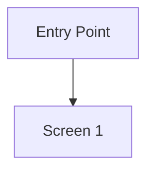
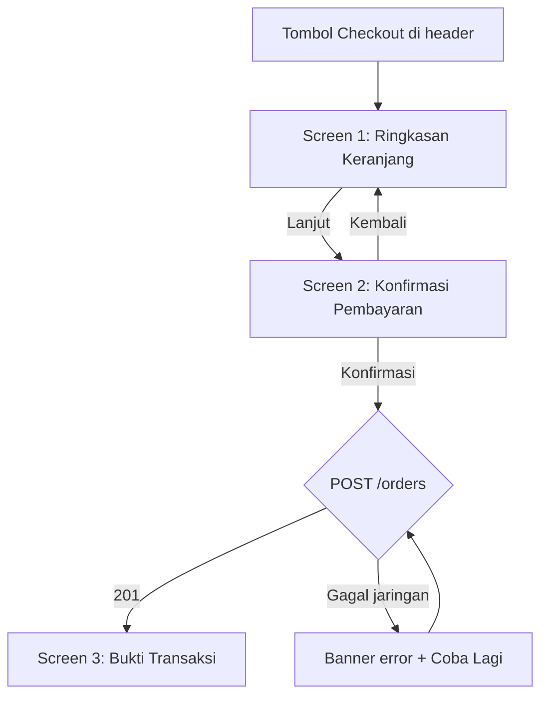

# FLOW Template — `ux-design`

Rumah kanonik bentuk `frontenddev/docs/<YYMMDDhhmm>-<slug>/FLOW.md`. Bagian 1 adalah kerangka yang disalin ke artefak, bagian 2 aturan yang ditagih `skills/_common/validate_doc.py --kind flow` dan self-test penulis, bagian 3 contoh terisi yang **tidak** tersalin ke artefak. `SKILL.md` merujuk ke sini dan dilarang menulis ulang kerangkanya.

---

## 1. Template Kanonik FLOW.md

````markdown
---
status: DRAFT
slug: <slug>
order: 10
stack: <stack-id>
based_on: <sha 7 digit HEAD saat artefak ditulis> (<YYYY-MM-DD>)
---

# User Flow — <Nama Fitur / Modul>

Perjalanan pengguna terstruktur untuk <tujuan fitur fungsional ringkas>.

## 1. Intent Statement & Scope
- **Intent**: Pengguna ingin <tujuan fungsional> melalui <rentang layar> dengan hasil akhir <kondisi sukses>.
- **Target Platform**: `<platform sesuai stack>`
- **Scope Layar**: `<Screen 1: Nama Layar>`, `<Screen 2: Nama Layar>`
- **Akar**: `<SC-{n} TASK.md yang dilayani alur ini>`

## 2. Diagram Alur (Mermaid Flowchart)



## 3. Perjalanan Layar Rinci

### Screen 1: <Nama Layar> (`<rute sesuai konvensi adapter>`)
- **Tujuan Layar**: <...>
- **Pemicu Masuk (Entry Points)**: <asal + parameter rute bertipe>
- **Aksi Pengguna (User Actions)**: <input, CTA, gesture>
- **Transisi Keluar (Exit Transitions)**: <maju / kembali beserta state yang dibawa>
- **Cabang State & Error**: <kosong, gagal koneksi, validasi>

## 4. Penanganan Batal & Kembali (Back / Cancel Matrix)

| Dari Layar | Pemicu Batal | Kondisi Form | Perilaku UI & Konsekuensi Data |
|---|---|---|---|

## 5. Kebutuhan Data per Langkah (Data Demands Table)

| ID | Layar / Langkah | Field Data yang Dituntut UI | Sumber Data Asal | Keterangan & Batasan |
|---|---|---|---|---|
| `DD-1` | <layar> | <field> | <API / store / state lokal> | <batasan> |

## 6. Catatan Keputusan Desain & Trade-offs
- <keputusan> — <alasan> — <konsekuensi yang diterima>
````

---

## 2. Aturan Validasi

**Mekanis** — ditagih `validate_doc.py --kind flow`; `FAIL` menahan `chain.py draft` dan `chain.py approve`:

1. **Frontmatter**: `status` hanya `DRAFT` (ditulis penulis) atau `APPROVED` (ditulis `chain.py approve`, tidak pernah dengan tangan); `slug`, `stack` terisi; `order: 10`; `based_on` berpola `<sha 7 digit> (YYYY-MM-DD)` dari `git rev-parse --short HEAD`.
2. **Struktur**: tepat satu H1 berawalan `# User Flow — `, dan enam heading `##` persis urutan bagian 1 — dilarang menambah, membuang, atau menomori ulang.
3. **Diagram**: seksi 2 memuat blok ` ```mermaid `; seksi 3 memuat minimal satu `### Screen <n>: <nama>`.
4. **Data Demands**: baris `DD-{n}` berurutan dari `DD-1` tanpa lompatan, minimal satu. Nomor ini dirujuk kolom `Sumber` Acceptance Criteria `CONTRACT.md`, dan `validate_doc.py --kind contract` menagih **tiap** `DD-{n}` dipikul minimal satu AC — Data Demand tanpa AC adalah sapuan mundur yang bolong.
5. **Placeholder**: nol `TBD`/`TODO`/`diisi nanti` dan nol slot `<...>` berspasi di luar blok kode.

**Semantik** — self-test penulis sebelum `chain.py draft`, tidak dapat ditagih skrip:

6. Tiap rute dan parameter rute di seksi 3 berjangkar bukti repo (`surface-map.md` profil atau pointer `file:baris` laporan `code-explorer`) — dilarang mengarang nama rute.
7. Tiap layar punya baris di matriks seksi 4 untuk kondisi form *dirty* bila layar itu memuat input.
8. Tiap Data Demand punya sumber asal yang nyata: endpoint yang akan dikunci `CONTRACT.md`, store yang tercatat profil, atau state lokal — bukan "dari backend" tanpa nama.
9. Baris **Akar** seksi 1 menyebut `SC-{n}` yang benar-benar ada di `TASK.md`; alur yang tidak melayani satu pun SC adalah perluasan lingkup.

---

## 3. Contoh Terisi — `order-checkout` (tidak tersalin ke artefak)

````markdown
---
status: DRAFT
slug: order-checkout
order: 10
stack: react-vite
based_on: 3f9c2ab (2026-09-23)
---

# User Flow — Order Checkout

Perjalanan pengguna terstruktur untuk menyelesaikan checkout pesanan dari keranjang sampai bukti transaksi.

## 1. Intent Statement & Scope
- **Intent**: Pengguna ingin membayar isi keranjang melalui layar ringkasan dan konfirmasi dengan hasil akhir bukti transaksi tampil.
- **Target Platform**: `React Vite SPA`
- **Scope Layar**: `Screen 1: Ringkasan Keranjang`, `Screen 2: Konfirmasi Pembayaran`, `Screen 3: Bukti Transaksi`
- **Akar**: `SC-1`, `SC-2`

## 2. Diagram Alur (Mermaid Flowchart)



## 3. Perjalanan Layar Rinci

### Screen 1: Ringkasan Keranjang (`/checkout`)
- **Tujuan Layar**: Meninjau item dan total sebelum membayar.
- **Pemicu Masuk (Entry Points)**: tombol *Checkout* di `src/app/Header.tsx:31`; tanpa parameter rute.
- **Aksi Pengguna (User Actions)**: ubah kuantitas, hapus item, klik *Lanjut*.
- **Transisi Keluar (Exit Transitions)**: *Lanjut* ke Screen 2 membawa `cartId`; *Kembali* ke halaman sebelumnya.
- **Cabang State & Error**: keranjang kosong menampilkan empty state dengan CTA *Belanja*.

## 4. Penanganan Batal & Kembali (Back / Cancel Matrix)

| Dari Layar | Pemicu Batal | Kondisi Form | Perilaku UI & Konsekuensi Data |
|---|---|---|---|
| Screen 2 | Browser Back | Kotor (catatan terisi) | Dialog "Buang catatan?" lewat `useBlocker` |

## 5. Kebutuhan Data per Langkah (Data Demands Table)

| ID | Layar / Langkah | Field Data yang Dituntut UI | Sumber Data Asal | Keterangan & Batasan |
|---|---|---|---|---|
| `DD-1` | Screen 1 | Item keranjang (`id`, `name`, `qty`, `priceCents`) | API Query (`GET /cart`) | Maks 50 item |
| `DD-2` | Screen 3 | Bukti (`receiptNumber`, `paidAt`) | Response `POST /orders` | Ditampilkan sekali, tidak di-cache |

## 6. Catatan Keputusan Desain & Trade-offs
- Konfirmasi dipisah dari ringkasan — mencegah bayar tak sengaja — satu layar tambahan diterima.
````
